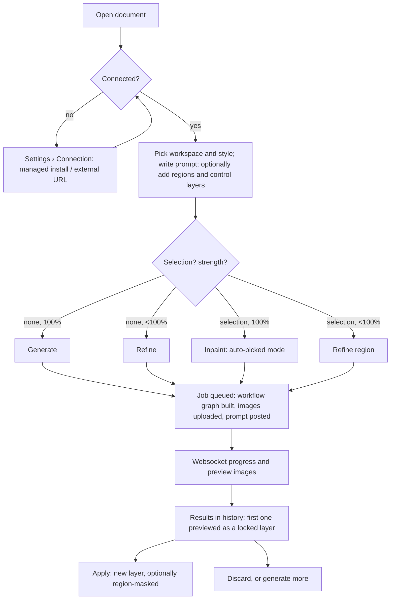
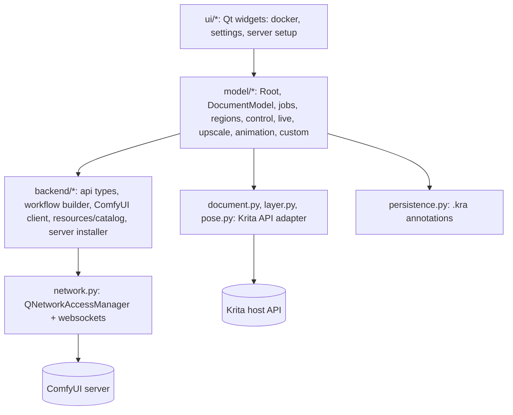

# App Findings: Krita AI Diffusion (the feature set to port) and PhotoCraft (the host)

Two apps were analyzed in one shared evidence pass, for a single piece of work: bringing Krita AI Diffusion's behavior into PhotoCraft as **AI Diffusion for PhotoCraft**.

- **Krita AI Diffusion** is the subject whose functionality must be reproduced. Its full inventory, with `file:line` citations, is in [reference/krita-ai-diffusion-inventory.md](reference/krita-ai-diffusion-inventory.md).
- **PhotoCraft** is the host whose extension surface decides how the feature can live there. Its full analysis is in [reference/photocraft-host-analysis.md](reference/photocraft-host-analysis.md).

This document is the synthesis. Section numbers like "§1.3" point into the Krita inventory, and "host §2" points into the PhotoCraft analysis.

## Inputs used

- **Krita AI Diffusion source**: `github.com/Acly/krita-ai-diffusion`, shallow clone at commit `828b70c` (2026-10-03), plugin version 1.54.0 (`ai_diffusion/__init__.py:3`). All first-party Python in `ai_diffusion/` was read, plus `docs/src/content/docs/*.mdx`, `README.md`, `AGENTS.md`, `tests/` and `presets/`. The vendored `websockets` and `debugpy` submodules were not checked out and were not read.
- **PhotoCraft source**: `github.com/storytold/photocraft`, shallow clone at commit `5617e00` (2026-11-04), workspace version 0.20.1 (`Cargo.toml:7`). Read: `AGENTS.md`, `docs/` (architecture, plugins, control-protocol, mcp, contributing, development, roadmap, gaps, scorecard, localization, decisions, target-app-parity, brand license), `crates/plugins`, `crates/engine` (command registry, jobs, prefs, updates), `crates/ui-egui` (dock and panel tables, prefs UI, previews, notices), `crates/doc`, `crates/raster`, `xtask/src/layers.rs`, `.github/workflows/ci.yml`.
- **Official sites**: `kritaaidiffusion.com` (not fetched separately; its docs live in the repo's `docs/` folder) and `getartcraft.com/apps/photocraft` (fetched).
- **Not available or not done**: neither app was built or run, no live interaction, no video, no screenshots. Every behavioral claim comes from reading source and docs. Runtime behavior (timing, exact visual results, live-painting latency) is unverified.
- **Tech-stack research**: manifests and lockfiles read directly (`pyproject.toml`, `requirements.txt`, `Cargo.toml`, `Cargo.lock`). No live-URL fingerprinting, since neither is a web app with a public instance to point it at.
- **Atomic findings: selective.** Only load-bearing or contested findings have a file in `findings/`.

## Feature inventory

Everything below is **observed** in Krita AI Diffusion v1.54.0 unless marked otherwise. Detail and citations: Krita inventory §1–§3.

### Workspaces (§1.1)

| Workspace | What it does |
|---|---|
| **Generate** | One button that picks its operation from document state: generate (strength 100%, no selection), refine / img2img (strength < 100%), inpaint (selection present), refine region, generate or refine a region only, and edit (edit-capable models such as Flux Kontext, Flux 2 Klein, Qwen Image Edit). Qwen Layered outputs N separate layers. |
| **Upscale** | Simple or tiled upscaling with an upscaler model, optional diffusion refinement at a chosen strength, and a target-size factor. |
| **Live** | Regenerates continuously as the user paints, with a debounce. Shows the result as a preview, applies it to the current or a new layer, and can record frames. |
| **Animation** | Generates per frame, or as a batch over a keyframe range, writing results into animated layers. |
| **Graph (custom workflow)** | Loads a ComfyUI workflow (from the server, a file, or the user's `workflows/` folder). Exposes its parameter nodes as panel widgets, feeds canvas, layer and selection images into it, and applies its outputs as layers. |

### Prompting and conditioning

- **Regions** (§1.2): regional prompts tied to layers or groups, a root prompt plus per-region prompts, region-only generation, and "apply to region" behaviors (replace, new layer, transparency mask).
- **Control layers** (§1.3): 17 control modes. Four use IP-Adapter (reference, style, composition, face) and thirteen use ControlNet (scribble, line art, soft edge, canny, depth, normal, pose, segmentation, stencil, hands, blur, and others). Each has strength, start/end range, a 5-step preset slider with per-architecture defaults, and a "from image" preprocessor for 10 of them. Pose layers can be edited as vector skeletons.
- **Prompt features** (§1.5): wildcards and dynamic prompts, `<lora:name:weight>` syntax, tag autocomplete from CSV files, Ctrl+Up/Down attention weighting, optional prompt translation, and a negative prompt that can be hidden.
- **Styles and sampler presets** (§1.4): 20 built-in styles (checkpoint, LoRAs, VAE, CLIP skip, sampler, steps, CFG, live-mode sampler, linked edit style, style prompt templates), user styles as JSON files, and 15 sampler presets.

### Inpaint, selection and resolution (§1.7–§1.8)

- 7 inpaint modes (auto, fill, expand, add content, remove content, replace background, custom), 7 fill modes and 4 context modes.
- Selection processing: feather, minimum transition, padding, grow offset and minimum size, all scaled by strength. A selection covering the whole canvas is ignored.
- Resolution is snapped to the architecture's multiple (16, or 32 for Qwen 2), with a resolution multiplier, tiled processing for large images, batches of 1–16, fixed or random seeds, and queue modes (enqueue, replace, cancel).

### Results and history (§1.6)

Results appear as a locked preview layer. A history list shows thumbnails, the seed and the prompt. Users can apply a result (as a new layer, or as a region-masked layer), discard it, toggle the preview, or re-use its seed. History is kept in memory up to a size limit, and optionally stored in the document file as WebP.

### UI surface (§2)

- One docker panel with a workspace selector, style selector, prompt stack, controls, generate and queue buttons, progress, an error box and history.
- A settings dialog with 6 pages: Connection, Styles, Diffusion, Interface, Performance, Plugin.
- A managed-server setup UI: install location, GPU backend, install / upgrade / launch / stop, verify, re-install, delete, workload packages with model ratings, individual packages and log viewing.
- 15 actions, all without default shortcuts (generate, three cancel actions, toggle preview, two apply actions, create region, four workspace switches, toggle workspace, toggle edit mode, settings), plus in-widget bindings (Shift+Enter to generate, Ctrl+Click on Generate to replace the queue, Delete to discard, Space to preview, double-click to apply).
- 51 settings keys in `settings.json`, each with a default (§2.11).
- 14 UI languages (§6.11).

### Backend (§3)

- **Connection modes**: managed local server, external/custom ComfyUI server, and the Interstice online service. The cloud mode is the plugin author's commercial service `[APP-008]`.
- **ComfyUI protocol**: 13 HTTP endpoints plus one websocket. Images are uploaded and downloaded through `comfyui-tooling-nodes` routes (`/api/etn/image/{id}`). The minimum ComfyUI version is 0.3.45. Progress, previews and results arrive over the websocket.
- **Workflow construction**: 8 workflow kinds, built by `workflow.py` and `comfy_workflow.py` (about 3,500 lines), with branches per architecture across 19 architectures (SD1.5, SDXL, Illustrious, Flux, Flux 2, Qwen, Z-Image, Anima, …). 142 distinct node classes are emitted.
- **Required custom nodes**: comfyui_controlnet_aux, ComfyUI_IPAdapter_plus, comfyui-tooling-nodes and comfyui-inpaint-nodes, plus ComfyUI-GGUF as optional. All are pinned to a commit.
- **Managed installer**: `uv`, a Python 3.12 venv, ComfyUI at a pinned commit, the custom nodes, per-GPU torch lock files (CUDA, ROCm, XPU, MPS, DirectML, CPU) and model downloads. The catalog has 65 entries / 71 files, each with a sha256. Process control includes a readiness probe and a Windows Job Object.

### Detecting and reusing an existing Krita AI Diffusion install (§4)

These facts are the basis for the user's added requirement: reuse an existing install's models instead of downloading them again `[APP-005]` `[APP-006]`.

- **User data** is `<krita appdata>/ai_diffusion`: `%APPDATA%\krita\ai_diffusion` on Windows, `~/.local/share/krita/ai_diffusion` on Linux, `~/Library/Application Support/krita/ai_diffusion` on macOS. When that location is unusable it falls back to `<GenericDataLocation>/krita-ai-diffusion`. Flatpak and MSIX locations are inferred.
- **Installed plugin** is `<krita appdata>/pykrita/ai_diffusion/__init__.py` (holds `__version__`).
- **Settings** are in `settings.json`. The keys that matter are `server_mode`, `server_path` (default `<user data>/server`), `server_url` (default `127.0.0.1:8188`), `server_backend` and `server_arguments`. `server_authorization` and `access_token` are credentials: do not read them without consent.
- **Model store** is `<server_path>/models/<folder>/` plus `<server_path>/ComfyUI/models/`, plus any section the user added to `<server_path>/ComfyUI/extra_model_paths.yaml`.
- **Server version and launch**: `.version` holds `"<version> <backend>"`. The launch command is `<venv python> -su main.py …` in `<server_path>/ComfyUI`. Readiness is the stdout line "To see the GUI go to".

## User flows

- **Live painting**: switch to Live, then each document change (debounced) builds a low-step workflow. The result streams into a preview layer, and Apply copies it into the current or a new layer. Leaving the Live workspace stops it (§1.1.2).
- **Managed install**: Settings › Connection › Local Managed Server, then pick a location, GPU backend and workloads, then install (progress for each step and download). It auto-launches and connects. Upgrade, verify and delete are on the Manage menu (§2.8, §3.E).
- **Control layer from image**: add a control layer and pick a mode, then "from image" runs a preprocessor job whose output becomes a new layer used as that control's input (§1.3).

## Architecture / data model

### Krita AI Diffusion (observed, §5–§6)

- The **Krita surface used is small and pixel-centric** `[APP-009]`: the active document, named annotations (binary blobs), the layer tree with stable UUIDs, layer / projection pixel get and set, the selection mask, vector-layer SVG import for poses, a few animation calls, and docker/action registration. The plugin uses no undo macros, colour profiles, view transforms or save calls. `tests/mock/krita.py` (760 lines) implements exactly that subset and works as an executable spec of the host interface.
- **No host events**: the plugin polls, every 20 ms for selection and time, and every 500 ms for the layer tree and poses.
- **Pixel contract** `[APP-007]`: 8-bit RGBA only. Other depths and colour models are refused, not converted.
- **Qt beyond widgets**: `QImage`/`QPainter` for image math, `QNetworkAccessManager` for HTTP, Qt signals for the observable property system, and asyncio pumped by a 20 ms `QTimer`. The non-UI core depends on QtCore/QtGui/QtNetwork, not on Krita.
- **Per-document persistence** `[APP-012]`: `.kra` annotations `ai_diffusion/document_id`, `ai_diffusion/ui.json` and `ai_diffusion/result{N}.webp`.
- **Tests**: a pytest suite with a mocked Krita module. Some tests need a live ComfyUI server.
- **License**: GPL-3.0, including the bundled styles, presets, tags, translations and icons `[APP-004]`.

### PhotoCraft (observed, host §1–§4)

- About 539k lines of Rust across 25 library crates in strict layers L0–L6, enforced by `cargo xtask layers`. The UI is egui/eframe on wgpu, and there is a WebAssembly build.
- **Every action is an engine command**: about 700 are registered, in a closed, static registry of `fn` pointers. The UI, CLI, JSON control channel and MCP server all dispatch by command id.
- **Plug-ins today** `[APP-001]`: sandboxed WASM filter modules (ABI v1, `wasmi`) with no host imports, so no network, files, panels, or reads of other layers. ABI v2 (panels, progress, other layers) is planned but unbuilt, and its planned scope has no network access.
- **Control channel** `[APP-002]`: loopback TCP with JSON lines and a bearer token. It can inspect documents and run any command. It cannot write pixels directly, cannot read the selection as a mask, has no change events, and cannot add UI.
- **Jobs lock their document** `[APP-003]`. A long generation must not run as an engine job, or the user can't keep painting.
- **Panels** `[APP-011]`: a static `PANELS` table and a closed `dock::Group` enum. Panels such as the histogram recompute off-thread per document revision.
- **Persistence**: layer XMP survives PSD, PSB, layered TIFF and `.pcraft`. Document XMP exists but has no raw setter command. Adding a new `Document` field forces `.pcraft` format changes.
- **Network precedent**: update checks inject a transport from the app crate, which keeps the engine network-free. tokio is already a dependency. No websocket crate is present.
- **Present and reusable**: an on-canvas preview mechanism (`display_memo` / `blend_preview`), undo coalescing, notices, file dialogs, `tl!` localization catalogs in about 25 languages, and a Preferences "AI Integrations…" page.
- **Governance**: contributions must be MIT OR Apache-2.0, and GPL-derived code is excluded in practice. Other rules: no `unsafe`, no panics, every command is fuzzed, the wasm build must keep compiling, git dependencies come only from `storytold`. AI features wait on owner decision #41, and upstream's AI direction is local ONNX inference, not a ComfyUI client `[APP-010]`.

## Known gaps and open questions

- **Nothing was run.** Exact visual output, live-painting latency and installer behavior are known from source only. Parity tests will need a ComfyUI instance with known models.
- **Host gaps for an out-of-process plug-in**, all inferred from host §1–§2. PhotoCraft has no:
  - plug-in process lifecycle;
  - bulk pixel get/set API;
  - selection-mask read;
  - change-event subscription;
  - plug-in-authored panel UI;
  - plug-in-authored canvas preview;
  - document-level named-blob storage, though layer XMP works;
  - plug-in actions or shortcuts in menus.

  Each is a generic host capability, not an AI-specific one.
- **Animation**: Krita keyframes map most closely to PhotoCraft video-layer frame stacks plus the timeline (host §2). How faithful that mapping can be is unverified.
- **Pose editing**: PhotoCraft shape layers hold one path with one style, so an OpenPose skeleton needs a different representation (an SVG smart object or a group of shapes) and editing support.
- **Bit depth**: Krita AI Diffusion refuses anything that isn't 8-bit RGBA. PhotoCraft documents are often 16- or 32-bit or non-RGB. "Identical" behavior would refuse them the same way, but converting may be the better choice. This is a requirements decision.
- **Web build**: browsers can't spawn processes, so an out-of-process plug-in is desktop-only (inferred).
- **Moving baselines**: Krita AI Diffusion changes its pinned ComfyUI and node commits nearly every release, and PhotoCraft merges dozens of PRs a day. The parity baseline must be pinned: Krita AI Diffusion v1.54.0 against PhotoCraft at `5617e00` or later.
- **Defects found in Krita AI Diffusion itself** (§7, not ours to fix, but worth not copying):
  - The websocket probe and the long-lived listener use different auth tokens.
  - `Settings.save`/`load` ignore their path argument.
  - After a reload, `JobParams.from_dict` leaves enum fields as strings.
- **Upstream reception**: whether PhotoCraft's maintainers would accept a generic process-plug-in host is unknown. Their stated plug-in direction is WASM ABI v2, and AI is gated on owner decision #41 `[APP-010]`.

## Notes for product-analysis

- PhotoCraft presents itself as "an open-source, clean-room reimplementation of Adobe Photoshop" for artists who want offline, local tools. ArtCraft, the same team's product, is described as "our AI image and video studio". An AI feature in PhotoCraft may overlap with ArtCraft strategically.
- Krita AI Diffusion's audience is digital painters who want generative AI inside a painting workflow, local-first with an optional paid cloud. Its pitch is "streamlined, no prompt engineering required" and control through the canvas (selections, layers, live painting).
