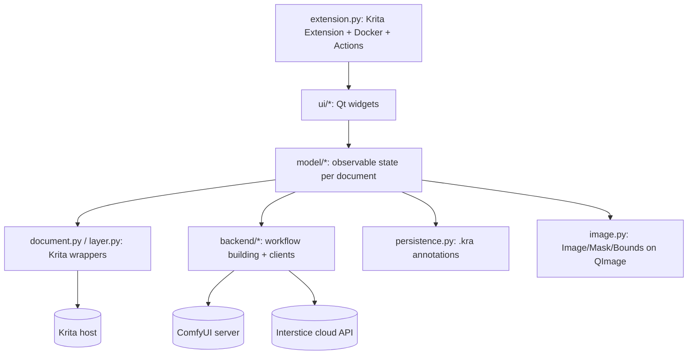

> **Reference for [App findings](../app-findings.md).** Krita AI Diffusion inventory, written during the 2026-11-04 analysis pass. Where it says "PhotoCraft AI Diffusion", read the product name chosen afterwards: **AI Diffusion for PhotoCraft**. Where it assumes a pure-Rust port, read the chosen design instead: an out-of-process Python plug-in (see the app findings).

# Krita AI Diffusion v1.54.0: reverse-engineering inventory for the PhotoCraft AI Diffusion port

Subject: Krita AI Diffusion plugin v1.54.0 (`ai_diffusion/__init__.py:3`, `ai_diffusion/backend/resources.py:13`). License GPL-3.0 (`LICENSE`). Python 3 / PyQt6, runs inside Krita 6.x (`ai_diffusion/__init__.py:16-23`). About 28.9k lines of first-party Python in `ai_diffusion/`, not counting the vendored `websockets` and `debugpy` git submodules, which are not checked out in this clone.

Purpose: an evidence-backed inventory of what the plugin does, to support requirements for porting it to PhotoCraft (pure Rust, egui, no Python or Qt) as "PhotoCraft AI Diffusion".

Conventions:
- Every path is relative to the repository root. `file:line` citations point at the clone at commit `828b70c`.
- Evidence tags: **[observed]** read directly in source; **[documented]** stated in `docs/src/content/docs/*.mdx`, `README.md` or `AGENTS.md`; **[inferred]** a conclusion not stated in the repo.
- Section map: 1 Features, 2 UI surface and settings, 3 Backend, 4 Detecting and reusing an existing install (new requirement), 5 Krita host API dependencies, 6 Architecture, data model, persistence, localization, tests, 7 Porting risks (legal, brand, technical).
- Sections were drafted in parallel, so a few facts appear in more than one place. Where two sections overlap, the more specific one wins: §4 for paths, §3 for protocol.

## Executive summary

| Area | Key facts |
|---|---|
| Workspaces | 5: Generate (which also covers refine, inpaint, refine-region and edit), Upscale, Live, Animation, Custom Graph (ComfyUI workflow) (§1.1) |
| Control layers | 17 `ControlMode`s (`backend/resources.py:316-333`): 4 IP-Adapter-style (reference, style, composition, face) and 13 ControlNet-style. Inpaint and universal are internal. 10 have "from image" preprocessors (§1.3) |
| Inpaint / fill / context | 7 inpaint modes, 7 fill modes, 4 context modes (§1.7) |
| Krita actions | 15, all with empty default shortcuts (§2.9) |
| Settings | 51 keys in `settings.json` (§2.11) |
| ComfyUI protocol | 13 HTTP endpoints plus 1 websocket. Images move through the `comfyui-tooling-nodes` `/api/etn/image/{id}` routes. Minimum ComfyUI 0.3.45 (§3.A) |
| Workflow graph | 8 workflow kinds, 142 distinct node `class_type`s emitted (§3.B) |
| Custom nodes | 4 required (controlnet_aux, IPAdapter_plus, comfyui-tooling-nodes, comfyui-inpaint-nodes) and 1 optional (ComfyUI-GGUF), each pinned to a commit (§3.C) |
| Model catalog | `presets/models.json`: 65 entries, which expand to 68 resources and 71 files, all with sha256. 19 concrete architectures (§3.F) |
| Cloud | Interstice (`https://api.interstice.cloud`): browser device-flow sign-in, token stored in `settings.json` `access_token` (§3.D) |
| Host capabilities | 72 Krita/Qt capability rows (H-01 to H-72). The groups are lifecycle/registration, document, layer tree, pixel I/O, selection, vector/SVG, animation, polling, event loop and paths (§5) |
| Reuse | Settings: `<krita appdata>/ai_diffusion/settings.json`. Default server: `<krita appdata>/ai_diffusion/server`. Models: `<server_path>/models/<folder>` plus `<server_path>/ComfyUI/models` plus `ComfyUI/extra_model_paths.yaml` (§4) |


Source: Krita AI Diffusion v1.54.0 (GPL-3.0). All paths are relative to the repository root.
Evidence tags: **[observed]** read in source, **[documented]** stated in `docs/src/content/docs/*.mdx`
or `README.md`, **[inferred]** concluded from code structure but not directly stated or exercised.

Scope note: settings keys are enumerated in §2.11; this section only
references settings where they change feature behavior.

---

## 1. Feature inventory

### 1.0 Architecture of a "feature" in this plugin

* All per-document state lives in `DocumentModel` (`ai_diffusion/model/model.py:128`). Each opened
  Krita document gets its own model, its own job queue, regions, control layers, and workspace
  sub-models (`upscale`, `live`, `animation`, `custom`) (`ai_diffusion/model/model.py:167-180`) [observed].
* Persisted document-level properties (saved into the .kra) are declared with `Property(..., persist=True)`
  (`ai_diffusion/model/model.py:134-145`) [observed]: `workspace`, `style`, `strength`, `region_only`,
  `edit_mode`, `batch_count`, `seed`, `fixed_seed`, `resolution_multiplier`, `queue_mode`,
  `translation_enabled`, `layer_count`.
* Every generation goes through one pipeline: UI model state -> `WorkflowInput` (`ai_diffusion/backend/api.py:188`)
  -> ComfyUI graph. The `WorkflowKind` enum is the closed set of built-in operations
  (`ai_diffusion/backend/api.py:14-22`) [observed]: `generate`, `inpaint`, `refine`, `refine_region`,
  `upscale_simple`, `upscale_tiled`, `control_image`, `custom`.
* `JobKind` (`ai_diffusion/model/jobs.py:28-35`) [observed]: `diffusion`, `control_layer`, `upscaling`,
  `live_preview`, `animation_batch`, `animation_frame`, `animation`.

### 1.1 Workspaces

`Workspace` enum (`ai_diffusion/model/model.py:84-89`) [observed]:

| Value | Name | UI label (menu) | Widget | Generate action dispatch |
|---|---|---|---|---|
| 0 | `generation` | "Generate" | `GenerationWidget` (`ai_diffusion/ui/generation.py:739`) | `model.generate()` |
| 1 | `upscaling` | "Upscale" | `UpscaleWidget` (`ai_diffusion/ui/upscale.py:113`) | `model.upscale_image()` |
| 2 | `live` | "Live" | `LiveWidget` (`ai_diffusion/ui/live.py:102`) | `model.generate_live()` |
| 3 | `animation` | "Animation" | `AnimationWidget` (`ai_diffusion/ui/animation.py:35`) | `model.animation.generate()` |
| 4 | `custom` | "Graph" | `CustomWorkflowWidget` (`ai_diffusion/ui/custom_workflow.py:698`) | `model.custom.generate()` |

* Dispatch table for the global "Generate" action: `ai_diffusion/ui/actions.py:5-16` [observed].
* Menu labels: `WorkspaceSelectWidget` (`ai_diffusion/ui/widget.py:876-904`) [observed].
* Switching away from Live stops live generation (`ai_diffusion/model/model.py:909-914`) [observed].
* In Cloud server mode the Graph workspace shows a placeholder "Custom workflows are not available on
  Cloud." (`ai_diffusion/ui/custom_workflow.py:1089-1096`, `ai_diffusion/ui/diffusion.py:339-341`) [observed].

#### 1.1.1 Generate (and Refine / Inpaint / Edit) workspace

The "Generate" workspace covers four distinct operations that are chosen implicitly from state, not
from separate modes [observed, `ai_diffusion/model/model.py:233-326`]:

| Condition | `WorkflowKind` | Button label |
|---|---|---|
| strength = 1, no selection, no region-only | `generate` | "Generate" |
| strength < 1 (or editing), no selection | `refine` | "Refine" |
| strength = 1, selection present | `inpaint` | Inpaint mode label (Fill, Expand, ...) |
| strength < 1, selection present | `refine_region` | "Refine" |
| region-only toggle, no selection | `inpaint` with `InpaintMode.add_object` (strength 1) or `refine_region` | "Generate Region" / "Refine Region" |
| edit model / edit mode active | `refine` (or `refine_region` with mask) | "Edit" |

Sources: kind selection `ai_diffusion/model/model.py:235-240, 283-287`; button text/icon logic
`ai_diffusion/ui/generation.py:993-1059` [observed]. Qwen Layered (`Arch.qwen_l`) forces
strength 1.0 (`ai_diffusion/model/model.py:237-238`) [observed].

Inputs/parameters exposed in this workspace [observed, `ai_diffusion/ui/generation.py:739-822`]:
* Workspace dropdown, Style dropdown (+ gear button opening the settings dialog at the Styles page).
* Region prompt stack (`RegionPromptWidget`), including positive prompt, optional negative prompt,
  region list and control-layer list.
* Strength slider (`StrengthWidget`, 1-100%, step 5, snaps to step-aligned percentages; optional
  "% - x/y steps" suffix when the `show_steps` setting is on) (`ai_diffusion/ui/widget.py:693-791`).
* "Layers" count slider/spinbox 1-10, only visible for Qwen Layered (`ai_diffusion/ui/widget.py:825-852`,
  `ai_diffusion/ui/generation.py:999-1000`).
* Add Control Layer, Add Region buttons.
* Custom inpaint options row (visible only when inpaint mode = Custom): Seamless, Focus, Edit, Fill
  combo, Context combo (`ai_diffusion/ui/generation.py:572-695`).
* Generate button with a dropdown arrow for the mode menu, plus a "region-only" toggle
  (`ai_diffusion/ui/generation.py:777-801`).
* Queue button with popup (batches, seed, resolution multiplier, enqueue mode, cancel).
* Progress bar, error box, history list.

Behaviors:
* Ctrl+Click on Generate = "generate and replace queue" (`ai_diffusion/ui/widget.py:967-977`,
  `ai_diffusion/ui/generation.py:861`, `ai_diffusion/model/model.py:212-213`) [observed].
* Shift+Enter in a prompt box triggers generate (`ai_diffusion/ui/widget.py:565-566`,
  `ai_diffusion/ui/generation.py:859`) [observed]; [documented] in `docs/src/content/docs/basics.mdx:22-23`.
* Hovering the Generate button shows estimated cost in cloud tokens (signed-in cloud users), a seed
  icon if seed is fixed, and a resolution icon if the multiplier is not 1.0
  (`ai_diffusion/ui/widget.py:960-1031`) [observed].
* Results are shown as a locked preview layer and added to history; applying creates a new layer
  (see 1.6) [observed].
* After each finished diffusion job, `settings.generation_finished_action` decides: do nothing, preview
  the first image (only if nothing is previewed yet), or auto-apply (`ai_diffusion/model/model.py:710-715`) [observed].
* Generation is refused for non-RGBA or non-8-bit documents (`ai_diffusion/document.py:194-202`,
  `ai_diffusion/model/model.py:217-220`) [observed].
* Style usage is tracked for a "recent styles" list in the style dropdown (`ai_diffusion/model/model.py:993-998`,
  `ai_diffusion/ui/widget.py:364-385`) [observed].

**Edit mode / edit models.** [observed]
* Architectures classified as edit: `flux_k`, `qwen_e`, `qwen_e_p`, `qwen_l` (`ai_diffusion/backend/resources.py:206-208`).
  "Supports edit" additionally includes Flux 2 Klein 4B/9B and Qwen 2 (`ai_diffusion/backend/resources.py:210-212`).
* A non-edit style can link an "edit style" (`StyleSettings.linked_edit_style`, `ai_diffusion/style.py:94-98`);
  `DocumentModel.edit_style` resolves it (`ai_diffusion/model/model.py:1044-1052`).
* `edit_mode` toggles between the linked edit style and the regular style; when edit mode is on in
  Generate/Live, a separate `edit_regions` root region (separate prompt set) is used
  (`ai_diffusion/model/model.py:175, 979-991`). Docs: "Edit mode stores its own text prompt"
  (`docs/src/content/docs/edit-models.mdx:133-150`) [documented].
* Edit instructions are synthesized for inpaint modes and control layers when the model supports
  editing (`ai_diffusion/backend/workflow.py:1535-1563`): e.g. "Fill the green spaces according to the
  image.", "Remove the object.", "Replace the background while keeping the main subject.", and per
  control mode "Apply the style from {}.", "Match the pose in {}." etc. (`ai_diffusion/backend/workflow.py:1523-1532`).
* Reference image naming per arch inside prompts: Flux 2 "image N", Qwen Edit Plus "Picture N",
  Qwen 2 "<imageN>" (`ai_diffusion/backend/workflow.py:1517-1522`).
* Edit models merge additional reference images as reference latents (Flux 2/Qwen Edit Plus: one
  latent per image; Flux Kontext/Qwen Edit: stitched into one image) (`ai_diffusion/backend/workflow.py:479-519`).
* Qwen Layered produces N separate layers (`layer_count`), applied as "[Layer i] ..." layers
  (`ai_diffusion/model/model.py:853-855`, `ai_diffusion/backend/workflow.py:1745`).
* Supported edit models per docs: Flux Kontext, Flux 2 Klein (experimental), Qwen Image Edit
  (experimental) (`docs/src/content/docs/edit-models.mdx:50-54`) [documented].

#### 1.1.2 Live painting workspace

Model: `LiveWorkspace` (`ai_diffusion/model/model.py:1241-1388`), scheduler `LiveScheduler`
(`ai_diffusion/model/model.py:1193-1238`). UI: `LiveWidget` (`ai_diffusion/ui/live.py:102-355`) [observed].

Parameters:
* `is_active` (play/pause), `is_recording`, `strength` (default 0.3, persisted, separate from the
  Generate workspace strength) (`ai_diffusion/model/model.py:1242-1245`).
* Seed spinbox + randomize button; seed is always fixed in live mode (uses `model.seed`, never random)
  (`ai_diffusion/model/model.py:495, 503`; `ai_diffusion/ui/live.py:168-185`).
* Edit toggle button (switch generate/edit mode) (`ai_diffusion/ui/live.py:187-190, 290-299`).
* Style dropdown, slim region prompt (active region) + slim root prompt, Add Region/Add Control
  Layer buttons, control list, error box, preview image with spinner overlay.

Behaviors [observed]:
* Uses the style's **live sampler preset** (`live_sampler`, `live_sampler_steps`, `live_cfg_scale`)
  (`ai_diffusion/backend/workflow.py:65-79`, `ai_diffusion/style.py:114-116`). Default live preset
  "Realtime - Hyper" uses the Hyper LoRA (`ai_diffusion/presets/samplers.json`); LCM/Lightning presets
  are hidden (`hidden: true`) but still available if a style references them (`ai_diffusion/style.py:433-439`).
  Sampler-preset LoRAs (hyper/lcm/lightning/turbo) are injected automatically
  (`ai_diffusion/backend/workflow.py:1867-1898`).
* Auto-regenerate loop: polls every 0.1 s; when the prepared `WorkflowInput` differs from the last one,
  it schedules a new job after a grace period. Grace period is 0.25 s only if average generation time
  exceeds 1.5 s, else 0; max accumulated wait 3 s (`ai_diffusion/model/model.py:1193-1238, 1302-1310`).
  Only generates while the document is the active one (`ai_diffusion/model/model.py:1304`).
* Batch size forced to 1 (`ai_diffusion/backend/workflow.py:1744`).
* Region handling differs from Generate: only the active region layer is generated with padding
  around it (min mask 512 px for SD1.5, 800 otherwise), with grow/feather/blend derived from free
  space (`ai_diffusion/model/model.py:464, 477-483`) [observed]; [documented] in
  `docs/src/content/docs/regions.mdx:250-285`.
* Result preview is composited over the canvas with a blue diagonal-hatch multiply pattern outside
  the generated area (`ai_diffusion/model/model.py:1338-1351`).
* **Apply** (copy result to active layer, behavior per `apply_behavior_live` setting) and
  **Apply to new layer** (forces `ApplyBehavior.layer`, `ApplyRegionBehavior.layer_group`, and limits
  to the active region) (`ai_diffusion/model/model.py:1312-1328`). Optional new seed after apply
  (`settings.new_seed_after_apply`).
* **Recording**: requires a saved document; frames are written as `frame-<n>.webp` into
  `<document>.live-frames/` next to the .kra on every result; on stop, frames are imported as an
  animation layer named `[Rec] <start>-<end>: <prompt>` (`ai_diffusion/model/model.py:1281-1292, 1353-1388`).
* Errors stop live mode (`ai_diffusion/model/model.py:650-655`).

#### 1.1.3 Upscale workspace

Model: `UpscaleWorkspace` (`ai_diffusion/model/model.py:1122-1190`). UI: `UpscaleWidget` +
`FactorWidget` (`ai_diffusion/ui/upscale.py:36-331`) [observed].

| Parameter | Default | Range / options | Source |
|---|---|---|---|
| `upscaler` (model file) | server default upscaler | server's upscaler list | `model.py:1123`, `upscale.py:250-271` |
| `factor` | 2.0 | slider 1.00-4.00 (100-400), spinbox 1.0-4.0 | `model.py:1124`, `upscale.py:44-54` |
| `use_diffusion` ("Refine upscaled image" group checkbox) | True | bool | `model.py:1125`, `upscale.py:138` |
| `strength` | 0.3 | 20%-50% | `model.py:1126`, `upscale.py:142` |
| `unblur_strength` ("Image guidance") | 0.5 | 0-100% (0 = Off) | `model.py:1127`, `upscale.py:146-149` |
| `tile_overlap_mode` | auto | Automatic / Custom | `model.py:1128`, `upscale.py:153-163` |
| `tile_overlap` | 48 px | 0-128 step 8 | `model.py:1129`, `upscale.py:157-160` |
| `use_prompt` | False | switch | `model.py:1130`, `upscale.py:167-174` |

Behaviors [observed]:
* Upscaler list ordering and friendly names: Default (4x NMKD Superscale), Fast (OmniSR x4), Quality
  (HAT), Sharp (Real HAT GAN); OmniSR x2/x3 hidden (`ai_diffusion/ui/upscale.py:250-271, 333-339`,
  `ai_diffusion/backend/resources.py:303-309`).
* Clicking Upscale resizes the Krita canvas immediately to `extent * factor`, then adds the result as
  a layer prefixed `[Upscale] ` (`ai_diffusion/model/model.py:426-439, 895-907`).
* Without diffusion: `upscale_simple` (model-only) (`ai_diffusion/model/model.py:418-419`).
* With diffusion: `upscale_tiled`. Tile size = style preferred resolution, else 800 (SD1.5) / 1024;
  at least longest_side/12 (max 12x12 tiles); minus 128 and snapped to the arch multiple
  (`ai_diffusion/backend/workflow.py:1715-1724`). Upscale model skipped when factor = 1 (pure tiled
  refine; button label switches to "Refine", `ai_diffusion/ui/upscale.py:326-330`).
* Default prompt is "4k uhd" (or "Enhance image quality. Preserve original content." for edit models)
  unless "Use Prompt" is on; with Use Prompt, region prompts are scaled and used per-tile
  (`ai_diffusion/model/model.py:387-397`). Warning if Use Prompt is on without regions
  (`ai_diffusion/ui/upscale.py:309-322`).
* Image guidance uses the `blur` ("Unblur"/tile) ControlNet if installed
  (`ai_diffusion/model/model.py:398-402`); disabled with tooltip otherwise
  (`ai_diffusion/ui/upscale.py:285-307`). Strength sliders disabled for edit models.
* Upscale batch disabled (queue button without batch slider) (`ai_diffusion/ui/upscale.py:193`).

#### 1.1.4 Animation workspace

Model: `AnimationWorkspace` (`ai_diffusion/model/model.py:1396-1558`). UI: `AnimationWidget`
(`ai_diffusion/ui/animation.py:35-205`) [observed].

Parameters: `sampling_quality` (Fast = live sampler / Quality = regular sampler, shown as an extra combo
next to the style) (`ai_diffusion/model/model.py:1391-1397`, `ai_diffusion/ui/animation.py:50`,
`ai_diffusion/ui/widget.py:346-350`); `batch_mode` (Full Animation / Single Frame radio buttons);
`target_layer` (only in Single Frame mode); prompt + optional negative prompt (root region only, no
region UI); strength; control layers.

Behaviors [observed]:
* **Full Animation**: requires a saved document; for strength < 1 the active layer must be animated.
  Iterates the playback range; for each frame that has a keyframe on the active layer (or every frame
  when strength = 1), enqueues an `animation_batch` job with that frame's pixels as input; control
  layers and region masks are sampled at that time (`ai_diffusion/model/model.py:1468-1508`,
  `ai_diffusion/model/control.py:121-130`). Results are saved to `<document>.animation/frame-<n>.png`
  and, after the last frame, imported as an animated layer named `[Generated] <start>-<end>: <prompt>`;
  cached (identical) frames reuse the previous image (`ai_diffusion/model/model.py:1510-1550`).
* **Single Frame**: generates the current time's frame and writes pixels directly into the target
  layer at the current time (error if time changed meanwhile) (`ai_diffusion/model/model.py:1425-1466, 1527-1538`).
* There is no Krita action to switch to this workspace (see 2.9); it is only in the workspace dropdown
  and reachable via "Toggle workspace" cycling [observed].
* Docs: "no support for animation models or generating in-between frames"
  (`docs/src/content/docs/basics.mdx:152-159`) [documented].

#### 1.1.5 Custom graph (ComfyUI workflow) workspace

Model: `ai_diffusion/model/custom_workflow.py`; UI: `ai_diffusion/ui/custom_workflow.py`;
graph expansion: `ai_diffusion/backend/workflow.py:1412-1508` [observed].

**Workflow sources** (`WorkflowSource`, `ai_diffusion/model/custom_workflow.py:49-52`) [observed]:
* `local`: JSON files in `<user_data_dir>/workflows/*.json`, loaded on connect
  (`ai_diffusion/model/custom_workflow.py:77, 94-98`). Import from file copies into this folder
  (`ai_diffusion/model/custom_workflow.py:204-215`); save-as with auto-suffix " (n)"; overwrite
  allowed only for local files (`ai_diffusion/model/custom_workflow.py:180-202`).
* `remote`: workflows "published" from the connected ComfyUI web UI over the plugin's websocket
  subscription (`connection.workflow_published`; `api/etn/workflow/subscribe`)
  (`ai_diffusion/model/custom_workflow.py:82, 125-127`, `ai_diffusion/backend/comfy_client.py:573-577`).
  Clicking "Open Web UI" opens the browser and auto-selects the next remote workflow that appears
  within 5 minutes (`ai_diffusion/model/custom_workflow.py:644-663`, `ai_diffusion/ui/custom_workflow.py:1032-1035`).
* `document`: the graph embedded in a .kra is restored as "Embedded Workflow (<doc name>)" when the
  id is not otherwise known (`ai_diffusion/model/custom_workflow.py:500-507`, `ai_diffusion/persistence.py:322-336`).
* List sorted by source (document, remote, local) then name; icons file-kra / web-connection / file-json
  (`ai_diffusion/model/custom_workflow.py:246-259, 68-70`).
* Accepts both UI and API-format ComfyUI exports (docs: API export recommended; "bypass" does not
  survive UI export) (`docs/src/content/docs/custom-graph.mdx:76-88`) [documented].

**Krita-specific nodes** (provided by the companion ComfyUI node pack; names from source) [observed]:

| Node type | Role | Outputs/behavior |
|---|---|---|
| `ETN_KritaCanvas` | Current visible canvas (or selection-context crop) | image, width, height, seed, mask (`workflow.py:1449-1456`) |
| `ETN_KritaSelection` | Current selection; inputs `context` (entire image / mask bounds / automatic) and `padding` | mask (solid 1.0 if none), active bool, offset x, offset y (`workflow.py:1457-1465`; `custom_workflow.py:382-385, 621-642`) |
| `ETN_Parameter` | Exposes a UI parameter; inputs `name`, `type`, `default`, `min`, `max` | value (`workflow.py:1466-1467`) |
| `ETN_KritaImageLayer` | UI layer picker (RGB layers) | image, mask (alpha); image batch of keyframes in animation mode (`workflow.py:1468-1471`; `custom_workflow.py:578-587`) |
| `ETN_KritaMaskLayer` | UI picker for mask layers | mask; mask batch in animation mode (`workflow.py:1472-1473`; `custom_workflow.py:588-597`) |
| `ETN_KritaStyle` | UI style picker; `sampler_preset` input: auto / regular / live | model, clip, vae, style positive, style negative, sampler name, scheduler, steps, cfg (`workflow.py:1474-1485`; `custom_workflow.py:598-615`) |
| `ETN_KritaStyleAndPrompt` | Syncs with the document's style and prompt; applies wildcards, `<lora:>`, style prompt merge; max 1 per workflow | same 9 outputs, with evaluated prompts (`workflow.py:1486-1497`; `model.py:552-572`; validation `custom_workflow.py:474-488`) |
| Krita Output (output node) | Sends images back; optional `offset x/y`, `name`, `batch mode` (default/images/animation/layers), `resize canvas` | parsed from the executed message's `info` (`comfy_client.py:923-940`) [observed]; inputs [documented] `custom-graph.mdx:94-116` |
| Send Text (output node) | Sends text with optional name and content type | parsed from `text` output (`comfy_client.py:899-920`) [observed]; [documented] `custom-graph.mdx:235-240` |

**Parameter kinds** (`ParamKind`, `ai_diffusion/model/custom_workflow.py:266-276`; parsing
`ai_diffusion/model/custom_workflow.py:323-372`) [observed]:

| `ETN_Parameter.type` / node | ParamKind | Widget | Defaults |
|---|---|---|---|
| `number (integer)` | `number_int` | slider + spinbox (`IntParamWidget`, `ui/custom_workflow.py:111`) | default 0, min -2^31, max 2^31 |
| `number` | `number_float` | slider + spinbox (`FloatParamWidget`, `:175`) | default 0.0, min 0.0, max 1.0 |
| `toggle` | `toggle` | switch with On/Off label (`BoolParamWidget`, `:245`) | False |
| `text` | `text` | line edit (`TextParamWidget`, `:286`) | "" |
| `prompt (positive)` | `prompt_positive` | resizable prompt editor with autocomplete (`PromptParamWidget`, `:309`) | "" |
| `prompt (negative)` | `prompt_negative` | prompt editor (2 lines) | "" |
| `choice` | `choice` | combo filled from the options of the connected downstream input (`_get_choices`, `custom_workflow.py:375-379`) | falls back to `text` if no options |
| `auto` | (ignored) | - | - |
| other | warning logged | - | - |
| `ETN_KritaImageLayer` | `image_layer` | `LayerSelect` filtered to image layers (`:58`) | first image layer |
| `ETN_KritaMaskLayer` | `mask_layer` | `LayerSelect` filtered to masks | first mask layer |
| `ETN_KritaStyle` | `style` | `StyleParamWidget` (`:390`) | - |

* **Ordering and groups**: names like `"2. Group/1. Name"`; leading `N. ` sets order (not displayed),
  `/` separates one level of group (`ai_diffusion/model/custom_workflow.py:287-320`) [observed];
  [documented] `custom-graph.mdx:152-165`. Groups have collapsible headers with "Reset all parameters
  in this group" (`ai_diffusion/ui/custom_workflow.py:470-500`); a global reset exists
  (`ai_diffusion/ui/custom_workflow.py:524-570`).
* Duplicate parameter names are a validation error (`ai_diffusion/model/custom_workflow.py:476-486`).
* Parameter values are stored per workflow id (`workflow_params[workflow_id]`) and coerced against
  declared defaults on load (`ai_diffusion/model/custom_workflow.py:441-450, 722-737`).
* "Copy Prompt" in the history context menu also restores custom-workflow parameters from job
  metadata (`ai_diffusion/ui/generation.py:477-478`, `ai_diffusion/model/custom_workflow.py:717-719`).

**Generation modes** (`CustomGenerationMode`, `ai_diffusion/model/custom_workflow.py:391-394`;
menu `ai_diffusion/ui/custom_workflow.py:787-798`) [observed]:
* `regular` ("Generate"): normal jobs, random seed unless fixed, batch count honored.
* `live` ("Generate Live"): button becomes "Start Generating"/"Stop Generating"; re-runs whenever the
  input changes (input equality check), seed fixed, polls at 0.1 s
  (`ai_diffusion/model/custom_workflow.py:530-535, 700-710`; `ai_diffusion/model/model.py:587-588`).
  Results go to a preview area with an Apply-to-new-layer button
  (`ai_diffusion/ui/custom_workflow.py:779-783, 1001-1005`).
* `animation` ("Generate Animation"): layer parameters send keyframe batches; output batches become
  animations (`ai_diffusion/model/model.py:528, 581-585`).

**Output mapping** [observed]:
* Images from output nodes become job results like any other job; apply creates a layer (name from
  the output node's `name` or the first positive-prompt param, else workflow id)
  (`ai_diffusion/model/custom_workflow.py:560-564, 665-682`).
* Output `offset x/y` moves the result's placement; `resize canvas` resizes the document on apply
  (`ai_diffusion/model/model.py:761-762`); `batch mode` = images/animation/layers changes the job kind
  or sets `is_layered` (`ai_diffusion/model/custom_workflow.py:675-682`).
* Text outputs are shown in an expandable "Text Output" panel; short plain text (<40 chars) as labels,
  longer as read-only text editors rendering plain/HTML/Markdown by MIME
  (`ai_diffusion/ui/custom_workflow.py:587-676`). Outputs not refreshed by the latest job are removed
  (`ai_diffusion/model/custom_workflow.py:684-690`).
* Selection mask: when the graph has an `ETN_KritaSelection` node, the selection is read with that
  node's context/padding and the canvas image is cropped accordingly
  (`ai_diffusion/model/model.py:534-542`, `ai_diffusion/model/custom_workflow.py:621-642`).

### 1.2 Regions (regional prompts)

Model: `Region`, `RootRegion` (`ai_diffusion/model/region.py:27-372`); UI: `ai_diffusion/ui/region.py` [observed].

* **Root region** (`RootRegion`): holds `positive`, `negative` and a control-layer list for the whole
  document; is the default when no regions exist (`ai_diffusion/model/region.py:151-178`). Its prompt
  is merged into every region's prompt (`workflow.merge_prompt(region.positive, root.positive)`,
  `ai_diffusion/model/region.py:443`) [observed]. Docs call it "Root prompt" (`regions.mdx:124-142`) [documented].
* **Region**: `positive` text, its own `ControlLayerList`, and a list of linked layer UUIDs persisted
  as a comma-joined string (`ai_diffusion/model/region.py:35-69`).
* **Linking rules**: only paint layers or groups; a layer inside a group links via the group
  ("link target") (`ai_diffusion/model/region.py:135-142`); a region can link multiple layers, a layer
  only one region (`regions.mdx:117-121`) [documented]. Moving a linked paint layer into a group
  re-links the region to the group (`ai_diffusion/model/region.py:323-329`) [observed].
* **Create region** (`ai_diffusion/model/region.py:241-257`) [observed]: links the active layer (or its
  group) if it is unlinked paint/group; otherwise creates a new group `Region <n>` containing a
  `Paint layer` (Generate workspace) or a new paint layer `Region <n>` (Live workspace)
  (`ai_diffusion/ui/actions.py:55-57`, `ai_diffusion/ui/live.py:325-326`).
* **Active region follows active layer** and vice versa: selecting a region's prompt activates its
  layer (the topmost child for groups) (`ai_diffusion/model/region.py:309-321`).
* **Mask derivation** [observed]: a region's coverage is the alpha channel of the linked layer's
  pixels (for groups: composited group), converted to Grayscale8 (`ai_diffusion/layer.py:188-200`).
  `process_regions` (`ai_diffusion/model/region.py:392-488`):
  1. Skips regions whose layer bounds are empty or whose rough bbox coverage < 2 x `min_coverage`
     (default 0.02).
  2. Iterating top-down, subtracts accumulated masks of regions above (layer stacking order).
  3. If one region covers > 90%, regional conditioning is dropped and that region's prompt becomes
     the main prompt.
  4. Regions with coverage < 2% are dropped.
  5. If total coverage < 95%, an inverted "background" region with the root prompt is inserted at the
     bottom (`JobRegion(..., "background", is_background=True)`).
* **Region inpaint mask** for "region only" / live mode: layer bounds padded by `selection_padding`%
  of the average side, clamped, alpha mask (`ai_diffusion/model/region.py:383-389`).
* **Region-only toggle** ("Generate the active layer region only (use layer transparency as mask)")
  (`ai_diffusion/ui/generation.py:791-797`): uses the active region layer as an inpaint mask and only
  its child regions (`ai_diffusion/model/model.py:252-257`) [observed]; docs call it "Refine region"
  (`regions.mdx:308-324`) [documented].
* **Region hierarchies**: nested groups; generating uses top-level regions, refining a region uses its
  children (`regions.mdx:353-370`) [documented]; `process_regions(parent_layer=...)` restricts to
  child layers (`ai_diffusion/model/region.py:417-421`) [observed].
* **Per-region control layers** are applied as regional IP-Adapter with the region mask
  (`ai_diffusion/backend/workflow.py:765-774`) [observed]; docs recommend this only for
  Reference/Composition/Style/Face (`regions.mdx:188-205`) [documented].
* **Applying results to regions** (see 1.6): one result layer per affected region group.
* **Segmentation from regions**: a Segmentation control layer can be generated from region layer
  masks using a fixed 12-color palette (`ai_diffusion/model/control.py:149-197, 464-477`) [observed].
* **Per-region prompt translation** (`ai_diffusion/model/region.py:144-148, 375-380`) [observed].
* `Arch.supports_regions` lists SD1.5/SDXL/Illustrious/Anima (`ai_diffusion/backend/resources.py:182-184`)
  but no call site was found in `ai_diffusion/` [observed: absence] - region attention masking is
  attempted for whatever arch the workflow builder supports [inferred].

### 1.3 Control layers

Model: `ControlLayer`, `ControlLayerList`, `ControlPresets` (`ai_diffusion/model/control.py`);
UI: `ControlWidget`, `ControlListWidget` (`ai_diffusion/ui/control.py`); modes:
`ControlMode` (`ai_diffusion/backend/resources.py:316-438`) [observed].

**ControlLayer properties** (`ai_diffusion/model/control.py:26-43`) [observed]:
`mode` (default reference), `layer_id`, `preset_value` (0-4, default 2), `strength` (int, 0-75 in UI,
divided by 50 -> 0.0-1.5; default 50 = 1.0), `start`/`end` (0.0-1.0, UI step 0.05),
`use_custom_strength` (default False), plus derived `is_supported`, `is_pose_vector`, `can_generate`,
`has_range`, `has_active_job`, `error_text`.

* Without "Use custom values", the 5-step preset slider interpolates strength and range from
  `presets/control.json` per mode and arch (`ai_diffusion/model/control.py:98-103, 371-387`). User
  overrides merged from `<user_data_dir>/presets/control.json` (created empty on first run)
  (`ai_diffusion/model/control.py:357-398`). Built-in preset keys: `default` (all, zimage), `reference`
  (all, flux), `style`, `composition`, `face`, `scribble` (all, sdxl), `line_art` (all, sdxl),
  `segmentation` (all, anima) (`ai_diffusion/presets/control.json`).
* New control layers use the active image layer (or its group parent for filter layers) and the last
  used mode (initially scribble; reference for edit archs) (`ai_diffusion/model/control.py:287-300`).
* Removing the underlying Krita layer removes the control layer (`ai_diffusion/model/control.py:321-323`).
* Layer pixels are captured at generation time; IP-Adapter modes ignore mask bounds and use layer
  bounds; lines/stencil/segmentation are made opaque on white; IP-Adapter images are scaled to 224x224
  (CLIP vision) except for edit-capable archs (`ai_diffusion/model/control.py:121-147`).
* Support check per mode/arch with error text (missing model, unsupported arch, GPU lacks IP-Adapter,
  "Too many control layers" beyond `client.features.max_control_layers`)
  (`ai_diffusion/model/control.py:203-260`). Control layers of the "part of image" kind are not hidden
  from the input image; others are excluded from the canvas capture (`ai_diffusion/model/model.py:599-614`,
  `ai_diffusion/backend/resources.py:371-372`).

**Every control mode** (`ai_diffusion/backend/resources.py:316-333`; labels
`ai_diffusion/model/control.py:444-462`) [observed]:

| Mode (enum value) | UI label | Family | In dropdown | "From Image" preprocessor (`workflow.py:1247-1305`) | Notes |
|---|---|---|---|---|---|
| `reference` (0) | Reference | IP-Adapter (SD1.5/SDXL, weight type "linear"); Flux: Redux style model; edit archs: reference latent | yes | none | part of image; also created by `<layer:...>` prompt syntax |
| `style` (14) | Style | IP-Adapter weight "style transfer" | yes | none | edit archs: instruction "Apply the style from {}." |
| `composition` (15) | Composition | IP-Adapter weight "composition" | yes | none | edit archs: instruction |
| `face` (13) | Face | IP-Adapter FaceID + InsightFace, adds face LoRA at 0.65 x median face strength | yes | none (asserted invalid) | `workflow.py:712-728, 1672-1675` |
| `inpaint` (1) | Inpaint | ControlNet (internal) | no | - | used internally for inpainting |
| `universal` (16) | Universal | ControlNet (Union/Promax) | no | - | substitutes other modes (`resources.py:384-423`) |
| `scribble` (2) | Scribble | ControlNet | yes | PiDiNet + Scribble | lines (inverted) |
| `line_art` (3) | Line Art | ControlNet | yes | LineArtPreprocessor | lines; part of image |
| `soft_edge` (4) | Soft Edge | ControlNet | yes | AnyLineArtPreprocessor_aux (lineart_standard merge) | lines |
| `canny_edge` (5) | Canny Edge | ControlNet | yes | CannyEdgePreprocessor (80/200) | lines |
| `depth` (6) | Depth | ControlNet / control LoRA (Flux) / model patch (Z-Image) | yes | DepthAnythingV2 (vitb) | |
| `normal` (7) | Normal | ControlNet | yes | BAE-NormalMapPreprocessor | |
| `pose` (8) | Pose | ControlNet | yes | DWPose/estimate_pose -> OpenPose JSON -> vector layer | see pose editing |
| `segmentation` (9) | Segment | ControlNet | yes | OneFormer-COCO-SemSeg; plus "From Regions" | |
| `blur` (10) | Unblur | ControlNet (tile) | yes | none | part of image; used by Upscale "Image guidance" |
| `stencil` (11) | Stencil | ControlNet (QR-code style) | yes | none | made opaque on white |
| `hands` (12) | Hands | ControlNet (depth) | yes | MeshGraphormer depth map (crop to selection supported) | "same as depth" for universal |

Classification functions: `is_ip_adapter` (reference/face/style/composition), `is_control_net` (all
others), `has_preprocessor` (ControlNet minus inpaint/blur/stencil/universal), `is_internal`
(inpaint, universal), `is_part_of_image` (reference, line_art, blur), `is_structural`
(`ai_diffusion/backend/resources.py:335-376`) [observed].

ControlNet application chain per layer (`ai_diffusion/backend/workflow.py:605-679`) [observed]: Anima
uses ControlNet-LLLite (`:631`); else a dedicated ControlNet for the mode, else the universal
ControlNet with `set_controlnet_type` (`:639`), else a model patch (Z-Image "fun controlnet", `:650`),
else a control LoRA (Flux depth/canny; only one control LoRA allowed per generation, `:651-659`).
Flux inpaint uses a dedicated inpainting ControlNet application (`:669`). IP-Adapter chaining:
max 5 images per weight type (`ai_diffusion/backend/workflow.py:733-760`).

"Generate control image from layer" [observed]: `generate_control_layer` captures the full visible
canvas (selection padded 25% to multiple of 64 restricts processing), runs the preprocessor workflow,
and creates a new layer `[Control] <Mode>` and re-points the control layer to it
(`ai_diffusion/model/model.py:616-636, 885-893`, `ai_diffusion/model/jobs.py:167-170`). Line-type
results are inverted to black lines on white (`ai_diffusion/backend/workflow.py:1307-1308`).

**Pose vector layers** (`ai_diffusion/pose.py`, `ai_diffusion/document.py:343-384`) [observed]:
* Poses use the OpenPose 18-keypoint body model (`body_parts`, `ai_diffusion/pose.py:20-39`), 17 bones
  (`ai_diffusion/pose.py:63-81`), an 18-color palette (`ai_diffusion/pose.py:84-103`).
* Stored as SVG shapes in a Krita **vector layer**: joints as `<circle id="Pxx_Jyy">`, bones as
  `<line id="Pxx_Byy" stroke-opacity="0.6">`; stroke width/radius scale with canvas diagonal
  (`ai_diffusion/pose.py:107-122, 278-318`).
* When "From Image" runs for pose mode, the returned OpenPose JSON (confidence > 0.1) is scaled to the
  canvas and inserted as a new vector layer (`ai_diffusion/pose.py:191-213`, `ai_diffusion/model/model.py:887-890`).
* Editing: a 500 ms timer polls the active vector layer; moved joint circles are detected by id and
  affected bones are re-generated as new SVG lines (old bone shapes removed); copied (duplicate-id)
  joints spawn a new person index (`ai_diffusion/document.py:343-381`, `ai_diffusion/pose.py:215-276`).
* "Add Skeleton" button inserts a default-pose person scaled to the canvas (only enabled when the
  control layer's layer is a vector layer) (`ai_diffusion/ui/control.py:237-238, 303-310`,
  `ai_diffusion/pose.py:183-189`).
* Docs: pose figures "can be edited with Krita's vector tools" (`control-layers.mdx:165-169`) [documented].

### 1.4 Styles and sampler presets

**Style fields** (`StyleSettings`, `ai_diffusion/style.py:20-116`; class `Style`
`ai_diffusion/style.py:119-237`) [observed]:

| Field | UI label | Default | Notes |
|---|---|---|---|
| `name` | Name | "Default Style" | |
| `version` | - | 2 | written on save |
| `architecture` | Diffusion Architecture | `Arch.auto` | items: Automatic + all archs (`resources.py:74-98`) |
| `checkpoints` | Model Checkpoint | `[]` | ordered fallback list; first available wins (`style.py:210-218`); legacy `sd_checkpoint` key accepted |
| `loras` | LoRA | `[]` | list of `{name, strength, enabled}` (`style.py:227`) |
| `style_prompt` | Style Prompt | "best quality, highres" | supports `{prompt}` placeholder |
| `negative_prompt` | Negative Prompt | "bad quality, low resolution, blurry" | |
| `vae` | VAE | "Checkpoint Default" | |
| `clip_skip` | Clip Skip | 0 | UI 0-12 with Override checkbox; only SD1.5/SDXL/Illustrious |
| `v_prediction_zsnr` | V-Prediction / Zero Terminal SNR | False | |
| `rescale_cfg` | Rescale CFG | 0.7 | not shown in editor [inferred from absence in `ui/style.py:658-746`] |
| `self_attention_guidance` | Enable SAG | False | |
| `preferred_resolution` | Preferred Resolution | 0 | UI 0-2048 step 8, Override checkbox |
| `linked_edit_style` | Linked Edit Style | "" | style filename, e.g. `built-in/flux-kontext.json` |
| `sampler` | Sampler | "Default - DPM++ 2M" | sampler preset name |
| `sampler_steps` | Sampler Steps | 20 | |
| `cfg_scale` | Guidance Strength (CFG Scale) | 7.0 | |
| `live_sampler` | Sampler | "Realtime - Hyper" | |
| `live_sampler_steps` | Sampler Steps | 6 | |
| `live_cfg_scale` | Guidance Strength (CFG Scale) | 1.8 | |

* File format: flat JSON object of the above keys (e.g. `ai_diffusion/styles/flux.json`). Invalid
  values fall back to defaults with a warning; legacy sampler names are mapped
  (`ai_diffusion/style.py:155-191, 412-427`) [observed].
* Locations: built-in `ai_diffusion/styles/*.json` (read-only in UI, id `built-in/<file>`); user styles
  `<user_data_dir>/styles/**/*.json` (id = relative posix path) (`ai_diffusion/style.py:202-208, 249-305`).
  `user_data_dir` = Krita AppData `.../ai_diffusion` or generic data `.../krita-ai-diffusion`
  (`ai_diffusion/util.py:30-54`) [observed].
* Styles sorted by name; "show built-in styles" setting filters; styles whose model is unsupported by
  the connected server are filtered out (`ai_diffusion/style.py:307-322`, `ai_diffusion/ui/widget.py:364-385`).
* LoRA trigger words and default strength are file metadata (`lora_triggers`, `lora_strength`) edited
  in the LoRA item's advanced panel and appended to prompts (`ai_diffusion/ui/style.py:126-140`,
  `ai_diffusion/backend/workflow.py:1901-1908`) [observed].

**Built-in styles** (20 files) [observed, `ai_diffusion/styles/*.json`]:

| File | Name | First checkpoint | Sampler / steps / CFG | Live sampler / steps / CFG | Linked edit style |
|---|---|---|---|---|---|
| anima.json | Anima | anima-base-v1.0 | Euler A / 30 / 4.0 | Flux - Turbo / 8 / 1.0 | - |
| anime-illustrious.json | Anime | novaAnimeXL_ilV125 (arch `illu`) | Euler A / 24 / 5.0 | Euler A / 20 / 4.0 | edit-flux2 |
| anime-noobai-xl.json | Anime (NoobAI XL) | NoobAI-XL-Vpred-v1.0 | Euler A / 26 / 5.0 | Flux - Euler simple / 20 / 4.0 | edit-flux2 |
| chroma.json | Chroma | Chroma1-HD | Flux - Euler simple / 26 / 4.0 | same / 26 / 1.0 | flux-kontext |
| cinematic-photo-xl.json | Cinematic Photo (XL) | RealVisXL_V5.0_fp16 | DPM++ 2M / 20 / 7.0 | Realtime - Hyper / 8 / 3.5 | edit-flux2 |
| cinematic-photo-zimage.json | Cinematic Photo | z_image_turbo_bf16 | Flux - Euler simple / 9 / 1.0 | same | edit-flux2 |
| cinematic-photo.json | Cinematic Photo (SD1.5) | serenity_v21 | DPM++ 2M / 20 / 7.0 | Realtime - Hyper / 8 / 4.0 | - |
| digital-artwork-xl.json | Digital Artwork | zavychromaxl_v80 | DPM++ 2M / 20 / 7.0 | Realtime - Hyper / 8 / 4.0 | edit-flux2 |
| digital-artwork.json | Digital Artwork (SD1.5) | dreamshaper_8 | DPM++ 2M / 20 / 7.0 | Realtime - Hyper / 8 / 5.0 | - |
| edit-flux2.json | General Editing | flux-2-klein-4b-nvfp4 | Flux 2 - Euler / 4 / 1.0 | same | - |
| ernie-image-turbo.json | Ernie Image Turbo | ernie-image-turbo | Flux - Euler simple / 8 / 1.0 | same | - |
| ernie-image.json | Ernie Image Turbo (sic) | ernie-image | Flux - Euler simple / 20 / 4.0 | same | - |
| flux-kontext.json | Flux Kontext | flux1-dev-kontext_fp8_scaled | Flux - Euler simple / 20 / 3.5 | Flux - Turbo / 8 / 3.5 | - |
| flux-schnell.json | Flux Schnell | flux1-schnell-fp8 | Flux - Euler simple / 4 / 3.5 | same | - |
| flux.json | Flux | flux1-krea-dev_fp8_scaled | Flux - Euler simple / 20 / 3.5 | Flux - Turbo / 8 / 3.5 | flux-kontext |
| flux2-klein.json | Flux 2 Klein | flux-2-klein-4b-nvfp4 | Flux 2 - Euler / 4 / 1.0 | same | - |
| krea2-turbo.json | Krea 2 Turbo | krea2_turbo_bf16 | Flux - Euler simple / 8 / 1.0 | same | - |
| qwen-edit.json | Qwen Edit | Qwen-Image-Edit | Euler beta / 20 / 2.5 | Euler beta / 10 / 1.0 | - |
| qwen.json | Qwen | Qwen-Image | Euler beta / 20 / 2.5 | Euler beta / 10 / 1.0 | qwen-edit |
| z-image-turbo.json | Z-Image Turbo | z_image_turbo_bf16 | Flux - Euler simple / 9 / 1.0 | same | - |

Note: `ernie-image.json` also carries the name "Ernie Image Turbo" (likely a copy/paste slip) [observed].

**Sampler presets** (`ai_diffusion/presets/samplers.json`; `SamplerPreset`/`SamplerPresets`
`ai_diffusion/style.py:350-439`) [observed]. Format: JSON with `//` comments, object keyed by display
name, values `{sampler, scheduler, steps, cfg, lora?, minimum_steps (default 4), hidden (default false)}`.
User presets in `<user_data_dir>/presets/samplers.json` override/extend; "Edit custom presets" link
writes a commented stub (`ai_diffusion/style.py:414-418, 483-496`, `ai_diffusion/ui/style.py:506`).

| Preset | sampler | scheduler | steps | min steps | cfg | lora | hidden |
|---|---|---|---|---|---|---|---|
| Default - DPM++ 2M | dpmpp_2m | karras | 20 | 4 | 7.0 | - | |
| Alternative - Euler A | euler_ancestral | normal | 20 | 4 | 6.0 | - | |
| Creative - DPM++ 2M SDE | dpmpp_2m_sde_gpu | karras | 20 | 4 | 6.0 | - | |
| Fast - UniPC BH2 | uni_pc_bh2 | gits | 12 | 4 | 4.0 | - | |
| Euler beta | euler | beta | 20 | 4 | 5.5 | - | |
| RES multistep simple | res_multistep | simple | 20 | 3 | 4.0 | - | |
| Turbo/Lightning Merge - DPM++ SDE | dpmpp_sde_gpu | karras | 6 | 4 | 2.0 | - | |
| Lightning Merge - Euler A Uniform | euler_ancestral | sgm_uniform | 8 | 4 | 1.5 | - | |
| Realtime - Hyper | euler | sgm_uniform | 8 | 3 | 3.5 | hyper | |
| Realtime - LCM | lcm | sgm_uniform | 6 | 4 | 1.8 | lcm | yes |
| Realtime - Lightning | euler | sgm_uniform | 8 | 4 | 1.5 | lightning | yes |
| SD3 - DPM++ 2M Uniform | dpmpp_2m | sgm_uniform | 24 | 4 | 5.0 | - | |
| Flux - Euler simple | euler | simple | 20 | 4 | 1.0 | - | |
| Flux - Turbo | euler | simple | 8 | 3 | 1.0 | turbo | |
| Flux 2 - Euler | euler | flux2 | 20 | 3 | 5.0 | - | |

* Steps vs strength: `start_step = round(steps * (1 - strength))`; if fewer than `minimum_steps` would
  remain, total steps are increased to `floor(min_steps / strength)` (`ai_diffusion/backend/workflow.py:81-94`).
  The strength slider snaps to percentages that align with integer steps (`ai_diffusion/ui/widget.py:719-755`).
* Style `cfg_scale` of 0 falls back to the preset cfg (`ai_diffusion/backend/workflow.py:74`); CFG ~1.0
  disables the negative prompt (`ai_diffusion/backend/workflow.py:1601-1603`) and the UI shows a
  warning icon on the negative prompt (`ai_diffusion/ui/region.py:443-449`, `ai_diffusion/model/region.py:340-343`).

`presets/models.json` is the model download catalog used by the installer (required/optional model
groups with URLs, sha256, alternative paths) [observed, file head]; covered by the server/install draft.

### 1.5 Prompt features

All prompt processing in `prepare_prompts` (`ai_diffusion/backend/workflow.py:1566-1631`) and
`ai_diffusion/text.py` [observed]. Processing order for the positive prompt:
1. Strip comments: `#` to end of line, unless escaped `\#` or a 6-digit hex color (`text.py:48, 55-60`).
2. Wildcards `{a|b|c}`, evaluated with `random.Random(seed)`, nested up to 10 passes (`text.py:52, 142-156`).
   Each job in a batch re-evaluates with its own seed (`model.py:352-363`).
3. LoRA tags `<lora:name>` or `<lora:name:strength>` (case-insensitive); matched by filename stem or
   normalized name among available LoRA files; missing LoRA raises an error; default strength from file
   metadata (`text.py:49, 75-108`). Tags are removed from the prompt.
4. Layer references `<layer:Layer Name>` become reference-mode control layers (error if not found) and
   are replaced in text with arch-specific tokens ("Picture N", "image N", "<imageN>") or removed
   (`text.py:50, 111-139`; `model.py:943-962`). Numbering starts after the edit input image and
   existing IP-Adapter controls (`text.py:125-132`).
5. LoRA trigger words of style LoRAs appended (`workflow.py:1594`).
6. Edit instructions prepended for edit-capable models (`workflow.py:1535-1563`).
7. Empty prompt with "Remove Content" becomes "background scenery" (`workflow.py:1596-1597`).
8. Style prompt merge: `{prompt}` placeholder replacement, otherwise `"<prompt>, <style_prompt>"`
   (`text.py:63-72`). If translation is on, wrapped as `lang:<xx> <prompt> lang:en`.

Negative prompt: same comment/wildcard handling, merged with the style negative prompt; dropped
entirely when CFG is ~1 (`workflow.py:1599-1609`). Shown only if `show_negative_prompt` setting is on,
and only for the root region (`ai_diffusion/ui/region.py:357-358`) [observed]; [documented]
`prompts.mdx:24-31`.

Region prompts get the same comment/wildcard/LoRA/layer processing; regional LoRAs are applied per
region via attention masks (`workflow.py:1611-1626, 523-570`).

Emphasis/weights: `(text:1.2)` syntax highlighted (`text.py:51`, `ui/widget.py:425-482`).
**Ctrl+Up / Ctrl+Down** in a prompt box adjusts the weight of the word/selection/bracket block
under the cursor by +/-0.1, clamped to [-2, 2]; works on `(...)` and `<...>` (e.g. LoRA strength)
(`ai_diffusion/ui/widget.py:667-690`, `ai_diffusion/text.py:159-306`) [observed]; [documented]
`prompts.mdx:56-59`.

Syntax highlighting (`PromptHighlighter`, `ai_diffusion/ui/widget.py:425-482`) [observed]: comments
grey italic, weight numbers red, `lora`/`layer` keywords and wildcard braces/pipes in strong highlight.

**Autocomplete** (`PromptAutoComplete`, `ai_diffusion/ui/autocomplete.py:140-284`) [observed]:
* After `<lora:` -> LoRA file names (available on server); inserting also appends the LoRA's trigger
  words (`autocomplete.py:220-224, 253-255`).
* After `<layer:` -> names of image layers in the document (`autocomplete.py:225-231`).
* Otherwise, after >2 characters -> tag completion from enabled tag CSV files, contains-match,
  case-insensitive, sorted by usage count, deduplicated; parentheses escaped on insert
  (`autocomplete.py:160-202, 232-242, 258-260`).
* Tag CSV format `tag,type,count,aliases` (underscores become spaces; type colors: general blue,
  artist red, copyright yellow, character green, meta cyan; count shown as k/m)
  (`ai_diffusion/tags/README.md`, `autocomplete.py:17-23, 109-125, 179-195`). Shipped files: Danbooru
  (~81k lines), Danbooru NSFW, e621, e621 NSFW. User CSVs in `<user_data_dir>/tags/` override same name
  (`autocomplete.py:169-174`). Enabled files chosen in Interface settings ("Tag Auto-Completion",
  default none) (`ai_diffusion/settings.py:339-343`).
* Popup keys Enter/Return/Up/Down/Tab/Backtab are reserved while active (`autocomplete.py:277-284`).

Other prompt-box behaviors [observed]: Shift+Enter generates; Ctrl+Backspace kept from Krita
(`ui/widget.py:548-555`); resize handle to change line count (persisted as `prompt_line_count`,
max 40 lines) (`ui/region.py:451-471`, `ui/theme.py:38`); placeholder texts "Describe the content
you want to see, or leave empty." / "Describe content you want to avoid." (`ui/widget.py:639-644`).

**Translation** [observed]: setting `prompt_translation` (language code, default "") enables a small
language badge in the prompt box (`ui/region.py:180-188, 398-410`). Click toggles per-document
`translation_enabled` (badge shows "EN" when off); Ctrl+Click immediately replaces the text with its
translation via `GET api/etn/translate/<lang>/<text>` (`ui/region.py:383-394`,
`ai_diffusion/backend/comfy_client.py:566-571`). At generation time, prompts are wrapped with
`lang:` directives and translated in-graph by `ETN_Translate` (`text.py:64-65`,
`backend/comfy_workflow.py:1166-1167`). Inline `lang:XX` directives in text are supported
[documented, `prompts.mdx:165-183`]. Style prompts are never translated [documented, `prompts.mdx:155-158`].

**Prompt import from image metadata** [observed]: when a PNG/JPEG/WebP file is opened and the
document has empty prompts, A1111 "parameters" text or a ComfyUI "prompt" graph (CLIPTextEncode
behind KSampler-family nodes) is parsed to fill positive/negative prompts
(`ai_diffusion/persistence.py:361-397`, called from `ai_diffusion/model/root.py:67`).

**Metadata export** [observed]: saved images can embed A1111-style "parameters" text
(`ai_diffusion/text.py:327-369`) and, in cloud mode, an IPTC XMP "trainedAlgorithmicMedia" /
"compositeWithTrainedAlgorithmicMedia" digital source type (`ai_diffusion/text.py:309-324`,
`ai_diffusion/model/model.py:1666-1668`).

### 1.6 Results, history and layers

**Job queue / history model** (`JobQueue`, `ai_diffusion/model/jobs.py:143-295`) [observed]:
* States `queued`, `executing`, `finished`, `cancelled` (`jobs.py:21-25`).
* Only `diffusion` and `animation` jobs are kept for history; other kinds are removed on finish
  (`jobs.py:204-211`). History is pruned oldest-first above `settings.history_size` MB of image memory
  (`jobs.py:238-240`).
* `JobParams` per job: bounds, name, regions, metadata (prompt, prompt_eval, negative, style, checkpoint,
  sampler, steps, guidance, loras, strength, control list, regions), seed, inpaint mode, frame, etc.
  (`jobs.py:51-118`; `model.py:316-325`).
* Selection = list of (job id, image index); `toggle_selection` remembers the previous one for the
  "Toggle preview" action (`jobs.py:223-231`).
* Discard single image or whole job; clear all finished (`jobs.py:242-260`).
* Persisted in the .kra as annotations: `ui.json` (state + history index) and `result<slot>.webp`
  image strips, capped by `history_storage` MB (`ai_diffusion/persistence.py:144-164, 234-296`).

**Preview on canvas** [observed]: selecting a history thumbnail writes the image into a single locked
layer `[Preview] <prompt, max 77 chars>` moved to the top; deselecting hides it; animation results
are never previewed on canvas (`ai_diffusion/model/model.py:720-751`). The preview layer is excluded
from canvas capture for subsequent generations (`model.py:605-606`).

**Apply** (`apply_generated_result`, `ai_diffusion/model/model.py:847-868`; `apply_result` `:753-780`;
`create_result_layer` `:782-845`) [observed]:
* No regions (or region behavior "none"): per `settings.apply_behavior` - replace active layer pixels,
  new layer on top, or new layer above active. New layer name: `[Generated] <prompt, max 200 chars> (<seed>)`.
* With regions: per `settings.apply_region_behavior` (`ai_diffusion/settings.py:57-62`): replace region
  layer content; or promote paint layer to a group and add a result layer per region named
  `<region prompt> (<seed>)`, cropped to region bounds + 10% padding; optionally restrict by
  alpha (paint over existing child content) or add a "Transparency Mask"; optionally hide previous
  child layers ("Layer group" vs "don't hide"); background region result inserted below linked layers.
* Animation jobs -> import frames as an animation layer `[Animation] <prompt>` (`model.py:870-883`).
* Layered (Qwen) jobs -> one `[Layer i] ` layer per image (`model.py:853-855`).
* Applied thumbnails get a small star overlay (`ai_diffusion/ui/generation.py:426-427`).

**Save image** (context menu): composites the result over the current canvas, saves next to the .kra
using the `save_image_file_name_format` template (placeholders `{document_name}`, `{job_timestamp}`,
`{current_timestamp}`, `{job_index}`, `{prompt}`; default
`{document_name}-generated-{job_timestamp}-{job_index}-{prompt}`), format PNG/WebP/JPEG with quality
settings (`ai_diffusion/model/model.py:1622-1668`) [observed]. Disabled until the document is saved
(`ai_diffusion/ui/generation.py:444-451`).

**Layer naming conventions** [observed]:

| Prefix / name | Created by | Source |
|---|---|---|
| `[Preview] <prompt>` | history preview (locked) | `model.py:732` |
| `[Generated] <prompt> (<seed>)` | apply | `model.py:769, 862` |
| `<region prompt> (<seed>)` | apply to region groups | `model.py:790` |
| `[Layer i] <prompt> (<seed>)` | Qwen layered apply | `model.py:855` |
| `[Upscale] <WxH> (<seed>)` | upscale | `model.py:422, 906` |
| `[Control] <Mode>` | control image generation / segmentation from regions | `jobs.py:168`, `control.py:164` |
| `[Animation] <prompt>` | animation job apply | `model.py:881` |
| `[Generated] <start>-<end>: <prompt>` | animation batch import | `model.py:1545` |
| `[Rec] <start>-<end>: <prompt>` | live recording import | `model.py:1387` |
| `Region <n>` / `Paint layer` | create region | `region.py:253-256` |
| `Transparency Mask` | region apply with mask behavior | `model.py:829` |

### 1.7 Inpaint modes, fill modes, context, selection handling

`InpaintMode` (`ai_diffusion/backend/api.py:117-124`), labels (`ai_diffusion/ui/generation.py:868-876`),
auto-fill mapping (`ai_diffusion/backend/workflow.py:945-990`) [observed]:

| Mode | Label | Fill used (non-edit) | Notes |
|---|---|---|---|
| `automatic` | Default (Auto-detect) | - | resolves to `expand` if selection touches/exceeds a canvas dimension else `fill` (`workflow.py:54-57`, `model.py:936-941`) |
| `fill` | Fill | blur | `use_reference` if prompt empty and IP-Adapter available |
| `expand` | Expand | border | outpainting; reference like fill |
| `add_object` | Add Content | neutral | SD1.5: condition mask if prompt non-empty and no structural control |
| `remove_object` | Remove Content | inpaint (small inpaint model) | empty prompt -> "background scenery" |
| `replace_background` | Replace Background | replace | selection inverted, feather minimized (`model.py:1571-1575`) |
| `custom` | Generate (Custom) | user choice | exposes Seamless / Focus / Edit / Fill / Context |

* Inpaint model usage threshold: SD1.5 strength > 0.5, SDXL-like > 0.8, Flux/Z-Image/Anima > 0.99
  (`workflow.py:976-985`). Edit archs force custom mode with no fill (`workflow.py:986-988`).
  Flux 2 4B / Qwen 2 with edit reference use a green fill (`workflow.py:967-971`).
* `FillMode` (`api.py:134-141`): none, neutral, blur, border, replace, inpaint, green. Custom UI
  offers None/Neutral/Blur/Border/Inpaint (`ui/generation.py:597-605`). Fill is disabled when strength < 1
  or editing (`ui/generation.py:662-667`).
* `InpaintContext` (`api.py:127-131`): automatic, mask_bounds ("Selection Bounds"), entire_image,
  layer_bounds (any selection/transparency mask layer listed by name) (`ui/generation.py:607-690`,
  `model.py:1091-1102`). Docs: "Custom Layer" context via saved selection masks
  (`selections.mdx:112-145`) [documented].
* Seamless = use inpaint model; Focus = condition mask / single regional prompt (SD1.5/SDXL only);
  Seamless enabled only for SDXL-like or archs with ControlNet inpaint (`ui/generation.py:580-591, 662-667`,
  `model.py:1084-1089`).
* The Generate dropdown menus vary by state: generate (Generate/Edit), inpaint (all modes + Edit +
  Custom), refine, refine selection, generate region, refine region, edit (`ui/generation.py:885-977`).

**Selection processing** [observed]:
* Selection modifiers (`ai_diffusion/model/model.py:1561-1585`; `ai_diffusion/document.py:19-27, 204-231`):
  feather relative = `selection_feather`% x strength; min transition px = `selection_min_transition` x
  strength; padding = `selection_padding`%; pad offset = `selection_grow_offset`; min size 256 (live:
  512/800); bounds snapped to the arch multiple (16, or 32 for Qwen 2, `backend/resolution.py:138-139`).
  A selection covering the whole document is ignored.
* Mask pre-processing (`calc_selection_pre_process`, `model.py:1588-1610`): denoise mask = dilate(grow)
  -> blur(feather); composite mask = erode(blend/2) -> blur(blend). Setting feather to 0 disables all.
  Docs explain the four mask areas (`selections.mdx:146-215`) [documented].
* Context area for strength-1 inpaint: mask bounds padded by max(longest_side/16, avg_side/2), min 512,
  square, multiple of 8; for refine only the mask bounds (`ai_diffusion/backend/resolution.py:14-36`).

### 1.8 Resolution, batches, seeds, queue

* **Resolution handling** (`ai_diffusion/backend/resolution.py:138-234`) [observed]: per-arch checkpoint
  ranges (SD1.5 512-768 / 512^2..512x768 px; SDXL 640-1280 / 800^2..1024^2; SD3 512-1536; default
  256-2048; inpaint models for Flux/Z-Image ~1 MP). Canvas larger than max -> generate at lower
  resolution then upscale/refine (2-pass); smaller than min -> generate larger then downscale. Style
  `preferred_resolution` overrides (+-20%). `resolution_multiplier` (0.3-1.5x, document property, Queue
  popup slider) and `max_pixel_count` (MP, setting) scale the working resolution
  (`resolution.py:175-180`; `ui/widget.py:161-172`).
* **Batches**: `batch_count` (1-10 "Batches" slider) = number of jobs enqueued; `settings.batch_size`
  (1-16, Performance settings) = max images per job, reduced for large resolutions
  (`resolution.py:50-53`, `ui/settings.py:874-876`). Seed for job i = seed + i x batch_size
  (`model.py:347-351`).
* **Seeds**: 32-bit random per generation unless "Fixed" (`workflow.py:60-62`, `model.py:269`);
  Queue popup has Fixed checkbox, seed spinbox, randomize button (`ui/widget.py:139-159`). "Copy Seed"
  in history sets fixed seed (`ui/generation.py:491-494`).
* **Queue modes** (`QueueMode`, `model.py:78-81`): at the Back, in Front (new jobs first), Replace
  Queue (cancels queued jobs first) (`model.py:342-345`, `ui/widget.py:178-183`).
* **Cancel**: active (interrupt), queued (remove + server cancel), all (`model.py:638-648`).
* **Queue button** icon shows inactive / waiting / active / upload states, tooltip with counts; popup
  shows document and total (all documents) job counts (`ui/widget.py:236-244, 294-317`).
* **Progress**: progress bar distinguishes generation vs upload (`model.py:92-94, 667-678`;
  `ui/generation.py:698-737`).
* **Cost estimate** for cloud: `estimate_cost` dry-runs the workflow (`model.py:441-452`).
* **Errors/warnings**: `ErrorKind` (`model.py:97-108`) - plugin, server, insufficient funds ("Charge"
  button opens recharge page), warning, incompatible LoRA ("Learn more" link), validation warning;
  error box copy-to-clipboard button (`ui/widget.py:1034-1146`).
* **Other per-generation switches from settings**: color match, NSFW filter (`workflow.py:1746-1747`).

### 1.9 Features found only in docs (or primarily documented)

* "Generate & Erase" best practice and refinement guidance (`basics.mdx:161-208`) [documented].
* Region "Edit coverage with Transparency masks" (`regions.mdx:345-351`) [documented].
* Tiled upscale with regions: per-tile region analysis (`regions.mdx:328-343`) [documented]; code scales
  region bounds by factor (`model.py:394-395`) [observed].
* Large resolution guidance, multiples, max batch size explanation (`resolutions.mdx`) [documented].
* Krita AI Tools plugin recommended for segmentation selections (`basics.mdx:78-81`) [documented].
* ComfyUI custom node requirements and download script for custom servers (`comfyui-setup.mdx`) [documented].

---

## 2. UI surface

### 2.1 Docker

* One docker registered: id `imageDiffusion`, title "AI Image Generation", default position right
  (`ai_diffusion/extension.py:167-173`, `ai_diffusion/ui/diffusion.py:279-282`) [observed].
* Content is a `QStackedWidget` switching between: Welcome, Generation, Upscaling, Live, Animation,
  Custom, Custom placeholder (`ai_diffusion/ui/diffusion.py:283-298, 317-344`). Welcome is shown when
  no document, not connected, an update is required, or there is unread news.
* `WelcomeWidget` (`diffusion.py:217-276`) contains: `AutoUpdateWidget` ("A new plugin version is
  available!", status, "Check for updates on startup", "Download and Install"; `:35-106`),
  `NewsWidget` (news text + Ok; `:177-214`), `ConnectionWidget` (status text: Not connected / attempt
  failed / outdated server / not installed / not signed in / connecting / discovering models; button
  "Configure"; `:109-174`).

### 2.2 Per-workspace panels

| Panel | Main elements (top to bottom) | Source |
|---|---|---|
| Generation | workspace dropdown + style select; region prompt stack (inactive regions above/below, active region editor, control list); strength (or Layers count) + Add Control + Add Region; custom inpaint row; Generate [+ mode arrow] [+ region-only toggle] + Queue button; progress; error box; history grid | `ui/generation.py:739-822` |
| Upscale | workspace dropdown + upscaler model combo; scale factor slider/spinbox with hover "Target size"; "Refine upscaled image" checkable group (style select, Strength, Image guidance, Tile Overlap Automatic/Custom + px, Use Prompt switch + prompt summary + warning); Upscale/Refine button + Queue; progress; error | `ui/upscale.py:113-209` |
| Live | workspace, play/pause, record, apply, apply-to-layer, style select; strength + edit toggle + seed + random; region prompt (slim, icon header) + root prompt (slim) + Add Region/Add Control; control list; error; preview image with spinner | `ui/live.py:112-238` |
| Animation | workspace + style select + Fast/Quality combo; prompt + optional negative; strength + Add Control; control list; Full Animation / Single Frame radios; Generate Animation/Generate Frame + Queue; progress; error; target layer combo (single frame); preview | `ui/animation.py:39-125` |
| Graph (custom) | workspace + workflow combo + Import, Save (rename/save-as edit mode with Apply/Cancel, overwrite confirm), Delete (confirm), Open Web UI, Settings; synced Style select and prompt editor (hidden unless workflow has Style & Prompt); splitter: parameters scroll area / bottom (Generate + Apply(live) + mode arrow + Queue; progress; error; Text Output; history; live preview) | `ui/custom_workflow.py:698-865, 1008-1087` |
| Graph placeholder (cloud) | "Custom workflows are not available on Cloud." | `ui/custom_workflow.py:1089-1115` |

### 2.3 Shared widgets (`ai_diffusion/ui/widget.py`)

| Widget | Purpose | Line |
|---|---|---|
| `QueuePopup` | Jobs counts (Document/Total), Batches 1-10, Seed (Fixed, value 0..2^32-1, randomize), Resolution 0.3x-1.5x, Enqueue (Back/Front/Replace), Cancel (Active/Queued/All) | 88 |
| `QueueButton` | Tool button with queue status icon, opens `QueuePopup` | 261 |
| `StyleSelectWidget` | Style combo with arch icons, recent styles first marked with a star and separator, optional Fast/Quality combo, gear button opening Settings at the style | 328 |
| `PromptHighlighter` | Syntax highlighting (comments, weights, lora/layer, wildcards) | 425 |
| `ResizeHandle` | Drag handle to resize prompt line count | 485 |
| `TextPromptWidget` | Plain text prompt editor; autocomplete; Shift+Enter; Ctrl+Up/Down weights | 521 |
| `StrengthWidget` | Slider-spinbox in percent with step snapping and optional step-count suffix | 693 |
| `LayerCountWidget` | Layers 1-10 (Qwen Layered) | 825 |
| `WorkspaceSelectWidget` | Workspace menu (Generate, Upscale, Live, Animation, Graph) | 876 |
| `GenerateButton` | Big button with operation text/icon; Ctrl+Click signal; hover cost/seed/resolution badges | 933 |
| `ErrorBox` | Error/warning/payment display, copy and Charge buttons | 1034 |
| `create_wide_tool_button` | Icon-only tool buttons (Add Region, Add Control Layer) | 1149 |

Other helpers: `IntervalSlider` (two-handle range slider for control range,
`ui/interval_slider.py:25`), `SwitchWidget` (toggle switch, `ui/switch.py:10`), `ExpanderButton`,
`WarningIcon`, setting widgets (`SpinBoxSetting`, `SliderSetting`, `ComboBoxSetting`, `TextSetting`,
`LineEditSetting`, `SwitchSetting`, `FileListSetting`, `SettingsTab`) (`ui/settings_widgets.py:30-494`).
Theme: palette-derived dark/light detection, colors, `icon(name)` loading `icons/<name>-<dark|light>.svg|png`,
architecture icons per checkpoint (`ui/theme.py:19-99`) [observed].

### 2.4 Region widgets (`ai_diffusion/ui/region.py`)

* `RegionPromptWidget` (`:486`): stacks inactive region rows above/below the active editor in layer
  order, plus the control list of the active region; unlinked regions listed at the top
  (`:551-566`).
* `InactiveRegionWidget` (`:33`): compact clickable row with region thumbnail and prompt text; root
  shows "Common text prompt - click to add content" when empty (`:72`).
* `ActiveRegionWidget` (`:89`): header (thumbnail, "<layers> - Regional text prompt" or "Text prompt
  common to all regions", link toggle button with contextual tooltips, remove button), positive and
  negative prompt editors, "no region" bar ("Active layer is not linked to a region" + "New region",
  "Link region" menu listing existing regions), language badge, negative-prompt warning icon
  (`:95-200, 279-345`). Header styles: full / icon / none (`PromptHeader`, `:83`).
* `RegionThumbnailWidget` (`:573`): renders linked layer thumbnail positioned within its parent bounds,
  or root/region icon.

### 2.5 Control list widgets (`ai_diffusion/ui/control.py`)

* `ControlWidget` row (`:28-321`): mode combo with per-mode icons (non-internal modes), layer combo
  (image layers, top-down), "From Image" generate button, "From Regions" (segmentation only),
  "Add Skeleton" (pose only), 0-4 preset strength slider (tooltip "Control strength: how much the layer
  affects the image"), error text (yellow, tooltip shows missing model search path), expand button,
  remove button. Expanded panel: "Use custom values" checkbox, Strength slider 0-75 (label shows
  value/50), Range interval slider (0-20 -> 0.00-1.00). Buttons collapse into the expanded panel when
  docker width < 420 px (`:240-275`). Preset slider and advanced options hidden for edit-capable archs.
* `ControlListWidget` (`:350-395`): vertical list bound to a `ControlLayerList` (root or region).

### 2.6 History widget (`ai_diffusion/ui/generation.py:73-542`)

* Icon-mode grid of 96 px thumbnails (2x for HiDPI), grouped under non-selectable header rows
  "<HH:MM> - [<strength>% - ]<prompt>" whenever params change (ignoring seed) (`:154-189`).
* Tooltip per image: title, "Click to toggle preview, double-click to apply.", prompt, evaluated
  prompt, negative, style, strength, model, LoRA, sampler, steps, CFG, control layers, seed (`:197-248`).
* Single click selects/previews; clicking a selected item deselects; double-click applies; Ctrl/Shift
  multi-select (ExtendedSelection) (`:108-113, 380-391`).
* Overlay buttons on the selected thumbnail: "Apply" (text hidden when narrow) and a "..." context
  button (`:116-125, 310-336`).
* Keyboard: Delete discards selected images without confirmation; Space toggles preview
  (`:397-408`).
* Context menu (`:430-455`): Copy Prompt (also writes prompt/negative into the active region and
  restores custom params), Copy Prompt (Evaluated), Copy Strength, Copy Style (disabled if style not
  found), Copy Seed (sets fixed seed), Info to Clipboard (JSON metadata), Save Image (requires saved
  document), Discard Image (confirm per setting `confirm_discard_image`), Clear History (confirm).
* Animation results shown as an animated thumbnail (`AnimatedListItem`, `:545-570`).
* Clicking a header row copies its prompt to the clipboard (`handle_preview_click`, `:374-378`)
  [observed]; whether header rows receive clicks given `NoItemFlags` is uncertain [inferred].

### 2.7 Settings dialog (`ai_diffusion/ui/settings.py:1150-1267`)

Title "Configure Image Diffusion"; left list of pages, right stacked pages, bottom bar with
"Restore Defaults", "Plugin version: x", "Open Settings folder" link, "Ok" (`:1162-1218`). Opening
from a style gear jumps to the Styles page with that style selected (`:1244-1251`) [observed].

| Page (list label) | Header | Contents | Source |
|---|---|---|---|
| Connection | Server Configuration | Server mode selector buttons with status (Online Service / Local Managed Server / Custom Server); stacked: `InitialSetupWidget` (3 options: Online Service "Login or Sign up", Local Managed Server "Start Installation", Custom ComfyUI "Connect via URL"), `CloudWidget` (sign in/out, `UserWidget`: account, total generated, tokens remaining, Buy Tokens 5000/15000, View Account, Sign out), `ServerWidget` (managed install, see 2.8), custom URL field + Connect + status + "View log files" + supported workloads / missing nodes / missing models report | `:64-130, 137-330, 347-676` |
| Styles | Style Presets | Style combo + create/duplicate/delete/refresh/open folder; "Built-in styles cannot be modified."; "Show pre-installed styles"; Name; Model Checkpoint (+ refresh, open folder); checkpoint warnings; "Checkpoint configuration (advanced)": Diffusion Architecture, VAE, Clip Skip (+Override), Preferred Resolution (+Override), V-Prediction/ZSNR, SAG; LoRA list (Add, Upload, refresh, open folder; per item enable, file combo, strength, advanced: trigger words, default strength + Set Default, local file path); Style Prompt; Negative Prompt; Linked Edit Style; Sampler Settings: "Quality Preset (generate and upscale)" and "Performance Preset (live mode)" each with sampler preset, steps, CFG, info line and "Edit custom presets" link | `ui/style.py:53-985` |
| Diffusion | Diffusion Settings | Selection feather 0-25%, Selection blend 0-100 px, Selection padding 0-25%, Color match, NSFW filter (Disabled/Basic 0.65/Strict 0.8, with warning dialog) | `:679-707` |
| Interface | Interface Settings | Language, Prompt translation, Prompt line count, Show negative prompt (Show/Hide), Show steps, Recent styles count 0-10, Tag auto-completion file list (+ reload, open folder), Generation finished action, Apply behavior, Apply region behavior, Apply behavior (live), Apply region behavior (live), New seed after apply, Save image format (+ quality widgets), Save image metadata, Debug dump workflow | `:710-803` |
| Performance | Performance Settings | History size (memory, "Currently using x MB"), History storage (in .kra), Performance preset (Automatic/CPU/GPU low/medium/high/Cloud/Custom) + device info, Advanced: batch size 1-16, resolution multiplier 0.3-1.5x, max pixel count 1-99 MP, tiled VAE (Always/Automatic), dynamic caching, multi-threading | `:805-953` |
| Plugin | Plugin Information and Updates | Current/latest version, "Check for updates on startup", "Check for Updates", "Download and Install"; System Information "Collect Diagnostics" (copied to clipboard, shown in a "Diagnostics Information" window), "View log files"; Documentation and Support links | `:956-1147` |

### 2.8 Managed server setup / model download UI (`ai_diffusion/ui/server.py`)

* `ServerWidget` (`:824-1335`): install location field + folder picker; backend combo
  (CPU, CUDA, MPS, DirectML, XPU, ROCm filtered by OS; `ai_diffusion/settings.py:25-42`); main button
  cycling Install / Upgrade / Launch / Stop; "Manage" menu: Verify (sha256 check with re-download
  offer), Re-install (confirm), Delete (destructive confirm "WARNING: This will delete the entire
  server installation INCLUDING ALL MODELS!"); status text, progress bar + info, "View log files";
  "No CUDA Devices Found" warning.
* Tabs: **Workloads** (`WorkloadsTab`, `:596-822`) with per-family sections SDXL, FLUX 2, Z-Image,
  FLUX 1, SD 1.5, each with `ModelPropsWidget` ratings (size GB, VRAM GB, speed, fidelity,
  understanding; `:497-549`) and model checkboxes (e.g. RealVis XL, ZavyChroma XL, Nova Anime XL,
  Flux.2 [klein] 4B, Z-Image Turbo, Flux Krea, Flux Kontext, Serenity, DreamShaper; `ModelCheckBox`
  `:552`). **Individual Packages** (`CustomPackageTab`, `:312-494`): groups Core components (Python,
  ComfyUI, Custom nodes, Required models), Workloads (SD1.5, SDXL, Flux, Flux 2, Z-Image),
  Upscalers, per-family model packages; `PackageGroupWidget` with per-item Install checkbox and
  status (Installed / Not installed / Not supported / Workload not selected) (`:63-310`).

### 2.9 Krita actions and shortcuts

Defined in `ai_diffusion/ai_diffusion.action` (category "AI Tools: Image Generation", all with
`activationFlags 10000`, `isCheckable false`) and registered in
`ai_diffusion/extension.py:137-163`; implementations in `ai_diffusion/ui/actions.py` [observed].
**Every default shortcut is empty** (`<shortcut></shortcut>`); users assign them in Krita's shortcut
settings.

| Action id | Text | Default shortcut | Behavior | Source |
|---|---|---|---|---|
| `ai_diffusion_generate` | Generate image | none | Workspace-dependent generate (see 1.1) | `.action:6-17`, `actions.py:5-16` |
| `ai_diffusion_cancel` | Cancel current job | none | Interrupt executing job | `.action:18-29`, `actions.py:19-21` |
| `ai_diffusion_cancel_queued` | Cancel queued jobs | none | Remove queued jobs | `.action:30-41`, `actions.py:24-26` |
| `ai_diffusion_cancel_all` | Cancel all jobs | none | Both | `.action:42-53`, `actions.py:29-31` |
| `ai_diffusion_toggle_preview` | Toggle preview | none | Hide/restore last previewed history image | `.action:54-65`, `actions.py:34-36` |
| `ai_diffusion_apply` | Apply result | none | Generate: apply first selected history image; Live: apply live result | `.action:66-77`, `actions.py:39-44` |
| `ai_diffusion_apply_alternative` | Apply result (layer) | none | Live: apply to new layer; otherwise same as Apply | `.action:78-89`, `actions.py:47-52` |
| `ai_diffusion_create_region` | Create region | none | Create region (group in non-live, layer in live) | `.action:90-101`, `actions.py:55-57` |
| `ai_diffusion_switch_workspace_generation` | Switch workspace: Generate | none | | `.action:102-113`, `extension.py:152-154` |
| `ai_diffusion_switch_workspace_upscaling` | Switch workspace: Upscale | none | | `.action:114-125`, `extension.py:155-157` |
| `ai_diffusion_switch_workspace_live` | Switch workspace: Live | none | | `.action:126-137`, `extension.py:158` |
| `ai_diffusion_switch_workspace_graph` | Switch workspace: Graph | none | Custom workspace | `.action:138-149`, `extension.py:159-161` |
| `ai_diffusion_toggle_workspace` | Toggle workspace | none | Cycle through all 5 workspaces in enum order (includes Animation) | `.action:150-161`, `actions.py:68-72` |
| `ai_diffusion_toggle_edit_mode` | Toggle edit mode | none | Flip `edit_mode` | `.action:162-173`, `actions.py:75-77` |
| `ai_diffusion_settings` | Show Settings | none | Open settings dialog | `.action:174-185`, `extension.py:143` |

Total: 15 actions. No "switch to Animation" action exists [observed].

**In-widget keyboard/mouse bindings** (not Krita actions) [observed]:

| Binding | Where | Effect | Source |
|---|---|---|---|
| Shift+Enter | prompt editors | Generate (Generate/Graph workspaces) | `ui/widget.py:565-566` |
| Ctrl+Up / Ctrl+Down | prompt editors | +/-0.1 attention weight | `ui/widget.py:667-690` |
| Ctrl+Backspace | prompt editors | delete word (overrides Krita shortcut) | `ui/widget.py:548-555` |
| Enter/Tab/Up/Down | autocomplete popup | navigate/accept completion | `ui/autocomplete.py:277-284` |
| Ctrl+Click | Generate button | generate and replace queue | `ui/widget.py:967-977` |
| Ctrl+Click | language badge | translate prompt text in place | `ui/region.py:383-388` |
| Delete | history list | discard selected images (no confirm) | `ui/generation.py:403-405` |
| Space | history list | toggle preview | `ui/generation.py:405-407` |
| Double-click | history thumbnail | apply | `ui/generation.py:113, 864-866` |
| Enter | workflow name edit | accept save-as name | `ui/custom_workflow.py:749` |

### 2.10 Dialogs and message boxes

| Dialog | Trigger | Source |
|---|---|---|
| SettingsDialog "Configure Image Diffusion" | Show Settings action, Configure button, gear buttons | `ui/settings.py:1150` |
| Diagnostics Information window | Plugin page "Collect Diagnostics" | `ui/settings.py:1118` |
| NSFW Filter Warning | enabling NSFW filter | `ui/settings.py:703` |
| Discard Image confirm | history discard | `ui/generation.py:515-521` |
| Clear History confirm | history context menu | `ui/generation.py:531-543` |
| Import Workflow file dialog (*.json) | Graph import | `ui/custom_workflow.py:1008-1016` |
| Delete Workflow confirm | Graph delete | `ui/custom_workflow.py:1021-1030` |
| Overwrite Workflow confirm | Graph save-as with existing name | `ui/custom_workflow.py:1070-1080` |
| Error popup (any exception in decorated handlers) | Graph workspace actions | `ui/custom_workflow.py:679-686` |
| Select LoRA file (*.safetensors) / "File too large" | Style editor LoRA upload | `ui/style.py:445-482` |
| Select Directory | server location | `ui/server.py:947-950` |
| Verification Complete / Verification Failed | Manage > Verify | `ui/server.py:1120-1140` |
| Confirm Reinstallation / Confirm Deletion | Manage menu | `ui/server.py:1155-1196` |
| No CUDA Devices Found | managed server backend check | `ui/server.py:979-983` |

Count: 1 main settings dialog plus 13 message/file dialogs listed above (14 total).

---

### 2.11 Plugin settings (`settings.json`) — every key with its default

Source: `ai_diffusion/settings.py`. Every class attribute `_name = Setting(...)` becomes a key `name` in `settings.json` (`ai_diffusion/settings.py:529-532`). The file is written by `json.dumps(self._values, default=encode_json, indent=4)` (`ai_diffusion/settings.py:536-539`). Enums are stored by **member name** (`ai_diffusion/util.py:174-180`); `Flag` enums by value; `Path` as POSIX string. On load, lines whose first non-blank characters are `//` are stripped, so the file tolerates line comments (`ai_diffusion/util.py:187-189`). Unknown keys are ignored; a value whose type does not match the default is replaced with the default and logged (`ai_diffusion/settings.py:551-560`); an invalid enum name falls back to the default (`ai_diffusion/settings.py:150-160`). Writing `performance_preset` (other than `auto`/`custom`) overwrites `batch_size`, `resolution_multiplier`, `max_pixel_count`, `tiled_vae` from a preset table (`ai_diffusion/settings.py:460-487,564-567`). [observed]

| Key | Type | Default | UI label / meaning | Line |
|---|---|---|---|---|
| `language` | str | `"en"` | Interface language (restart required) | `settings.py:166-171` |
| `auto_update` | bool | `true` | Check for new plugin versions on startup | `settings.py:173-176` |
| `server_mode` | enum ServerMode | `undefined` | `undefined` / `managed` / `external` / `cloud` | `settings.py:18-22,178-183` |
| `access_token` | str | `""` | Cloud access token (also passed to ComfyClient as websocket bearer, see §3) | `settings.py:185-186` |
| `server_path` | str | `<user_data_dir>/server` | Directory where ComfyUI is installed (needs >=16 GB) | `settings.py:188-195` |
| `server_url` | str | `"127.0.0.1:8188"` | URL of a running ComfyUI | `settings.py:197-202` |
| `server_backend` | enum ServerBackend | `mps` on macOS, else `cuda` | `cpu`/`cuda`/`mps`/`directml`/`xpu`/`rocm` | `settings.py:25-42,204-205` |
| `server_arguments` | str | `""` | Extra ComfyUI command-line args (managed server) | `settings.py:207-210` |
| `server_authorization` | str | `""` | ComfyUI Authorization token (HTTP + websocket) | `settings.py:212-213` |
| `check_server_resources` | bool | `true` | Refuse connection if nodes/models missing | `settings.py:215-216` |
| `selection_feather` | int | `10` | Selection feather, % of selection size (UI slider 0-25 %, `ui/settings.py:684`) | `settings.py:218-223` |
| `selection_min_transition` | int | `32` | Minimum feather in px for denoising | `settings.py:225-228` |
| `selection_grow_offset` | int | `4` | Binary dilation (px) before feathering | `settings.py:230-235` |
| `selection_blend` | int | `25` | Alpha-blend transition area (UI 0-100 px, `ui/settings.py:685`) | `settings.py:237-240` |
| `selection_padding` | int | `6` | Min padding around selection (UI 0-25 %, `ui/settings.py:686`) | `settings.py:242-245` |
| `color_match` | bool | `true` | Match peripheral colors (needs selection) | `settings.py:247-252` |
| `nsfw_filter` | float | `0.0` | NSFW filter strength (0 = off) | `settings.py:254-257` |
| `new_seed_after_apply` | bool | `false` | Live: new seed after apply | `settings.py:259-264` |
| `prompt_translation` | str | `""` | Source language code for prompt translation | `settings.py:266-271` |
| `save_image_metadata` | bool | `false` | Embed metadata when saving thumbnails as PNG | `settings.py:273-278` |
| `save_image_format` | enum ImageFileFormat | `png_small` | `png`/`png_small`/`webp`/`webp_lossless`/`jpeg` | `settings.py:75-123,280-285` |
| `save_image_quality_webp` | int | `80` | | `settings.py:287-292` |
| `save_image_quality_jpeg` | int | `85` | | `settings.py:294-299` |
| `save_image_file_name_format` | str | `"{document_name}-generated-{job_timestamp}-{job_index}-{prompt}"` | Keys: `{document_name}`, `{job_timestamp}`, `{current_timestamp}`, `{job_index}`, `{prompt}` | `settings.py:301-308` |
| `confirm_discard_image` | bool | `true` | Confirm before discarding images | `settings.py:310-311` |
| `prompt_line_count` | int | `2` | Prompt editor height | `settings.py:313-316` |
| `prompt_line_count_live` | int | `2` | Same, Live workspace | `settings.py:318-319` |
| `show_negative_prompt` | bool | `false` | Show negative prompt editor | `settings.py:321-324` |
| `generation_finished_action` | enum | `preview` | `none`/`preview`/`apply` | `settings.py:45-48,326-331` |
| `show_steps` | bool | `false` | Show step count in strength box | `settings.py:333-336` |
| `tag_files` | list[str] | `[]` | Enabled tag autocomplete CSVs | `settings.py:338-343` |
| `apply_behavior` | enum ApplyBehavior | `layer` | `replace`/`layer`/`layer_active` | `settings.py:51-54,345-350` |
| `apply_region_behavior` | enum ApplyRegionBehavior | `layer_group` | `none`/`replace`/`layer_group`/`transparency_mask`/`no_hide` | `settings.py:57-62,352-353` |
| `apply_behavior_live` | enum | `replace` | | `settings.py:355-360` |
| `apply_region_behavior_live` | enum | `replace` | | `settings.py:362-365` |
| `show_builtin_styles` | bool | `true` | | `settings.py:367-368` |
| `recent_styles_count` | int | `4` | | `settings.py:370-375` |
| `recent_styles` | list[str] | `["built-in/edit-flux2.json","built-in/anime-illustrious.json","built-in/cinematic-photo-zimage.json","built-in/digital-artwork-xl.json"]` | Style ids (see §1 Styles) | `settings.py:377-386` |
| `history_size` | int | `1000` | RAM for result history, MB (UI 5-20000, `ui/settings.py:811-815,846-849`) | `settings.py:388-393` |
| `history_storage` | int | `20` | History stored in `.kra`, MB (UI 5-2000, `ui/settings.py:851-854`) | `settings.py:395-400` |
| `history_format` | enum ImageFileFormat | `webp` | Format of history images in `.kra` | `settings.py:402-407` |
| `multi_threading` | bool | `true` | Background threads for some ops | `settings.py:409-414` |
| `performance_preset` | enum PerformancePreset | `auto` | `auto`/`cpu`/`low`/`medium`/`high`/`cloud`/`custom` | `settings.py:65-72,416-421` |
| `batch_size` | int | `4` | Max batch size | `settings.py:423-428` |
| `resolution_multiplier` | float | `1.0` | | `settings.py:430-437` |
| `max_pixel_count` | int | `6` | Megapixels | `settings.py:439-444` |
| `dynamic_caching` | bool | `false` | First Block Cache | `settings.py:446-451` |
| `tiled_vae` | bool | `false` | | `settings.py:453-458` |
| `debug_dump_workflow` | bool | `false` | Write last prompt to log folder | `settings.py:489-494` |
| `document_defaults` | dict | `{}` | Recently used per-document settings (no `changed` signal) | `settings.py:496-497,522` |
| `last_news` | str | `""` | Last seen news digest | `settings.py:499-500` |

Performance preset table (`settings.py:460-487`): cpu = batch 1 / 2 MP; low = batch 2 / 2 MP / tiled VAE; medium = batch 4 / 6 MP; high = batch 6 / 8 MP; cloud = batch 8 / 6 MP; all with multiplier 1.0. [observed]

Not a setting but environment: `KRITA_AI_DIFFUSION_DEBUG_IMAGE` (debug image dump folder, `settings.py:502-503`), `INTERSTICE_URL` / `INTERSTICE_WEB_URL` (cloud endpoint override, `backend/cloud_client.py:82-83`), `AI_DIFFUSION_ENV=WORKER` (log to stdout, `util.py:76-77`). [observed]

Legacy migration: if `<plugin_dir>/settings.json` exists (pre-1.15 location) and the new file does not, it is moved (`settings.py:572-580`). On a missing file, defaults are written immediately (`settings.py:544-546`). [observed]


### 2.12 Porting notes for features and UI (inferred)

* The UI is thin over observable models (`Property` + signals); a Rust port can mirror `DocumentModel`
  as per-document state with change notifications, and keep the five workspaces as a sum type
  [inferred].
* The "which operation" decision (generate/refine/inpaint/refine_region/edit) is derived from strength,
  selection, region-only flag and model arch, not stored; the button label is a pure function of that
  state (`ai_diffusion/ui/generation.py:993-1059`) [inferred].
* Heavy reliance on Krita specifics that a host editor must provide: layer alpha as masks, group
  compositing, vector layer SVG shapes with stable ids (pose), keyframes/playback range, selection
  masks, document annotations for persistence [inferred].
* Pose editing relies on polling a vector layer every 500 ms and diffing shape positions; a native
  editor could implement a dedicated pose tool instead [inferred].

---

## 3. Backend: ComfyUI connection, workflows, cloud service, installer, model catalog

Scope: Krita AI Diffusion v1.54.0 (`ai_diffusion/backend/*`, `ai_diffusion/model/connection.py`,
`ai_diffusion/ui/server.py`, `ai_diffusion/presets/models.json`, `scripts/download_models.py`).
All paths are relative to the repo root.

Evidence tags: **[observed]** read directly in source; **[documented]** stated in `docs/src/content`
or README; **[inferred]** reasoned from code shape, naming, or external knowledge of ComfyUI.

Constraint worth keeping in mind for the port: the plugin uses only Qt networking
(`QNetworkAccessManager`) for HTTP and a vendored `websockets` library for the socket; no other
third-party libs at runtime (`AGENTS.md`, "Overview") [documented].

---

### 3.0 Summary numbers

| Item | Count | Source |
|---|---|---|
| ComfyUI HTTP endpoints used by `ComfyClient` | 13 distinct (path + method), plus 1 websocket | §3.A.1 |
| Cloud (Interstice) API endpoints | 11 on `api.interstice.cloud` (+ presigned PUT/GET, + `plugin/latest` used by the updater) | §3.D |
| ComfyUI node `class_type`s emitted by built-in workflows | 142 distinct (+3 only in debug dumps, +7 `ETN_Krita*`/`ETN_Parameter` consumed from custom graphs) | §3.B.4 |
| Custom node packs | 4 required + 1 optional | §3.C |
| Model catalog (`presets/models.json`) | 65 JSON entries -> 68 `ModelResource` objects, 71 files, all with sha256 | §3.F |
| Architectures (`Arch`) | 19 concrete + `auto` + `all` | §3.F.1 |
| Workflow kinds (`WorkflowKind`) | 8 | §3.B.1 |
| Torch requirement lock files | 12 (`{linux,windows}-{cpu,cuda,cuda126,xpu,rocm}`, `macos-{cpu,mps}`) | §3.E.3 |
| Minimum ComfyUI | 0.3.45 (client-supplied `prompt_id` must be honoured) | `ai_diffusion/backend/comfy_client.py:320-322` |
| Pinned ComfyUI for managed install | commit `e9027f2b30f37bb3052714eb08fcf479542f4fc0` | `ai_diffusion/backend/resources.py:15-16` |
| Server/resources version | `1.54.0` | `ai_diffusion/backend/resources.py:13` |

---

### 3.A ComfyUI protocol (`comfy_client.py`, `network.py`, `client.py`)

#### 3.A.0 Client abstraction

`Client` is an ABC with `connect`, `discover_models` (async generator of `DiscoverStatus`),
`enqueue(work, front) -> job_id`, `listen()` (async generator of `ClientMessage`), `interrupt`,
`cancel(job_ids)`, `refresh`, `translate`, `disconnect`, plus `user`, `news`, `missing_resources`,
`features`, `performance_settings` properties (`ai_diffusion/backend/client.py:392-458`) [observed].
Two implementations: `ComfyClient` (local/remote ComfyUI) and `CloudClient` (Interstice service).

Event vocabulary sent up to the app (`ClientEvent`, `ai_diffusion/backend/client.py:31-42`) [observed]:
`progress, finished, interrupted, error, connected, disconnected, queued, upload, published,
output, payment_required`. A `ClientMessage` is `(event, job_id, progress, images, result, error)`
(`client.py:74-80`). `result` may be a pose dict, `SharedWorkflow`, `TextOutput`, or
`JobInfoOutput` (`client.py:45-71`).

Client selection (`ai_diffusion/model/connection.py:133-143`) [observed]:

| `settings.server_mode` | Client |
|---|---|
| `cloud` | `CloudClient(CloudClient.default_api_url, settings.access_token)`; state `auth_missing` if token empty |
| `external`, `managed` | `ComfyClient(settings.server_url, settings.access_token)` |

Autostart (`ai_diffusion/model/root.py:112-157`) [observed]:
- `managed` + server stopped: start the managed server, then `ComfyClient(url)` with the URL parsed from stdout (`root.py:117-122`).
- `undefined` / `external`: try `settings.server_url` (default `127.0.0.1:8188`), and for `undefined` also `127.0.0.1:8000` ("ComfyUI Desktop default port", `root.py:130`). `external` retries 5 times with back-off `5*(retry+1)` s (`root.py:132-146`). If `undefined` connects it becomes `external`; if not, mode falls back to `cloud` (`root.py:147-154`).

#### 3.A.1 Endpoints used against ComfyUI

Base URL normalisation: strip `/`, replace `0.0.0.0` with `127.0.0.1`, prefix `http://` if missing
(`comfy_client.py:668-673`). Default `http://127.0.0.1:8188` (`comfy_client.py:142`).
`_get` default timeout 60 s (`comfy_client.py:271-272`).

| # | Method | Path | Body / query | Purpose | Cite |
|---|---|---|---|---|---|
| 1 | GET | `/system_stats` | - | first call on connect; parse `devices[0].{type,name,vram_total}` into `DeviceInfo` | `comfy_client.py:168`, `client.py:108-122` |
| 2 | WS | `/ws?clientId=<uuid>` | - | probe on connect, then long-lived listener | `comfy_client.py:171-178`, `:327-348` |
| 3 | GET | `/object_info` | - | node catalogue; node presence + COMBO option lists = model lists | `comfy_client.py:182`, `:239` |
| 4 | GET | `/api/etn/model_info/{folder}?offset=N&limit=8` | folders `checkpoints`, `diffusion_models`, `unet_gguf` | per-file arch metadata, paginated via `_meta.total`; non-paginated fallback if no `_meta`; 600 s overall timeout | `comfy_client.py:245-253`, `:468-487` |
| 5 | POST | `/prompt` | `{"prompt": <api graph>, "client_id": <uuid>, "prompt_id": <job uuid>}` | submit job; response `prompt_id` must equal sent one | `comfy_client.py:312-322` |
| 6 | POST | `/interrupt` | `{}` | stop the running job | `comfy_client.py:444-445` |
| 7 | POST | `/queue` | `{"delete": [job ids]}` | remove pending jobs | `comfy_client.py:447-455` |
| 8 | PUT | `/api/etn/image/{id}` | raw bytes, `application/octet-stream` | upload input image before `/prompt` | `comfy_client.py:546-552`, `network.py:136-144` |
| 9 | GET | `/api/etn/image/{id}` | - | download result image (timeout 300 s) | `comfy_client.py:538-544` |
| 10 | PUT | `/api/etn/upload/loras/{file.id}` | raw LoRA bytes, progress tracked | upload a local LoRA missing on the server, then `refresh()` | `comfy_client.py:603-616` |
| 11 | GET | `/api/etn/translate/{lang}/{text}` | - | prompt translation (plain call; workflows also use `ETN_Translate`) | `comfy_client.py:566-571` |
| 12 | GET | `/api/etn/languages` | - | list of `{code,name}` translation packages | `comfy_client.py:870-876` |
| 13a | POST | `/api/etn/workflow/subscribe` | `{"client_id": id}` | subscribe to workflows published from the ComfyUI web UI | `comfy_client.py:573-577` |
| 13b | POST | `/api/etn/workflow/unsubscribe` | `{"client_id": id}` | on disconnect | `comfy_client.py:579-583` |

Not used [observed by absence in `comfy_client.py`]: `/upload/image`, `/view`, `/history`, `/free`,
`/models`, `/queue` GET, `/embeddings`, `/extensions`. All image I/O goes through the
comfyui-tooling-nodes (`ETN`) HTTP routes.

All `/api/etn/*` routes are served by the `comfyui-tooling-nodes` pack [inferred from prefix and
the pack being required]. The model-info route is optional in practice: failure is logged and the
client falls back to filename heuristics (`comfy_client.py:486-487`, `:520-524`) [observed].

#### 3.A.2 HTTP layer (`network.py`)

- `RequestManager` wraps one `QNetworkAccessManager`; requests return asyncio futures resolved in the `finished` signal (`network.py:86-151`, `:223-246`) [observed].
- Redirect policy `NoLessSafeRedirectPolicy` (`network.py:104-107`).
- POST always JSON (`application/json`, explicit Content-Length) (`network.py:130-135`); PUT always `application/octet-stream` (`network.py:136-144`); only GET/POST/PUT allowed (`network.py:129`).
- Response decoding: JSON if `Content-Type` contains `application/json`, else raw bytes (`network.py:236-241`).
- Errors -> `NetworkError(code, message, url, status, data)`; tries to parse a JSON body and use its `"error"` field, else body text, else Qt error string; `OperationCanceledError` mapped to a timeout message (`network.py:43-64`).
- Transfer timeout via `setTransferTimeout` (`network.py:113-114`).
- SSL errors are only logged (not ignored explicitly) (`network.py:253-255`). On macOS `SSL_CERT_FILE` defaults to `/etc/ssl/cert.pem` (`comfy_client.py:57-61`).
- Upload helper yields `(sent,total)` progress and can attach `x-amz-checksum-sha256` (`network.py:162-194`).
- Large file download (`download()` used by the installer): writes `<path>.part`, resumes with `Range: bytes=N-`, restarts on HTTP 416, aborts if no progress for 30 s, 3 attempts, retries on RemoteHostClosed/TemporaryNetworkFailure/Timeout (`network.py:309-401`).
- Test host remap: env `HOSTMAP` remaps huggingface.co / civitai.com to `http://localhost:51222` (`network.py:404-415`).

#### 3.A.3 Auth and extra headers (ComfyUI)

- Every request carries `ngrok-skip-browser-warning: 69420` and `skip_zrok_interstitial: 69420` (tunnel interstitial bypass) (`comfy_client.py:158-159`) [observed].
- If `settings.server_authorization` is set, `Authorization: Bearer <token>` is added to HTTP (`comfy_client.py:160-161`, `network.py:108-110`) and to the listener websocket via `additional_headers` (`comfy_client.py:329`, `:680-684`) [observed].
- Quirk: the *probe* websocket in `connect()` uses `self._token`, which is `settings.access_token` (the cloud token) when created via `create_client`, not `server_authorization` (`comfy_client.py:172`, `connection.py:141`) [observed]. For a port, treat `server_authorization` as the single ComfyUI bearer token [inferred].
- Settings keys: `server_authorization` ("ComfyUI Authorization Token", `settings.py:212-213`), stored in plain JSON in `<user_data_dir>/settings.json` (`settings.py:164`, `:536-539`) [observed].

#### 3.A.4 Connect sequence (`ComfyClient.connect`, `comfy_client.py:163-235`)

1. `GET /system_stats` -> `DeviceInfo(type,name,vram GB)`; parse failure -> `("cpu","unknown",0)` (`client.py:114-122`).
2. Open and immediately close `ws://.../ws?clientId=<id>`; failure raises `ServerError("Could not establish websocket connection at ...")` (`comfy_client.py:173-178`).
3. `GET /object_info` -> `ComfyObjectInfo`. Check each required pack's sentinel nodes (§3.C). Missing -> `MissingResources(list[CustomNode])` unless `settings.check_server_resources` is false (`comfy_client.py:181-185`).
4. Features: `ip_adapter=True, translation=True, languages=GET /api/etn/languages, gguf = "UnetLoaderGGUF" in nodes` (`comfy_client.py:187-192`).
5. Build `models.resources: dict[resource_id_string, filename|None]` by reading COMBO option lists of loader nodes and matching against `search_paths` (`comfy_client.py:195-228`):

| Loader node / input | Resource kinds resolved |
|---|---|
| `DualCLIPLoader.clip_name1` + `DualCLIPLoaderGGUF.clip_name1` | text encoders `clip_l, clip_g, t5, qwen, qwen_3_06b, qwen_3_4b, qwen_3_8b, qwen_3vl_4b, qwen_3vl_8b, ministral` (`:199-201`, `:747-763`) |
| `VAELoader.vae_name` | `vae-default-<arch>` for every arch (`:203-204`, `:827-832`) |
| `ControlNetLoader.control_net_name` | controlnet per (mode, arch) (`:206-207`, `:766-772`) |
| `CLIPVisionLoader.clip_name` | clip_vision sd15/sdxl/illu `ip_adapter`, flux `redux` (`:209-210`, `:784-794`) |
| `IPAdapterModelLoader.ipadapter_file` | ip_adapter per (mode, arch) (`:212-213`, `:775-781`) |
| `ModelPatchLoader.name` | model_patch zimage universal/blur (`:215-216`, `:797-802`) |
| `StyleModelLoader.style_model_name` | ip_adapter-reference-flux (Redux) (`:218-219`, `:805-807`) |
| `UpscaleModelLoader.model_name` | upscalers; `default` falls back to `fast_4x` if absent (`:221-222`, `:810-819`) |
| `INPAINT_LoadInpaintModel.model_name` | inpaint default, fooocus head/patch (`:224-225`, `:835-844`) |
| `LoraLoader.lora_name` | every `lora-*` search path id (`:227-228`, `:822-824`) |

6. DirectML workaround: device type `privateuseone` -> OmniSR fast upscalers replaced by default upscaler (crash) (`comfy_client.py:230-235`).

Then `discover_models(refresh)` (`comfy_client.py:237-265`): inspect `checkpoints`, `diffusion_models`, and `unet_gguf` (only if gguf) via `/api/etn/model_info`; build `models.checkpoints`; compute supported workloads per arch (`_check_workload`, §3.F.5); if no workload is complete and `check_server_resources` -> `MissingResources(dict[Arch, missing ids])`; finally ensure there is a usable style (creates/patches `default.json` with the first supported checkpoint) (`comfy_client.py:847-867`).

`ClientModels` holds `checkpoints: dict[filename, CheckpointInfo(filename, arch, format)]`, `vae`, `loras`, `upscalers`, `node_inputs`, `resources` (`client.py:209-218`).

#### 3.A.5 Job submission and queue

- Client-side queue: `ClientJobQueue` (unbounded deque, `front=True` to prioritise) (`client.py:128-164`). `enqueue()` creates `JobInfo(uuid4, work)` and returns the id immediately (`comfy_client.py:280-283`, `:64-76`).
- Runner loop `_run` (`comfy_client.py:288-300`): waits on a single-slot `QueuedJob` ("a job that has been sent to the server but hasn't been started", `comfy_client.py:79-109`), then pops the next job. So at most **one** prompt is pending on the ComfyUI queue at a time; the rest stay client-side, which keeps cancel/prioritise local [observed/inferred].
- `_run_job` (`comfy_client.py:302-325`): `create_workflow(work, models)` -> optional debug dump (`settings.debug_dump_workflow`, writes graph with images embedded as base64 to the log dir) -> `upload_images` -> `upload_loras` -> POST `/prompt` with `prompt_id = job.id`. Mismatch raises "Please update ComfyUI to 0.3.45 or later!" (`comfy_client.py:320-322`).
- Job start is detected on websocket `execution_start` whose `prompt_id` matches the waiting slot (`_start_job`, `comfy_client.py:628-642`). If messages were dropped, any message for the waiting job promotes it (`_get_active_job`, `:618-626`).

#### 3.A.6 Websocket messages handled (`_listen_websocket`, `comfy_client.py:350-431`)

Connection: `ws(s)://<host>/ws?clientId=<client uuid>`, `max_size=2**30`, `ping_timeout=60`
(`comfy_client.py:330`, `:676-684`). The client id is one `uuid4` per `ComfyClient` instance
(`comfy_client.py:149`).

| Message | Handling |
|---|---|
| binary frame | header `>II` = (event, format); if event==1 (`PREVIEW_IMAGE`) and format==2 (PNG), decode remaining bytes as an image and append to current result batch (`comfy_client.py:357-360`, `:879-886`) |
| `status` | emit `connected` (also used to clear "reconnecting" state) (`:365-366`, `connection.py:217-220`) |
| `execution_start` | promote waiting job to active, reset `Progress` and image buffer (`:368-374`) |
| `execution_interrupted` | clear job, emit `interrupted` (`:376-379`) |
| `executing` with `node == null` | job done: emit `finished` with collected images; if no images (fully cached run) reuse previous result; if still none emit error "No new images were generated because the inputs did not change." (`:381-396`) |
| `execution_cached`, `executing`, `progress` | update `Progress` and emit `progress` (`:398-405`) |
| `executed` | for active job: download HTTP images listed in `output.images` where `source=="http"` and `id` present (`GET /api/etn/image/{id}`) (`:407-409`, `:554-564`); extract `output.text` -> `TextOutput` (`:899-920`); `output.info` -> `JobInfoOutput{name, offset_x/y, batch_mode, resize_canvas}` (`:923-940`); `output.openpose_json[0]` -> pose result (`:889-896`) |
| `execution_error` | log `exception_message` + `traceback`, emit `error` (`:420-426`) |
| `etn_workflow_published` | `SharedWorkflow("<publisher.name> (<publisher.id>)", data.workflow)` -> `published` (`:428-431`) |

Progress formula: `0.2 * nodes/(node_count+1) + 0.8 * samples/sample_count`, where `executing`
increments nodes, `execution_cached` adds `len(nodes)`, each `progress` message adds one sample
(`comfy_client.py:112-136`). `sample_count` is the sum of `steps` the builder added
(`comfy_workflow.py:292`, `:320`, `:354`).

#### 3.A.7 Images to and from the server

**Upload (server mode)** [observed]:
- The builder's `load_image` / `load_mask` emit `ETN_LoadImageCache(id=<crc32 hex>)`; output 0 = RGB image, output 1 = mask/alpha (`comfy_workflow.py:1190-1198`). Id = `zlib.crc32` of PNG bytes, formatted `%08x`; bytes kept in `workflow.image_data` (`comfy_workflow.py:271-276`; `Image.to_bytes` default PNG, `image.py:638-644`).
- Before POST `/prompt`, each entry is PUT to `/api/etn/image/{id}` (`comfy_client.py:307`, `:546-552`).
- Alpha input: `ETN_LoadImageCache` + `ETN_ApplyMaskToImage` (`comfy_workflow.py:1190-1192`).
- Image batches are composed with `ImageBatch` / mask batches via `MaskToImage`/`ImageBatch`/`ImageToMask` (`comfy_workflow.py:1200-1210`, `:1131-1138`).

**Download (server mode)** [observed]:
- Output node `ETN_SaveImageCache(images, format="PNG")` (`comfy_workflow.py:1226-1229`). Results arrive either as `executed.output.images[] = {source:"http", id}` -> `GET /api/etn/image/{id}`, or as binary websocket preview frames (PNG). The client accepts both and appends to the same `ImageCollection` (`comfy_client.py:357-360`, `:407-409`). Which path ETN uses depends on the ETN version/config [inferred].

**Debug / alternate modes** [observed]:
- `embed_images()` rewrites for a standalone JSON dump: `ETN_LoadImageCache` -> `ETN_LoadImageBase64` (`image` base64 PNG) or `ETN_LoadMaskBase64` (`mask`), `ETN_SaveImageCache`/`ETN_ReturnImage` -> `PreviewImage`, and fixes mask output index 1 -> 0 (`comfy_workflow.py:127-173`).
- `ComfyRunMode.runtime` ("runs as part of same process, transfer images in memory") uses `ETN_InjectImage`/`ETN_InjectMask`/`ETN_ReturnImage` (`comfy_workflow.py:17-19`, `:1186-1195`, `:1226-1228`). Not used by `ComfyClient` (which uses default `server`); presumably used by the cloud worker [inferred].

#### 3.A.8 Cancel / interrupt / disconnect / reconnect

- `interrupt()` -> POST `/interrupt {}` (`comfy_client.py:444-445`).
- `cancel(ids)` -> POST `/queue {"delete": ids}`, clears the waiting slot if it matches, removes from client queue, emits `interrupted` for each id (`comfy_client.py:447-455`).
- `disconnect()` cancels runner and listener tasks and POSTs unsubscribe (`comfy_client.py:457-466`).
- Reconnect: `async for websocket in websockets.connect(...)` (vendored `websockets` reconnecting iterator) re-subscribes and listens again; every loop end emits `disconnected`; UI shows "Disconnected from server, trying to reconnect..." until a `status` arrives (`comfy_client.py:330-348`, `connection.py:214-220`) [observed]. `ConnectionClosedError` is logged; `OSError` reported as error (`comfy_client.py:334-338`).
- On `CancelledError` the active job and waiting slot are cleared (`comfy_client.py:339-343`).

#### 3.A.9 Version checks and error handling

- Only explicit ComfyUI version requirement: echoed `prompt_id` (0.3.45+) (`comfy_client.py:320-322`) [observed]. No custom-node version probing at runtime; only node presence (§3.C) [observed].
- `MissingResources` carries either `list[CustomNode]` or `dict[Arch, list[ResourceId]]` (`client.py:167-177`); UI error "Connection established, but the server is missing required custom nodes or models." (`connection.py:121-127`).
- HTTP 401 during connect clears `settings.access_token` (`connection.py:114-120`).
- LoRA not present on server and not locally available -> `ValueError("Lora model is not available: ...")`; LCM LoRA names -> "LCM is no longer supported by the server..." (`client.py:491-516`).

---

### 3.B Workflow construction (`api.py`, `workflow.py`, `comfy_workflow.py`)

#### 3.B.1 Request data model (`api.py`) [observed]

`WorkflowInput` is the single serialisable request ("everything relevant to image generation MUST
be contained here", `AGENTS.md`) (`api.py:187-201`):

| Field | Type | Notes |
|---|---|---|
| `kind` | `WorkflowKind` | `generate=0, inpaint=1, refine=2, refine_region=3, upscale_simple=4, upscale_tiled=5, control_image=6, custom=7` (`api.py:14-22`) |
| `images` | `ImageInput{extent: ExtentInput{input, initial, desired, target}, initial_image, hires_image, hires_mask, layer_count}` | `api.py:25-43` |
| `models` | `CheckpointInput{checkpoint, version: Arch, vae, loras[LoraInput{name,strength,storage_id}], clip_skip, v_prediction_zsnr, rescale_cfg=0.7, self_attention_guidance, dynamic_caching, tiled_vae}` | `api.py:46-68`; `storage_id` = "Base64-encoded SHA256 hash" (`api.py:50`) |
| `sampling` | `SamplingInput{sampler, scheduler, cfg_scale, total_steps, start_step, seed}`; `denoise_strength = (total-start)/total` | `api.py:71-86` |
| `conditioning` | `ConditioningInput{positive, negative, style, control[ControlInput{mode,image,strength,range}], regions[RegionInput{mask,bounds,positive,control,loras}], language, edit_reference}` | `api.py:89-114` |
| `inpaint` | `InpaintParams{mode: InpaintMode, target_bounds, fill: FillMode, grow, feather, blend, use_inpaint_model, use_condition_mask, use_reference}` | `api.py:117-160` |
| `crop_upscale_extent`, `upscale: UpscaleInput{model, tile_overlap}` | | `api.py:163-166` |
| `control_mode`, `batch_count`, `color_match`, `nsfw_filter` | | `api.py:197-200` |
| `custom_workflow` | `CustomWorkflowInput{workflow: dict, params, positive_evaluated, negative_evaluated, models, sampling}` | `api.py:177-184` |

Enums: `InpaintMode{automatic, fill, expand, add_object, remove_object, replace_background, custom}`;
`InpaintContext{automatic, mask_bounds, entire_image, layer_bounds}`; `FillMode{none, neutral, blur,
border, replace, inpaint, green}` (`api.py:117-141`).

Serialisation (`api.py:277-366`): dataclasses -> dict, fields equal to default omitted, enums by
name, every `Image` replaced by an integer index into a side `ImageCollection`; images concatenated
into one blob (default WebP) with `offsets`, under `image_data: {bytes, offsets}`. Used by the cloud
client and for job comparison. `to_dict(max_image_size)` rejects extents over the limit
(`api.py:369-376`).

`WorkflowInput.cost` (cloud credit estimate): `control_image=1`, `upscale_simple=2`, else
`base(arch) + round(10 * batch*px*sqrt(px)*steps / unit)`, base sd15=1, sdxl-like=2, flux/flux2=4,
zimage=6, other=1 (`api.py:248-274`) [observed].

#### 3.B.2 Builder (`ComfyWorkflow`)

- `root: dict[str node_id, {"class_type", "inputs"}]` - ComfyUI API (prompt) format. Node ids are sequential integers as strings starting at "1" (`comfy_workflow.py:197-208`). Links encoded `[str(node), output_index]`.
- `add(class_type, output_count, **inputs)` fills missing *required* inputs with defaults from `/object_info` (`add_default_values`, `comfy_workflow.py:118-125`; default extraction rules `:1380-1404`). This makes the graph tolerant of new required inputs in newer ComfyUI [inferred].
- `add_cached` dedupes identical loader nodes by `class_type + str(inputs)` (`comfy_workflow.py:219-225`).
- `node_count`, `sample_count` drive progress (`comfy_workflow.py:66-67`).
- `import_graph` topologically re-numbers an external graph and converts UI-format (nodes/links/widgets) to API format using `/object_info` (`comfy_workflow.py:72-109`, `:1436-1489`).

#### 3.B.3 Workflow kinds -> builder functions (`workflow.create`, `workflow.py:1777-1864`) [observed]

| Kind | Function | High-level graph |
|---|---|---|
| generate | `generate` (`workflow.py:875-900`) | load ckpt+loras -> IP-adapter -> regional attention mask -> empty latent -> encode prompt -> apply control -> `SamplerCustomAdvanced` -> optional hires refine pass -> NSFW filter -> scale to target -> send |
| inpaint | `inpaint` (`workflow.py:1009-1152`) | DifferentialDiffusion model; load image+mask, grow/feather, fill masked area (blur/border/neutral/MAT inpaint/green), optional reference IP-adapter, inpaint ControlNet / Fooocus patch / inpaint-model conditioning; sample; optional 2nd upscale pass on crop; color match; composite mask |
| refine | `refine` (`workflow.py:1155-1183`) | img2img over whole image; supports Qwen-Layered multi-layer latent |
| refine_region | `refine_region` (`workflow.py:1186-1244`) | img2img in selection with DifferentialDiffusion + noise mask, optional Fooocus/inpaint CN, crop and composite |
| upscale_simple | `upscale_simple` (`workflow.py:1318-1325`) | `UpscaleModelLoader` + `ImageUpscaleWithModel` (+ `ImageScale` if factor != 4) |
| upscale_tiled | `upscale_tiled` (`workflow.py:1328-1409`) | optional model upscale -> `ETN_TileLayout`; per tile: extract tile, per-tile regions (coverage > 10%) and control tiles, sample with tile mask, `ETN_MergeImageTile` |
| control_image | `create_control_image` (`workflow.py:1247-1315`) | run a controlnet_aux preprocessor on the canvas (scribble/lineart/softedge/canny/depth/normal/pose/segmentation/hands) |
| custom | `expand_custom` (`workflow.py:1412-1505`) | splice a user graph: replace `ETN_KritaCanvas/Selection/ImageLayer/MaskLayer/Style/StyleAndPrompt/Parameter` placeholder nodes with real loaders/values; copy all other nodes |

`prepare()` (`workflow.py:1634-1749`) turns UI state into `WorkflowInput`: resolves arch, checks
server has checkpoint/LoRAs/VAE (`:1911-1966`), adds sampler-preset LoRA (`hyper`, `lcm`,
`lightning`, `turbo` from `presets/samplers.json`) (`:1867-1898`), adds face LoRA at
`0.65 * median face strength` (`:1673-1675`), computes extents/batch, tile size for tiled upscale
(sd15 800, else 1024, at most 12x12 tiles, minus 128, multiple of 16 or 32 for qwen2)
(`workflow.py:1719-1737`, `resolution.py:138-139`).

#### 3.B.4 Node class_types emitted (142 distinct) [observed list; pack attribution partly inferred]

Extracted from `add(`/`add_cached(` call sites in `comfy_workflow.py` and `workflow.py`.

**comfyui-tooling-nodes (Acly, `ETN_` prefix) - 21**
`ETN_LoadImageCache` (`:1191`), `ETN_SaveImageCache` (`:1229`), `ETN_ApplyMaskToImage` (`:1164`),
`ETN_Translate` (`:1167`), `ETN_NSFWFilter` (`:1171`), `ETN_BackgroundRegion` (`:720`),
`ETN_DefineRegion` (`:723`), `ETN_ListRegionMasks` (`:728`), `ETN_AttentionMask` (`:731`),
`ETN_TileLayout` (`:1237`), `ETN_ExtractImageTile` (`:1248`), `ETN_ExtractMaskTile` (`:1251`),
`ETN_MergeImageTile` (`:1254`), `ETN_GenerateTileMask` (`:1257`), `ETN_ReferenceImage` (`:1262`),
`ETN_ApplyReferenceImages` (`:1275`), `ETN_control_load` (`:792`), `ETN_control_apply` (`:805`)
(ControlNet-LLLite for Anima), `ETN_InjectImage` (`:1188`), `ETN_InjectMask` (`:1195`),
`ETN_ReturnImage` (`:1228`) (last three runtime mode only).
Debug-dump only: `ETN_LoadImageBase64`, `ETN_LoadMaskBase64`, core `PreviewImage` (`:127-173`).
Consumed (replaced) placeholders in custom graphs: `ETN_KritaCanvas`, `ETN_KritaSelection`,
`ETN_Parameter`, `ETN_KritaImageLayer`, `ETN_KritaMaskLayer`, `ETN_KritaStyle`,
`ETN_KritaStyleAndPrompt` (`workflow.py:1449-1498`).

**comfyui-inpaint-nodes (Acly, `INPAINT_`) - 11**
`INPAINT_LoadInpaintModel`, `INPAINT_LoadFooocusInpaint`, `INPAINT_ApplyFooocusInpaint`,
`INPAINT_VAEEncodeInpaintConditioning`, `INPAINT_InpaintWithModel`, `INPAINT_ColorMatch`,
`INPAINT_MaskedFill`, `INPAINT_MaskedBlur`, `INPAINT_ExpandMask`, `INPAINT_ShrinkMask`,
`INPAINT_StabilizeMask` (`comfy_workflow.py:575-578`, `:940-953`, `:1076-1090`, `:1146-1161`).

**ComfyUI_IPAdapter_plus (cubiq) - 6**
`IPAdapterModelLoader`, `IPAdapterInsightFaceLoader` (provider CPU, `buffalo_l`), `IPAdapterEncoder`,
`IPAdapterCombineEmbeds` (method concat), `IPAdapterEmbeds` (`embeds_scaling="V only"`),
`IPAdapterFaceID` (`comfy_workflow.py:542`, `:569-572`, `:860-929`).

**comfyui_controlnet_aux (Fannovel16) - 12**
`InpaintPreprocessor` (`:935`), `HintImageEnchance` (`:1036`), `DWPreprocessor` (`:1290`),
`PiDiNetPreprocessor`, `ScribblePreprocessor`, `LineArtPreprocessor`, `AnyLineArtPreprocessor_aux`,
`CannyEdgePreprocessor`, `DepthAnythingV2Preprocessor` (`depth_anything_v2_vitb.pth`),
`BAE-NormalMapPreprocessor`, `OneFormer-COCO-SemSegPreprocessor`,
`MeshGraphormer-DepthMapPreprocessor` (`workflow.py:1268-1305`).

**ComfyUI-GGUF (city96, optional) - 4**
`UnetLoaderGGUF`, `CLIPLoaderGGUF`, `DualCLIPLoaderGGUF`, `TripleCLIPLoaderGGUF` - selected when a
filename ends in `.gguf` (`comfy_workflow.py:507-530`).

**ComfyUI core - 88** [inferred core: not in any pack's node list]
- Loaders: `CheckpointLoaderSimple`, `UNETLoader` (`weight_dtype=default`), `CLIPLoader`, `DualCLIPLoader`, `TripleCLIPLoader`, `VAELoader`, `ControlNetLoader`, `CLIPVisionLoader`, `UpscaleModelLoader`, `StyleModelLoader`, `ModelPatchLoader`, `LoraLoader`, `LoraLoaderModelOnly`.
- Sampling: `KSampler`, `KSamplerAdvanced`, `SamplerCustomAdvanced`, `KSamplerSelect`, `SamplerEulerCFGpp`, `RandomNoise`, `BasicGuider`, `CFGGuider`, `FluxGuidance`, `BasicScheduler`, `AlignYourStepsScheduler`, `GITSScheduler`, `PolyexponentialScheduler`, `LaplaceScheduler`, `Flux2Scheduler`, `SplitSigmas`.
- Model patches: `DifferentialDiffusion`, `ModelSamplingDiscrete`, `ModelSamplingSD3`, `RescaleCFG`, `SelfAttentionGuidance`, `EasyCache`, `ZImageFunControlnet`.
- Conditioning: `CLIPTextEncode`, `CLIPSetLastLayer`, `T5TokenizerOptions`, `ConditioningSetArea`, `ConditioningSetMask`, `ConditioningCombine`, `ConditioningAverage`, `ConditioningSetTimestepRange`, `ConditioningZeroOut`, `InstructPixToPixConditioning`, `ReferenceLatent`, `TextEncodeQwenImageEdit`, `TextEncodeQwenImageEditPlus`, `TextEncodeQwenImage21`, `PairConditioningSetDefaultCombine`, `PairConditioningSetProperties`, `PairConditioningSetPropertiesAndCombine`, `CreateHookLora`, `SetClipHooks`, `CLIPVisionEncode`, `StyleModelApply`.
- ControlNet: `ControlNetApplyAdvanced`, `ControlNetInpaintingAliMamaApply`, `SetUnionControlNetType`.
- Latent: `EmptyLatentImage`, `EmptySD3LatentImage`, `EmptyFlux2LatentImage`, `EmptyHunyuanLatentVideo` (Qwen-Layered), `LatentCutToBatch`, `RepeatLatentBatch`, `LatentCrop`, `SetLatentNoiseMask`, `VAEEncode`, `VAEEncodeTiled`, `VAEEncodeForInpaint`, `VAEDecode`, `VAEDecodeTiled` (tile 512, overlap 64).
- Image/mask: `EmptyImage`, `ImageCrop`, `ImageScale` (lanczos; bilinear for masks), `ImageUpscaleWithModel`, `ImageInvert`, `ImageBatch`, `ImageFromBatch`, `ImageStitch`, `ImageCompositeMasked`, `ImageToMask`, `MaskToImage`, `CropMask`, `SolidMask`, `ThresholdMask`, `SaveImage`.

#### 3.B.5 Assembly details by concern [observed]

**Checkpoint loading** (`load_checkpoint_with_lora`, `workflow.py:118-204`):
- `FileFormat.checkpoint` -> `CheckpointLoaderSimple` (model, clip, vae); `FileFormat.diffusion` -> `UNETLoader`/`UnetLoaderGGUF` and separate text encoder + VAE.
- Text encoder per arch (`workflow.py:135-169`):

| Arch | Loader | type |
|---|---|---|
| sd15 | `CLIPLoader(clip_l)` | `stable_diffusion` |
| sdxl/illu/illu_v | `DualCLIPLoader(clip_g, clip_l)` | `sdxl` |
| sd3 (always reloaded) | `TripleCLIPLoader(l,g,t5)` if t5 found else `DualCLIPLoader(g,l)` | `sd3` |
| flux/flux_k | `DualCLIPLoader(clip_l, t5)` | `flux` |
| flux2_4b / flux2_9b | `CLIPLoader(qwen_3_4b / qwen_3_8b)` | `flux2` |
| chroma | `CLIPLoader(t5)` + `T5TokenizerOptions(min_padding=1,min_length=0)` | `chroma` |
| qwen/qwen_e/qwen_e_p/qwen_l | `CLIPLoader(qwen)` | `qwen_image` |
| qwen2 | `CLIPLoader(qwen_3vl_8b)` | `qwen_image` |
| anima | `CLIPLoader(qwen_3_06b)` | `omnigen2` |
| zimage | `CLIPLoader(qwen_3_4b)` | `lumina2` |
| ernie | `CLIPLoader(ministral)` | `flux2` |
| krea2 | `CLIPLoader(qwen_3vl_4b)` | `krea2` |

- Then: clip skip (`CLIPSetLastLayer`, sd15/sdxl/illu only), VAE override or arch default VAE, `EasyCache` if dynamic caching and arch in flux/sd3/sdxl-like (`:179-181`), LoRAs via `LoraLoader`, `ModelSamplingSD3` for sd3, `ModelSamplingDiscrete(v_prediction, zsnr)` + `RescaleCFG` for v-pred / illu_v, `ModelSamplingDiscrete(lcm)` when the LCM LoRA is used, `SelfAttentionGuidance` when enabled.

**Sampling** (`sampler_custom_advanced`, `comfy_workflow.py:340-376`): always `SamplerCustomAdvanced`
with `RandomNoise(seed)`, guider = `FluxGuidance`+`BasicGuider` for flux-like (guidance = cfg if
cfg > 1 else 3.5), `BasicGuider` when cfg == 1, else `CFGGuider`; sigmas from scheduler node chosen by
name (`ays`, `gits`, `polyexponential`, `laplace`, `flux2`, else `BasicScheduler`); img2img uses
`SplitSigmas(start_at_step)`; `euler_cfgpp` sampler -> `SamplerEulerCFGpp` (`:378-490`).
Empty latent: SD3-style for flux/qwen/sd3/chroma/zimage, Flux2-style for flux2/ernie, else classic
(`comfy_workflow.py:585-592`).

**Prompt / conditioning** (`encode_prompt`, `workflow.py:523-569`): `TextPrompt.prepare` merges style
prompt and wraps in `ETN_Translate` when a language is set (`workflow.py:340-346`). Encoders:
`CLIPTextEncode` by default, `TextEncodeQwenImageEdit` (stitched images) for qwen_e,
`TextEncodeQwenImageEditPlus` (up to 3 images) for qwen_e_p, `TextEncodeQwenImage21` (up to 10
images, emits both pos/neg) for qwen2; empty prompt on SDXL-like -> `ConditioningZeroOut`
(`workflow.py:355-367`). Edit models: `ReferenceLatent` on both pos/neg with VAE-encoded input and
reference images (flux2, qwen_e_p one latent per image; flux_k/qwen_e stitch images)
(`workflow.py:479-520`). Prompt "instructions" are prepended for edit-capable models and some control
modes are rewritten to reference images (`workflow.py:1535-1563`).

**Regions** (`apply_attention_mask`, `workflow.py:572-602`): 0 regions -> nothing; 1 region ->
merged into main prompt; >1 -> `ETN_BackgroundRegion` + `ETN_DefineRegion(mask, cond)` per region ->
`ETN_AttentionMask(model, regions)`. If regions carry LoRAs, per-region clip gets
`CreateHookLora`+`SetClipHooks`, and conditioning is assembled with `ETN_ListRegionMasks` +
`PairConditioningSet*` (`workflow.py:539-569`, `:395-401`). Regions supported only for sd15, sdxl,
illu, illu_v, anima (`resources.py:181-183`).

**ControlNet** (`apply_control`, `workflow.py:605-679`), lookup order:
1. Anima: LLLite via `ETN_control_load`/`ETN_control_apply` (universal fallback).
2. Specific `ControlNetLoader` model for the mode.
3. Universal/union model + `SetUnionControlNetType` (type map at `comfy_workflow.py:807-825`).
4. Z-Image model patch: `ModelPatchLoader` + `ZImageFunControlnet` (inpaint variant uses `ThresholdMask`).
5. Control LoRA (`LoraLoaderModelOnly`; Flux depth/canny add `InstructPixToPixConditioning`); only one control LoRA allowed.
Inpaint control on sd15/illu goes through `InpaintPreprocessor` (black fill for illu); line modes are inverted (`ImageInvert`); Flux inpaint CN uses `ControlNetInpaintingAliMamaApply`; others `ControlNetApplyAdvanced(strength, start/end percent)`.

**IP-Adapter / reference** (`workflow.py:682-774`): sd15/sdxl-like only. Face -> `IPAdapterFaceID` with
InsightFace; reference/style/composition -> per-mode batch of `IPAdapterEncoder` (max 5) ->
`IPAdapterCombineEmbeds` -> `IPAdapterEmbeds` with weight types `linear`, `style transfer`,
`composition`; regional variant passes the region mask as `attn_mask`. Flux reference uses Redux:
`ETN_ReferenceImage` chain + `CLIPVisionLoader(sigclip)` + `StyleModelLoader(redux)` ->
`ETN_ApplyReferenceImages`.

**Inpaint specifics** (`workflow.py:903-1152`): fill modes map to `INPAINT_MaskedBlur(65, falloff 9)`,
`INPAINT_MaskedFill(navier-stokes)+blur`, `INPAINT_MaskedFill(neutral)`, `INPAINT_InpaintWithModel`
(MAT/LaMa, seed 834729), green `EmptyImage(0x00FF00)` composite for Flux2/Qwen2 edit outpaint.
Per-arch `use_inpaint_model` thresholds: sd15 strength > 0.5, sdxl-like > 0.8, flux/zimage/anima > 0.99,
edit archs switch to `InpaintMode.custom` (`workflow.py:976-989`). SDXL inpaint model = Fooocus
patch (`INPAINT_VAEEncodeInpaintConditioning` + `INPAINT_ApplyFooocusInpaint`); Flux fill model sets
cfg 30 and disables caching (`workflow.py:1023-1026`). Inpaint CN strength/range: flux 0.9 (0-0.5),
zimage 0.5, others 1.0 (`workflow.py:993-1006`).

**Hires / upscaling** (`scale_refine_and_decode`, `workflow.py:817-858`): `ScaleMode` decides
none/resize (lanczos)/upscale_fast (OmniSR 2-4x)/upscale_small (OmniSR 2x + 0.4 strength refine)/
upscale_quality (NMKD 4x + refine).

**Tiling** (`upscale_tiled`, `workflow.py:1328-1409`): tile layout computed client-side
(`TileLayout`, from tile overlap or denoise strength) then mirrored server-side with `ETN_TileLayout`.

**Output**: `ETN_NSFWFilter` if sensitivity > 0 (`comfy_workflow.py:1169-1172`), `ETN_ApplyMaskToImage`
for inpaint compositing, final `ETN_SaveImageCache`.

#### 3.B.6 Arch capability flags (drive branches) (`resources.py:177-228`) [observed]

| Flag | Archs |
|---|---|
| `has_controlnet_inpaint` | sd15, flux, zimage, qwen, anima |
| `supports_regions` | sd15, sdxl, illu, illu_v, anima |
| `supports_lcm` | sd15, sdxl |
| `supports_clip_skip` | sd15, sdxl, illu, illu_v |
| `supports_attention_guidance` | sd15, sdxl, illu, illu_v, anima |
| `supports_cfg` | all except flux, flux_k |
| `supports_alpha` | qwen2 |
| `is_edit` | flux_k, qwen_e, qwen_e_p, qwen_l |
| `supports_edit` | is_edit + flux2_4b, flux2_9b, qwen2 |
| `is_sdxl_like` | sdxl, illu, illu_v |
| `is_flux_like` | flux, flux_k |
| `is_flux2` | flux2_4b, flux2_9b |
| `is_qwen_like` | qwen, qwen_e, qwen_e_p, qwen_l |

Universal-control substitution sets per arch: `resources.py:384-423`; instruction substitution for
flux2/qwen2: `resources.py:425-438`.

---

### 3.C Required custom nodes and versions

#### 3.C.1 Packs (`resources.py:27-71`) [observed]

| Name | Folder | Repo | Pinned commit | Sentinel nodes checked | Required |
|---|---|---|---|---|---|
| ControlNet Preprocessors | `comfyui_controlnet_aux` | https://github.com/Fannovel16/comfyui_controlnet_aux | `e8b689a513c3e6b63edc44066560ca5919c0576e` | `InpaintPreprocessor`, `DepthAnythingV2Preprocessor` | yes |
| IP-Adapter | `ComfyUI_IPAdapter_plus` | https://github.com/cubiq/ComfyUI_IPAdapter_plus | `b188a6cb39b512a9c6da7235b880af42c78ccd0d` | `IPAdapterModelLoader`, `IPAdapter` | yes |
| External Tooling Nodes | `comfyui-tooling-nodes` | https://github.com/Acly/comfyui-tooling-nodes | `b3ae4aa2d98f6ac4284ddbe261e3559c94bd652b` | `ETN_LoadImageCache`, `ETN_SaveImageCache`, `ETN_Translate` | yes |
| Inpaint Nodes | `comfyui-inpaint-nodes` | https://github.com/Acly/comfyui-inpaint-nodes | `bd6d8fd5104d539187dfb172d07352215c09fcaa` | `INPAINT_LoadFooocusInpaint`, `INPAINT_ShrinkMask`, `INPAINT_StabilizeMask`, `INPAINT_ColorMatch` | yes |
| GGUF | `ComfyUI-GGUF` | https://github.com/city96/ComfyUI-GGUF | `01f8845bf30d89fff293c7bd50187bc59d9d53ea` | `UnetLoaderGGUF`, `DualCLIPLoaderGGUF` | optional |

Documented equivalently in `docs/src/content/docs/comfyui-setup.mdx:15-29` [documented].

#### 3.C.2 Version constants

- `resources.version = "1.54.0"` - "used as the server version", written to `<server>/.version` (`resources.py:11-13`, `server.py:206`) [observed].
- ComfyUI: `comfy_url = https://github.com/comfyanonymous/ComfyUI`, `comfy_version = e9027f2b30f37bb3052714eb08fcf479542f4fc0` (`resources.py:15-16`) [observed].
- Runtime minimum for external servers: ComfyUI 0.3.45 (only via the `prompt_id` check) (`comfy_client.py:322`) [observed]. Pack commits are only enforced for the managed install; external servers are checked for node presence only [observed].

#### 3.C.3 Verification and error messages

- Runtime (`_check_for_missing_nodes`, `comfy_client.py:687-698`): a pack is "missing" if any sentinel node is absent from `/object_info`; each miss logs `Missing required node {node} from package {name} ({url})`. Result raises `MissingResources(list[CustomNode])` -> UI error (§3.A.9). Bypass: `settings.check_server_resources = False` ("Refuse connection if nodes or models are missing", `settings.py:215-216`).
- Optional GGUF presence toggles `features.gguf` and GGUF model discovery (`comfy_client.py:191`, `:251-253`, `:531-536`).
- Managed install (`Server.check_install`, `server.py:151-156`): a pack is missing if `ComfyUI/custom_nodes/<folder>` does not exist (folder name only, not commit).
- `import_graph` warns when a custom graph uses an uninstalled node; UI conversion errors with "Workflow uses node type X, but it is not installed on the ComfyUI server." (`comfy_workflow.py:87-90`, `:1460-1463`).

---

### 3.D Cloud service (`cloud_client.py`)

#### 3.D.1 Identity

- Service name: **Interstice** (interstice.cloud). API base `https://api.interstice.cloud` (env override `INTERSTICE_URL`), web base `https://www.interstice.cloud` (env `INTERSTICE_WEB_URL`) (`cloud_client.py:82-83`) [observed]. Docs host `docs.interstice.cloud` (`server.py:908`). The plugin updater also uses the same API (`model/updates.py:37`, `:75`).
- Device presented as `DeviceInfo("Cloud", "Remote GPU", 24)` (`cloud_client.py:88`).

#### 3.D.2 Auth flow (device-style browser sign-in) [observed]

| Step | Call | Detail |
|---|---|---|
| 1 | POST `auth/initiate` | `{"client_id": uuid4, "client_info": "Generative AI for Krita [Device: <hostname>]"}` -> `{url}` (`cloud_client.py:107-111`) |
| 2 | open browser | `default_web_url + init.url` via `QDesktopServices.openUrl` (`cloud_client.py:113-115`, `connection.py:75-77`) |
| 3 | POST `auth/confirm` | `{"client_id"}` polled every 2 s while `status == "not-found"`, 300 s timeout (`cloud_client.py:117-123`) |
| 4 | result | `status == "authorized"` -> `token`; else error `"Authorization could not be confirmed: <status>"` (`cloud_client.py:125-131`) |

- Token stored as `settings.access_token` ("Cloud Access Token"), plain JSON in `<user_data_dir>/settings.json`, saved after sign-in (`settings.py:185-186`, `connection.py:79-82`) [observed]. Note the client info includes the machine hostname [observed].
- All calls send `Authorization: Bearer <token>` (`cloud_client.py:101-105`). 401 on `user` -> "The login data is incorrect, please sign in again." and token cleared (`cloud_client.py:138-143`, `connection.py:118-120`).

#### 3.D.3 Endpoints [observed]

| Method | Path | Request | Response / use | Cite |
|---|---|---|---|---|
| POST | `auth/initiate` | client_id, client_info | `url` | `:111` |
| POST | `auth/confirm` | client_id | `status` (`not-found`/`authorized`/...), `token` | `:117-131` |
| GET | `user?plugin_version=<v>` | - | `id, name, images_generated, credits, news?, max_upload_size?, max_control_layers?` | `:137-149` |
| GET | `plugin/resources` | - | `ClientModels.from_dict`: `checkpoints{file:{filename,arch,format}}, vae, loras, upscalers, resources{id:file}` | `:153-158`, `client.py:220-230` |
| POST | `generate` | `{"input": {"workflow": WorkflowInput.to_dict(...), "clientInfo": "krita-ai-diffusion <ver>", "options": {"useWebpCompression": bool}}}` | `id, worker_id, status, user{credits, images_generated}` | `:228-246` |
| POST | `status/{remote_id}` | `{}` | `status` in `in_queue, in_progress, completed, failed, violation, cancelled, timed_out`; `output.progress`; `output` on completion; `error` | `:248-292` |
| POST | `cancel/{worker_id}/{remote_id}` | `{}` | cancellation ack | `:333-336` |
| POST | `upload/image` | `{}` | `{url, object}` presigned "temporary transfer" | `:376-380` |
| PUT | `<presigned url>` | image blob (octet-stream) | - | `:379` |
| POST | `upload/lora` | `{hash, size}` | `status: too-large(max) / limit-exceeded / cached / other+url` | `:387-401` |
| PUT | `<presigned url>` | LoRA bytes, header `x-amz-checksum-sha256: <hash>` | progress | `:404-405`, `network.py:173-174` |
| GET | `<result url>` | - | concatenated result image blob | `:418-421` |
| POST | `admin/cost` | `WorkflowInput.to_dict()` | integer cost (admin/testing) | `:427-429` |
| GET | `plugin/latest?version=<v>` | - | updater (`url`, `sha256`) | `model/updates.py:73-93` |

The `x-amz-checksum-sha256` header implies an S3-compatible object store (R2/S3) for presigned
uploads [inferred]; the code never names the provider.

#### 3.D.4 Job pipeline [observed]

Three executors run concurrently, each with its own queue: `send -> generate -> receive`
(`cloud_client.py:40-45`, `:93-96`, `:181-218`).
- **send**: `job.input = work.to_dict(max_image_size=16*1024)`; upload LoRAs; images: if base64 size of the blob < 4096 bytes, inline `{"base64", "offsets"}`, else `upload/image` + PUT and replace with `{"s3_object", "offsets"}` (`cloud_client.py:220-226`, `:366-374`).
- **generate**: POST `generate`, update credits from response `user`, then poll `status/{id}` every 0.5 s (`_poll_interval`, `:499`); `in_queue` -> `queued` event; `in_progress` -> progress (`output.progress`, default 0.09) (`:228-264`).
- **receive**: `output.images = {url | base64, offsets}` -> `ImageCollection`; `output.pose`; `output.lora_warning` -> finished with `error="incompatible_lora"` (`:294-305`, `:414-425`).
- Errors: HTTP 402 with JSON body -> `payment_required` event carrying the body plus `url = <web>/user`, credits updated (`:431-442`). Failed job errors are JSON strings with `error_message`, `error_traceback` (`:445-454`).
- `interrupt`: marks send-stage job cancelled; for generate-stage POST `cancel/...`; receive stage completes (`:330-337`). `cancel(ids)` marks queued jobs cancelled (`:339-343`).

#### 3.D.5 Feature differences vs local [observed]

| Aspect | Cloud | Local ComfyUI |
|---|---|---|
| Model discovery | server-supplied list (`plugin/resources`) | `/object_info` + pattern matching |
| Images | WebP blob (inline < 4 KiB or presigned upload) | PNG per image via `/api/etn/image` |
| Translation languages | fixed: zh, fr, de, ru, es (`cloud_client.py:468-478`) | `GET /api/etn/languages` |
| Upload limit | `max_upload_size` (default 300 MiB) | none |
| Control layers | `max_control_layers` (default 4), truncated (`:484-490`) | 1000 |
| Self-attention guidance | forced off (`:485-486`) | user setting |
| Steps | capped 1000 (`:491-492`) | uncapped |
| Batch / pixels | batch clamp 4..8, max_pixel_count clamp 1..8, dynamic caching off (`:353-360`) | settings |
| Custom graphs, shared workflows | no websocket, no publish events | yes |
| Account | user/credits/news | none |

---

### 3.E Managed local server installer (`server.py`, `ui/server.py`, `requirements/*`)

#### 3.E.1 Locations [observed]

- `user_data_dir`: Qt `AppDataLocation` if it exists and contains "krita" -> `<that>/ai_diffusion`, else `GenericDataLocation/krita-ai-diffusion` (`util.py:30-54`).
- Server path default `<user_data_dir>/server` ("At least 16 GB of free disk space is required for a minimal installation") (`settings.py:188-195`). Relative paths resolved against the backend package directory (`server.py:84-86`).
- Logs: `<user_data_dir>/logs/client.log` and `server.log` (`util.py:57-89`).
- Layout under server path: `uv/` (uv binary), `venv/` (Python 3.12), `ComfyUI/`, `models/<folder>/...`, `.cache/` (downloaded zips/scripts), `.version` (`server.py:92-122`, `:234-296`).

#### 3.E.2 Install steps (`Server._install`, `server.py:176-209`) [observed]

1. Refuse DirectML ("DirectML is obsolete and can no longer be installed.") (`:179-180`).
2. Write `.version` = `incomplete` (`:185`).
3. **uv**: if not at `<server>/uv/uv(.exe)` and not on PATH, download `https://astral.sh/uv/0.9.26/install.ps1|.sh` into `.cache`, run with `UV_UNMANAGED_INSTALL=<server>/uv` (Windows: `powershell -ExecutionPolicy Bypass -File`, fallback to `%SYSTEMROOT%\System32\WindowsPowerShell\v1.0\powershell.exe`; else `sh`) (`:109-113`, `:234-258`).
4. **Python**: `uv venv --python 3.12 <server>/venv` (uv fetches a managed CPython 3.12) (`:260-269`) [observed command; download source inferred to be uv's python-build-standalone].
5. **ComfyUI**: download `https://github.com/comfyanonymous/ComfyUI/archive/<commit>.zip` to `.cache/ComfyUI-<commit>.zip`, extract, then (`:271-296`):
   - pip install torch stack: `uv pip install -r requirements/<platform>-<backend>.txt --index-strategy unsafe-best-match` with `VIRTUAL_ENV=<server>/venv`; CUDA on Pascal-or-older GPUs uses `cuda126` lock (`:279-286`, `platform_tools.py:202-203`). On Linux `UV_CONCURRENT_DOWNLOADS=2`, `UV_CONCURRENT_INSTALLS=2` (`:226-228`). Without uv: `python -su -m pip install` (`:229-231`).
   - `uv pip install -r ComfyUI-<commit>/requirements.txt` (frontend/templates matching the commit) (`:288-290`).
   - Rename/extend `extra_model_paths.yaml` with a `krita-managed` block pointing at `../models` (§3.E.5) and create model subfolders (`:292-293`, `:955-995`).
   - Rename `ComfyUI-<commit>` -> `ComfyUI` (3 retries for Windows locks) (`:294`, `:813-831`).
6. **Custom nodes** (required then optional): download `<repo>/archive/<commit>.zip` to `.cache/<folder>-<commit>.zip`, extract into `ComfyUI/custom_nodes`, rename to `<folder>` (`:202-204`, `:298-311`). No per-pack `requirements.txt` is executed; their deps are pre-merged into the lock files (`requirements/base.in:33-67`) [observed].
7. Write `.version` = `"<resources.version> <backend.name>"`, re-run `check_install` (`:206-209`).
8. Models: separate `Server.download(package_ids)` for selected `ModelResource` ids, each file to `<server>/<file.path>` via resumable download, skipping resources present under server path or `ComfyUI/` (`:340-374`).

UI flow: `_install` -> `upgrade` if needed -> `install` if not installed / missing resources -> `download(selected_models)` -> `_start` (`ui/server.py:1031-1053`) [observed].

Failure handling: `try_install` deletes partially created dirs (`server.py:789-797`); common errors rewritten (bind address, missing NVIDIA driver, HTTPS read timeout) (`:902-930`).

#### 3.E.3 Torch / backend matrix [observed]

`ServerBackend` (`settings.py:25-42`): `cpu` (all), `cuda` (not macOS), `mps` (macOS only),
`directml` (Windows only; installation refused), `xpu` (not macOS), `rocm` (not macOS). Default:
`mps` on macOS, else `cuda`.

Lock files generated by `scripts/package.py:33-76` via `uv pip compile requirements/base.in
--python-version 3.12 --index-url https://pypi.org/simple [--extra-index-url
https://download.pytorch.org/whl/<tag>]`. Base pins: `torch==2.13.0`, `torchvision==0.28.0`,
`torchaudio==2.11.0` (`requirements/base.in:9-11`).

| Lock file | Extra index | torch build |
|---|---|---|
| `linux-cpu.txt`, `windows-cpu.txt` | `whl/cpu` | `2.13.0+cpu` |
| `linux-cuda.txt`, `windows-cuda.txt` | `whl/cu130` | `2.13.0+cu130` (+ `triton==3.7.1` on Linux) |
| `linux-cuda126.txt`, `windows-cuda126.txt` | `whl/cu126` | `2.13.0+cu126` (Pascal or older) |
| `linux-xpu.txt`, `windows-xpu.txt` | `whl/xpu` | `2.13.0+xpu` + intel runtime libs |
| `linux-rocm.txt` | `whl/rocm7.2` | `2.13.0+rocm7.2` |
| `windows-rocm.txt` | none; overrides from `rocm-windows.in` | `torch 2.9.1+rocm7.2.1` wheels from `repo.radeon.com/rocm/windows/rocm-rel-7.2.1/` + `rocm-sdk-core`, `rocm-sdk-libraries-custom`, `rocm` (`requirements/rocm-windows.in:1-3`, `rocm-windows-deps.in`) |
| `macos-cpu.txt`, `macos-mps.txt` | PyPI only (aarch64, macOS 14.0 target) | `2.13.0` |

Lock file is selected as `<platform_id>-<backend.name>.txt`, `platform_id` in
`windows|macos|linux` (`server.py:283`, `platform_tools.py:13`).

Other notable pins in `base.in`: `svglib==1.5.1` (pycairo avoidance), `sentencepiece==0.2.0`
(argostranslate), `argostranslate` (ETN translation), `gguf`, `mediapipe>=0.8.0`, `spandrel`
(`requirements/base.in:8-67`). `ai_diffusion/backend/server_requirements.txt` is a different,
older-looking pin set (e.g. `transformers==5.7.0`, `numpy==1.26.4`) referencing
`scripts/server_requirements.in`, which does not exist; it is not referenced by `server.py`
[observed absence; likely stale] [inferred].

#### 3.E.4 Launch, detection, stop [observed]

`Server.start(port=None)` (`server.py:441-503`):
- Command: `<venv python> -su main.py` in cwd `ComfyUI/`, plus `--cpu` (cpu backend) or `--directml`, plus `settings.server_arguments.split(" ")`, plus `--port N` if given. No `--listen`, no `--extra-model-paths-config` (ComfyUI auto-loads `extra_model_paths.yaml` from its root) [observed args; auto-load inferred].
- Env: `ONEDNN_MAX_CPU_ISA=AVX2` for non-CPU backends (workaround #401); `PYTHONPATH` removed (`server.py:460-461`, `platform_tools.py:41-42`).
- Process: Windows `CREATE_NO_WINDOW` and attached to a Win32 job object (dies with Krita); Linux `preexec_fn=set_pdeathsig`; stderr merged into stdout (`platform_tools.py:26-57`).
- Ready detection: read stdout lines (logged to `server.log`) until a line contains `"To see the GUI go to"`; URL = text after `http://` (`server.py:469-476`). Port/host therefore come from ComfyUI defaults (`127.0.0.1:8188`) unless overridden through `server_arguments` [inferred].
- On early exit: collect output (10 s), raise "Error during server startup: ..." (`:483-499`).
- `run()` keeps draining stdout into `server.log` and sets `stopped` on exit (`:505-525`). `stop()` = `terminate()` + wait up to 5 s (`:527-537`).

#### 3.E.5 `extra_model_paths.yaml` block (`server.py:933-952`) [observed]

```yaml
krita-managed:
    base_path: ../models
    checkpoints: checkpoints
    clip: clip
    clip_vision: clip_vision
    controlnet: controlnet
    diffusion_models: diffusion_models
    embeddings: embeddings
    inpaint: inpaint
    ipadapter: ipadapter
    loras: loras
    model_patches: model_patches
    style_models: style_models
    text_encoders: text_encoders
    upscale_models: upscale_models
    unet: unet
    vae: vae
```

Folders pre-created under `<server>/models`: checkpoints, clip_vision, controlnet, diffusion_models,
inpaint, ipadapter, loras, model_patches, style_models, text_encoders, upscale_models, vae
(`server.py:977-995`). `model_patches` is retro-inserted into older yaml files (`:966-974`).

#### 3.E.6 State machine, update, verify, uninstall [observed]

`ServerState`: `not_installed, missing_resources, installing, stopped, starting, running, verifying,
uninstalling, update_required` (`server.py:44-53`).

`check_install` (`server.py:90-174`):
- Reads `.version` = `<version> [<backend>]`.
- `update_required` if ComfyUI present and version != `resources.version`, or GPU backend changed (cuda/directml/xpu/rocm vs installed gpu/cpu backend), or Python missing; also if version is `incomplete` with everything present.
- `missing_resources` if any required custom node folder or any `Arch.all` required model is missing (`:151-161`). Then accumulates (for UI) all missing required, checkpoint, upscale and optional model ids (`:171-174`).

Upgrade (`server.py:376-439`): move `ComfyUI` to `upgrade-<version>/ComfyUI` (abort if exists),
remove legacy Windows embedded Python (`<server>/python`) and any pip-created venv when uv is absent
(`:1017-1040`), run a fresh `install`; on failure restore backup; on success move legacy
`ComfyUI/models` to `<server>/models` if needed, move back `models` and
`custom_nodes/comfyui_controlnet_aux/ckpts`, copy `extra_model_paths.yaml`, delete backup.

Verify (`server.py:546-593`): sha256 every catalog file present (thread), report
`mismatch`/`error`; `fix_models` deletes and re-downloads mismatches (`:595-619`).

Uninstall (`server.py:621-693`): removes `ComfyUI` (refuses if `ComfyUI/models` still has files > 12 MB
or any `.safetensors`, unless deleting models) , `python`, `venv`, `.cache`, `uv`; writes
`incomplete`; with `delete_models` also removes `models/` and the server dir. Removal is restricted
to subdirs of the server path (`remove_subdir`, `:849-867`).

#### 3.E.7 Installer UI groupings (`ui/server.py`) [observed]

- "Workloads" tab: SDXL (RealVis, ZavyChroma, Nova Anime/illu), Flux 2 Klein 4B (fp8 or Q6_K), Z-Image Turbo, Flux 1, SD1.5 (`ui/server.py:596-720`); model set = `required_models + recommended_models`.
- Custom tab workloads: sd15, sdxl, flux, flux2_4b, zimage; optional groups by arch (`ui/server.py:312-394`).
- `ModelRequirements.cuda` items hidden unless backend is CUDA (`ui/server.py:286-293`); `no_cuda` alternatives used otherwise (`resources.py:487-490`).

---

### 3.F Model catalog and resolution (`resources.py`, `presets/models.json`)

#### 3.F.1 Architectures (`resources.py:74-98`, `:262-284`) [observed]

| Enum | Display | Text encoder ids (`:230-260`) | Default VAE search pattern (`:832-850`) |
|---|---|---|---|
| sd15 | SD 1.5 | clip_l | `vae-ft-mse-840000-ema` |
| sdxl | SD XL | clip_l, clip_g | `sdxl_vae` |
| sd3 | SD 3 | clip_l, clip_g (+t5 optional) | `sd3` |
| flux | Flux | clip_l, t5 | `flux-`, `flux_`, `flux/`, `flux1`, `ae.s` |
| flux_k | Flux Kontext | clip_l, t5 | same as flux |
| flux2_4b | Flux 2 Klein 4B | qwen_3_4b | `flux2` |
| flux2_9b | Flux 2 Klein 9B | qwen_3_8b | `flux2` |
| illu | Illustrious | clip_l, clip_g | `sdxl_vae` |
| illu_v | Illustrious v-prediction | clip_l, clip_g | `sdxl_vae` |
| chroma | Chroma | t5 | flux patterns |
| qwen | Qwen | qwen | `qwen` |
| qwen_e | Qwen Edit | qwen | `qwen` |
| qwen_e_p | Qwen Edit Plus | qwen | `qwen` |
| qwen_l | Qwen Layered | qwen | `qwen_image_layered_vae` |
| qwen2 | Qwen 2 | qwen_3vl_8b | `qwen_image_2.1_vae` |
| anima | Anima | qwen_3_06b | `qwen_image` |
| zimage | Z-Image | qwen_3_4b | `z-image` + flux patterns |
| ernie | ERNIE Image | ministral | `flux2` |
| krea2 | Krea 2 | qwen_3vl_4b | `qwen_image` |
| auto / all | meta | - | - |

#### 3.F.2 Resource identity [observed]

- `ResourceKind`: checkpoint, text_encoder, vae, controlnet, clip_vision, ip_adapter, lora, model_patch, upscaler, inpaint, embedding, preprocessor, node (`resources.py:287-300`).
- `ControlMode`: reference(0), style(14), composition(15), face(13), inpaint(1), universal(16), scribble(2), line_art(3), soft_edge(4), canny_edge(5), depth(6), normal(7), pose(8), segmentation(9), blur(10), stencil(11), hands(12) (`resources.py:316-333`); IP-adapter modes = reference/face/style/composition (`:357-364`).
- `UpscalerName`: default=`4x_NMKD-Superscale-SP_178000_G.pth`, quality=`HAT_SRx4_ImageNet-pretrain.pth`, sharp=`Real_HAT_GAN_sharper.pth`, fast_2x/3x/4x=`OmniSR_X{2,3,4}_DIV2K.safetensors` (`resources.py:303-313`).
- String id: `"{kind.name}-{identifier}-{arch.name}"`, e.g. `controlnet-inpaint-sd15`, `upscaler-default-all` (`resources.py:441-444`); parse splits on `-` (`:461-470`).
- `ModelFile{path, url, id, sha256}`, `ModelResource{name, id, files, alternatives, requirements}`; `exists_in(dir)` = all files exist, or any alternative path exists (`resources.py:493-562`).

#### 3.F.3 Catalog (`presets/models.json`) [observed]

Categories (`resources.py:641-649`): `required` (`models.json:2`), `checkpoints` (`:235`), `upscale`
(`:368`), `optional` (`:392`), `prefetch` (`:709`), `deprecated` (`:791`, empty).

| Category | JSON entries | ModelResource objects | Files |
|---|---|---|---|
| required | 18 | 21 | 21 |
| checkpoints | 11 | 11 | 11 |
| upscale | 2 | 2 | 2 |
| optional | 28 | 28 | 29 |
| prefetch | 6 | 6 | 8 |
| deprecated | 0 | 0 | 0 |
| **total** | **65** | **68** | **71** (all with sha256) |

All URLs are `https://huggingface.co/<org>/<repo>/resolve/main/...` except Flux Redux
(`https://files.interstice.cloud/models/flux1-redux-dev.safetensors`) and the safety checker
(`.../resolve/refs%2Fpr%2F41/...`).

**Required (installed with any workload; arch-specific ones with that workload)**

| Name | Id(s) | Target path | Source repo |
|---|---|---|---|
| CLIP Vision | clip_vision-ip_adapter-sd15, -sdxl | `models/clip_vision/clip-vision_vit-h.safetensors` (alt `SD1.5/model.safetensors`, `SD1.5/pytorch_model.bin`) | h94/IP-Adapter image_encoder |
| NMKD Superscale | upscaler-default-all | `models/upscale_models/4x_NMKD-Superscale-SP_178000_G.pth` | gemasai/4x_NMKD-Superscale-SP_178000_G |
| OmniSR Superscale | upscaler-fast_4x-all (files also fast_2x, fast_3x) | `models/upscale_models/OmniSR_X{2,3,4}_DIV2K.safetensors` | Acly/Omni-SR |
| ControlNet Inpaint | controlnet-inpaint-sd15 | `models/controlnet/control_v11p_sd15_inpaint_fp16.safetensors` | comfyanonymous/ControlNet-v1-1_fp16_safetensors |
| ControlNet Unblur | controlnet-blur-sd15 | `models/controlnet/control_lora_rank128_v11f1e_sd15_tile_fp16.safetensors` | same |
| IP-Adapter (SD1.5) | ip_adapter-reference-sd15 | `models/ipadapter/ip-adapter_sd15.safetensors` | h94/IP-Adapter |
| IP-Adapter (SDXL) | ip_adapter-reference-sdxl | `models/ipadapter/ip-adapter_sdxl_vit-h.safetensors` | h94/IP-Adapter |
| Hyper-SD LoRA (SD1.5) | lora-hyper-sd15 | `models/loras/Hyper-SD15-8steps-CFG-lora.safetensors` | ByteDance/Hyper-SD |
| Hyper-SD LoRA (SDXL) | lora-hyper-sdxl | `models/loras/Hyper-SDXL-8steps-CFG-lora.safetensors` | ByteDance/Hyper-SD |
| Fooocus Inpaint | inpaint-fooocus-sdxl (files fooocus_head/patch) | `models/inpaint/fooocus_inpaint_head.pth`, `inpaint_v26.fooocus.patch` | lllyasviel/fooocus_inpaint |
| MAT Inpaint | inpaint-default-all | `models/inpaint/MAT_Places512_G_fp16.safetensors` | Acly/MAT |
| Easy Negative | embedding-easy_negative-sd15 | `models/embeddings/EasyNegative.safetensors` | embed/EasyNegative |
| Clip-L | text_encoder-clip_l-flux | `models/text_encoders/clip_l.safetensors` | comfyanonymous/flux_text_encoders |
| T5-XXL | text_encoder-t5-flux | `models/text_encoders/t5-v1_1-xxl-encoder-Q5_K_M.gguf` | city96/t5-v1_1-xxl-encoder-gguf |
| VAE (Flux) | vae-default-flux, vae-default-zimage | `models/vae/flux_vae.safetensors` | Comfy-Org/Lumina_Image_2.0_Repackaged (ae) |
| Qwen 3 4B | text_encoder-qwen_3_4b-flux2_4b, -zimage | `models/text_encoders/Qwen3-4B-Q4_K_M.gguf` | unsloth/Qwen3-4B-GGUF |
| VAE (Flux 2) | vae-default-flux2_4b | `models/vae/flux2-vae.safetensors` | Comfy-Org/vae-text-encorder-for-flux-klein-4b |
| Outpaint LoRA (Flux 2) | lora-inpaint-flux2_4b | `models/loras/flux-2-klein-4B-outpaint-lora.safetensors` | fal/flux-2-klein-4B-outpaint-lora |

Note the GGUF text encoders (T5, Qwen3) mean the GGUF pack is effectively needed for Flux /
Flux2 / Z-Image workloads in the managed install [inferred].

**Default checkpoints (11)**

| Name | Id | File (target folder) | Req. |
|---|---|---|---|
| Serenity (SD1.5 photo) | checkpoint-serenity-sd15 | `checkpoints/serenity_v21Safetensors.safetensors` | - |
| DreamShaper (SD1.5 art) | checkpoint-dreamshaper-sd15 | `checkpoints/dreamshaper_8.safetensors` | - |
| RealVis (SDXL photo) | checkpoint-realvis-sdxl | `checkpoints/RealVisXL_V5.0_fp16.safetensors` | - |
| ZavyChroma (SDXL art) | checkpoint-zavychroma-sdxl | `checkpoints/zavychromaxl_v80.safetensors` | - |
| Nova Anime XL (Illustrious) | checkpoint-nova-illu | `checkpoints/novaAnimeXL_ilV125.safetensors` | - |
| NoobAI XL v-pred | checkpoint-noobai-illu_v | `checkpoints/NoobAI-XL-Vpred-v1.0.safetensors` | - |
| Flux Krea | checkpoint-flux_dev-flux | `diffusion_models/flux1-krea-dev_fp8_scaled.safetensors` | no_cuda (alt svd fp8) |
| Flux Kontext | checkpoint-flux_kontext-flux | `diffusion_models/flux1-dev-kontext_fp8_scaled.safetensors` | no_cuda (alt) |
| Flux 2 Klein 4B Q6_K | checkpoint-q6_k-flux2_4b | `diffusion_models/flux-2-klein-4b-Q6_K.gguf` | no_cuda |
| Flux 2 Klein 4B fp8 | checkpoint-fp8-flux2_4b | `diffusion_models/flux-2-klein-4b-fp8.safetensors` | cuda |
| Z-Image Turbo fp8 | checkpoint-turbo_fp8-zimage | `diffusion_models/z_image_turbo_fp8_e4m3fn.safetensors` | - |

**Upscale (2)**: HAT quality, Real HAT GAN sharper (`upscale_models/`, Acly/hat).

**Optional (28)** - by arch:

| Arch | Resources |
|---|---|
| sd15 (9) | ControlNet scribble, line_art, soft_edge, canny_edge, depth, normal, pose, segmentation (comfyanonymous fp16 set; several are control-LoRA rank128), stencil (monster-labs QR code monster) |
| sdxl (2) | ControlNet Universal (xinsir union promax), Stencil XL (QR monster) |
| flux (4) | ControlNet Universal (Union-Pro-2.0 fp8), Inpaint (alimama beta), Reference = sigclip vision + Redux style model (2 files), Turbo LoRA (alimama FLUX.1-Turbo-Alpha) |
| illu (11) | NoobAI inpaint CN; Eugeoter noob-sdxl CN scribble/lineart/softedge/canny/depth/normal/tile; Laxhar openpose; CLIP Vision G; noob IP-Adapter |
| zimage (2) | Fun ControlNet Union 2.1 lite, Tile 2.1 lite (`model_patches/`, alibaba-pai) |

**Prefetch (6)** - preprocessor weights placed directly under
`custom_nodes/comfyui_controlnet_aux/ckpts/...` (pidinet, sk_model/sk_model2, MistoLine MTEED,
Depth-Anything-V2-Base vitb, yolo_nas_l_fp16 + dw-ll_ucoco_384 onnx) and the NSFW safety checker under
`custom_nodes/comfyui-tooling-nodes/safetychecker/model.safetensors`.

`recommended_resource_ids` (20; installer default selections): sd15 scribble/line_art/soft_edge/canny/
depth/pose CN, sdxl universal CN, illu inpaint/scribble/line_art/canny/depth/pose CN + IP-adapter +
CLIP-G, flux inpaint/universal CN + turbo LoRA, zimage universal/blur patches
(`resources.py:892-914`).

#### 3.F.4 Resolution: resource id -> server filename [observed]

1. `search_paths: dict[resource_id_string, list[pattern]]` (`resources.py:739-851`), ~110 entries. A pattern may contain `*` wildcards (e.g. `anima*lllite*depth`).
2. `_find_model(model_list, kind, arch, identifier)` (`comfy_client.py:701-740`): normalise each server filename (`\` -> `/`, lowercase); a pattern matches if **every `*`-separated fragment is a substring** of the name (order not enforced). Priority: names containing `krita` win (priority 0), else `pattern_index*100 + len(name)` (earlier pattern, then shorter name). Logs found/missing with the pattern list and available files.
3. Result stored in `ClientModels.resources[id_string]` (may be `None`).
4. Lookup `ClientModels.find(id)`: exact id -> for `illu_v` fall back to `illu` -> fall back to the `all` arch variant (`client.py:241-249`). `ModelDict.find` maps style/composition to reference for SD/SDXL IP-adapter, and optionally falls back to `universal` when `ControlMode.can_substitute_universal(arch)` (`client.py:283-294`). `find_control` tries controlnet -> model_patch -> ip_adapter -> lora (`client.py:296-302`).
5. Model lists come from COMBO options of loader nodes in `/object_info` (§3.A.4), so `extra_model_paths.yaml` folders are honoured automatically and subfolders are allowed [observed; also documented `comfyui-setup.mdx:36-38`, `:86-89`].

Examples of patterns: `controlnet-inpaint-sd15 -> ["control_v11p_sd15_inpaint"]`;
`controlnet-universal-flux -> ["flux.1-dev-controlnet-union-pro-2.0", "flux.1-dev-controlnet-union-pro",
"flux.1-dev-controlnet-union", "flux1devcontrolnetunion"]`;
`text_encoder-t5-all -> ["t5xxl_fp16", "t5xxl_fp8_e4m3fn", "t5xxl_fp8_e4m3fn_scaled", "t5-v1_1-xxl", "t5"]`;
`inpaint-default-all -> ["MAT_Places512_G_fp16", "Places_512_FullData_G", "big-lama.pt"]`;
`lora-inpaint-flux2_4b -> ["flux-2-klein-4B-outpaint-lora", "4b-outpaint-lora", "LyNiaZ53Tudg0J6sT8Xbx"]`
(`resources.py:740-851`).

The local-file installer uses a different check: exact relative `ModelFile.path` (or alternatives)
under the server dir or `ComfyUI/` (`resources.py:559-562`, `server.py:805-810`).

#### 3.F.5 Workload (arch) completeness [observed]

`_check_workload(arch)` (`comfy_client.py:650-665`): missing = every id in `required_resource_ids`
whose arch is that arch or `all` and `models.find(id)` is None, plus a pseudo id
`checkpoint-model-<arch>` if no checkpoint of that arch exists (Illustrious accepts SDXL
checkpoints). Required ids (`resources.py:854-890`):

| Arch | Required (besides `all`: upscaler default + fast_2x, inpaint default) |
|---|---|
| sd15 | controlnet inpaint, controlnet blur, ip_adapter reference, clip_vision, lora hyper |
| sdxl | ip_adapter reference, clip_vision, lora hyper, inpaint fooocus_head + fooocus_patch |
| sd3 | text_encoder clip_l, clip_g |
| qwen, qwen_e, qwen_e_p | text_encoder qwen, vae |
| qwen2 | text_encoder qwen_3vl_8b, vae |
| anima | text_encoder qwen_3_06b, vae |
| zimage | text_encoder qwen_3_4b, vae |
| flux2_4b / flux2_9b | text_encoder qwen_3_4b / qwen_3_8b, vae |
| ernie | text_encoder ministral, vae |
| krea2 | text_encoder qwen_3vl_4b, vae |
| flux, flux_k, chroma, illu, illu_v, qwen_l | none beyond `all` + a checkpoint (encoders/VAE fail later at workflow build if absent) |

`Client.supports_arch(arch)` = no missing ids (`client.py:441-444`); styles whose arch is unsupported
are filtered (`client.py:478-488`).

#### 3.F.6 Arch detection for checkpoints [observed]

1. Preferred: server-side `GET /api/etn/model_info/{checkpoints|diffusion_models|unet_gguf}` returns `{filename: {base_model, type, is_inpaint, is_refiner, ...}}` (`comfy_client.py:476-483`, `:502-516`). `Arch.from_string(base_model, type, filename)` (`resources.py:100-144`):

| base_model | extra | Arch |
|---|---|---|
| `sd15` | | sd15 |
| `sdxl` | type `v-prediction` | illu_v |
| `sdxl` | | sdxl |
| `sd3` | | sd3 |
| `flux` | filename contains `kontext` | flux_k |
| `flux`, `flux-schnell` | | flux |
| `flux2_4b` or `flux2` + type `klein-4b` | | flux2_4b |
| `flux2_9b` or `flux2` + type `klein-9b` | | flux2_9b |
| `illu` / `illu_v` / `chroma` | | same |
| `qwen-image` | filename `edit` + (`2509` or `2511`) | qwen_e_p |
| `qwen-image` | filename `edit` | qwen_e |
| `qwen-image` | filename `layered` | qwen_l |
| `qwen-image` | | qwen |
| `qwen-image21` | | qwen2 |
| `anima`, or `unknown` + filename `anima` | | anima |
| `z-image`, `zimage` | | zimage |
| `ernie-image`, `ernie_image` | | ernie |
| `krea2` | | krea2 |
| other | | None (dropped) |

   Dropped: unknown arch, inpaint models (except Flux fill), refiners (`comfy_client.py:515`). Note "Illu checkpoints are detected as SDXL" by the server (`comfy_client.py:659`); the user can override the style arch to a compatible one (`client.py:461-475`, `resources.py:158-165`).
2. Fallback (no ETN model info): `CheckpointLoaderSimple.ckpt_name` options with filename heuristic: `"xl"` in name -> sdxl else sd15 (`comfy_client.py:520-524`, `resources.py:146-150`, `:167-170`).
3. GGUF unets missing from model info default to Flux (`comfy_client.py:531-534`).
4. Format: `checkpoint` (from `checkpoints` folder) vs `diffusion` (from `diffusion_models`/`unet_gguf`), which selects the loader path (`comfy_client.py:518-526`, `workflow.py:125-133`).

#### 3.F.7 `scripts/download_models.py` [observed]

- Standalone CLI (requires `aiohttp`, `tqdm`; optional `truststore`) importing `ai_diffusion.backend.resources` (`scripts/download_models.py:16-44`).
- Selection flags: `--minimal` (first default checkpoint = Serenity + sd15 required), `--recommended` (sdxl required + sdxl checkpoints + upscalers + controlnets), `--all`, workloads `--sd15 --sdxl --illu --flux --flux2 --zimage`, `--checkpoints`, `--checkpoint <id>`, `--controlnet`, `--upscalers`, `--prefetch`, `--deprecated` (`:53-136`, `:280-305`).
- Backend filter: `--backend auto` detects CUDA devices; CUDA excludes `no_cuda` alternatives, others exclude `cuda`-only (`:47-50`, `:139-142`, `:324-328`).
- Dedupes resources sharing the same first-file URL (`:125-131`).
- Downloads to `<destination>/<file.path>` via `.part` then rename, 4 parallel jobs, 5 retries, `--continue-on-error`; env `AI_DIFFUSION_DOWNLOAD_URL` replaces the scheme+host (mirror) (`:149-242`). `--check` verifies sha256 (`:245-258`).
- Documented usage: `python download_models.py --all /path/to/your/comfyui` (`docs/src/content/docs/comfyui-setup.mdx:53-76`) [documented].

---

### 3.G Porting notes (inferred)

- Minimum viable local protocol: `/system_stats`, `/object_info`, `/ws`, `/prompt`, `/interrupt`, `/queue` + ETN routes `/api/etn/image/{id}` (PUT/GET), `/api/etn/model_info/{folder}`. Translation, languages, LoRA upload, and workflow publish are optional extras.
- The single-pending-prompt design (§3.A.5) is load-bearing for local cancel/priority semantics; reproduce it or switch to tracking the server queue.
- The image cache id is a CRC32 of PNG bytes; a Rust port can use any stable id but must PUT before submitting.
- Arch detection depends on ETN's model-info endpoint; without it only sd15/sdxl are distinguishable.
- The 142-node vocabulary pins the port to the four required packs at the listed commits; `add_default_values` relies on `/object_info` to fill new required inputs.
- Cloud protocol is a private service (Interstice); reimplementing it implies an account and API stability the port does not control.

---

## 4. Detecting and reusing an existing Krita AI Diffusion install

This section is the evidence base for the new requirement: PhotoCraft AI Diffusion should find an existing Krita + Krita AI Diffusion installation and reuse its models (and, ideally, its ComfyUI server) without downloading again.

### 4.1 Where Krita AI Diffusion keeps its user data (`user_data_dir`)

The plugin computes one root folder at import time (`ai_diffusion/util.py:30-54`):

1. It asks Qt for `QStandardPaths.writableLocation(AppDataLocation)` **as seen from inside the Krita process**. If that folder exists and its name contains "krita" (case-insensitive), the root is `<AppDataLocation>/ai_diffusion` (`util.py:39-41`). [observed]
2. Otherwise it uses `QStandardPaths.writableLocation(GenericDataLocation)/krita-ai-diffusion` (`util.py:42-46`). [observed]
3. If either raises, it falls back to the plugin folder itself (`util.py:48-49`). [observed]
4. Under the test mock, `<repo>/.appdata` (`util.py:33-36`). [observed]

Krita's AppDataLocation resolves to the Krita resource folder. Paths for each OS:

| OS / packaging | `<krita appdata>` | `user_data_dir` (primary) | Evidence |
|---|---|---|---|
| Windows (installer / portable zip) | `%APPDATA%\krita` (`C:\Users\<user>\AppData\Roaming\krita`) | `%APPDATA%\krita\ai_diffusion` | [documented] `docs/src/content/docs/common-issues.mdx:104-111`; diagnostics redaction regex `[A-Z]:\\Users\\(.*)\\AppData\\` (`model/root.py:247-250`) [observed] |
| Linux (distro / AppImage) | `~/.local/share/krita` | `~/.local/share/krita/ai_diffusion` | [documented] `common-issues.mdx:110`; redaction regex `/home/(.*)/\.local/share` (`model/root.py:252-253`) [observed] |
| macOS | `~/Library/Application Support/krita` | `~/Library/Application Support/krita/ai_diffusion` | [documented] `common-issues.mdx:111` |
| Linux Flatpak | `~/.var/app/org.kde.krita/data/krita` | `.../krita/ai_diffusion` | [inferred] from Flatpak's XDG_DATA_HOME remapping; not in source |
| Windows Store (MSIX) Krita | virtualized under `%LOCALAPPDATA%\Packages\<Krita package>\LocalCache\Roaming\krita` | `...\krita\ai_diffusion` | [inferred] MSIX file-system virtualization; not in source |
| Fallback (step 2) | n/a | Windows `%LOCALAPPDATA%\krita-ai-diffusion`; Linux `~/.local/share/krita-ai-diffusion`; macOS `~/Library/Application Support/krita-ai-diffusion` | [inferred] Qt GenericDataLocation per OS, applied to `util.py:43-46` |

The plugin code itself lives in `<krita appdata>/pykrita/ai_diffusion/` and should be there. `extension.py:37-41` logs a warning when the parent folder is not `pykrita` [observed]. The docs list the same two folders (`common-issues.mdx:104-105`) [documented]. The installed plugin version is `__version__` in `<krita appdata>/pykrita/ai_diffusion/__init__.py:3` (`"1.54.0"`). The same string is `resources.version` (`backend/resources.py:13`) [observed]. Next to the folder sits the `ai_diffusion.desktop` service file (`ai_diffusion.desktop`, `X-KDE-Library=ai_diffusion`) [observed].

Detection recipe [inferred, built from the observed facts above]: for each candidate `<krita appdata>` in the table, the plugin is installed if `<krita appdata>/pykrita/ai_diffusion/__init__.py` exists. It has user data if `<krita appdata>/ai_diffusion/settings.json` exists. Also check the fallback `krita-ai-diffusion` folders. Whether the plugin is *enabled* in Krita is stored in Krita's own `kritarc` (Python plugin manager), not by the plugin. Typical locations are `%LOCALAPPDATA%\kritarc` (Windows), `~/.config/kritarc` (Linux) and `~/Library/Preferences/kritarc` (macOS) [inferred, not in plugin source]. PhotoCraft does not need that flag to reuse models.

Contents of `user_data_dir`:

| Path (relative to `user_data_dir`) | What | Citation |
|---|---|---|
| `settings.json` | All plugin settings (see §2 settings table) | `settings.py:164` |
| `server/` | Default managed ComfyUI install (`server_path` default) | `settings.py:188-195` |
| `logs/client.log`, `logs/server.log` | Rotating logs, 10 MB x 4 backups | `util.py:57-89` |
| `styles/*.json` | User styles; built-ins are `<plugin_dir>/styles/*.json`, referenced by id `built-in/<file>.json` | `style.py:203-207,250-251` |
| `presets/samplers.json` | User sampler presets, merged over `<plugin_dir>/presets/samplers.json` | `style.py:361-382` |
| `presets/control.json` | User control-strength presets, override of `<plugin_dir>/presets/control.json` | `model/control.py:358-359` |
| `workflows/*.json` | Saved custom ComfyUI workflows (Graph workspace) | `model/custom_workflow.py:77,94-96` |
| `tags/*.csv` | User tag-autocomplete files; same-named file overrides `<plugin_dir>/tags/<name>.csv` | `ui/autocomplete.py:169-174` |
| `database/loras.json` | LoRA file library metadata | `files.py:233-239` |

### 4.2 Connection settings that matter for reuse

All of these are in `<user_data_dir>/settings.json` (`settings.py:164`). It is plain JSON. Lines starting with `//` are tolerated (`util.py:187-189`). Enums are stored by name (`util.py:174-178`).

| Key | Values | Default | Meaning for PhotoCraft |
|---|---|---|---|
| `server_mode` | `"undefined"` / `"managed"` / `"external"` / `"cloud"` | `"undefined"` | Which of the three setups the user picked (`settings.py:18-22,178-183`) |
| `server_path` | absolute path string (POSIX separators when written by `encode_json`, `util.py:179-180`; values typed in the UI may use native separators) | `<user_data_dir>/server` | Root of the managed install. A *relative* value is resolved against `ai_diffusion/backend/` (`backend/server.py:84-86`) |
| `server_url` | `"host:port"` or a URL | `"127.0.0.1:8188"` | Address of the external ComfyUI. In `undefined` mode the plugin also probes `127.0.0.1:8000`, the ComfyUI Desktop default, and saves whichever answered (`model/root.py:127-150`) |
| `server_backend` | `cpu`/`cuda`/`mps`/`directml`/`xpu`/`rocm` | `cuda` (`mps` on macOS) | Torch flavor of the managed install. `cpu` adds `--cpu` and `directml` adds `--directml` at launch (`backend/server.py:452-455`) |
| `server_arguments` | string | `""` | Extra ComfyUI arguments, split on single spaces (`backend/server.py:456-457`) |
| `server_authorization` | string | `""` | Sent as auth on HTTP and websocket requests to ComfyUI (`backend/comfy_client.py:160-161`). **Secret** |
| `access_token` | string | `""` | Interstice cloud token. Also passed to `ComfyClient` and used as the `Authorization: Bearer` header of the *initial* websocket probe (`model/connection.py:141`, `backend/comfy_client.py:171-175,680-684`). The long-lived listener uses `server_authorization` instead (`comfy_client.py:329`), an inconsistency worth noting. **Secret.** Do not import it without explicit consent |
| `check_server_resources` | bool | `true` | Whether missing nodes or models block connecting |

### 4.3 Layout of the managed server (`server_path`)

Built from `backend/server.py`:

```
<server_path>/                         default <user_data_dir>/server
  .version                             "<plugin version> <backend>", e.g. "1.54.0 cuda"; "incomplete" during/after a failed install or uninstall  (server.py:94-101,185,206,680)
  .cache/                              downloaded archives: ComfyUI-<commit>.zip, <node folder>-<commit>.zip, install_uv.ps1|.sh  (server.py:92,183-184,236-238,272-273,307)
  uv/uv(.exe)                          uv 0.9.26, installed only if uv is not on PATH  (server.py:109-113,234-258)
  venv/                                Python 3.12 venv made by `uv venv --python 3.12`  (server.py:260-269)
     Scripts/python.exe  (Windows) | bin/python3  (others)  (server.py:115-122)
  python/                              legacy embedded Python (old Windows installs); removed on upgrade/uninstall  (server.py:1017-1025,661-664)
  ComfyUI/                             ComfyUI at commit e9027f2b30f37bb3052714eb08fcf479542f4fc0  (resources.py:15-16, server.py:106-107,271-296)
     main.py, nodes.py                 presence of main.py + nodes.py + custom_nodes/ = "has ComfyUI"  (server.py:106-107,726-734)
     extra_model_paths.yaml            gets a `krita-managed:` section with base_path ../models  (server.py:933-974)
     models/                           ComfyUI's own default model tree (older installs kept models here; still checked)
     custom_nodes/
        comfyui_controlnet_aux/        (+ ckpts/ preprocessor weights, kept across upgrades: server.py:388-391)
        ComfyUI_IPAdapter_plus/
        comfyui-tooling-nodes/         (+ safetychecker/ weights, prefetch list)
        comfyui-inpaint-nodes/
        ComfyUI-GGUF/                  optional
  models/                              THE shared model store for managed installs  (server.py:293,366-368)
     checkpoints/ clip_vision/ controlnet/ diffusion_models/ inpaint/ ipadapter/ loras/
     model_patches/ style_models/ text_encoders/ upscale_models/ vae/          created by _create_extra_model_dirs (server.py:977-995)
     embeddings/ (in the yaml and in models.json, not pre-created) ; unet/ clip/ (yaml only)
  upgrade-<version>/                   temporary backup during upgrade  (server.py:386-431)
```

The `krita-managed` block the installer appends to `ComfyUI/extra_model_paths.yaml` is in `server.py:933-952`. It maps `base_path: ../models` (relative to the ComfyUI dir, so `<server_path>/models`) and these folders: `checkpoints, clip, clip_vision, controlnet, diffusion_models, embeddings, inpaint, ipadapter, loras, model_patches, style_models, text_encoders, upscale_models, unet, vae`. It is created by renaming `extra_model_paths.yaml.example` and appending the block. The append happens only once, guarded by the string `krita-managed`. A later fix-up inserts `model_patches` (`server.py:955-974`). On upgrade the old yaml is copied over the new one, so user edits survive (`server.py:998-1005`). The docs tell users to edit this file to share models from other folders (`common-issues.mdx:168-178`) [documented]. **So the full set of model directories for a managed install is `<server_path>/models/**`, `<server_path>/ComfyUI/models/**`, plus every other section the user added to `<server_path>/ComfyUI/extra_model_paths.yaml`.** [observed + documented]

Download target: model files are written to `<server_path>/<file.path>`, where `file.path` comes from `presets/models.json` and always starts with `models/<folder>/...`. The prefetch entries start with `custom_nodes/...` instead (`server.py:363-368`). `presets/models.json` has 18 required, 11 checkpoint, 2 upscale, 28 optional, 6 prefetch and 0 deprecated entries. Their folders are `models/{checkpoints,diffusion_models,clip_vision,controlnet,embeddings,inpaint,ipadapter,loras,model_patches,style_models,text_encoders,upscale_models,vae}`. The prefetch entries go to `custom_nodes/comfyui_controlnet_aux/ckpts/...` and `custom_nodes/comfyui-tooling-nodes/safetychecker`. [observed, counted from `ai_diffusion/presets/models.json`]

### 4.4 How the plugin decides which models are installed

There are two separate mechanisms:

1. **Filesystem check, managed install only.** `Server.check_install()` runs `find_missing([server_path, comfy_dir], ...)` (`backend/server.py:158-174,805-810`). `ModelResource.exists_in(base)` is true when every `base / file.path` exists, or when any of the entry's `alternatives` paths exists (`backend/resources.py:559-562`). It checks both `<server_path>/models/...` and `<server_path>/ComfyUI/models/...`. It does **not** read `extra_model_paths.yaml`. Custom nodes count as present when `ComfyUI/custom_nodes/<folder>` exists (`server.py:151-156`). The optional integrity check uses the `sha256` values in `models.json` (`resources.py:521-535,633-638`; `server.py:546-593`) [observed]. The server's state comes from `.version`: if it differs from `resources.version`, the state is `update_required` (`server.py:136-141,162-167`).
2. **Server query, any running ComfyUI.** On connect, `ComfyClient` calls `GET /object_info` and reads the allowed values of loader-node inputs: `DualCLIPLoader.clip_name1`, `VAELoader.vae_name`, `ControlNetLoader.control_net_name`, `CLIPVisionLoader.clip_name`, `IPAdapterModelLoader.ipadapter_file`, `ModelPatchLoader.name`, `StyleModelLoader.style_model_name`, `UpscaleModelLoader.model_name`, `INPAINT_LoadInpaintModel.model_name` and `LoraLoader.lora_name`. It matches those filenames against the `search_paths` patterns (`backend/comfy_client.py:180-228`, `backend/resources.py:739ff`). Checkpoints and diffusion models are listed through `GET /api/etn/model_info/{checkpoints|diffusion_models|unet_gguf}?offset=&limit=8`. The `base_model`, `type`, `is_inpaint` and `is_refiner` fields drive arch detection, and `CheckpointInfo.deduce_from_filename` is the fallback (`backend/comfy_client.py:237-263,468-526`). This path honors `extra_model_paths.yaml` because ComfyUI resolves it. The docs say so: "paths configured in `extra_model_paths.yml` will also work" (`docs/src/content/docs/comfyui-setup.mdx:36-38`) [observed + documented].

### 4.5 How the managed server is launched (needed to reuse it)

`Server.start()` (`backend/server.py:441-503`):
- Command: `<venv python> -su main.py [--cpu | --directml] <server_arguments split on " "> [--port N]`, run with cwd `<server_path>/ComfyUI`. The plugin passes no `--port` at autostart (`model/root.py:119`), so ComfyUI uses its default of 8188. [observed]
- Environment: `ONEDNN_MAX_CPU_ISA=AVX2` for every non-CPU backend (workaround for issue #401) (`server.py:460-461`). On Windows the process is put in a Job Object with `JOB_OBJECT_LIMIT_KILL_ON_JOB_CLOSE`, so it dies with Krita (`server.py:464-466`, `platform_tools.py:52`, `win32.py:70-80`). On other OSes it is a plain child process that Krita terminates on shutdown [observed/inferred].
- Readiness: the plugin reads stdout until a line contains `"To see the GUI go to"`. The URL is the text after `http://` (`server.py:468-476`). All stdout is logged to `logs/server.log`.
- Stop: `terminate()`, then waits up to 5 s (`server.py:527-537`).

### 4.6 Reuse options for PhotoCraft (derived)

| Option | How | Pros | Cons / risks |
|---|---|---|---|
| A. Connect to a ComfyUI Krita already started | Read `server_mode`. If `managed`, try `127.0.0.1:8188`. If `external`, use `server_url`. Run the same `system_stats` + `object_info` checks | No duplicate GPU process, no extra disk | Works only while Krita is running. The server dies with Krita (job object). Node versions are whatever the Krita plugin version pinned |
| B. Launch Krita's managed install ourselves | Use the §4.5 command line against `<server_path>` | Reuses Python env, nodes and models with zero downloads | Port 8188 collides if Krita also starts it. We would be running someone else's install, pinned to their plugin version (`.version`). We must **never** upgrade, re-install or uninstall it, because that would break Krita |
| C. Own managed ComfyUI, sharing Krita's model store | Install PhotoCraft's own ComfyUI. Append a section to *its* `extra_model_paths.yaml` with `base_path: <krita server_path>/models`, the same folder map as §4.3, and also `<krita server_path>/ComfyUI/models` plus any sections in Krita's yaml | No model re-download. Our node versions are independent. Krita stays untouched | Python, torch and nodes are downloaded again (several GB, but no models). Must handle Krita moving or deleting its folder |
| D. External/Desktop server | Use `server_url` (or probe `:8000` for ComfyUI Desktop the way `root.py:130` does) | Nothing to install | Models live wherever that server keeps them. Required nodes must be present |

Recommendation [inferred]: prefer C for the managed path, with A as an opportunistic shortcut when Krita's server is already up and passes the node/version checks. Expose B only as an advanced opt-in. Never read or reuse `access_token` / `server_authorization` without explicit user consent; they are credentials (`model/root.py:233-235` redacts them in diagnostics).

To check which Krita-managed models are present without a running server, use the same rule as `exists_in` (§4.4.1) against PhotoCraft's own copy of the model catalog. For a mixed catalog, a filename-pattern match like `search_paths` over the folders listed in §4.3 is more forgiving.

---

Subject: Krita AI Diffusion plugin v1.54.0 (`ai_diffusion/__init__.py:3`), GPL-3.0, Python/PyQt6, Krita 6.x only (`ai_diffusion/__init__.py:16-22`).
Purpose: inventory everything the plugin takes from its host (Krita + Qt) so a pure-Rust/egui port (PhotoCraft) knows what it must supply, and document the plugin's own architecture and data model.

All paths are relative to the repo root. Evidence tags:

- **[observed]** read directly in source at the cited line(s).
- **[documented]** stated in repo docs (`AGENTS.md`, `CONTRIBUTING.md`, `docs/`).
- **[inferred]** a conclusion drawn from the code, not stated anywhere.

Vendored `ai_diffusion/websockets/` and `ai_diffusion/debugpy/` are excluded throughout.

---

## 5. Krita host API dependencies (what PhotoCraft must supply)

### 5.0 Summary for the port

- The Krita surface the plugin actually touches is **small and pixel-centric**: active document, annotations, a node tree with UUIDs, `pixelData`/`setPixelData`/`projectionPixelData`, a selection mask, vector-layer SVG import, a few animation calls, and plugin registration (extension, docker, actions). There is no use of undo macros, opacity, colour profiles, the modified flag, view zoom/transform or saving [observed: grep for `setModified|colorProfile|activeView|activeWindow|setOpacity|beginMacro|undo` over `ai_diffusion/` finds no Krita calls; only comments at `ai_diffusion/layer.py:177` and `ai_diffusion/layer.py:525`].
- Krita exposes **no Python events** for layer-tree, selection or time changes, so the plugin **polls**: 20 ms per document for selection/time (`ai_diffusion/document.py:137-140`), 500 ms per document for the layer tree (`ai_diffusion/layer.py:366-369`), 500 ms for pose vector shapes (`ai_diffusion/document.py:346-349`) [observed]. PhotoCraft can replace all of this with real change notifications.
- **asyncio is pumped by a 20 ms QTimer** (`ai_diffusion/eventloop.py:16-20`) and HTTP goes through `QNetworkAccessManager` bridged to asyncio futures (`ai_diffusion/backend/network.py:86-151`, `:223-245`) [observed]. In Rust this collapses to a real async runtime (tokio) plus a channel into the egui frame loop.
- **Pixel format contract: 8-bit RGBA only**, delivered by Krita as packed BGRA bytes, wrapped as `QImage::Format_ARGB32` (`ai_diffusion/image.py:335-349`); non-RGBA/non-U8 documents are rejected with an error rather than converted (`ai_diffusion/document.py:194-202`) [observed].
- **Per-document state lives in `.kra` annotations**: `ai_diffusion/document_id`, `ai_diffusion/ui.json` (JSON), and `ai_diffusion/result{N}.webp` (concatenated encoded images) (`ai_diffusion/document.py:126-130`, `:258-266`; `ai_diffusion/persistence.py:164`, `:253`) [observed]. PhotoCraft needs an equivalent named-blob store inside its document format.
- `tests/mock/krita.py` (760 lines) is a ready-made **specification of the host surface the plugin needs**: it implements exactly the subset of `krita` used by the tests [observed `tests/mock/krita.py:1-5`]. It is the best single reference for writing a PhotoCraft "host trait".

---

**Capability table (§5.1-§5.12).**

Columns: **Capability** | **Krita / Qt calls** | **Where used** | **What PhotoCraft must supply**. Rows are numbered H-01... for cross-reference. 72 rows total.

### 5.1 Plugin lifecycle and registration

| # | Capability | Krita calls | Where used | PhotoCraft must supply |
|---|---|---|---|---|
| H-01 | Plugin manifest / discovery | `.desktop` file `ServiceTypes=Krita/PythonPlugin`, `X-KDE-Library=ai_diffusion` | `ai_diffusion.desktop:1-8` [observed] | Not applicable: the feature is compiled into PhotoCraft (or registered via its own plugin/feature registry). |
| H-02 | Host version gate | `krita.Krita.instance().version()` must start with `"6"`; otherwise `ImportError` | `ai_diffusion/__init__.py:16-22` [observed] | Nothing (compile-time). Diagnostics report the host version (`ai_diffusion/model/root.py:209-219`) - supply an app-version string. |
| H-03 | Dependency presence check | `importlib.util.find_spec(".websockets.src")` raises if the vendored websockets lib is missing | `ai_diffusion/__init__.py:7-13` [observed] | A WebSocket client crate (e.g. tokio-tungstenite). |
| H-04 | Extension object | subclass `krita.Extension`; `__init__`, `setup()`, `createActions(window)`; registered with `Krita.instance().addExtension(...)` | `ai_diffusion/extension.py:18-58`, `:89` [observed] | An app-start hook (init settings, eventloop, root model; auto-connect on `setup`). |
| H-05 | Startup sequence | in `__init__`: `eventloop.setup()`, `settings.load()`, `root.init()`, construct `SettingsDialog`; in `setup()`: `eventloop.run(root.autostart(...))` | `ai_diffusion/extension.py:44-54` [observed] | Same ordering: settings load before any model; autostart server/connection after the UI exists. |
| H-06 | Docker (dock panel) registration | `Krita.instance().addDockWidgetFactory(DockWidgetFactory("imageDiffusion", DockWidgetFactoryBase.DockPosition.DockRight, ImageDiffusionWidget))` | `ai_diffusion/extension.py:90-96` [observed] | A dockable egui side panel, default right side. |
| H-07 | Docker base class | `krita.DockWidget` subclass; `setWidget(QStackedWidget)`; `canvasChanged(canvas)` override | `ai_diffusion/ui/diffusion.py:279-312` [observed] | Panel hosting a page stack (welcome / generation / upscale / live / animation / graph). |
| H-08 | Action registration | `window.createAction(f"ai_diffusion_{name}", "", "")`, `action.triggered.connect(func)`; 15 actions | `ai_diffusion/extension.py:60-86` [observed] | Command registry with stable ids `ai_diffusion_generate`, `_cancel`, `_cancel_queued`, `_cancel_all`, `_toggle_preview`, `_apply`, `_apply_alternative`, `_create_region`, `_switch_workspace_{generation,upscaling,live,graph}`, `_toggle_workspace`, `_toggle_edit_mode`, `_settings`. |
| H-09 | Action metadata (text, icon, shortcut) | Krita `.action` XML collection (all shortcuts empty by default) | `ai_diffusion/ai_diffusion.action:2-182` [observed] | Shortcut-binding UI and default (empty) bindings; display texts such as "Generate image", "Apply result (layer)". |
| H-10 | Trigger action by name | `Krita.instance().action("ai_diffusion_settings").trigger()` | `ai_diffusion/ui/diffusion.py:174`, `ai_diffusion/ui/custom_workflow.py:871` [observed] | Invoke-command-by-id. |
| H-11 | Action handlers resolve the active document model | `root.model_for_active_document()` | `ai_diffusion/ui/actions.py:5-77` [observed] | Commands must be routed to the per-document model of the focused document. |
| H-12 | Application shutdown hook | `Krita.instance().notifier()`, `notifier.setActive(True)`, `notifier.applicationClosing.connect(shutdown)`; shutdown terminates managed server and stops eventloop | `ai_diffusion/extension.py:49-51`, `:56-58` [observed] | App-exit hook: kill the managed ComfyUI child process, stop the async runtime. |
| H-13 | Host icon theme | `Krita.instance().icon(name)` for `document-open`, `reload-preset`, `list-add`, `duplicate`, `deletelayer`, `edit-copy` | `ai_diffusion/ui/style.py:369`, `:377`, `:431`, `:591`, `:596`, `:601`, `:606`, `:611`, `:668`, `:751`; `ai_diffusion/ui/settings.py:732`, `:737`; `ai_diffusion/ui/server.py:842`; `ai_diffusion/ui/widget.py:1050` [observed] | Six generic icons. Plugin-owned icons come from `ai_diffusion/icons/{name}-{dark,light}.svg` (`ai_diffusion/ui/theme.py:41-51`). |
| H-14 | Host custom widget | `krita.DoubleSliderSpinBox` (slider+spinbox hybrid, `setRange(min,max,decimals)`, `setSoftMinimum/Maximum`, `isDragging`) | `ai_diffusion/ui/settings_widgets.py:6`, `:266`; `ai_diffusion/ui/widget.py:7`, `:693` (`StrengthWidget`) [observed]; surface in `tests/mock/krita.py:703-760` | An egui slider-spinbox widget. |
| H-15 | Light/dark theme detection | `QGuiApplication.instance().palette()`; dark if `Window` lightness < 128; colours derived from palette | `ai_diffusion/ui/theme.py:17-31` [observed] | Theme query (egui `Visuals::dark_mode`). |
| H-16 | Developer debugger | inserts `debugpy/src` and listens on 127.0.0.1:5678 if present | `ai_diffusion/extension.py:25-35` [observed] | Not needed. |
| H-17 | Install-location sanity check | warns if parent dir isn't `pykrita` | `ai_diffusion/extension.py:37-42` [observed] | Not needed. |

### 5.2 Document access

| # | Capability | Krita calls | Where used | PhotoCraft must supply |
|---|---|---|---|---|
| H-18 | Active document | `Krita.instance().activeDocument()` | `ai_diffusion/document.py:110`, `:151`, `:172`, `:303` [observed] | "Focused document" query. |
| H-19 | All open documents | `Krita.instance().documents()` (wrapped with `acquire_elements` to fix SIP leaks) | `ai_diffusion/document.py:154`, `:297-299`; `ai_diffusion/util.py:211-225` [observed] | Enumeration of open documents (for validity checks and copy detection). |
| H-20 | Document "fully initialised" test | `doc.activeNode() is not None` and `doc in documents()` | `ai_diffusion/document.py:150-156`, `:294-299` [observed] | A way to know a document is ready (in PhotoCraft: always true once opened) [inferred]. |
| H-21 | Persistent document identity | UUID stored in annotation `ai_diffusion/document_id` ("document unique identifier"); `doc.annotation(...)`, `setAnnotation(...)` | `ai_diffusion/document.py:120-147` [observed] | Stable per-document UUID persisted in the file. |
| H-22 | Duplicated-document handling | if another open document carries the same id (doc was copied), assign a new UUID (see upstream issue #2164) | `ai_diffusion/document.py:157-162` [observed] | Same rule when a document is duplicated / "save as copy" opened twice. |
| H-23 | Wrapper instance cache | `WeakValueDictionary[str, KritaDocument]`; reuse only if wrapped Krita doc is still open | `ai_diffusion/document.py:118`, `:163-167` [observed] | Not needed if PhotoCraft hands out stable document handles. |
| H-24 | Document size | `doc.width()`, `doc.height()` | `ai_diffusion/document.py:184`; `ai_diffusion/layer.py:556-560` [observed] | Canvas extent. |
| H-25 | Resolution / DPI | `doc.resolution()`; plugin uses `resolution()/72.0` as the vector-shape scale factor ("KisImage::xRes which is applied to vectors") | `ai_diffusion/document.py:282-284`; consumed by pose sync `ai_diffusion/document.py:364`, `:372` [observed] | PPI value, only needed if vector shapes are stored in points rather than pixels. |
| H-26 | Colour model and depth guard | `doc.colorModel() == "RGBA"`, `doc.colorDepth() == "U8"`; otherwise error "Incompatible document: Color {model/depth} must be ..." | `ai_diffusion/document.py:194-202`; called before generate `ai_diffusion/model/model.py:217-220` and control-layer generation `:617-621` [observed] | Colour-mode query; or always provide an 8-bit RGBA view (preferred: convert on read rather than reject) [inferred]. |
| H-27 | Filename | `doc.fileName()` | `ai_diffusion/document.py:186-188` [observed] | Document path (or empty when unsaved). Used for: model name (`ai_diffusion/model/model.py:1039-1041`), save-result path (`:1625-1647`), live-recording folder `<name>.live-frames` (`:1356-1368`), animation folder `<name>.animation` (`:1476-1483`), import prompt from PNG/JPEG/WEBP metadata (`ai_diffusion/persistence.py:361-383`). |
| H-28 | Named binary annotations | `setAnnotation(f"ai_diffusion/{key}", f"AI Diffusion Plugin: {key}", QByteArray)`, `annotation(...)` (empty `QByteArray` means missing), `removeAnnotation(...)` | `ai_diffusion/document.py:258-266` [observed] | Arbitrary-size named blobs saved in the document file. Sizes: up to `history_storage` MB (default 20 MB) of images (`ai_diffusion/settings.py:395-400`). |
| H-29 | Composite (projection) read | `doc.pixelData(x, y, w, h)` | `ai_diffusion/document.py:242-243` [observed] | Flattened image of visible layers for a rect, 8-bit RGBA. |
| H-30 | Composite excluding specific layers | hide layers via `setVisible(False)` + `doc.refreshProjection()`, read, re-show, `refreshProjection()` again | `ai_diffusion/document.py:233-249` [observed] | Better: a "flatten with exclusions" API that does not mutate visibility (avoids undo noise and flicker) [inferred]. Used to exclude control layers and the preview layer (`ai_diffusion/model/model.py:599-614`). |
| H-31 | Scale image | `doc.scaleImage(w, h, res, res, "Bilinear")` | `ai_diffusion/document.py:251-253`; called by upscale (`ai_diffusion/model/model.py:438`) before the result arrives [observed] | Resample-whole-document operation (bilinear). |
| H-32 | Resize canvas | `doc.resizeImage(0, 0, w, h)` | `ai_diffusion/document.py:255-256`; used when a custom-workflow result asks `resize_canvas` (`ai_diffusion/model/model.py:761-762`) [observed] | Canvas-size change without resampling. |
| H-33 | Not used | modified flag, save/export, colour profile, document info | grep finds no Krita calls (see Section 0) [observed] | Nothing. |

### 5.3 Layer tree

All layer access goes through `ai_diffusion/layer.py` (`Layer` wraps `krita.Node`; `LayerManager` owns the tree cache).

| # | Capability | Krita calls | Where used | PhotoCraft must supply |
|---|---|---|---|---|
| H-34 | Root / traversal | `doc.rootNode()`, `node.childNodes()` (recursive, depth-first, bottom-to-top order) | `ai_diffusion/layer.py:362-365`, `:384`, `:566-571` [observed] | Tree traversal with stable child order. |
| H-35 | Ignore internal nodes | skip nodes whose `type()` is `""` ("Krita sometimes inserts 'fake' nodes ... like decorations-wrapper-layer") | `ai_diffusion/layer.py:574-579` [observed] | Nothing (workaround). |
| H-36 | Layer type | `node.type()` string: `paintlayer, vectorlayer, grouplayer, filelayer, clonelayer, filllayer, filterlayer, transparencymask, selectionmask, filtermask, transformmask, colorizemask`; classified as image / mask / filter | `ai_diffusion/layer.py:17-55`, `:91-93` [observed] | Layer kind enum. Minimum: paint, vector, group, transparency mask; others are read-only "image" or "filter" kinds. |
| H-37 | Unique id | `node.uniqueId()` -> `QUuid`; `.toString()` for persistence | `ai_diffusion/layer.py:72-78` [observed] | Stable per-layer UUID persisted in the file (ids are stored in `ui.json`, see Section 2.7). |
| H-38 | Name | `node.name()`, `node.setName(...)` | `ai_diffusion/layer.py:68`, `:80-89` [observed] | Get/set name. Names matter: prompt syntax references layers by name (`ai_diffusion/model/model.py:943-951`). |
| H-39 | Visibility | `node.visible()`, `node.setVisible(...)` | `ai_diffusion/layer.py:103-117` [observed] | Get/set visible. |
| H-40 | Lock | `node.locked()`, `node.setLocked(...)`; preview layer is created locked | `ai_diffusion/layer.py:123-129`; `ai_diffusion/model/model.py:742-743` [observed] | Get/set locked. |
| H-41 | Bounds | `node.bounds()` (QRect), clamped to image ("layer bounds can be larger than the image") | `ai_diffusion/layer.py:131-135` [observed] | Content bounding rect of a layer. |
| H-42 | Exact mask bounds workaround | "node.bounds() returns the whole image" for masks, so build a `krita.Selection()`, `setPixelData(mask)`, read its `x/y/width/height` | `ai_diffusion/layer.py:241-256` [observed] | Tight non-zero bounds of a mask/alpha channel (compute natively). |
| H-43 | Parent / children / siblings | `node.parentNode()`, `node.childNodes()` | `ai_diffusion/layer.py:137-151`, `:258-281` [observed] | Parent and ordered children; region logic depends on groups (`ai_diffusion/model/region.py:136-142`). |
| H-44 | Active layer get | `doc.activeNode()` with fallbacks: cache lookup, forced update, `_last_active` ("Active layer is not in the layer tree yet, can happen immediately after creating a new layer or merging") | `ai_diffusion/layer.py:441-457` [observed] | Current/selected layer query that is consistent immediately after edits. |
| H-45 | Active layer set | `doc.setActiveNode(node)` | `ai_diffusion/layer.py:459-463` [observed] | Set current layer. |
| H-46 | Restore active layer after insert | `RestoreActiveLayer` context: insertions change active layer "as a side effect ... doesn't happen directly", so restore asynchronously after polling up to 10 x 10 ms | `ai_diffusion/layer.py:314-338`; `ai_diffusion/eventloop.py:55-60` [observed] | An insert-layer API with a "don't activate" flag removes the need [inferred]. |
| H-47 | Create paint layer | `doc.createNode(name, "paintlayer")`, `node.setPixelData(...)`, `parent.addChildNode(node, above)` | `ai_diffusion/layer.py:465-492` [observed] | Create paint layer at position (parent, above-sibling), optionally with initial pixels. |
| H-48 | Create group layer | `doc.createGroupLayer(name)` | `ai_diffusion/layer.py:510-513` [observed] | Create group. |
| H-49 | Wrap layer in new group | `createGroupLayer`, `parent.addChildNode(group, layer)`, `parent.removeChildNode(layer)`, `group.addChildNode(layer, None)` | `ai_diffusion/layer.py:515-522`; used when applying region results (`ai_diffusion/model/model.py:805-811`) [observed] | Reparent/move operations. |
| H-50 | Create vector layer | `doc.createVectorLayer(name)`, `rootNode().addChildNode(node, None)`, `node.addShapesFromSvg(svg)` | `ai_diffusion/layer.py:494-501`; used for pose control results (`ai_diffusion/model/model.py:885-890`) [observed] | Vector layer that accepts SVG content (see 1.6). |
| H-51 | Create transparency mask | `doc.createTransparencyMask(name)`, `setPixelData(mask)` (1 channel) | `ai_diffusion/layer.py:503-508`; used in region apply (`ai_diffusion/model/model.py:826-829`) [observed] | Layer mask child of a group/layer. |
| H-52 | Move to top | `parent.removeChildNode(node)`, `parent.addChildNode(node, None)` | `ai_diffusion/layer.py:216-222`; preview layer kept on top (`ai_diffusion/model/model.py:740`) [observed] | Reorder. |
| H-53 | Remove | `node.remove()`; deferred variant via eventloop | `ai_diffusion/layer.py:231-239` [observed] | Delete layer. |
| H-54 | Blend mode | `node.blendingMode()`, `setBlendingMode(...)` used only as a refresh hack (set to its own value) | `ai_diffusion/layer.py:224-226` [observed] | Nothing functional; a "layer pixels changed, redraw" call. Opacity is not used. |
| H-55 | Replace layer content with undo | instead of editing in place, create a new layer with composited content above the old one, then remove the old one later ("to allow undo") | `ai_diffusion/layer.py:524-533` [observed] | If PhotoCraft has proper undo for pixel writes, edit in place [inferred]. |
| H-56 | Layer-tree change detection | 500 ms `QTimer` poll comparing ids, names, parents, active id; emits `changed`, `active_changed`, `parent_changed(Layer)`, `removed(Layer)` ("Krita doesn't expose Python events for these kinds of changes") | `ai_diffusion/layer.py:341-417`, `:291-304` [observed] | Layer-tree change events: added, removed, renamed, reparented, active changed. Consumers: regions (`ai_diffusion/model/region.py:181-182`), control layers (`ai_diffusion/model/control.py:285`), UI combos (`ai_diffusion/ui/control.py:53`, `ai_diffusion/ui/generation.py:655`, `:844`, `ai_diffusion/ui/custom_workflow.py:73`, `ai_diffusion/ui/animation.py:148`, `ai_diffusion/ui/live.py:268`). |
| H-57 | Layer lists by kind | `all`, `images` (image types), `masks` (transparency/selection masks) | `ai_diffusion/layer.py:535-554` [observed] | Filtered enumeration for layer pickers. |

### 5.4 Pixel I/O

| # | Capability | Krita calls | Where used | PhotoCraft must supply |
|---|---|---|---|---|
| H-58 | Read layer pixels (projection incl. children/masks) | `node.projectionPixelData(x, y, w, h)` -> packed bytes; asserts `node.colorDepth() == "U8"` | `ai_diffusion/layer.py:153-160` [observed] | Per-layer rendered RGBA8 of a rect (for groups: composited children). |
| H-59 | Read layer at frame | `node.pixelDataAtTime(x, y, w, h, time)` | `ai_diffusion/layer.py:158-159`, `:193-194` [observed] | Per-frame pixel read (animation). |
| H-60 | Read mask pixels | `node.pixelData(...)` on mask nodes -> 1 byte/pixel; non-mask layers: alpha extracted via `QImage` `Format_Alpha8` reinterpreted as `Grayscale8` | `ai_diffusion/layer.py:188-200` [observed] | Mask read (8-bit) and alpha-channel extraction. |
| H-61 | Write layer pixels | `node.setPixelData(QByteArray, x, y, w, h)`; when writing a different rect, first blanks the old bounds (`cropNode` avoided because it "clutters the undo stack"); optional keep-alpha composite; then `refresh()` | `ai_diffusion/layer.py:162-186` [observed] | Write RGBA8 rect into a layer; clear layer. |
| H-62 | Layer thumbnail | `node.thumbnail(w, h)` -> `QImage` | `ai_diffusion/layer.py:228-229`; region thumbnails `ai_diffusion/ui/region.py:591` [observed] | Downscaled layer preview. |
| H-63 | Byte layout | Krita RGBA/U8 pixel data is packed BGRA (mock stores "flat BGRA bytes"); plugin wraps as `QImage::Format_ARGB32` with stride `w*4`, masks as `Format_Grayscale8` with stride `w` | `ai_diffusion/image.py:335-349`; `tests/mock/krita.py:205` [observed]; BGRA ordering = little-endian ARGB32 [inferred] | Agree on one in-memory format (recommend RGBA8 straight alpha in Rust; convert at the boundary). Note `QImage::Format_ARGB32` is non-premultiplied [inferred from Qt semantics]. |
| H-64 | Scanline padding | `Image.data` strips 32-bit scanline padding for masks; `to_packed_bytes` copies row by row | `ai_diffusion/image.py:585-597`, `:657-668` [observed] | Nothing (Rust buffers are tightly packed). |
| H-65 | Non-8-bit / non-RGBA documents | not converted: `check_color_mode` error; `from_packed_bytes` raises "Only 8-bit/channel image formats are supported" on size mismatch; `get_pixels` asserts U8 | `ai_diffusion/document.py:194-202`; `ai_diffusion/image.py:339-345`; `ai_diffusion/layer.py:155` [observed] | Decide policy: PhotoCraft can convert 16-bit/float to sRGB 8-bit on read and back on write [inferred]. |

### 5.5 Selection

| # | Capability | Krita calls | Where used | PhotoCraft must supply |
|---|---|---|---|---|
| H-66 | Selection get + bounds + pixels | `doc.selection()` (None = no selection), `selection.x/y/width/height()`, `selection.duplicate()`, `selection.invert()`, `selection.pixelData(x, y, w, h)` (8-bit coverage) | `ai_diffusion/document.py:204-231`, `:329-340` [observed] | Selection as an 8-bit coverage mask with bounding rect; invert. |
| H-67 | "Entire document selected" treated as no selection | bounds cover the canvas and every mask byte is `0xff` | `ai_diffusion/document.py:209-210`, `:333-340` [observed] | Nothing (port logic). |
| H-68 | Feather / grow / padding | not Krita's feather: plugin pads bounds (`Bounds.pad` with `multiple`, `min_size`, `square`) from `SelectionModifiers`; grow/feather/blend are sent to the ComfyUI workflow as numbers | `ai_diffusion/document.py:19-27`, `:217-229`; `ai_diffusion/model/model.py:1561-1610` [observed] | Only raw selection mask; no host feather needed. |
| H-69 | Selection-change event | 20 ms poll of selection bounds and current time per open document; emits `selection_bounds_changed`, `current_time_changed`; poller stops once the doc becomes invalid | `ai_diffusion/document.py:136-140`, `:305-319` [observed] | Selection-changed and time-changed events. Consumer: `ai_diffusion/ui/generation.py:843` (updates Generate button mode), `ai_diffusion/model/model.py:1416`. |

### 5.6 Vector layers / SVG (OpenPose editing)

| # | Capability | Krita calls | Where used | PhotoCraft must supply |
|---|---|---|---|---|
| H-70 | Vector shapes round-trip | `VectorLayer.shapes()`, `Shape.name()`, `Shape.position()` (pose code expects joint circles named by id, positions in points, scaled by `resolution`), `Shape.remove()`, `Shape.setZIndex(-1)`, `layer.addShapesFromSvg(svg)` returning new shapes | `ai_diffusion/document.py:343-381`; `ai_diffusion/pose.py:215-276`, `:278-318` [observed] | A vector layer storing named shapes (`<circle id="...">`, `<line id="...">`) the user can drag; ability to add shapes from SVG and delete/re-add bone lines. `toSvg` is not used [observed grep]. |
| H-71 | Pose sync loop | `PoseLayers` 500 ms timer: if the active layer of the active document is a vector layer, compare joint positions, regenerate affected bones as SVG lines and add them below joints | `ai_diffusion/document.py:343-384`; triggered by "add character" `ai_diffusion/ui/control.py:238` [observed] | A pose-editing tool. PhotoCraft can implement poses natively (skeleton model + on-canvas handles) and only emit the rasterised/OpenPose data the workflow needs [inferred]. |

### 5.7 Animation

| # | Capability | Krita calls | Where used | PhotoCraft must supply |
|---|---|---|---|---|
| H-72 | Timeline queries and frame import | `doc.currentTime()`, `doc.playBackStartTime()`, `doc.playBackEndTime()`, `node.animated()`, `node.hasKeyframeAtTime(t)`, `node.pixelDataAtTime(...)`, `doc.importAnimation([files], offset, step=1)` (creates a new animated layer from image files; returns bool) | `ai_diffusion/document.py:272-292`; `ai_diffusion/layer.py:202-214`, `:283-285`; `ai_diffusion/model/model.py:870-883`, `:1381-1388`, `:1488-1550` [observed] | Only if PhotoCraft has a timeline: current frame, playback range, per-layer keyframe test and per-frame pixels, and "import image sequence as new layer". The plugin round-trips frames through PNG/WEBP files on disk because `importAnimation` only takes paths [observed `ai_diffusion/model/model.py:872-878`]. The newly imported layer is assumed to become the active layer and is renamed asynchronously (`:880-883`, `:1547-1550`) [observed]. |

### 5.8 View / canvas, undo, notifications, events (no separate rows; covered above or absent)

- **View/Canvas** [observed]: the only use is `DockWidget.canvasChanged(canvas)` with `canvas.view()` non-null to detect switching documents, followed by a 0.1 s wait "until fully opened/initialized" (`ai_diffusion/ui/diffusion.py:305-312`). No zoom, pan, transform, or active-view access. PhotoCraft supplies: an "active document changed" event.
- **Undo / batch** [observed]: no undo-macro API is used. Every Krita mutation (`setPixelData`, `addChildNode`, `setName`, `setVisible`, ...) presumably creates its own undo entry [inferred]. Design choices driven by undo: new layer instead of in-place replace (`ai_diffusion/layer.py:524-533`), avoid `cropNode` (`ai_diffusion/layer.py:177`). PhotoCraft should group "apply result" into one undo step [inferred].
- **Notifications/messages** [observed]: no Krita notification API. Errors are surfaced in the docker (`DocumentModel.error`, `ai_diffusion/model/model.py:650-659`); modal `QMessageBox` for persistence load failure (`ai_diffusion/persistence.py:131-134`), discard/overwrite confirmations (`ai_diffusion/ui/generation.py:513-522`, `ai_diffusion/ui/custom_workflow.py:1023-1029`, `:1070-1079`).
- **Document closed**: never signalled; detected lazily by `is_valid` checks and `Root.prune_models()` (`ai_diffusion/model/root.py:57-59`, `:71-80`) [observed].
- **Document object replaced**: "for some reason Krita sometimes creates a new object for an existing document" - `DocumentModel.document` setter swaps the wrapper while asserting identity equality (`ai_diffusion/model/model.py:1024-1033`) [observed].
- **Keyboard shortcut conflicts**: widgets accept `ShortcutOverride` for Delete/Space (history list) and Ctrl+Backspace (prompt editor) because "Krita overrides" them (`ai_diffusion/ui/generation.py:396-407`, `ai_diffusion/ui/widget.py:548-555`) [observed]. PhotoCraft: ensure focused egui text fields win over global shortcuts.

### 5.9 Timers and polling inventory

| Timer | Interval | Purpose | Source |
|---|---|---|---|
| eventloop pump | 20 ms | run one asyncio iteration | `ai_diffusion/eventloop.py:16-20` [observed] |
| `KritaDocument._poller` | 20 ms (per doc) | selection bounds + current time | `ai_diffusion/document.py:137-140` [observed] |
| `LayerManager._timer` | 500 ms (per doc) | layer tree diff | `ai_diffusion/layer.py:366-369` [observed] |
| `PoseLayers._timer` | 500 ms (global) | pose shapes -> bones | `ai_diffusion/document.py:346-349` [observed] |
| `LiveScheduler.poll_rate` | 0.1 s (async sleep) | live mode input diffing; grace 0.25 s, max wait 3 s, delay only if avg gen time > 1.5 s | `ai_diffusion/model/model.py:1193-1238`, `:1302-1310` [observed] |
| `ModelSync._delayed_save` | 1 s debounce | write `ui.json` annotation | `ai_diffusion/persistence.py:277-285` [observed] |
| custom-workflow web switch | 5 min one-shot | wait for a web-published workflow | `ai_diffusion/model/custom_workflow.py:644-648` [observed] |
| UI timers | various | spinner / history animation | `ai_diffusion/ui/live.py:42`, `ai_diffusion/ui/generation.py:551` [observed] |

### 5.10 Qt event loop and asyncio integration (`ai_diffusion/eventloop.py`)

[observed unless marked]

- A private `asyncio.new_event_loop()` plus module-level `QTimer` (`:6-7`).
- `process_python_events` (`:10-13`): if the loop is not running, `call_soon(loop.stop)` then `run_forever()` - this runs exactly one iteration of ready callbacks and I/O polling, then returns to Qt.
- `setup()` (`:16-20`) starts the 20 ms timer; `stop()` (`:40-48`) stops it and closes the loop at shutdown.
- `run(coro)` (`:23-37`) schedules a coroutine as a Task (spinning the loop once if not already inside it) and returns the Task - this is how every Qt slot launches async work (`eventloop.run(...)` appears throughout `model/*`).
- `run_until_complete` (`:51-52`) is used by `ModelSync.__del__` to flush pending image saves (`ai_diffusion/persistence.py:137-142`) and by the test harness.
- `wait_until(cond, iterations=10)` sleeps 10 ms per iteration (`:55-60`); `process_events()` sleeps 1 ms, documented as "usually a hack where some API requires certain events to be processed first and this is not enforced by Krita" (`:63-66`).
- Network futures: `RequestManager` creates `asyncio` futures and resolves them from `QNetworkAccessManager.finished` (`ai_diffusion/backend/network.py:86-151`, `:223-245`); JSON auto-decoded by content type. WebSockets use the vendored pure-asyncio `websockets` lib (`ai_diffusion/backend/comfy_client.py:22`, `:170-177`).
- Consequence [inferred]: worst-case 20 ms latency for any async continuation; CPU-heavy work (WEBP encoding of history) is pushed to `loop.run_in_executor` when `settings.multi_threading` (`ai_diffusion/persistence.py:245-251`).
- Port mapping [inferred]: tokio runtime on a background thread; model state owned by the UI thread; results delivered via channels drained once per egui frame plus `ctx.request_repaint()`.

### 5.11 Settings, data and resource paths

| Item | Logic | Source |
|---|---|---|
| User data dir | `QStandardPaths.writableLocation(AppDataLocation)`; if it exists and its name contains "krita" -> `<that>/ai_diffusion`, else `GenericDataLocation/krita-ai-diffusion`; falls back to the plugin dir on exception; tests use `<repo>/.appdata` when `krita.IS_MOCK` | `ai_diffusion/util.py:30-54` [observed]; documented as `<appdata>/krita/ai_diffusion` (Windows `C:\User\<name>\AppData\Roaming\krita\...`, Linux `~/.local/share/krita/...`) in `docs/src/content/docs/common-issues.mdx:104-110` [documented] |
| Logs | `<user_data>/logs/client.log` and `server.log`, `RotatingFileHandler` 10 MB x 4 backups, format `%(asctime)s %(levelname)s %(message)s`; stdout when `AI_DIFFUSION_ENV=WORKER`; migrates legacy `<plugin>/.logs` (v1.14 and earlier) | `ai_diffusion/util.py:57-89` [observed] |
| Settings | `<user_data>/settings.json` (JSON, `//` comment lines tolerated); migrates legacy `<plugin>/settings.json` | `ai_diffusion/settings.py:164`, `:536-560`, `:572-580`; `ai_diffusion/util.py:187-189` [observed] |
| Managed server | default `<user_data>/server` | `ai_diffusion/settings.py:189-191` [observed] |
| Styles | built-in `ai_diffusion/styles/`, user `<user_data>/styles` | `ai_diffusion/style.py:251` [observed] |
| Sampler presets | `<plugin>/presets/samplers.json` + `<user_data>/presets/samplers.json` | `ai_diffusion/style.py:361-362` [observed] |
| Control presets | `<plugin>/presets/control.json` + `<user_data>/presets/control.json` | `ai_diffusion/model/control.py:358-359` [observed] |
| Custom workflows | `<user_data>/workflows` | `ai_diffusion/model/custom_workflow.py:77` [observed] |
| LoRA metadata DB | `<user_data>/database/loras.json` | `ai_diffusion/files.py:233-240` [observed] |
| Autocomplete tags | `<plugin>/tags` + `<user_data>/tags` | `ai_diffusion/ui/autocomplete.py:169-170` [observed] |
| Icons, languages | `<plugin>/icons`, `<plugin>/language` | `ai_diffusion/ui/theme.py:41`; `ai_diffusion/localization.py:75`, `:84` [observed] |
| Krita resource folder | not used (no Krita resource APIs) | grep [observed] |

Port note [inferred]: PhotoCraft should use its own app-data root (e.g. via the `directories` crate) with the same sub-layout (`settings.json`, `logs/`, `styles/`, `presets/`, `workflows/`, `database/`, `tags/`, `server/`) so files can be migrated or shared.

### 5.12 Qt-only (non-Krita) dependencies that must also be replaced

| Qt facility | Used for | Where | Rust/egui replacement [inferred] |
|---|---|---|---|
| `QObject` + `pyqtSignal` | every model's change notification; `ObservableProperties` builds on it | `ai_diffusion/model/properties.py`; all `model/*` | Observable/reactive state (e.g. revision counters, or an event bus); egui immediate-mode can mostly read state directly. |
| `QTimer` | event pump and all polling | Section 1.9 | Async runtime timers / per-frame checks. |
| `QImage`, `QPainter` | the entire `Image`/`Mask` implementation: decode/encode, crop, scale, composite modes (SourceOver, SourceAtop, Source, SourceOut), fill, invert, format conversion; live-preview hatch overlay | `ai_diffusion/image.py` (whole file); `ai_diffusion/model/model.py:1338-1351` | `image` crate + custom compositing (or tiny-skia). |
| `QImageWriter` / `QImageReader` | PNG/WEBP/JPEG encode with quality; reading PNG text keys; WEBP support detection (`qt6-imageformats`) | `ai_diffusion/image.py:294-307`, `:616-645`; `ai_diffusion/persistence.py:348-358` | `image`/`png`/`webp` crates. |
| `QBuffer`, `QByteArray` | in-memory streams, annotation payloads, base64 | `ai_diffusion/image.py:886-923` | `Vec<u8>`, `std::io::Cursor`, `base64`. |
| `QNetworkAccessManager` | all HTTP (REST, downloads, uploads, auto-update, installer) | `ai_diffusion/backend/network.py:12`, `:86-245`; `ai_diffusion/backend/server.py:14`, `:182`, `:350`, `:596` | `reqwest`. |
| `QDesktopServices.openUrl` | open browser for cloud sign-in, ComfyUI web UI | `ai_diffusion/model/connection.py:77`; `ai_diffusion/ui/custom_workflow.py:1034` | `open`/`webbrowser` crate. |
| `QStandardPaths` | user data dir | `ai_diffusion/util.py:39-45` | `directories` crate. |
| `QAbstractListModel`, `QSortFilterProxyModel` | file lists (checkpoints/LoRAs), workflow list | `ai_diffusion/files.py:92`, `:249`; `ai_diffusion/model/custom_workflow.py:67`, `:246` | Plain `Vec` + filter closures. |
| `QtWidgets` (dialogs, combos, list widgets, `QMessageBox`, `QFileDialog`, clipboard) | all UI | `ai_diffusion/ui/*` | egui + `rfd` (file dialogs) + `arboard` (clipboard). |
| `QUuid` | layer ids, persisted as strings `{xxxxxxxx-...}` | `ai_diffusion/model/properties.py:185-199` | `uuid` crate; keep brace format for compatibility with stored `.kra` state. |
| `sip.transferback` | ownership fix for Krita-allocated lists | `ai_diffusion/util.py:211-225` | Nothing. |

---

## 6. Architecture and data model

### 6.1 Layering



`AGENTS.md` documents the same split: `backend/` (ComfyUI, cloud, workflow, installer), `ui/`, `model/` ("often there is a 1:1 relationship between `model/` and `ui/` files"), and top-level wrappers/persistence/utils [documented `AGENTS.md`]. Plugin code may use only Qt and the vendored websockets library [documented `AGENTS.md`].

### 6.2 Module list (one line each)

Top level `ai_diffusion/`:

- `__init__.py` - version, websockets presence check, Krita-6 gate, mock-path setup when outside Krita.
- `extension.py` - Krita `Extension` subclass: startup sequence, action registration, docker factory, shutdown.
- `eventloop.py` - asyncio loop pumped by a 20 ms QTimer; `run`, `wait_until`, `process_events`.
- `document.py` - `Document` (null-object) and `KritaDocument` wrapper: identity, extent, selection->mask, projection read, resize, annotations, animation import, polling; `PoseLayers` vector-pose sync.
- `layer.py` - `LayerType`, `Layer` (node wrapper with pixel I/O), `LayerManager` (polled tree cache, layer creation helpers), `RestoreActiveLayer`.
- `image.py` - `Extent`, `Point`, `Bounds` geometry; `Image` (QImage wrapper), `ImageCollection`, `Mask`, `DummyImage`, `BlendMode`; encode/decode, PNG iTXt and XMP writers.
- `pose.py` - OpenPose skeleton model: parse DWPose JSON, SVG emit, update from moved vector shapes.
- `persistence.py` - `ModelSync` (document state <-> annotations), `RecentlyUsedSync` (defaults for new docs), prompt import from image metadata.
- `settings.py` - `Settings` singleton (typed `Setting` descriptors, JSON persistence, performance presets) and enums (`ServerMode`, `ApplyBehavior`, `ImageFileFormat`, ...).
- `style.py` - `Style` (checkpoint + sampler + LoRAs + prompts), `Styles` collection, sampler presets.
- `files.py` - `File`, `FileCollection` (list model + JSON database), `FileLibrary` (checkpoints, LoRAs), `FileFilter`.
- `text.py` - prompt processing: comments, merge with style prompt, LoRA tags, `<layer:...>` references, wildcards, attention editing, metadata/XMP text.
- `localization.py` - JSON-file translations, `translate()` (imported as `_`).
- `util.py` - data/log dirs, loggers, misc helpers, JSON encoder, SIP ownership fix.
- `platform_tools.py` - OS detection, subprocess creation, Windows encoding detection, long-path zip, CUDA capability probing.
- `win32.py` - Windows Job Object so child server dies with Krita.

`ai_diffusion/backend/`:

- `api.py` - serialisable request types (`WorkflowInput` and parts); "everything relevant to image generation MUST be contained here" [documented `AGENTS.md`].
- `client.py` - abstract `Client`, `ClientMessage`/`ClientEvent`, model inventory (`ClientModels`), features, style/arch helpers.
- `comfy_client.py` - local/remote ComfyUI HTTP + WebSocket client (default `http://127.0.0.1:8188`, `ai_diffusion/backend/comfy_client.py:142`).
- `cloud_client.py` - Interstice cloud client (default `https://api.interstice.cloud`, overridable by `INTERSTICE_URL`, `ai_diffusion/backend/cloud_client.py:82`).
- `comfy_workflow.py` - ComfyUI graph builder (`ComfyWorkflow`, `ComfyNode`), object_info parsing.
- `workflow.py` - turns `WorkflowInput` into ComfyUI graphs; prompt preparation, inpaint detection, seed generation.
- `resolution.py` - diffusion resolution scaling, tiling layout.
- `resources.py` - supported architectures, models, custom nodes, control modes.
- `server.py` - managed ComfyUI installer/launcher (uv, venv, downloads).
- `network.py` - `RequestManager` (QNetworkAccessManager -> asyncio), download helpers, `NetworkError`.

`ai_diffusion/model/`:

- `root.py` - `Root` singleton: server, connection, files, workflows, per-document models, auto-update; diagnostics report.
- `model.py` - `DocumentModel` plus `CustomInpaint`, `UpscaleWorkspace`, `LiveWorkspace`/`LiveScheduler`, `AnimationWorkspace`; selection modifiers.
- `jobs.py` - `Job`, `JobQueue`, `JobKind`, `JobState`, `JobParams`, `JobRegion`.
- `connection.py` - `Connection` state machine, cloud sign-in, message pump, performance preset selection.
- `control.py` - `ControlLayer`, `ControlLayerList`, `ControlPresets`.
- `region.py` - `Region`, `RootRegion`, region-to-conditioning processing, region masks.
- `custom_workflow.py` - `WorkflowCollection` (user/remote ComfyUI workflows), `CustomWorkspace` (params from graph, outputs).
- `properties.py` - observable property system and widget binding.
- `updates.py` - `AutoUpdate` plugin self-updater.

`ai_diffusion/ui/` (all Qt widgets):

- `diffusion.py` - docker root `ImageDiffusionWidget` (page stack) and welcome/connection/update/news pages.
- `generation.py` - Generate workspace: history list, inpaint options, progress, generate menu.
- `live.py` - Live workspace with preview area.
- `upscale.py` - Upscale workspace.
- `animation.py` - Animation workspace.
- `custom_workflow.py` - Graph workspace: parameter widgets generated from workflow, outputs view.
- `control.py` - control-layer list widgets.
- `region.py` - region prompt widgets, region thumbnails.
- `widget.py` - shared widgets: style select, prompt text editor with highlighter, strength slider, queue button, workspace select, error box.
- `style.py`, `settings.py`, `settings_widgets.py`, `server.py` - settings dialog tabs (styles, connection, diffusion, interface, performance, server installer, about).
- `autocomplete.py` - prompt tag autocomplete from CSV tag files.
- `actions.py` - action handlers routed to the active model.
- `theme.py` - colours, icon loading, checkpoint icons.
- `switch.py`, `interval_slider.py` - custom toggle switch and range slider.

### 6.3 Root (`ai_diffusion/model/root.py`)

[observed]

- Singleton `root = Root()` (`:192`), initialised by the extension via `root.init()` (`:43-55`): creates `Server(settings.server_path)`, `Connection()`, `FileLibrary.load()`, `WorkflowCollection`, an empty model list, a **null model** over a placeholder `Document()` (`:49`), `RecentlyUsedSync`, `AutoUpdate` (checks immediately if `settings.auto_update`), and wires `connection.message_received -> _handle_message` and `models_changed -> _update_files`.
- `model_for_active_document()` (`:71-80`): prunes closed docs, finds or lazily creates a `DocumentModel` for `KritaDocument.active()`. Creation (`:61-69`) attaches `RecentlyUsedSync.track`, a `ModelSync` (persistence), and imports prompts from image metadata, then emits `model_created`.
- `active_model` falls back to the null model (`:106-110`).
- `autostart()` (`:112-156`): managed mode -> start server then connect; cloud -> connect if a token exists; undefined/external -> try `settings.server_url` (and `127.0.0.1:8000`, "ComfyUI Desktop default port", when undefined) with retries and backoff `5*(retry+1)` s; on failure in undefined mode switch to cloud mode.
- `_handle_message` routes each `ClientMessage` to the model that owns `msg.job_id` (`:166-172`).
- `collect_diagnostics()` (`:204-259`): plugin/Krita/Python versions, platform, CUDA capabilities, paths, all settings (tokens redacted), last 300 lines of client/server logs; redacts the OS username pattern from paths; truncated to fit GitHub's issue body limit.

### 6.4 DocumentModel (`ai_diffusion/model/model.py`)

Enums [observed]: `QueueMode {back, front, replace}` (`:78-81`), `Workspace {generation, upscaling, live, animation, custom}` (`:84-89`), `ProgressKind {generation, upload}`, `ErrorKind {none, plugin_error=100, server_error=200, insufficient_funds=201, warning=300, incompatible_lora=301, validation_warning=302}` (`:97-108`).

Observable properties (persisted unless noted) [observed `:134-148`]: `workspace`, `style`, `strength` (1.0), `region_only`, `edit_mode`, `batch_count` (1), `seed`, `fixed_seed`, `resolution_multiplier` (1.0), `queue_mode`, `translation_enabled` (True), `layer_count` (4); transient `progress_kind`, `progress`, `error`. Each has a `<name>_changed` signal plus `modified(QObject, str)`.

Sub-objects [observed `:167-188`]: `jobs: JobQueue`, `regions: RootRegion`, `edit_regions: RootRegion` (separate prompt set for edit mode), `inpaint: CustomInpaint`, `upscale: UpscaleWorkspace`, `live: LiveWorkspace`, `animation: AnimationWorkspace`, `custom: CustomWorkspace`. The private `_layer` is the **preview layer**.

Main methods [observed]:

- `generate()` / `generate_replace()` -> `_generate(queue_mode)` (`:209-231`): colour-mode check, `_prepare_workflow()`, `enqueue_jobs(..., batch_count, queue_mode)`.
- `_prepare_workflow(dryrun)` (`:233-326`): chooses `WorkflowKind` (generate / refine when strength<1 or editing / inpaint / refine_region), builds the mask from the selection (or the active region layer), computes bounds, conditioning from regions, resolves `<layer>` references to control inputs, prepares prompts (wildcards, LoRAs), captures the current image if needed, calls `workflow.prepare(...)`, fills `JobParams` (bounds, name, regions, metadata incl. style, checkpoint, sampler, steps, guidance, control, loras, strength).
- `enqueue_jobs(...)` (`:328-368`): handles `QueueMode.replace` (cancel queued first), loops batch count with `seed + i*settings.batch_size`, re-evaluates wildcards per seed, `jobs.add(...)`, `client.enqueue(input, front)` -> server job id.
- `upscale_image()` (`:426-439`): prepares tiled-diffusion or simple upscale, enqueues, then **resizes the document immediately** to the target extent.
- `estimate_cost()` (`:441-452`): dry-run to compute `input.cost` (cloud credits).
- `generate_live()` / `_prepare_live_workflow()` (`:454-518`); `_generate_custom()` (`:520-597`) for the graph workspace.
- `generate_control_layer(control)` (`:616-636`): runs a preprocessor job on the full image (selection padded 25%).
- `cancel(active, queued)`, `clear_queued()` (`:638-648`).
- `handle_message(msg)` (`:661-700`): maps `ClientEvent` -> job state transitions (queued, progress, upload, output, finished, interrupted, error, payment_required). On `finished`: stores results, creates control layer or upscale layer depending on `JobKind`.
- `_finish_job` (`:702-718`): on success, optionally auto-preview or auto-apply per `settings.generation_finished_action`.
- `show_preview(job_id, index)` / `hide_preview()` (`:720-751`): one locked layer named `[Preview] <prompt>` reused and moved to top.
- `apply_result(image, params, behavior, region_behavior, prefix)` (`:753-780`): optional canvas resize; without regions: replace active layer content (`ApplyBehavior.replace`) or create a new layer named `"{prefix}{name} ({seed})"` (above the active layer for `layer_active`); with regions: per region `create_result_layer`.
- `create_result_layer(...)` (`:782-845`): link target resolution, replace mode, promote paint layer to group, crop to region bounds +10% padding, restrict to region alpha (transparency mask or keep-alpha composite, hide siblings), insert below background-region layers.
- `apply_generated_result(job_id, index)` (`:847-868`): animation -> `apply_animation` (import frames); layered output -> one layer per image `[Layer i]`; else `[Generated]` prefix; removes preview; marks result used.
- `add_control_layer` (`:885-893`): pose JSON -> vector layer with SVG; else image layer.
- `save_result(job_id, index)` (`:933-934`) -> `_save_job_result` (`:1622-1668`): composites result onto current image, filename template `{document_name}-generated-{job_timestamp}-{job_index}-{prompt}`, PNG with A1111-style `parameters` iTXt, or WEBP/JPEG with quality; cloud mode adds XMP `DigitalSourceType`.
- Properties: `active_regions`, `active_style` (edit style when edit mode), `arch`, `history`, `has_document`, `name`, `edit_style`, `can_edit`, `is_editing` (`:978-1065`).

Workspace sub-models [observed]: `CustomInpaint` (`:1068-1102`: `mode, fill, use_inpaint, use_prompt_focus, context, context_layer_id`), `UpscaleWorkspace` (`:1122-1190`: `upscaler, factor, use_diffusion, strength, unblur_strength, tile_overlap_mode, tile_overlap, use_prompt`), `LiveWorkspace` (`:1241-1388`: `is_active, is_recording, strength`, recording to `<doc>.live-frames/frame-N.webp`), `AnimationWorkspace` (`:1396-1558`: `sampling_quality, target_layer, batch_mode`; batch writes `<doc>.animation/frame-N.png` then imports).

### 6.5 Jobs (`ai_diffusion/model/jobs.py`)

[observed]

- `JobState(Flag)`: `queued=0, executing=1, finished=2, cancelled=3` (`:21-25`).
- `JobKind`: `diffusion, control_layer, upscaling, live_preview, animation_batch, animation_frame, animation` (`:28-35`).
- `JobRegion` (`:38-48`): `layer_id: str, prompt, bounds, is_background`.
- `JobParams` dataclass (`:51-65`): `bounds, name, regions, metadata: dict, ref_layers, workflow_kind, seed, has_mask, is_layered, inpaint_mode, frame: (frame, start, end), animation_id, resize_canvas`. `from_dict` migrates pre-1.26.0 documents where prompt/strength/style/etc. were top-level (`:67-80`). Note [inferred]: `from_dict` does not convert `workflow_kind`/`inpaint_mode` strings back into enums after reload.
- `Job` (`:121-140`): `id` (server-assigned), `kind`, `state`, `params`, `control`, `timestamp` (UTC), `results: ImageCollection`, `in_use: dict[index, bool]`.
- `JobQueue(QObject)` (`:143-295`): deque of jobs, selection (`Item(job, image)`), memory accounting in MB. Signals `count_changed, selection_changed, job_finished, job_discarded, result_used, result_discarded`. Diffusion/animation jobs are kept as history and pruned when `memory_usage > settings.history_size` (default 1000 MB, `ai_diffusion/settings.py:388-393`); other kinds are removed when finished (`:204-211`). `_cancel_earlier_jobs` marks older still-queued jobs cancelled to recover from sporadic disconnects (`:288-295`).

### 6.6 Connection and Client

`Connection` (`ai_diffusion/model/connection.py`) [observed]:

- `ConnectionState`: `disconnected, connecting, connected, error, discover_models=10, auth_missing=20, auth_requesting=21, auth_pending=22, auth_error=23` (`:27-38`).
- Properties `state, error, progress(current,total)`; signals `models_changed, message_received(ClientMessage), workflow_published(str)` (`:41-51`).
- `_connect(client)` (`:91-131`): `client.connect()`, `discover_models` with progress, missing resources, `apply_performance_preset` by device type/VRAM (`:254-265`: cpu, cloud, <=6 GB low, <=12 GB medium, else high), spawns `_handle_messages` task. `NetworkError` 401 clears the access token.
- Cloud sign-in (`:70-89`): `CloudClient.sign_in()` async generator yields a URL (opened in the browser) and then the token.
- `_handle_messages` (`:192-207`) iterates `client.listen()`; connection-level events (`error` without job id, `disconnected`, `connected`, `published`) are handled here, everything else re-emitted (`:210-226`).
- Reacts to `settings.changed` for `server_mode`/`access_token` (`:241-251`).

`Client` ABC (`ai_diffusion/backend/client.py:392-458`) [observed]: attributes `url, models: ClientModels, device_info: DeviceInfo`; abstract `connect()`, `discover_models(refresh) -> AsyncGenerator[DiscoverStatus(folder, current, total)]`, `enqueue(work: WorkflowInput, front) -> job_id`, `listen() -> AsyncGenerator[ClientMessage]`, `interrupt()`, `cancel(job_ids)`, properties `features: ClientFeatures`, `performance_settings`; defaults for `refresh`, `translate(text, lang)`, `disconnect`, `user`, `news`, `missing_resources`, `supports_arch`; async context manager calls `disconnect`.

- `ClientEvent` (`:31-42`): `progress, finished, interrupted, error, connected, disconnected, queued, upload, published, output, payment_required`.
- `ClientMessage` (`:74-80`): `event, job_id="", progress=0, images: ImageCollection|None, result: ClientOutput|None, error: str|None`.
- Output payload types: `TextOutput(key, name, text, mime)`, `JobInfoOutput(name, offset, batch_mode, resize_canvas)` with `OutputBatchMode {default, images, animation, layers}`, `SharedWorkflow(publisher, workflow)` (`:45-68`); custom-workflow handling in `ai_diffusion/model/custom_workflow.py:665-684`.
- `ClientFeatures` (`:383-389`): `ip_adapter, translation, languages, max_upload_size, max_control_layers, gguf`.

### 6.7 Observable property system (`ai_diffusion/model/properties.py`)

[observed]

- Declare `name = Property(default, getter=None, setter=None, persist=False)` on a class that mixes `QObject` and `ObservableProperties`, plus a matching `name_changed = pyqtSignal(T)` (`:36-52`).
- `__init_subclass__` replaces each `Property` with a `PropertyImpl` (a Python `property`); custom getter/setter names resolve to methods (`:15-27`). Instances get backing fields `_name` initialised with a copied default for list/dict (`:29-33`, `:206-209`).
- Default setter: no-op if equal; else store, emit `<name>_changed(value)`, and if `persist`, emit `modified(instance, name)` (`:67-77`). `modified` is what persistence listens to.
- Bindings: `bind(model, prop, widget, widget_prop, Bind.two_way|one_way)`, `bind_combo`, `bind_toggle`, which find `<prop>_changed` or Qt-style `<prop>Changed` signals and `set<Prop>` setters (`:102-163`).
- Serialisation: `serialize(obj, converter)` collects persisted properties via `dir(cls)`; Enums -> `.value`, `QUuid` -> string (`:180-189`). `deserialize` reverses with type checking (`TypeError` on mismatch) (`:192-203`).

Port mapping [inferred]: a Rust struct per model with `#[derive(Serialize, Deserialize)]` and a "dirty/modified" flag or revision counter replaces this; egui reads fields directly each frame.

### 6.8 Auto-update (`ai_diffusion/model/updates.py`)

[observed]

- API base `INTERSTICE_URL` env or `https://api.interstice.cloud` (`:37`).
- `check()` -> `GET {api}/plugin/latest?version={current}` with 10 s timeout (`:68-96`); response JSON fields `version`, `url`, `sha256`; states `checking -> latest | available | failed_check`.
- `run()` (`:103-127`): download the zip from `url`, verify SHA-256, extract into a temp dir with the long-path-safe `ZipFile`, `shutil.copytree(source, plugin_dir, dirs_exist_ok=True)` - overwriting the installed plugin in place (`plugin_dir` = parent of `ai_diffusion`, i.e. the `pykrita` folder, `:54`), then `restart_required`.
- States: `unknown, checking, available, latest, downloading, installing, restart_required, failed_check, failed_update` (`:18-27`). UI: `ai_diffusion/ui/diffusion.py:35-106`; toggled by `settings.auto_update`.
- Port note [inferred]: not applicable to a compiled Rust app (PhotoCraft has its own update channel); the endpoint is Interstice-specific.

### 6.9 KritaDocument abstraction (`ai_diffusion/document.py`)

[observed]

- `Document(QObject)` (`:30-110`) is the interface and the null object used when no document is open: `extent`, `filename`, `check_color_mode`, `create_mask_from_selection(SelectionModifiers) -> (Mask, original_bounds)`, `get_image(bounds, exclude_layers)`, `resize(extent)`, `resize_canvas(w, h)`, `annotate/find_annotation/remove_annotation`, `add_pose_character(layer)`, `import_animation(files, offset)`, `layers: LayerManager`, `selection_bounds`, `resolution`, `playback_time_range`, `current_time`, `is_valid`, `is_active`; signals `selection_bounds_changed`, `current_time_changed`.
- `KritaDocument` (`:113-326`) implements it over `krita.Document` (details in §5).
- This interface is the natural seam for PhotoCraft: implement the same trait over PhotoCraft's document model, and the rest of the model layer ports unchanged in behaviour [inferred].

### 6.10 Persistence (`ai_diffusion/persistence.py`)

**Storage location** [observed]: Krita document annotations (saved inside `.kra`). Keys are always prefixed `ai_diffusion/` with description `"AI Diffusion Plugin: {key}"` (`ai_diffusion/document.py:258-259`).

| Annotation key | Content | Source |
|---|---|---|
| `ai_diffusion/document_id` | UTF-8 UUID string | `ai_diffusion/document.py:126-130` |
| `ai_diffusion/ui.json` | UTF-8 JSON (indent 2) of the full document model state | `ai_diffusion/persistence.py:144-164` |
| `ai_diffusion/result{slot}.webp` | concatenated encoded images of one finished job (format = `settings.history_format`, default WEBP quality 80, `ai_diffusion/settings.py:402-407`; PNG fallback if Qt lacks WEBP) | `ai_diffusion/persistence.py:240-259`; `ai_diffusion/image.py:891-913` |

Legacy compatibility: lookups also try the key without extension (`ui`, `result{N}`) (`ai_diffusion/persistence.py:339-345`) [observed].

**`ui.json` schema** (version 1, `ai_diffusion/persistence.py:29-30`, `:144-162`) [observed; field lists from the `Property(..., persist=True)` declarations]:

```jsonc
{
  "version": 1,
  "preview_layer": "{uuid}" | "",
  // DocumentModel persisted props (enums as .value ints, Style as filename)
  "workspace": 0, "style": "<style file>.json", "strength": 1.0, "region_only": false,
  "edit_mode": false, "batch_count": 1, "seed": 123, "fixed_seed": false,
  "resolution_multiplier": 1.0, "queue_mode": 0, "translation_enabled": true, "layer_count": 4,
  "inpaint":   { "mode": int, "fill": int, "use_inpaint": bool, "use_prompt_focus": bool,
                 "context": int, "context_layer_id": "{uuid}" },
  "upscale":   { "upscaler": str, "factor": float, "use_diffusion": bool, "strength": float,
                 "unblur_strength": float, "tile_overlap_mode": int, "tile_overlap": int, "use_prompt": bool },
  "live":      { "strength": float },
  "animation": { "sampling_quality": int, "target_layer": "{uuid}", "batch_mode": bool },
  "custom":    { "workflow_params": {workflow_id: {...}}, "mode": int, "params_ui_height": int,
                 "workflow_id": str, "graph": {ComfyUI API graph} | null },
  "root":      { "positive": str, "negative": str },     // RootRegion
  "edit":      { "positive": str, "negative": str },     // edit-mode RootRegion
  "control":   [ { "mode": int, "layer_id": "{uuid}", "preset_value": int, "strength": int,
                   "start": float, "end": float, "use_custom_strength": bool } ],
  "regions":   [ { "layer_ids": "{uuid},{uuid}", "positive": str, "control": [ ...as above ] } ],
  "history":   [ { "id": "<server job id>", "slot": int, "offsets": [int, ...],
                   "params": { JobParams fields; enums encoded by name via encode_json,
                               bounds as [x,y,w,h] },
                   "kind": "diffusion" | "animation", "in_use": { "0": true } } ]
}
```

Sources: model props `ai_diffusion/model/model.py:134-145`; inpaint `:1068-1074`; upscale `:1122-1130`; live `:1244`; animation `:1397-1399`; custom `ai_diffusion/model/custom_workflow.py:398-405` plus `ai_diffusion/persistence.py:322-326`; regions `ai_diffusion/model/region.py:35-36`, `:157-158` (layer ids comma-joined, `:56-60`); control `ai_diffusion/model/control.py:31-37`; history `ai_diffusion/persistence.py:100-114`; enum encoding difference: properties use `.value` (`ai_diffusion/model/properties.py:183-184`) while `encode_json` uses `.name` for Enum and `.value` for Flag (`ai_diffusion/util.py:174-184`).

**When it is saved** [observed]:

- Any persisted property change on the model or its sub-objects emits `modified` -> `_save_later()` -> debounced `_delayed_save` (waits until 1 s without changes) -> `_save()` (`ai_diffusion/persistence.py:197-232`, `:277-285`). Also on region/control add/remove, `result_used`, `selection_changed`.
- On job finished (diffusion/animation with results): encode images (in executor if `multi_threading`), write `result{slot}.webp`, append history entry, prune, then immediate `_save()` (`:234-259`). Image tasks are chained so they write in order (`:240-244`).
- On job discarded: remove annotation and history entry (`:261-267`); on single-image discard: re-encode remaining images (`:269-275`, note: default WEBP format here, not `history_format`) [observed].
- Pruning: oldest history slots dropped while total bytes > `settings.history_storage` MB (default 20) (`:291-297`; `ai_diffusion/settings.py:395-400`).
- Annotations are only written into the Krita document object; they reach disk when the user saves the `.kra` [inferred: plugin never calls save].

**When it is loaded** [observed]: `ModelSync.__init__` runs when the `DocumentModel` is created for a document (`ai_diffusion/model/root.py:66`); if `ui.json` exists, `_load` restores preview layer id, all sub-objects, control/regions (via `emplace`), and for each history item with a matching `result{slot}` annotation recreates a finished `Job` and its images (`ai_diffusion/persistence.py:128-135`, `:166-195`). Failure shows a `QMessageBox` warning but continues.

**Versioning/migration** [observed]: a single `version = 1` (written, not checked on load) (`ai_diffusion/persistence.py:29-30`, `:147`); field-level migrations: pre-1.26.0 `JobParams` (`ai_diffusion/model/jobs.py:71-79`), `unblur_strength` non-float reset to 0.5 (`ai_diffusion/persistence.py:316-317`), old `custom.params` moved into `workflow_params` (`:335-336`), extension-less annotation names (`:339-345`).

**Cross-document defaults** [observed]: `RecentlyUsedSync` stores last-used `style, batch_count, translation_enabled, inpaint_mode/fill/use_model/use_prompt_focus/context, upscale_model` in `settings.document_defaults` and applies them to documents without `ui.json` (`ai_diffusion/persistence.py:33-97`).

**Prompt import** [observed]: for `.png/.jpg/.jpeg/.webp` documents with empty prompts, read A1111 `parameters` or ComfyUI `prompt` text chunks (PNG parsed manually because `QImageReader` collapses newlines) (`ai_diffusion/persistence.py:348-397`).

Port note [inferred]: PhotoCraft needs (a) named binary sidecar blobs in its document format, (b) the same JSON shape if `.kra` interoperability is ever wanted; otherwise a native serde struct is simpler. Storing history images as one concatenated blob plus offsets is worth keeping (cheap partial decode).

### 6.11 Localization

[observed unless marked]

- Format: `ai_diffusion/language/<id>.json` = `{ "id": str, "name": str, "translations": { "<English source string>": "<translation>" | null } }`; `null` means untranslated (`ai_diffusion/localization.py:14-22`, `:54-61`; `CONTRIBUTING.md:13-45` [documented]).
- Lookup: `translate(key, **kwargs)` returns the translation or the key itself, then `str.format(**kwargs)`; on format error falls back to formatting the English key (`ai_diffusion/localization.py:40-48`, `:93-94`). Imported everywhere as `from .localization import translate as _`. Placeholders `{name}` must be preserved [documented `CONTRIBUTING.md:39`].
- Selection: language id read directly from `<user_data>/settings.json` key `language` at import time (before `Settings` loads), so changing language "requires restart" (`ai_diffusion/localization.py:63-80`, `:89-90`; `ai_diffusion/settings.py:166-171`).
- Available languages (`Localization.scan()`, `:82-86`) - 14 files, 596 keys each (except `en.json`, which is empty because English is the key):

| id | name | translated / 596 |
|---|---|---|
| en | English | n/a |
| es-ca | Catala (Valencia) | 444 |
| es | Espanol | 444 |
| fr | Francais | 342 |
| id | Bahasa indonesia | 465 |
| it | Italiano | 594 |
| ja | Japanese | 591 |
| ko | Korean | 420 |
| pt-br | Portugues do Brasil | 436 |
| ru | Russian | 591 |
| th | Thai | 328 |
| tr | Turkce | 507 |
| zh-cn | Simplified Chinese | 588 |
| zh-tw | Traditional Chinese | 592 |

(counts computed by loading each JSON [observed]; names transliterated here, originals are native-script.)

- `scripts/translation.py`: extracts strings with regex `_\(\s*"(.+?)"[\,|\s*\)]` from all `.py` under `ai_diffusion` (excluding `websockets`, `debugpy`, `icons`, caches) (`:6-23`); commands `template` (rewrites `new_language.json.template` with id `ex`), `update` (prunes removed keys, adds new keys as `null` in every language file except `en.json`), or `<lang>` to create a file (`:26-65`). Bug: the `<lang>` branch reads `args.lang`, which is never defined (the positional is `command`) (`:57-65`) [observed]. Only literal double-quoted strings directly inside `_(...)` are extractable [inferred from regex].
- Port note [inferred]: the JSON files can be consumed as-is by a Rust `HashMap<String, String>` lookup with the English text as key; keep `{placeholder}` formatting semantics.

### 6.12 Tests (`tests/`)

Harness [observed]:

- `tests/conftest.py`: creates a `QCoreApplication` at import (timers need it, `:24-29`), calls `eventloop.setup()`; options `--test-install`, `--cloud`, `--ci`, `--benchmark` (`:34-38`); orders `test_workflow` tests by architecture/cloud (`:41-58`); `qtapp` decorator/fixture that runs a coroutine while pumping Qt events (`:61-95`); resets mock `Krita._instance` and `KritaDocument._instances` per test (`:98-103`); clears `<repo>/.appdata/data` and `tests/results` (`:106-124`); `local_download_server` fixture runs `scripts/file_server.py` on port 51222 (`:127-139`); `CloudService` launches a local Interstice coordinator (`npm run dev` in `service/api`) and worker when a `service/` checkout exists (`:142-319`).
- `tests/pytest.ini`: `asyncio_mode = auto`, ignores `benchmark images references results server` dirs.
- `tests/config.py`: test server dir `tests/server` or `AI_DIFFUSION_TEST_SERVER_DIR`; default checkpoints per arch.
- `tests/mock/krita.py`: mock `krita` module (`IS_MOCK = True`) with `Action, Notifier, View, Canvas, Window, Extension, DockWidget, DockWidgetFactory(Base), Node, VectorLayer, Shape, Selection, Document, Krita, DoubleParseSpinBox, DoubleSliderSpinBox` (`tests/mock/krita.py:13-760`); added to `sys.path` by `ai_diffusion/__init__.py:27-33` when real Krita is absent. `tests/mock/client.py`: `MockClient(Client)` with a push queue for scripted `ClientMessage`s (`:29-148`).
- Running [documented `AGENTS.md`]: `pytest tests/<file>.py`; all fast tests `pytest tests --ci`; workflows (inference) `pytest tests/test_workflow.py`; cloud `--cloud`; installer `pytest tests/test_server.py --test-install`; UI smoke `python scripts/design.py --exit`. CI runs `pytest tests/test_server.py -vs --test-install` then `pytest tests -vs --ci` (`.github/workflows/test.yml:79-81`) [observed].

Per-file coverage (test counts are top-level `def test_*`) [observed from imports and names]:

| File | Tests | Covers | Needs server |
|---|---|---|---|
| `test_api.py` | 3 | `WorkflowInput` serialisation | no |
| `test_client.py` | 6 | `ComfyClient` connect, enqueue/cancel at points, interrupt, against a managed server on port 8189 | yes: installed server in `tests/server` (`tests/test_client.py:32-45`); CI installs it first |
| `test_comfy_workflow.py` | 7 | ComfyUI graph builder | no |
| `test_connection.py` | 4 | `Connection` state machine with mock client | no |
| `test_custom_workflow.py` | 16 | workflow collection, params from graph, outputs | no |
| `test_document.py` | 7 | `KritaDocument.active` caching, copies get new id, selection/time polling, close/reopen | no (mock Krita) |
| `test_files.py` | 7 | `FileCollection` / database | no |
| `test_image.py` | 36 | `Image`, `Mask`, `Bounds`, encoding, metadata | no |
| `test_image_transfer.py` | class-based | cloud image upload b64 vs transfer, webp/png | cloud service |
| `test_layer.py` | 12 | `LayerManager` add/remove/active/reparent/rename, stale active fallback, `write_pixels`, `update_layer_image` | no (mock Krita) |
| `test_model.py` | 15 | `DocumentModel` generate/refine/inpaint/batch/references, job event handling, preview/apply incl. regions | no (MockClient) |
| `test_persistence.py` | 3 | `RecentlyUsedSync`, `ModelSync` round-trip, history images | no |
| `test_platform.py` | 3 | platform tools | no |
| `test_pose.py` | 9 | pose parse/update/SVG | no |
| `test_properties.py` | 11 | property system and bindings | no |
| `test_resolution.py` | 21 | resolution scaling/tiling | no |
| `test_resources.py` | 4 | resource tables | no |
| `test_server.py` | 12 | installer from scratch/resume, upgrades | `--test-install` (downloads) |
| `test_service.py` | 9 | cloud service end-to-end | cloud service; skipped with `--ci` |
| `test_settings.py` | 14 | settings and styles persistence | no |
| `test_text.py` | 20 | prompt processing | no |
| `test_updates.py` | 2 | auto-update download/install, authorization | local cloud service |
| `test_util.py` | 3 | utils | no |
| `test_workflow.py` | 49 | full inference workflows vs reference images (local ComfyUI at `127.0.0.1:8188`, optionally cloud) | yes: running ComfyUI with models; skipped with `--ci` (`tests/test_workflow.py:65-86`) |

### 6.13 Utilities

**`util.py`** [observed]: `plugin_dir` (`:23`); `user_data_dir` and `log_dir` logic (Section 1.11); `client_logger`/`server_logger` (`:87-89`); `log_error` normalises messages to start with "Error:" (`:92-99`); helpers `ensure, parse_enum, maybe, batched, clamp, median_or_zero, is_one, unique, flatten, trim_text, sanitize_prompt` (first 40 alnum chars), `find_unused_path` (`-1`, `-2` suffix), `encode_json`, `read_json_with_comments`; `acquire_elements` SIP leak workaround (`:211-225`).

**`platform_tools.py`** [observed]: `is_windows/is_macos/is_linux/platform_id` (`:10-13`); `create_process` (asyncio subprocess, `CREATE_NO_WINDOW` on Windows, `PR_SET_PDEATHSIG` on Linux, removes `PYTHONPATH` "Krita adds its own python path", optional Windows job attachment) (`:16-59`); `determine_system_encoding` because "Krita's embedded Python always reports UTF-8" on Windows (`:62-92`); `LongPathZipFile` with `\\?\` prefix (`:95-108`); CUDA compute capability via `nvcuda.dll`/`libcuda.so` ctypes (`:111-203`).

**`win32.py`** [observed]: ctypes Job Object with `JOB_OBJECT_LIMIT_KILL_ON_JOB_CLOSE` so the ComfyUI child dies with the host (`:66-81`). Rust equivalent: `windows` crate job objects, or `command-group`.

**`files.py`** [observed]: `FileSource` flags `unavailable/local/remote`, `FileFormat` `checkpoint/diffusion/lora` (`:17-28`); `File` dataclass with `id, name, source, format, icon, hash (base64 SHA-256), path, size, metadata` (`:31-89`); `FileCollection` list model persisted to JSON (only LoRAs have a database file, `loras.json`), merges local+remote sources, removes missing (`:92-225`); `FileLibrary(checkpoints, loras)` singleton (`:228-246`); `FileFilter` proxy with `available_only` and name prefix (`:249-292`). There is no "favorites" concept; per-file `metadata` stores LoRA `lora_triggers` and `lora_strength` (`ai_diffusion/ui/style.py:232-236`).

**`image.py`** [observed]: geometry `Extent` (multiple_of, scale_keep_aspect, scale_to_pixel_count, diagonal...), `Point`, `Bounds` (pad with multiple/min_size/square, clamp, restrict, expand, intersection, union, relative_to, scale) (`:34-288`); `BlendMode {alpha, keep, replace}` (`:310-313`); `Image` over `QImage` with load/create/from_packed_bytes/from_bytes/from_base64/from_pil, scale, crop, mask add/subtract, compare, make_opaque, invert, average, to_array (numpy, optional), write/to_bytes/to_base64 with `ImageFileFormat` (`png` q85 "fast", `png_small` q50, `webp` q80, `webp_lossless` q100, `jpeg` q85, `ai_diffusion/settings.py:75-115`), WEBP fallback to PNG when unsupported, PNG `iTXt` writer, PNG text reader (tEXt/zTXt/iTXt), XMP injection for PNG/JPEG(APP1)/WEBP(RIFF `XMP ` chunk) (`:316-820`); `DummyImage` for dry-runs (`:822-841`); `ImageCollection` with concatenated `to_bytes` + offsets (`:844-932`); `Mask(bounds, Grayscale8 QImage)` (`:935-995`).

**`text.py`** (brief) [observed]: UTF-16 index helpers for Qt text cursors (`:19-34`), LoRA tag extraction `<lora:name:weight>` (`:75`), `<layer:name>` references (`:111-140`), wildcards `{a|b}` seeded (`:142`), attention-weight editing (`:229-310`), `create_ai_generated_xmp` (IPTC DigitalSourceType) and A1111-style metadata text (`:312-369`).

---

### 6.14 Appendix A - Krita workarounds and hacks (consolidated)

| Workaround | Reason given | Source |
|---|---|---|
| `acquire_elements` + `sip.transferback` on lists returned by Krita | SIP leaks Krita-allocated `QList<QObject*>` members | `ai_diffusion/util.py:211-225` [observed] |
| Doc considered invalid until `activeNode()` non-null and in `documents()` | document "not fully initialized yet" | `ai_diffusion/document.py:150-156`, `:294-299` [observed] |
| New UUID for a document whose id collides with another open doc | copied documents (#2164) | `ai_diffusion/document.py:157-162` [observed] |
| `DocumentModel.document` setter swaps wrapper | Krita "sometimes creates a new object for an existing document" | `ai_diffusion/model/model.py:1024-1033` [observed] |
| Polling layer tree, selection, time, pose shapes | no Python events exposed | `ai_diffusion/layer.py:342-344`; `ai_diffusion/document.py:114-116` [observed] |
| Skip type `""` nodes | Krita inserts fake processing nodes | `ai_diffusion/layer.py:574-579` [observed] |
| `setBlendingMode(blendingMode())` to refresh | avoid full document refresh | `ai_diffusion/layer.py:224-226` [observed] |
| Selection object to compute mask bounds | `node.bounds()` returns whole image for masks | `ai_diffusion/layer.py:245-251` [observed] |
| Clamp layer bounds to image | layer bounds can exceed image | `ai_diffusion/layer.py:131-135` [observed] |
| Async restore of active layer after insert | insert changes active layer asynchronously | `ai_diffusion/layer.py:326-338` [observed] |
| Active-layer fallbacks (`_last_active`, root) | active node not yet in tree after create/merge | `ai_diffusion/layer.py:441-457` [observed] |
| Blank old bounds instead of `cropNode` | `cropNode` clutters undo stack | `ai_diffusion/layer.py:176-179` [observed] |
| New layer for replace-content | allow undo | `ai_diffusion/layer.py:524-533` [observed] |
| Hide/refresh/show to exclude layers from projection | no exclude-layers projection API | `ai_diffusion/document.py:233-249` [observed] |
| `resolution()/72` scale for vector positions | KisImage xRes applied to vectors | `ai_diffusion/document.py:282-284` [observed] |
| `asyncio.sleep(0.1)` after `canvasChanged` | wait until document fully opened | `ai_diffusion/ui/diffusion.py:309-312` [observed] |
| `ShortcutOverride` accept in widgets | Krita global shortcuts steal keys | `ai_diffusion/ui/generation.py:398-406`; `ai_diffusion/ui/widget.py:550-555` [observed] |
| Remove `PYTHONPATH` for child processes | Krita adds its own Python path | `ai_diffusion/platform_tools.py:43-44` [observed] |
| Detect system encoding via external python | Krita's embedded Python reports UTF-8 on Windows | `ai_diffusion/platform_tools.py:66-90` [observed] |
| `LongPathZipFile` | Python in Krita 5.2 lacks long-path support | `ai_diffusion/platform_tools.py:95-108` [observed] |
| Parse PNG text chunks manually | `QImageReader` collapses newlines | `ai_diffusion/persistence.py:348-358` [observed] |

### 6.15 Appendix B - Minimal host trait for PhotoCraft (sketch) [inferred]

Derived from the §5 rows; names are illustrative.

- `DocumentHost`: `active_document()`, `documents()`, `on_active_document_changed`, `on_app_exit`.
- `Doc`: `id() -> Uuid` (persisted), `extent()`, `ppi()`, `path() -> Option<PathBuf>`, `color_mode()`, `selection() -> Option<(Rect, MaskU8)>`, `composite(rect, exclude: &[LayerId]) -> RgbaImage`, `scale_image(w, h)`, `resize_canvas(w, h)`, `blob_get/set/remove(name)`, `timeline() -> Option<Timeline>`, events `selection_changed`, `time_changed`, `layers_changed{added, removed, renamed, reparented, active}`.
- `Layers`: `root()`, `children(id)`, `parent(id)`, `kind(id)`, `name/set_name`, `visible/set_visible`, `locked/set_locked`, `bounds(id)`, `active()/set_active(id)`, `create_paint(name, parent, above, pixels, rect, activate)`, `create_group`, `wrap_in_group(id)`, `create_mask(parent, mask, rect)`, `create_vector(name, svg)`, `move_to_top(id)`, `remove(id)`, `read_rgba(id, rect, frame)`, `read_mask(id, rect, frame)`, `write_rgba(id, rect, pixels)`, `thumbnail(id, size)`, `has_keyframe(id, t)`, `is_animated(id)`, `import_frames(paths|images, offset) -> LayerId`.
- `Undo`: `begin_group(label)` / `end_group()` around apply-result.
- `Ui`: dock panel slot, command registry with ids/shortcuts, generic icons, slider-spinbox widget, theme dark/light, open-URL, message box, file dialog, clipboard.

---

## 7. Hard-to-port, legal and brand-sensitive items

### 7.1 Licensing

| Item | Facts | Consequence for "PhotoCraft AI Diffusion" |
|---|---|---|
| Plugin license | GPL-3.0 (`LICENSE:1-2`) [observed] | Translating the Python source into Rust closely (the same workflow-graph logic in `backend/workflow.py`, the same algorithms in `image.py`/`resolution.py`/`text.py`, the same data model) is very likely a **derivative work**. The port would then have to be GPL-3.0-compatible, and so would PhotoCraft if the port is linked into the same binary [inferred, not legal advice]. Options: (a) license PhotoCraft AI Diffusion and the host under GPL-3.0; (b) do a clean-room reimplementation from a written functional spec (this report plus the ComfyUI node docs), with people who did not read the GPL source writing the code; (c) run the AI feature as a separate GPL process that talks over IPC (the "aggregate" argument is legally weaker) |
| Bundled data files | `presets/models.json`, `presets/samplers.json`, `presets/control.json`, `styles/*.json`, `tags/*.csv`, `language/*.json`, icons in `ai_diffusion/icons/` all ship in the GPL repo [observed] | Copying them carries GPL obligations. Tag CSVs are probably derived from Danbooru/e621 tag dumps [inferred]. Translations are community contributions under the repo license [inferred] |
| Vendored submodules | `ai_diffusion/websockets` (python-websockets, BSD-3) and `ai_diffusion/debugpy` (MIT) are git submodules (`.gitmodules`) and are not checked out in this clone [observed] | Not needed in Rust. Use a Rust websocket crate |
| ComfyUI and custom nodes | ComfyUI (GPL-3.0) and the node packs are separate programs that the plugin downloads and talks to over HTTP [observed: `backend/resources.py:15-71`] | Talking to them over HTTP is normal arms-length use. Redistributing them inside an installer (as the managed installer does by download, not by bundling) means following each pack's license [inferred] |
| Model weights | `presets/models.json` points at Hugging Face URLs for third-party weights [observed]. Several families carry restrictive licenses, e.g. FLUX.1-dev non-commercial, SD3 / Stability community license, and assorted research licenses on ControlNet/IP-Adapter variants [inferred, check each URL] | The installer has to show or accept the model licenses. "Works identically" must not mean silently downloading non-commercial weights for a commercial product |

### 7.2 Brand and service

| Item | Evidence | Note |
|---|---|---|
| "Krita" name | `ai_diffusion.desktop` (Krita PythonPlugin service), `__init__.py:20-23` hard-requires Krita 6.x | Krita is a KDE e.V. project and trademark [inferred]. Use only nominatively, e.g. "imports from Krita AI Diffusion". The `krita-managed` section name in `extra_model_paths.yaml` (`backend/server.py:935`) and the log names `krita.ai_diffusion.*` (`util.py:88-89`) are Krita-branded strings. Do not reuse them for PhotoCraft's own install; reading them for detection is fine |
| "Interstice" cloud | `https://api.interstice.cloud`, `https://www.interstice.cloud`, overridable by `INTERSTICE_URL` / `INTERSTICE_WEB_URL` (`backend/cloud_client.py:82-83`). Plugin auto-update checks `{api}/plugin/latest` (`model/updates.py:37,73-75`). Docs and help links point to `docs.interstice.cloud` (for example `backend/server.py:908`) [observed] | A commercial service run by the plugin's author. A port **must not** reuse its endpoints, sign-in flow, branding or user tokens without an agreement. "Works identically" has to exclude the Online Service tier unless PhotoCraft runs its own service or partners with Interstice. Auto-update and news (`backend/cloud_client.py:148-149`) are Interstice-hosted too |
| Author's custom nodes | `comfyui-tooling-nodes` (`ETN_*` nodes, `/api/etn/*` routes) and `comfyui-inpaint-nodes` (`INPAINT_*`) are from the same author (github.com/Acly) (`backend/resources.py:42-60`) [observed] | Node class names and routes are functional identifiers and must be used verbatim to interoperate, which is fine. A hard dependency on a third party's node pack is a supply-chain and maintenance risk: if the pack changes, PhotoCraft breaks. Pin versions, as the plugin does |
| Built-in style names | style files such as `built-in/edit-flux2.json` and `anime-illustrious.json` (`settings.py:381-384`) | Style names reference model brands (Flux, Illustrious, Z-Image, ...). Fine nominatively |

### 7.3 Technically hard to port (see §5 for the full host-capability list)

1. **asyncio on the Qt event loop.** Everything async runs in a custom loop integration (`eventloop.py`). PhotoCraft needs an equivalent async runtime (e.g. tokio) that hands results to the egui frame loop, which redraws immediately on demand.
2. **ComfyUI graph construction.** `backend/workflow.py` (1984 lines) plus `backend/comfy_workflow.py` (1492 lines) encode many arch-specific branches. These are the heart of "works identically", and the exact node graph per arch (SD1.5/SDXL/Illustrious/Flux/Flux2/Qwen/Z-Image/Anima, ...) has to be reproduced. They change with nearly every plugin release.
3. **Image math in Qt.** Masks, feathering, blending, color conversion and compositing currently rely on `QImage`/`QPainter` (`image.py`). They must be rewritten bit-exactly enough that results match, e.g. selection feather/grow, blend transitions and alpha compositing on apply.
4. **Krita layer semantics.** Regions linked to layers or groups, transparency masks on apply (`ApplyRegionBehavior.transparency_mask`), group layers, pose **vector layers stored as SVG** (`pose.py`), and animation keyframes (animation workspace). Each needs a PhotoCraft counterpart (§5).
5. **Per-document persistence in `.kra` annotations.** PhotoCraft must define its own container (§6). Reading Krita `.kra` AI state is optional, but useful if "identical" includes opening Krita documents.
6. **Live painting.** Continuous regenerate-on-change with debouncing, plus the preview layer. It needs cheap change detection on the document, which Krita gives through polling (see §5).
7. **Managed installer.** It drives `uv`, PowerShell/sh install scripts, per-platform torch requirement files, GPU detection (`platform_tools.py`, Pascal-or-older CUDA 12.6 fallback in `backend/server.py:280-281`) and Windows Job Objects (`win32.py`). Doing this from Rust is feasible but platform-heavy.
8. **Localization.** 14 language JSON files (en, es, es-ca, fr, id, it, ja, ko, pt-br, ru, th, tr, zh-cn, zh-tw) plus a template, keyed by English source strings (`localization.py`). They can be reused only under GPL. Otherwise retranslate.
9. **Fast-moving upstream.** The pinned ComfyUI commit and node-pack commits (`backend/resources.py:13-71`) change with each release. "Identical to v1.54.0" is a moving target. Define the parity baseline explicitly as v1.54.0.
