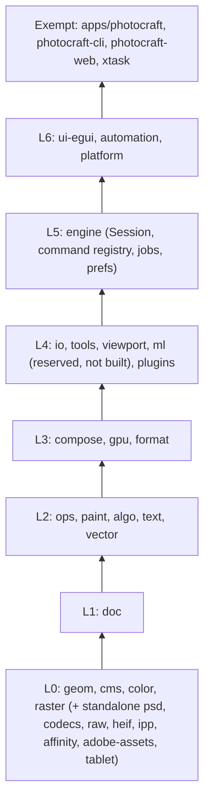

> **Reference for [App findings](../app-findings.md).** PhotoCraft host and integration analysis, written during the 2026-11-04 analysis pass. Where it says "PhotoCraft AI Diffusion", read the product name chosen afterwards: **AI Diffusion for PhotoCraft**.

# PhotoCraft as a host for "PhotoCraft AI Diffusion": integration analysis

Source analysed: the read-only PhotoCraft clone (single-commit shallow clone, HEAD `5617e00`, "Merge pull request #11168", committed 2026-11-04).
All paths are repo-relative. Evidence labels:

- **[O] observed**: read in source code or config.
- **[D] documented**: stated in project docs (may drift from the code).
- **[I] inferred**: my reasoning from the evidence. Not verified by building or running.

Nothing was built or run. Everything here comes from reading the files.

> **Version note [O]:** the workspace version is `0.20.1` (`Cargo.toml:7`), not 0.19.0. `ROADMAP.md:8` still says "at version 0.6.0", so the docs lag the code. Plan for a fast-moving upstream: PR numbers are above #11,000, and `contributors/contributors.json` reports 189 contributors and 1,302 commits as of 2026-10-10.

---

## 0. Executive summary

| Option | Viable? | Fidelity to Krita AI Diffusion | Main blocker |
|---|---|---|---|
| (a) Native crate(s) in a fork or an upstream PR | **Yes, the only route to "works identically"** | High: in-process panel, canvas preview, document access, jobs, prefs | Upstream: GPL code is banned, owner decision #41 is pending, and the work touches shared files. A fork carries a large, fast-moving rebase burden. |
| (b) External companion process over the control channel or MCP bridge | **Partially**: fine for batch-style generate/inpaint, poor for live painting, and gives no in-app UI | Low to medium | No pixel-in/pixel-out methods in bridge mode, no change events, file-placing commands refused, 1 MiB request cap, no way to add UI |
| (c) Plug-in ABI v2 or panel plug-ins | **Not available.** Designed but unbuilt, with no network in the sandbox | n/a today | ABI v1 is filter-only with no imports. v2 is "missing" and has no design for network access. |

Recommended shape [I]: a **native implementation** that follows PhotoCraft's own seams. That means pure logic in a new L4 crate, document-touching commands in an engine `ai_cmds.rs` module, a dock panel and preferences in `ui-egui`, and the HTTP/websocket transport injected from `apps/photocraft`, the same way update checks are injected today. It should be written **clean-room** (from behaviour and the ComfyUI API, not by translating Krita AI Diffusion's GPL Python) if it is ever to go upstream. Use option (b) only as a stopgap prototype.

---

## 1. Integration options

### 1(a) Native: new crate(s) in a fork or an upstream PR

#### Where it sits in the layer graph

Layering is enforced by `cargo xtask layers` from the table in `xtask/src/layers.rs:35-76` [O]:

- A new crate must be registered in `TABLE`. An unregistered crate fails the check (`xtask/src/layers.rs:260` "UNREGISTERED", test `unregistered_crate_is_error` at `:358`) [O]. The layer table already reserves `("ml", Class::Layer(4))` (`xtask/src/layers.rs:63`), but there is no `crates/ml` directory [O]. `docs/architecture.md:25` says: "Not built (yet) from the plan: the `ml` crate (no ML runtime; see gap G15), plug-in ABI v2" [D].
- UI crates (`egui`, `eframe`, `winit`, `craft-ui`, `rfd`, `bevy*`) are allowed only at L6 or higher (`xtask/src/layers.rs:104-107`) [O].
- **The command registry is closed and static** [O]. `CommandSpec` (`crates/engine/src/cmd.rs:15-28`) holds `&'static str` ids and plain `fn` pointers (`type Run = fn(&mut Session, &Value) -> Result<Value>`, `:11`). The registry is a `OnceLock` built from `build()` (`:237-246`) with a hand-maintained `v.extend(crate::<module>::specs())` list (for example `crate::plugin_cmds::specs()` at `:1395`). New engine commands therefore have to live in the **engine crate** (or in a crate the engine depends on, at L4 or below). An L6 crate cannot register engine commands. Shell-only commands (panel toggles and the like) go in `crates/engine/src/shell_commands.rs:9` `SHELL_COMMANDS`, implemented by `ui-egui` (`crates/ui-egui/src/menus.rs:59`) [O].
- **Proposed split [I]:**
  - `crates/ai-diffusion` (or the reserved `ml`), **L4**: ComfyUI workflow-graph builder, request/response types, style and preset model, region and control-layer model, job queue state machine. Pure data with serde, no network, compiles on wasm.
  - `crates/engine/src/cmd/ai_cmds.rs`, **L5**: commands such as `ai.applyResult` (new raster layer or video frame from bytes), `ai.captureRegion` (composite or layer plus selection mask as bytes), `ai.setRegionPrompt` (layer XMP) and `ai.generate` (enqueue). It exposes `specs()` and is registered in `cmd.rs`. This follows the contributing checklist (`docs/contributing.md:14-26`) [D].
  - `crates/ui-egui/src/panels/ai_diffusion_ui.rs`, **L6**: the docker panel, canvas preview and preferences page.
  - Transport in `apps/photocraft/src/ai_transport.rs` (exempt), or in `ui-egui` under `cfg(not(target_arch = "wasm32"))`. It is injected through `Services` the same way the updater is.

#### The precedent to copy: injected network transport

The engine is kept network-free on purpose. `crates/engine/src/cmd/updates_cmds.rs:1-2` [O] says: "The desktop injects a non-blocking transport; the engine owns the result so CLI, MCP and the GUI query the same state without network dependencies." `CheckFn` is `Box<dyn FnMut() -> Result<Receiver<CheckResult>, String> + Send>` (`:16`). `apps/photocraft/src/updates.rs:6-26` implements it with a `std::thread` plus `craft_update::Http` (ureq/rustls) [O]. `ui-egui` receives it as `Services::check_updates` (`crates/ui-egui/src/services.rs:457`) [O]. An AI transport (HTTP plus websocket to ComfyUI) should follow this pattern exactly [I].

#### How panels and dockers are added in `crates/ui-egui`

- The dock layout is drawn by `craft-ui`'s docking (`craft_ui::docking::*`, pinned from `storytold/craft-libs`). PhotoCraft owns the **panel registry**: `const PANELS: &[(&str, &str, Group)]` (`crates/ui-egui/src/panels/panel_docking.rs:25-44`) maps ids such as `"histogram"` to labels and dock groups [O].
- Groups are a closed enum `dock::Group` with seven variants: Color, Properties, Character, Navigator, History, Layers, Brushes (`crates/ui-egui/src/dock.rs:22-39`). Each has a key, a default height and a compact height (`:41-80`) [O].
- Panel bodies are dispatched by `(group, tab)` in `crates/ui-egui/src/panels/dock.rs:98-122` (`dock_body`), reached from `panel_docking.rs:826` `fn body` and the `DockContent` impl at `:1214` [O]. Panel menus are dispatched by id in `panel_menu` (`panel_docking.rs:1177-1211`) [O].
- Visibility flags live in the serde `UiState`: `state::Panels` (`crates/ui-egui/src/state.rs:25-62`), driveable with `ui.set {panels: …}` [O].
- **Steps to add an "AI Image Generation" docker [I, from the above]:**
  1. Add a `Group` variant (or a tab in an existing group) and its key and heights in `dock.rs`.
  2. Add a `PANELS` row in `panel_docking.rs`.
  3. Add an arm in `panels/dock.rs::dock_body`.
  4. Add a `Panels` flag in `state.rs`.
  5. Add a Window-menu toggle: a `SHELL_COMMANDS` entry plus a `menus/invoke.rs` mapping (compare `crates/ui-egui/src/menus/invoke.rs:10`, `"navigator" | "info" | "histogram" => "window.toggle.navigator"`).
  6. Add `tl!` strings and catalog rows.
  7. Add tests and an offscreen snapshot (`AGENTS.md:68`).
- **Comparable panels to model on:**
  - `panels/histogram_panel.rs` (869 lines) is a docked panel that computes off the UI thread "for the document revision, source and preview they describe, and kept until one of those changes" (`:6-8`), and persists options in `prefs.dialogs` (`:24`) [O]. This is the closest analogue to a panel that watches document revisions and shows async results.
  - `panels/timeline_ui.rs` (226 lines) is a small floating panel. "All actions run the engine `timeline.*` commands, so the control channel drives it the same way" (`:1-2`) [O].
  - `panels/actions.rs` (1,641 lines) is a list, play and record style panel [O].

#### Commands, undo and transactions

- Each `run` "records exactly **one** history step (use `coalesce` for drags and typing sessions)" (`docs/contributing.md:22`) [D]. Any command accepts `"coalesce": "<key>"` to merge consecutive edits into one undo step (`crates/engine/src/session/execute.rs:11-14`) [O].
- In-process edits go through `Session::edit(label, |doc, active| …)` (`execute.rs:226`), which produces one undoable state [O].
- There is no general multi-command transaction. MCP `command_batch` is "Not an atomic transaction" (`docs/mcp.md:88-90`) [D].

#### Background jobs, progress and cancel

`crates/engine/src/jobs.rs:1-24` [O]:

- Work runs through `jobs::run` or `jobs::edit_job` against a COW snapshot. `JobCtx::progress(fraction, message)` is at `:150`, `cancelled()` at `:163`, and `commit()` at `:186`.
- The result is applied on the UI thread as one undo step.
- `jobs.list` and `jobs.cancel` exist as commands (`:1866`, `:1876`).
- The shell shows status-bar progress with Cancel, or a modal dialog (`crates/ui-egui/src/jobs_ui.rs:1-20`) [O].
- **Caveat [O→I]:** "While a job runs on a document, commands that would edit that document are disabled with a message naming the job" (`jobs.rs:23-24`). Krita AI Diffusion lets the user keep painting while ComfyUI generates. A long generation must therefore **not** be an engine job holding the document. Run the network wait outside the job system (a transport thread polled per frame, like the update check) and apply the result with a short command [I].
- **Web [O]:** "On wasm `start` runs inline" (`jobs.rs:14`), so the browser has no worker threads for jobs.

#### Web build constraints

- Golden rule 7: "Never break wasm. L0–L6 must `cargo check --target wasm32-unknown-unknown` … File-system code is `cfg(not(target_arch = "wasm32"))`" (`AGENTS.md:69`) [D]. `cargo xtask ci` runs the wasm check (`.github/workflows/ci.yml:165-166`) [O]. The web wasm size gate is 24 MiB (`Cargo.toml:115-121`) [O].
- The browser build has no control server: "browsers can't listen on TCP" (`docs/development.md:587`) [D].
- [I] In the browser, ComfyUI access needs `fetch` and a `WebSocket` through `web-sys`, which is allowed (only hand-written JS is banned, `docs/contributing.md:3`), plus CORS headers on the ComfyUI server and HTTPS/mixed-content handling. A managed local-server installer and model downloads are desktop-only and must be `cfg`-gated, following precedents such as `craft-update` being native-only (`crates/ui-egui/Cargo.toml:45-48`).

#### Async, HTTP and websocket crates already in `Cargo.lock` [O]

| Crate | Version | Pulled in by | Usable directly? |
|---|---|---|---|
| `tokio` | 1.54.1 | `photocraft-automation` (`crates/automation/Cargo.toml:24`), `photocraft-cli` (`apps/photocraft-cli/Cargo.toml:34`), `rmcp`, `reqwest` | Yes, already a direct workspace dependency (L6 and apps) |
| `ureq` | 3.5.0 (rustls) | `craft-update` only (native `ui-egui` and `apps/photocraft`) | Transitively. Adding it directly is a small step [I]. |
| `reqwest` | 0.13.5 | `winprint` → `sigstore-*` (via `craft-print`) | Present only transitively, so a direct dependency is a new edge [I] |
| `hyper` 1.12.0, `rustls` 0.23.46, `http` 1.5.0, `url` 2.5.8, `futures` 0.3.34, `mio`, `crossbeam-channel` | | various | |
| `rmcp` | 3.6.0 | `automation` | MCP |
| `base64` | 0.22 / 0.23 | engine, ui-egui, automation | |
| **Any websocket crate** (`tungstenite`, `tokio-tungstenite`, `ewebsock`, `async-tungstenite`) | **absent** | | A new dependency is needed for ComfyUI progress and preview |
| `ort`, `candle`, `burn` | **absent** | | `docs/scorecard.md:264`: "No ONNX runtime dependency" |

Dependency policy [O]:

- The CI step "Git dependencies come from storytold" fails any `git+` source outside `github.com/storytold/` and any cargo source replacement or patching (`.github/workflows/ci.yml:89-119`). crates.io dependencies are allowed.
- There is **no `deny.toml` / cargo-deny or cargo-audit config** in the repo [O]. The Linux gate runs a shared workflow, `storytold/craft-common-actions/.github/workflows/gate.yml@main` (`ci.yml:149`), whose contents are external and were not inspected.
- Dependabot is enabled (`.github/dependabot.yml`).
- Choosing a dependency over `unsafe` is the stated precedent (`docs/decisions.md:9-28`) [D].

#### Preferences: storage and adding a page

- Preferences are one serde document owned by the engine (`crates/engine/src/prefs.rs:1-19`). Frontends persist it: desktop in the OS config dir, web in browser storage. Agents use `prefs.get/set/reset` [D/O].
- `pub struct Preferences` (`prefs.rs:1171-1222`) has typed sections plus free-form JSON maps owned by the shell, such as `dialogs: BTreeMap<String, Value>` ("The last choices of dialogs…", `:1220-1222`) [O].
- **There is already an "AI Integrations…" Preferences page.** The menu catalog has `(&["Edit","Preferences"], "AI Integrations…", None, "edit.preferences.integrations")` (`crates/ui-egui/src/menu_catalog.rs:152`). It is backed by `Integrations { allow_agent_control, control_port }` (`prefs.rs:1073-1086`) [O]. AI Diffusion settings (server URL or managed install, performance preset, model paths, styles) fit naturally there or in a sibling section [I].
- The Preferences dialog generates fields from the section JSON (`section_fields(...)`, `crates/ui-egui/src/prefs/prefs_ui/tests.rs:1703`; per-platform field hiding in `prefs_ui/graphics.rs:138`) [O]. Adding a section means struct fields plus validation, labels and i18n [I].
- Settings from automation: `prefs.set` refuses whole-preference updates and file-backed sections over control (`docs/control-protocol.md:192`) [D].

#### Native integration cost [I]

- Panel, preview, commands, transport, prefs and tests come to roughly **several thousand lines** of Rust before full feature parity. Krita AI Diffusion is a large Python codebase with workflow generation, model resolution, a server installer and a UI.
- Upstream bars, all required: no `unwrap`/`panic` in non-test code, `unsafe_code = "forbid"`, `panic_hunt` fuzzing of every command, tests at 8/16/32-bit, layers, wasm check, i18n, parity and scorecard updates, a dev-log entry (`AGENTS.md:50-115`) [D].
- Shared-file churn: `cmd.rs`, `menus.rs`, `state.rs` and the dock tables are "shared files" needing "small, surgical edits" (`AGENTS.md:119`) [D].

### 1(b) External companion process over the control channel or MCP bridge

#### What the protocol is [D/O]

- **Transport:** the desktop app listens on loopback TCP at `127.0.0.1:<port>` with newline-delimited JSON, one request and one reply per line (`docs/control-protocol.md:11-41`; `apps/photocraft/src/control_server.rs:1-2`). Handlers are in `crates/ui-egui/src/control.rs` (`docs/control-protocol.md:43`).
- **Auth:** the first frame must be `{"method":"auth","params":{"token":"<64 hex>"}}` within 10 s (`crates/automation/src/security.rs:27`), with a 256-bit token from `--control-token-file`, `PHOTOCRAFT_CONTROL_TOKEN[_FILE]`, or generated and printed to stderr (`docs/control-protocol.md:18-26`).
- **Enabling:** `--control <port>`, or Preferences › AI Integrations `controlPort` with `allowAgentControl` (default true) (`apps/photocraft/src/main.rs:127-140`; `prefs.rs:1082-1085`).
- [I] A Windows GUI-subsystem app started from the Start menu has no console (`docs/development.md:168`). A companion therefore needs the user to configure a token file or env var. A generated token printed to stderr is unreachable.
- **Methods:** `engine.execute {command, params}` (any of the roughly 700 engine commands), `engine.commands`, `ui.inspect`, `ui.set`, `ui.menu.invoke`, `ui.dialog.*`, `ui.pointer/click/key/type`, `ui.screenshot`, `app.open`, `app.save`, `app.quit`, `jobs.list/cancel` (`docs/control-protocol.md:45-115`, `:443`).
- **MCP:** `photocraft-cli mcp --bridge 127.0.0.1:<port>` wraps the same protocol (`docs/control-protocol.md:357-395`; `docs/mcp.md:83-96`).

#### Capability check for a Krita-AI-Diffusion-style client

| Need | Over the desktop control channel | Evidence |
|---|---|---|
| Document size, mode, depth, layer tree, selection bounds, revision | **Yes**: `document.inspect` / MCP `doc_inspect` | `crates/engine/src/inspect.rs:20,45,52`; `docs/control-protocol.md` (table row `document.inspect`) [O] |
| Read composite pixels | **Indirect**: `app.save {path}` writes a PNG/TIFF under the automation write root, and the companion reads the file. `ui.screenshot` captures the window, not the document. `doc.render` (base64 PNG) is **headless-only**. | `docs/control-protocol.md:113`, `:387`, `:395`, `:454` [D] |
| Read one layer's pixels | **Not directly** in bridge mode. `doc_export_layers` maps to `file.export.layersToFiles`, a `file.*` command, and "every `file.*` command except `file.new`, the `file.close*` commands and a few path-free ones" is refused. The workaround is to toggle visibility and `app.save`. | `docs/control-protocol.md:381`, `:192` [D] |
| Read a single pixel | `document.pixel {x,y}` returns the float channels | `crates/engine/src/adjust_params/tests.rs:371` [O] |
| Read the selection as a mask | **No bulk read.** Only `selectionBounds`. Workarounds such as `select.saveSelection` to a channel, then duplicating or exporting, are convoluted. | `inspect.rs:45` [O]; the [I] is that no mask-export method was found |
| Write pixels or create a layer from an image | **No direct method.** `file.placeEmbedded {path}` and MCP `doc_place` are **refused in bridge mode** ("the command reads an ambient path … `doc_place` is refused the same way"). There is no base64-pixels command; the only base64 inputs are presets, plug-ins, ATN and SVG sources. Workaround [I]: `app.open` the generated PNG from the read root, then `select.all`, `edit.copy`, `document.activate`, `edit.paste`, and close the temporary document. This works because the clipboard is session-internal (`crates/engine/src/lib.rs:209`), but it is slow and visibly opens tabs. | `docs/control-protocol.md:382`, `:192`; `crates/engine/src/cmd/file_cmds.rs:291-300` [O/D] |
| Create, rename, move, delete and group layers; masks | **Yes**: `layer.new.layer`, `layer.setProps {name,…}`, `layer.renameLayer`, `layer.arrange.*`, `layer.delete`, `layer.new.group`, `layer.groupLayers`, `layer.layerMask.*` | Command ids under `crates/engine/src` [O] |
| Per-layer metadata | **Yes**: `layer.xmpMetadata {layer, rawData}` (read/write, up to 4 MiB) | `crates/engine/src/cmd/layer_xmp_cmds.rs:17,88` [O] |
| Undo grouping | Per-command `coalesce` key. `command_batch` is not atomic. | `execute.rs:11-14`; `docs/mcp.md:88-90` |
| Change notifications or subscriptions | **None.** Request/reply only; no subscribe, push or event method was found. Poll `document.inspect` `revision`. | grep of `control.rs` and `control-protocol.md` [O] |
| Bit depth and colour | `document.inspect` reports them, but `app.save` re-encodes, and **`image.mode.*` is refused** on the desktop. | `docs/control-protocol.md:192` [D] |
| Limits | 1 MiB per request line, 8 MiB per reply, 16 connections, 30 s socket timeout, 60 s reply deadline, 256 batch steps | `docs/control-protocol.md:476-485`, `:41`; `security.rs:17-23` [D/O] |
| Add UI inside PhotoCraft | **No.** There is no method to register panels, menus, dialogs or overlays. `ui.dialog.open` only opens built-in kinds, and `notices` can be read and cleared, not authored. | `docs/control-protocol.md:58-66` [D]; `crates/ui-egui/src/notices.rs:1-4` [O] |
| Live painting | **Not practical [I].** Each tick costs an `app.save` (full-resolution encode plus disk write), a re-read, a generation, and a multi-step open/copy/paste/close. There is no change event and no preview overlay. At best 1 Hz-class latency with UI flicker, against Krita's in-process preview layer. | Derived from the rows above |

**Verdict [I]:** a companion (its own window, any language and any licence including GPL-3.0) can do "generate or inpaint the current composite or selection region and insert the result as a layer". It can do that today, with friction. It **cannot** provide a docked panel, an on-canvas preview, live painting, or region and control-layer authoring that feels native. Its UI would be a separate window, much like Krita AI Diffusion's panel torn out of Krita. It is good as a quick prototype and as a license-isolated GPL port of the Python logic.

**Precedent [O]:** PhotoCraft already integrates with a sibling app through an external process. `apps/photocraft/src/external_svg.rs:1-10, 147-155` launches VectorCraft to edit SVG smart objects through a watched temp file. That is file handoff, not a control protocol.

### 1(c) Extending the plug-in system (ABI v2, panel plug-ins)

What exists [O/D]:

- `docs/plugins.md:1-8`: WebAssembly modules run in `wasmi`.
- Host imports are rejected: "the module imports `{}.{}`, but plug-ins get no host imports (no WASI, files or network)" (`crates/plugins/src/runtime.rs:208-210`).
- `ABI_VERSION = 1` (`runtime.rs:14`). `enum Kind { Filter }` is the only kind (`crates/plugins/src/manifest.rs:18-20`).
- The limits table states there is no network, clock or randomness, plus a 60 s wall clock per run (`docs/plugins.md:39-48`).

What is planned [D], quoted:

- `docs/plugins.md:183-187` ("Not in v1"): "Panel / UI plug-ins, plug-ins that read other layers or documents, host callbacks (progress, cancel), plug-in-provided file formats."
- `docs/scorecard.md:263` (AUTO-219-6, status **missing**): "Plug-in ABI v2: panel kind, progress/cancel calls, read other layers, Last Filter repeats" (evidence: "runtime.rs:15 ABI_VERSION = 1; manifest.rs:18 Kind::Filter only").
- `docs/gaps.md:235-239` (G16): "PhotoCraft has its own sandboxed WebAssembly plug-in ABI v1 … but ABI v2 (panels, progress, other layers) is missing (AUTO-219-6). Estimate: 250–450 h. Human: .8BF needs native code under the isolated-`unsafe` rule."
- `docs/target-app-parity.md:227-229`: plug-in hosting needs owner decisions, and "UXP is a JavaScript runtime, which AGENTS.md forbids in the UI".
- `docs/roadmap.md:93`: "Later, needs owner decisions | AI backend (#41), plug-in hosting (.8BF / UXP), scripting compatibility | 550–1,050 h".
- `docs/decisions.md` has two entries (smart-object identity and file-replace ACLs). **Nothing on plug-in v2, scripting or AI** [O].

**Verdict [I]:** ABI v2 is unscheduled, and even its planned scope (panels, progress, other layers) **does not include network access**, which an AI-diffusion client fundamentally needs. Waiting for v2 is not a plan. Designing v2 yourself (a network capability, a panel kind, a document API) would be a bigger upstream negotiation than the native feature itself.

#### Is anything AI-generative planned or in progress upstream? Quotes [D]

- `docs/gaps.md:226-233` (G15): "**Missing:** Generative Fill and Expand, Generative Upscale, Neural Filters, Sky Replacement, Super Zoom, ML Select Subject/Sky. There is no ML runtime (AUTO-219-7). Classical substitutes exist … users ask for local models (#2313, #1996, #2682). … **Estimate:** 300–600 h. **Human:** owner decision #41 (model licences, local vs remote)."
- `docs/target-app-parity.md:87`: "AI features | 5% | 10% | 300–600 | No ML runtime at all (scorecard AUTO-219-7); classical substitutes only. Needs an owner decision and openly licensed models (#41)". `:478`: "AI / generative | none | ~0% | Deferred by decision (#41)."
- `docs/scorecard.md:264` (AUTO-219-7, **missing**): "Local ONNX models behind a flag, managed in Preferences; subject select, background removal" ("No ONNX runtime dependency").
- `docs/roadmap.md:111` (M10, planned): "`ml` (ort native / ort-web on the web), Select Subject/Object/Sky, Remove BG, Remove tool, content-aware fill, healing, AI denoise, RAW develop".
- `docs/architecture.md:136`: "ml/ photocraft-ml model registry + InferenceBackend trait (ort native / burn|candle web); SAM2, matting, depth, sky". `:434`: "model registry with SHA-256 verification and on-demand download". `:318`: "background jobs (filters, AI inference, export) … read snapshots without locks".
- `docs/atn.md:2061`: "Generative Fill (`syntheticFill`) | AI feature: in PhotoCraft this goes through the **shared AI layer**; until then such steps stay kept steps." The "shared AI layer" is not defined anywhere else in the repo [O].
- `docs/context-menu-parity.md:73`: "Photoshop's Generative Fill … rows are left out: PhotoCraft has no such commands."
- `README.md:416`: "And **ArtCraft** itself, our AI image and video studio for artists who want real control." [I] The vendor already ships an AI product. An AI feature in PhotoCraft may overlap with ArtCraft strategically, which is one more reason the owner decision (#41) gates upstream acceptance.
- **Nothing is in progress** [O]: there is no `ml` crate, no ORT/candle/burn dependency, and no AI commands or menu items. The only "AI" menu label is the agent-control preferences page (`menu_catalog.rs:152`). The one in-tree neural net is a hand-ported face-detection CNN ("inference is plain Rust: no runtime", `crates/algo/src/faces.rs:7`; BSD-3 weights, `ATTRIBUTION.md:74`).
- Upstream's AI direction is **local ONNX inference** (ort) for selection and matting, **not a ComfyUI client**. A ComfyUI-based generative feature is a different design from the planned `ml` crate [I].

---

## 2. Host capability matrix

Legend: In-process API is what a native crate would use. Control/MCP is what an external process gets.

| Capability | Present? | In-process API (Rust) | Engine command(s) / control | Notes |
|---|---|---|---|---|
| Pixel layers get/set | Yes | `LayerContent::Raster(Surface)` (`crates/doc/src/lib.rs:597-605`). `Surface` holds sparse COW 256² tiles with a runtime `PixelFormat` (`crates/raster/src/lib.rs:253`): `read_region → Vec<f32>`, `write_region(&[f32])`, `try_to_interleaved/write_interleaved` (bytes), `read_rgba8_into`, `convert`, `content_bounds` | `document.pixel` (single pixel). There is **no bulk get/set command**. | Samples are U8, U16 or F32 (`crates/color/src/lib.rs:28-32`); the f32 accessors normalise. Colour modes are Bitmap, Grayscale, Indexed, Rgb, Cmyk, Lab, Multichannel, Duotone (`:51-60`). Golden rule: "Never introduce a `u8`-only pixel path in public APIs. Never assume sRGB" (`AGENTS.md:64`) [D]. AI I/O must convert through `photocraft-cms` [I]. |
| Add, rename, move, delete layers | Yes | `Session::edit` closures on `Document.layers` (bottom-to-top, `lib.rs:887-888`) | `layer.new.layer`, `layer.renameLayer`, `layer.setProps`, `layer.arrange.*`, `layer.delete`, `layer.duplicate` | Must keep exactly one history step per command |
| Layer groups (Krita "regions") | Yes | `LayerContent::Group(Group)` | `layer.new.group`, `layer.groupLayers`, `layer.mergeGroup`, `layer.setExpanded` | Region prompts could be stored in group or layer XMP (below) [I] |
| Selection read as mask, feathering | Yes (in-process) | `Document.selection: Option<Surface>` (a coverage surface, `lib.rs:896`) | `select.*` (rect, lasso, subject…), `select.modify.feather`, `select.saveSelection`, `select.loadSelection`; `document.inspect` gives `selectionBounds` only | External bulk mask read is missing (see 1b) |
| Layer masks / transparency masks | Yes | `Layer.mask: Option<LayerMask>`, `vector_mask` (`lib.rs:642-645`) | `layer.layerMask.*` (density/feather edit, from transparency, reveal/hide selection, apply, delete), `layer.vectorMask.*` | Krita "transparency mask" maps to a layer mask [I] |
| Vector/shape layers (pose skeletons?) | Partial | `LayerContent::Shape(ShapeLayer{path, fill, stroke, …})`, **one path with one fill and one stroke** (`crates/doc/src/vector.rs:336-351`); SVG smart objects keep vector source (`smart_svg_cmds.rs`, `layer.smartObjects.updateVectorSource`, 16 MiB cap) | `shape.create/edit/info`, `path.*`, `layer.smartObjects.exportSvg/updateSvg` | [I] An OpenPose skeleton (colour-coded limbs and joints) does not fit one ShapeLayer. Options: a group of shape layers per limb, or an **SVG smart object** holding the skeleton (closest to Krita's vector-layer pose editing; needs a custom pose-edit tool), or a custom XMP payload plus rendered raster. |
| Smart objects | Yes | `LayerContent::Smart(SmartObject)` with contents id (`docs/decisions.md:3-7`) | `layer.smartObjects.*` | |
| Animation, timeline, frames | Partial | `Document.timeline: Option<Timeline{fps,duration,current,work_start,work_end}>` (`crates/doc/src/video.rs:61`). Video layers keep `VideoData.frames: Vec<Surface>` (`video.rs`): "Frame-animation and video-timeline modes both reduce to 'which frame is current'" (`:1-3`) | `timeline.create/delete/setFrame/nextFrame/previousFrame/setProps/info` (`crates/engine/src/cmd/timeline_cmds.rs:145-151`), `file.export.renderVideo` | Krita keyframes map to video-layer frames [I]. Scorecard: video/timeline about 30% (`ROADMAP.md:81`). |
| Undo grouping / transactions | Yes | One `Session::edit` = one step; `coalesce` key | any command plus `"coalesce"` | No cross-command atomic batch |
| Document bit depth and colour profile | Yes | `Document.depth: SampleType`, `mode: ColorMode`, `icc_profile: Option<Arc<Vec<u8>>>` (`lib.rs:884-886`) | `document.inspect`; `image.mode.*` (refused over the desktop control channel) | |
| Canvas viewport info | Yes (UI) | `ui-egui` `state::View{zoom, center, rotation, doc_size}` (`crates/ui-egui/src/state.rs:117-135`) | `ui.inspect` → `view`; `ui.set {zoom, center, rotation}` | No explicit "visible rect" field. Derivable from zoom, centre and window size [I]. |
| Events for document changes | In-process: **revision polling** | Per-document `revision` counter (`inspect.rs:20,52`). Panels cache "for the document revision" and recompute when it moves (`histogram_panel.rs:6-8`). `ui-egui` ticks every frame (`jobs_ui.rs:6`). | Control: **none** (poll) | Live painting in-process = watch `(doc id, revision)` per frame and debounce [I] |
| Text layers | Yes | `LayerContent::Text(TextLayer)` | `type.create`, `type.edit`, `type.info`, … | |
| Preview overlays on canvas | Yes (in-process pattern) | The app swaps a temporary display document for the canvas: `display_memo` (`crates/ui-egui/src/lib.rs:347`), `blend_preview` (`:398`), `patch_preview` (`:404`), `cam_preview`, filter live preview (`dialogs/filter_preview_ui.rs:1-9`) | none | [I] A "generated result preview" panel can reuse the same mechanism (show a temp `Arc<Document>` with the candidate layer inserted, commit on Apply) |
| Notifications | Yes (UI) | `notices.rs` (lower-right cards, max 3, in `UiState`, `crates/ui-egui/src/notices.rs:1-13`) | `ui.inspect` reads them; `ui.set` clears them | No authoring over control |
| File dialogs | Yes | `Services::file_dialog` (`services.rs:417`; rfd native, async on web) | n/a | |
| Threads / jobs with progress and cancel | Yes | `jobs::run/edit_job`, `JobCtx` (`jobs.rs:650,747,150,163`); rayon native | `jobs.list`, `jobs.cancel` | Jobs lock the document (see 1a caveat); wasm runs inline |
| i18n / localisation | Yes | `tl!` macro; UTF-8 TSV catalogs in `crates/ui-egui/src/i18n/*.tsv` with plural and context support; English fallback (`docs/localization.md:1-6`); about 25 languages | `prefs.set interface.language` | `cargo xtask i18n-coverage` reports missing strings without failing (`docs/localization.md:39-42`). Engine messages remain English. |
| Settings / preferences persistence | Yes | `Preferences` serde document (`prefs.rs:1171`), `Integrations` section and the existing "AI Integrations…" page; `dialogs` free-form map | `prefs.get/set/reset` | Persisted by the frontend (OS config dir / browser storage) |
| Per-document metadata in `.pcraft` / PSD | Yes, without format changes | **Layer XMP** `Layer.xmp` (`lib.rs:680`), "saved in PSD, PSB, layered TIFF and `.pcraft`, and copied when the layer is duplicated" (`layer_xmp_cmds.rs:1-3`). **Document XMP** `Metadata.xmp` (`lib.rs:863-867`); raw PSD resources and global blocks are kept verbatim. | `layer.xmpMetadata` (read/write); `file.fileInfo` (only named fields; no raw document-XMP setter found) | [I] Store AI state (prompts, seeds, region and control-layer roles, style) as a custom XMP namespace on layers or groups, plus document XMP through a new command. A new `Document` field instead forces `.pcraft` format changes: "`photocraft-format` deliberately fails to compile when a `photocraft-doc` struct gains a field" (`AGENTS.md:138-141`). |
| Model download / server installer | Not present | Needs HTTP download and `std::process` spawning (native only). Precedents: `external_svg.rs` spawns VectorCraft; `craft-update` self-update downloads. | n/a | [I] Upstream acceptance of a managed **Python** ComfyUI installer is uncertain given "Rust only" (`AGENTS.md:3`), though launching an external server is not textually banned. Must be `cfg`-gated off wasm. |

---

## 3. Contribution and governance

### Rules [D]

- **Licence:** "contributions are MIT OR Apache-2.0" (`docs/contributing.md:4`; `Cargo.toml:9`; `NOTICE`).
- **Clean-room:**
  - "do not copy code, shaders, icons, ICC profiles or other assets from proprietary software" (`docs/contributing.md:5`).
  - "Never copy their code … Implement from public specs … and observation. Third-party assets must be permissively licensed … get a row in `ATTRIBUTION.md`" (`AGENTS.md:65`).
- **GPL is effectively excluded,** in practice not just in principle:
  - `crates/raw/README.md:82`: "no public description of these codes was found apart from GPL decoder source, which this crate may not use (clean-room)".
  - `crates/text/src/tests.rs:1786-1788`: "we do not invent EngineData keys or copy figure-style tables from GPL editors (AGENTS.md clean-room)".
  - `crates/affinity/README.md:85`: "No GPL/AGPL code (such as Inkscape's Affinity extension) was read."
  - `docs/architecture.md:581` records the licence choice of MIT/Apache over "GPL-3.0 … the Krita/GIMP model".
- **What this means for a Krita AI Diffusion port [I]:**
  - A **translation** of Krita AI Diffusion (GPL-3.0) into Rust is a derivative work. It can only be distributed under GPL-3.0, and **would not be accepted upstream**.
  - An upstream-bound implementation must be clean-room: written from observed behaviour, user docs and the public ComfyUI HTTP/websocket API, by people working from a written behavioural spec rather than from the Python source. That mirrors how upstream handled Affinity (`crates/affinity/README.md:80-97`).
  - A **GPL-3.0 fork** of PhotoCraft is licence-compatible (MIT and Apache-2.0 code can be combined into a GPLv3 work), but the combined binary is GPLv3 and permanently diverges.
  - A **separate GPL companion process** talking over the control channel keeps the licences apart, though the companion's limits (section 1b) apply.
  - Also check the licences of Krita AI Diffusion's bundled **workflow JSON, custom-node lists and model catalogs**. Models need "openly licensed models" per #41.
- **Code-quality gates:**
  - Never crash: no `unwrap/expect/panic/unreachable/todo/unimplemented` outside tests, enforced by clippy (`clippy.toml`, `AGENTS.md:50-61`).
  - `unsafe_code = "forbid"` (`Cargo.toml:79-80`), with one exception crate (`tablet`).
  - Input numbers are hostile, recursion is bounded, lock poisoning is handled (`AGENTS.md:56-58`).
  - Time goes through `chrono` (`AGENTS.md:73`).
  - Every new crate needs `[lints] workspace = true` (`AGENTS.md:61`).
- **Commands, not handlers:** the add-a-command checklist (`docs/contributing.md:14-26`); `panic_hunt` fuzzes every command (`AGENTS.md:72,101`).
- **UI:** use `theme::Tokens` and `widgets::*`; verify visually; attach before/after screenshots to PRs (`docs/contributing.md:11`). Demo images must be public-domain (`AGENTS.md:68`).
- **Fonts and assets:** never commit fonts (they live in craft-fonts) (`AGENTS.md:65`). Every asset needs an `ATTRIBUTION.md` row.
- **Dependencies:** git dependencies only from `github.com/storytold/` and no cargo source patching, both CI-enforced (`.github/workflows/ci.yml:89-119`). crates.io dependencies are fine. No cargo-deny config in the repo; the shared gate is external. Precedent: prefer a safe dependency to `unsafe` (`docs/decisions.md:16-28`).
- **CI:**
  - Don't add or change CI in a feature PR (`AGENTS.md:158-161`).
  - Jobs: the Linux gate (shared `craft-common-actions` gate running `cargo xtask ci`); Windows unit and integration legs with nextest; corpus; web plus wasm size gate; fuzz (`.github/workflows/ci.yml`).
- **Commits:** "small, focused, with a clear subject line" (`docs/contributing.md:12`). Contributor credit through `contributors/people.toml`, own entry only (`AGENTS.md:143-156`). An AI-model credit is generated from `Co-Authored-By` trailers (`docs/contributors.md:3-4`).
- **Big outside contributions:** there is no CONTRIBUTING.md at the root, no PR template and no CODEOWNERS in `.github/` [O]. CodeRabbit auto-reviews PRs (`.coderabbit.yaml`).
  - The project absorbs heavy parallel agent-driven contribution: "the repository has sustained 10–20 concurrent agents" (`docs/target-app-parity.md:223`) and 189 contributors [D/O].
  - `docs/integration-testing/` records a third-party fork (`FredApps/photocraft`) integrating 108 PRs into a Windows portable test build with a gate table (`integration-checkpoint.md:5-30`). That is a precedent for downstream integration forks, not an upstream process.
  - **Owner decisions** are explicitly required for AI (#41) and plug-ins (`docs/target-app-parity.md:227-229`). [I] A large AI feature should start as an issue or discussion referencing #41 and #219 before any PR, and land as a series of small PRs: crate scaffold, engine commands, panel, transport.
- **Security:** treat files, paths, metadata and automation requests as hostile (`SECURITY.md`). The automation roots fail closed (`docs/mcp.md:56-67`).

---

## 4. Build and test

- **Toolchain [O]:** Rust stable, `rust-version = "1.95"`, `edition = "2024"`, `resolver = "3"` (`Cargo.toml:2-10`). There is no `rust-toolchain.toml`. Add the wasm target with `rustup target add wasm32-unknown-unknown` (`docs/development.md:5`).
- **Windows [D]** (`docs/development.md:12-35`):
  - Use the MSVC toolchain plus Visual Studio / Build Tools with "Desktop development with C++". On ARM64 also install the Clang compiler (`aws-lc-sys`).
  - Watch for Smart App Control blocking cargo or rustc (os error 4551, #1585).
  - The single-instance forwarder means `cargo run` while an installed PhotoCraft is open forwards to it. Pass `--new-instance` or set `PHOTOCRAFT_CONFIG_DIR` (`docs/development.md:137`).
- **Run [D]** (`docs/development.md:41-50`):
  - `cargo run --release -p photocraft -- path/to/image.psd`
  - With control: `cargo run --release -p photocraft -- --control 7878 --control-token-file .private/control.token --automation-read-root work --automation-write-root work`
  - Optional fonts: `CRAFT_FONTS_DIR=<craft-fonts checkout>` (`AGENTS.md:65`).
- **Tests [D]:**
  - `cargo test --workspace`; `cargo xtask test`; `cargo xtask ci` (fmt, clippy, layers, scorecard, tests, panic_hunt, doctests, wasm, i18n report); `cargo nextest run --workspace`; `cargo test -p <crate> --lib --tests` for fast loops (`docs/development.md:41-66`).
  - Pre-finish list: `AGENTS.md:95-107`.
  - Parallel agents should use separate `CARGO_TARGET_DIR`s, about 10 GB each (`AGENTS.md:119-123`).
- **UI verification [D]:** offscreen `cargo run -p photocraft-ui-egui --example snapshot`; `egui_kittest` with wgpu snapshots (`crates/ui-egui/Cargo.toml:66`).
- **CI [O]:** `.github/workflows/ci.yml` runs on push to main and PRs:
  - The Linux gate (shared `gate.yml@main`, `cargo xtask ci --locked --features heif`, 100-minute timeout, `:146-166`).
  - Windows unit and integration nextest legs (selected by touched paths or the `full-ci` label, `:71-143`, `:175-276`).
  - A without-heif test, the corpus tests, the web build with a 24 MiB wasm gate, and optional fuzz.
  - Other workflows: release, docs, freebsd, nix, packaging-lint, perf-nightly, sonarcloud, windows-arm64.
- **Integration testing [D]:** `docs/integration-testing/` holds a downstream integration-build record (gates, Windows portable test protocol, per-PR regression appendix). It is a fork process, not an upstream harness. The in-repo harness for agents is the control channel plus `automation/tests/it/agent_tasks.rs` (10 MCP tasks, `docs/roadmap.md` M11).
- **Headless CLI [D]** (`docs/development.md:245-272`): `photocraft-cli convert | info | run --cmd … --params … | batch | commands | mcp [--bridge]`. Install with `cargo install --path apps/photocraft-cli --locked` (`docs/mcp.md:9`).

---

## 5. Branding and naming

- **The family [D]:** PhotoCraft is one of the **Crafting Apps** from the ArtCraft team: VectorCraft, FilmCraft, LightCraft, PdfCraft, EffectCraft, DesignCraft, FigCraft, WordCraft, SoundCraft, DeckCraft, CADCraft, GridCraft, TextureCraft, Craft Anything (`README.md:391-418`). There is also a **community app, SolidCraft by Tangency Labs**, with id `io.tangencylabs.solidcraft` (`README.md:414`). That is a precedent for third parties using the `…Craft` naming under their own reverse-DNS id. ArtCraft itself is "our AI image and video studio".
- **Naming rules [D]** (`AGENTS.md:3`):
  - The product name is written **PhotoCraft** (`{Function}Craft` in PascalCase) in user-facing text.
  - Machine names are lowercase: crates `photocraft-*`, binaries, file names, ids such as `ai.storyteller.photocraft`. Siblings use `ai.storyteller.<app>` (e.g. `ai.storyteller.vectorcraft`, `apps/photocraft/src/external_svg.rs:155`).
  - Shared components live in `storytold/craft-libs`, pinned by git revision (`Cargo.toml:13,42-47`).
- **Add-ons [O]:** there is no add-on naming convention. Plug-ins use reverse-DNS manifest ids (`docs/plugins.md:98`). In-tree crate naming suggests `photocraft-ai-diffusion` for a crate [I].
- **Trademark [D]:**
  - The **ArtCraft** name and logos are not open source (`docs/brand/LICENSE-brand.txt:1-6`).
  - Forks "must remove the ArtCraft Marks … and must not call it ArtCraft or present it as an ArtCraft product. You may say, in plain text, that your work is based on PhotoCraft by the ArtCraft team" (`:30-35`).
  - The brand licence covers the ArtCraft marks. It does **not** state a policy for the name "PhotoCraft" [O], and Apache-2.0 grants no trademark rights [I]. Naming a third-party product "**PhotoCraft** AI Diffusion" therefore needs confirmation from the ArtCraft team. Safer alternatives: "AI Diffusion for PhotoCraft", or an upstream feature simply called "AI Image Generation" inside PhotoCraft.

---

## 6. Gaps that matter for an AI-diffusion port (ranked) [I]

1. **No network seam in the engine.** Copy the `updates_cmds::CheckFn` injection pattern. No websocket crate is present.
2. **Static command registry.** AI commands must be added in `photocraft-engine` itself, which touches the shared `cmd.rs`.
3. **Jobs lock the document.** Generation must run outside the engine job system so painting continues.
4. **No external pixel I/O over the desktop control channel** (place is refused, no base64 pixels, no mask export) and **no change events**. This rules out a good companion-based live mode.
5. **No in-app UI for external code.** Plug-in ABI v2 (panels) is unbuilt and has no network capability planned.
6. **Pose skeletons** have no natural vector-layer equivalent (ShapeLayer is one path with one style). Use an SVG smart object or a group of shapes, plus a custom editing tool.
7. **Persistent AI state:** use layer and document XMP to avoid `.pcraft` schema churn. There is no raw document-XMP setter command yet.
8. **Web build:** the managed server installer and model downloads are native-only. The browser needs CORS-enabled ComfyUI and fetch/WebSocket through web-sys. Jobs run inline.
9. **Governance:** owner decision #41 is pending, upstream's AI direction is local ONNX (`ml` crate), the clean-room/no-GPL rule applies, and ArtCraft overlaps strategically.
