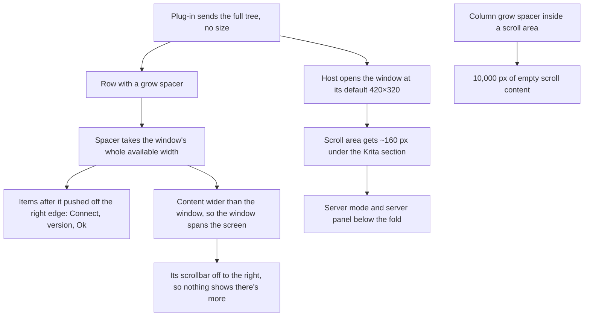

# Findings: the settings dialog's Connection page is drawn incompletely in PhotoCraft

## Problem

In the real PhotoCraft (the fork's `feat/process-plugins`), the plug-in's settings dialog ("Configure Image Diffusion") draws only part of its Connection page: "Server Configuration", the Krita AI Diffusion section and Restore Defaults. Missing:
- the server-mode buttons;
- the server panel (Server URL, its field, Connect, the connection status, the detected workloads);
- in the bottom row, the plug-in version, "Open Settings folder" and Ok.

The dialog spans the whole window width. A server therefore can't be set up from this page inside PhotoCraft.

## Investigation

- **The plug-in sends everything.** The `dialog.open` request, captured by running the plug-in process against a minimal host and opening the dialog with `action.triggered`, holds all 53 nodes: the server-mode row (`row #w46`, three images), the server stack (`stack #w51`: Server URL, the line edit, Connect, the status, the workloads) and the bottom row (`row #l63`: Restore Defaults, version, link, Ok). Nothing missing is hidden.
- **The fork's renderer reproduces it.** A temporary test in the fork (not kept) fed that captured tree to `process_plugin_dialogs::show` in a 1440×900 egui_kittest harness. The rendered image matches the screenshot from PhotoCraft, and every label is present but out of view:

  | Label | Position (x, y) | Where |
  |---|---|---|
  | "Server URL" | (118, 336) | below Restore Defaults (y = 276), inside the scroll area, past its visible part |
  | "Connect" | x = 1425 | past the window's right edge |
  | "Plugin version" | x = 1520 | past the window's right edge |
  | "Ok" | x = 1689 | past the window's right edge |

  The layout is stable: the same positions after 6, 26 and 86 frames.
- **One suspect at a time**, each rendered as a variant of the captured tree:

  | Change | Result |
  |---|---|
  | Remove the 1,200-character workload list | no change |
  | Remove the two link labels | no change |
  | Turn the `grow` spacers into fixed spacers | the bottom row shows in full ("Ok" at x = 558); the server panel is still below the fold |

- **The dialog's size.** It opens at the fork's default (`default_size(420, 320)`, `crates/ui-egui/src/process_plugin_dialogs.rs:223`). `dialog.open` has no size field (`OpenDialogParams`, `crates/process-plugin-protocol/src/method.rs:522`; `docs/process-plugins.md:277`). Upstream's dialog asks Qt for at least 960×480 and resizes itself to about 80% of the screen's height (`ai_diffusion/ui/settings.py:1190-1194`). The mirror doesn't send any of it.

## Root Cause(s)

1. **`grow` spacers take all the width there is, wherever they sit** (`crates/ui-egui/src/process_plugin_ui/render.rs:160-166`). In a row, a spacer allocates `ui.available_width()`. In an egui `Window` that sizes itself to its content, that's the window's whole width at that point, so everything after the spacer in the row is pushed past the edge: Connect after the URL field's spacer, and version, link and Ok after the two spacers in the bottom row. Qt's stretch instead shares the space left over once the row's other items are laid out. The mirror maps `QSpacerItem` and `addStretch` to these `grow` spacers, and upstream uses them throughout.
2. **The dialog opens at 420×320.** The protocol carries no size and the mirror sends none, so a dialog designed for at least 960×480 opens at the host's default. The Connection page's scroll area gets what's left under the Krita section, about 160 pixels, and its server panel is below that fold. Its scrollbar sits at the window's right edge, out of sight because of cause 1.
3. **A minor effect of cause 1 vertically.** A `grow` spacer in a column takes `ui.available_height().min(1e4)`. Inside a scroll area the available height is unbounded, so the spacer at the end of the server panel (`l53.6`) adds 10,000 empty pixels to the scrollable content.

## Recommended Fix

The renderer and protocol fixes belong in the fork, offered upstream with the rest of the host; only the size reporting is in the plug-in.

- **Grow spacers that share the leftover space.**
  - **In a row:** lay out the items after the first `grow` spacer from the right edge (egui's right-to-left layout), which is how Qt's stretch places them. Or measure the row's fixed content in the previous frame and give the spacers what's left; egui has no single-pass way to know it.
  - **In a column inside a scroll area:** give a `grow` spacer no height instead of 10,000 pixels.
- **A size for dialogs.** Add optional `width`, `height`, `minWidth` and `minHeight` to `dialog.open` (protocol, host and docs). The mirror sends the Qt dialog's size and minimum size, and the host uses them for the window's default and minimum size, kept within the main window.
- **Tests:**
  - in the fork, the captured settings tree (made synthetic) rendered in a kittest harness, with Server URL, Connect and Ok inside the window;
  - in the plug-in, the mirror sends the dialog's size.
- **Re-check** in the real PhotoCraft: set up a custom server from the Connection page, and look over the other pages (Styles, Diffusion, Interface, Performance, Plugin), which use the same layouts.
