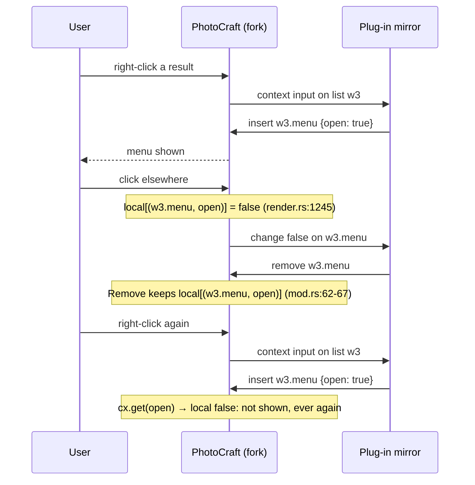

# Findings: a plug-in's right-click menu stops opening

## Problem

The report: sometimes, after generating or using the plug-in normally, the right-click menu stops working. Right-clicking a result in the history no longer opens upstream's context menu (Copy Prompt, Copy Seed, Save Image, Discard Image and so on). It isn't clear when it starts.

## Investigation

- **How a context menu reaches PhotoCraft.**
  - PhotoCraft sends a right-click on a list as a `context` input.
  - The list adapter emits upstream's `customContextMenuRequested` (`photocraft_host/qt_mirror/adapters/lists.py:195-208`).
  - Upstream builds a `QMenu` and calls `exec()` (`ai_diffusion/ui/generation.py:430-455`). The mirror replaces `exec` (`photocraft_host/qt_mirror/menus.py:49-56`) and adds a `popup` node with id `<list>.menu` and `open: true`, anchored to the list (`menus.py:119-133`, `mirror.py:316-320`).
  - Choosing an entry, or PhotoCraft reporting `change: false` for the popup, closes it, and the popup node goes from the tree (`mirror.py:322-326`).
- **What the plug-in sends.** A script drove that sequence against the mock host, with a `QListWidget` and a custom context menu: right-click, click elsewhere, right-click again. These are the patches it recorded:

  | Step | Patches |
  |---|---|
  | Right-click | `insert w3.menu {anchor: w3, open: true}` |
  | Click elsewhere (`change: false` on `w3.menu`) | `remove w3.menu` |
  | Right-click again | `insert w3.menu {anchor: w3, open: true}`: the same id |

  Both times upstream built its menu and called `exec()`.
- **What PhotoCraft does with them** (the fork):
  - `show_popup` reads `open` through `cx.get`, which prefers the tree's local value (`crates/ui-egui/src/process_plugin_ui/render.rs:1216-1219`).
  - A click outside the popup stores a local `open: false` and sends the change to the plug-in (`render.rs:1244-1246`).
  - Local values are cleared only by a `Set` of the same prop or a whole-tree `Replace`. A `Remove` takes the node out and leaves its local values in place (`crates/ui-egui/src/process_plugin_ui/mod.rs:41-67`).

## Root Cause(s)

**A local `open: false` outlives the popup it belonged to, and hides the next popup that reuses its id.** The cause is in the fork, in `Tree::apply` (`mod.rs:62-67`). The plug-in reusing the id (`menus.py:121`) makes it show up.

- **It starts the first time a context menu is dismissed by clicking elsewhere.** Choosing an entry doesn't trigger it: that path never stores a local `open`. From then on, that list's context menu never shows. Upstream still builds the menu each time, so nothing is logged.
- **It ends only when the whole panel tree is replaced,** which clears every local value. That's why it seems to come and go.
- **It isn't limited to the history list.** Every menu upstream opens with `exec()` is anchored by node id and has the same id each time:
  - the history's context menu (`generation.py:455`);
  - the Generate mode drop-down (`generation.py:977`);
  - the Custom Graph workspace's generate menu (`custom_workflow.py:919`);
  - the region link menu (`region.py:343`).

  Dialogs render through the same tree code, so a menu opened in one is affected too.

## Recommended Fix

Fix it in the fork, where the stale state lives, and make the plug-in robust as well:

1. **Fork:** when `Tree::apply` removes a node (`Patch::Remove`, and the subtree a `Replace` of a node drops), clear the local values of that node and its descendants. A node that comes back is then shown as the plug-in sends it. Add a test in `process_plugin_ui/tests.rs`: set a local `open: false` on a popup, remove it, re-insert it with `open: true`, and check that it shows.
2. **Plug-in:** give each popup the mirror opens a fresh id, for example `<anchor>.menu.<n>` with a counter. A new menu then never inherits an old one's state, even from a PhotoCraft without the fix. Its entries' ids follow the popup's (`menus.py:136-175`). Add a mirror test: open, close through `change: false`, reopen, and check that the second popup has a new id.
3. **Verify** in PhotoCraft: right-click a result, click elsewhere, then right-click again, both in the history and on the Generate mode drop-down.
