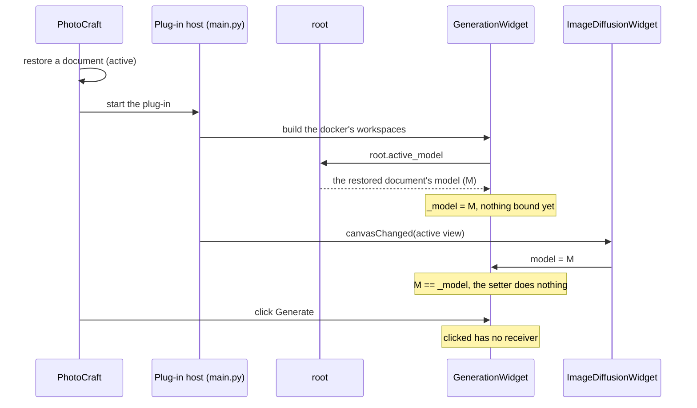

# Findings: the panel is dead in a document that was open when the plug-in started

## Problem

In the fork's PhotoCraft, PhotoCraft restored a recovered document at launch, before the plug-in started. In that document, clicking Generate in the AI Image Generation panel queued nothing and logged nothing. In a document created after the plug-in started, Generate worked at once.

This happens whenever a document is already open when the plug-in starts:
- a restored document;
- a file PhotoCraft was launched with;
- the plug-in being restarted from Preferences › Plug-ins with documents open.

## Investigation

- **Upstream's workspace widgets start from whatever model is active.** `GenerationWidget.__init__` sets `self._model = root.active_model` (`ai_diffusion/ui/generation.py:742`). Its `model` setter connects everything only `if self._model != model` (`:829-862`):
  - the Generate button's `clicked` → `model.generate` (`:852`);
  - the strength, style and workspace bindings;
  - the selection and layer signals;
  - the history, queue and progress bar.
- **`root.active_model`** is the active document's model, or the null model when there is none (`ai_diffusion/model/root.py:71-79`, `:107-110`).
- **The same start and guard appear in the other workspaces:**
  - `UpscaleWidget` (`ai_diffusion/ui/upscale.py:119`, `:218-219`);
  - `LiveWidget` (`ai_diffusion/ui/live.py:114`, `:246-247`);
  - `CustomWorkflowWidget` and `CustomWorkflowPlaceholder` (`ai_diffusion/ui/custom_workflow.py:702`, `:879-880`, `:1093`, `:1112-1113`);
  - `AnimationWidget` (`ai_diffusion/ui/animation.py:41`, `:131-132`), which PhotoCraft doesn't show.
- **The docker hands each workspace its model** in `ImageDiffusionWidget.update_content` (`ai_diffusion/ui/diffusion.py:327-354`). It runs on `canvasChanged`, a connection change or a workspace change.
- **In Krita**, dockers are built when the main window is, before any document is open. So every workspace starts with the null model, and the first real model it's given binds it.
- **In PhotoCraft**, the plug-in process starts after PhotoCraft, and builds the dockers in `photocraft_host/main.py:184-192`. If a document is already active then:
  1. every workspace starts with that document's model;
  2. `update_content` hands each the same model;
  3. the guard skips the binding.
- **Reproduced on the mock host** with a scratch script. Upstream's four PhotoCraft workspaces were built while a document was already open, then given its model as the docker does:

  | | Generate | Upscale | Live | Custom Graph |
  |---|---|---|---|---|
  | Bindings, document already open | 0 | 0 | 0 | 0 |
  | Bindings, document opened afterwards | 19 | 19 | 16 | 12 |

  With the document already open, emitting the Generate button's `clicked` didn't reach the model.
- **In PhotoCraft** (fork release build, isolated profile, local ComfyUI), clicks on Generate in the restored document did nothing, and nothing was logged. A document created with File › New worked at once.
- **Switching documents should bring it back, going by the code.** Once the docker has been handed another document's model, handing it the first one again passes the guard and binds it. This wasn't tried in PhotoCraft.

## Root Cause(s)

1. **The plug-in builds upstream's dockers with a document already active** (`photocraft_host/main.py:184-192`). Krita never does this.
2. **Upstream's workspace widgets bind their model only when it changes** (`generation.py:831`, `upscale.py:219`, `live.py:247`, `custom_workflow.py:880` and `:1113`, `animation.py:132`). They start with `root.active_model` (`generation.py:742` and the like), so a model that was active when they were built is never bound.

## Recommended Fix

Build the dockers as Krita does, before any document is active. In `photocraft_host/main.py`, the stand-in reports no active document while the dockers are being built, so every workspace starts with the null model. Then `canvasChanged` hands them the active document's model, and each binds it as in Krita. This needs no upstream change, and it covers every workspace at once, including any that upstream adds.

The alternative is to change upstream's widgets to start from the null model. That touches five upstream files and keeps them diverging from Krita AI Diffusion. Upstream doesn't hit this in Krita, so it isn't an upstream bug as such.

A regression test belongs in `tests/photocraft/`. It would start the host with a document already open, and check that a click on Generate reaches the model.
