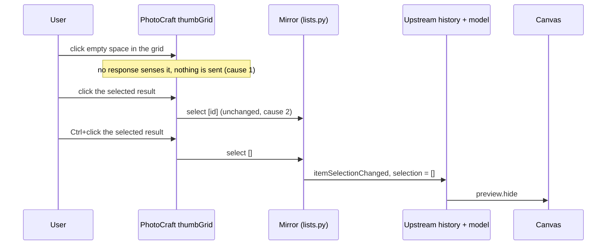

# Findings: a generated result can't be deselected by clicking the history's empty space

## Problem

In the Generate panel's history, the selected result can only be deselected by selecting another result. Clicking empty space in the thumbnail grid, away from any result or other component, should deselect it. With no result selected, its preview should leave the canvas.

## Investigation

- **Upstream, in Krita.** The history is a `QListWidget` in `ExtendedSelection` mode (`ai_diffusion/ui/generation.py:110`). A result is deselected in four ways:
  - **Clicking empty space in the list.** In this selection mode, Qt clears the selection when a press lands on no item.
  - **Clicking the selected result again.** Upstream's `mousePressEvent` does this (`generation.py:380-391`); in Qt it usually needs Ctrl+click.
  - **Ctrl+click.**
  - **Space.** It calls `JobQueue.toggle_selection` (`ai_diffusion/model/jobs.py:233-238`).
- **From selection to preview, in upstream code:**
  1. `itemSelectionChanged` runs `select_item` (`generation.py:114`, `:343-344`), which sets `jobs.selection`.
  2. `selection_changed` runs `Model.update_preview` (`ai_diffusion/model/model.py:186`, `:724-728`).
  3. With an empty selection, that calls `hide_preview`. In PhotoCraft, `hide_preview` calls `Document.hide_preview`, which sends `preview.hide` (`ai_diffusion/document.py:243-244`, `photocraft_host/krita/_document.py:783-784`).
- **The mirror handles an empty selection.** A scratch check called `ListWidgetAdapter._select` with `[]` on a list with one selected item (`photocraft_host/qt_mirror/adapters/lists.py:169-192`). The selection was cleared, and `itemSelectionChanged` fired once with nothing selected. So when PhotoCraft sends `select []`, upstream's chain above runs and the preview is hidden.
- **PhotoCraft never sends `select []` for a plain click.** The mirror sends the history as a `thumbGrid`, which the fork draws in `thumb_grid` (`crates/ui-egui/src/process_plugin_ui/render.rs:1156-1215`):
  - Each thumbnail and header gets its own click response, passed to `item_interaction` → `select` (`render.rs:1044-1046`, `:1009-1029`).
  - The grid's own area (`horizontal_wrapped`) is only checked for the pointer, to forward keys (`render.rs:1211-1213`). A click on it is never read.
- **What `select` sends** (`render.rs:1009-1029`):
  - A plain click sends `[id]`, even when that result is already the only one selected. So clicking the selected result again changes nothing. Upstream's `mousePressEvent` never runs: the mirror plays back a selection, not a mouse press.
  - Ctrl+click (⌘ on macOS) removes the result from the selection, so a Ctrl+click on the only selected result sends `[]`. This, and Space, deselect today, going by the code. Neither was tried in PhotoCraft.

## Root Cause(s)

1. **The fork's thumbnail grid ignores clicks on its empty space** (`render.rs:1162-1213`). Only the items sense clicks, so a click between or after them sends nothing. Qt's `ExtendedSelection` list would clear the selection.
2. **A plain click on the selected result keeps it selected** (`render.rs:1024-1028`). Upstream deselects it in `mousePressEvent`, which the mirror can't play back: PhotoCraft sends the resulting selection, `[id]`, not the press.

The preview isn't a separate fault. It follows the selection through upstream's own code, and leaves the canvas whenever the selection becomes empty.

## Recommended Fix

In the fork's `thumb_grid`, sense a click on the grid's own area. When it lands on no item or other component and something is selected, send `select []`. The plug-in needs no change for this. Doing the same for `list` grids (`fn grid`) would match Qt's behaviour wherever a plug-in list allows multiple selection.

Open question for the plan: should a plain click on the selected result deselect it too, as in Krita (cause 2)? Two options:
- The plug-in marks the list with a prop such as `clickDeselects`, and `select` sends `[]` for a plain click on the only selected item.
- Leave it as Qt's default, where only Ctrl+click toggles.

The user's report asks only for empty space.
