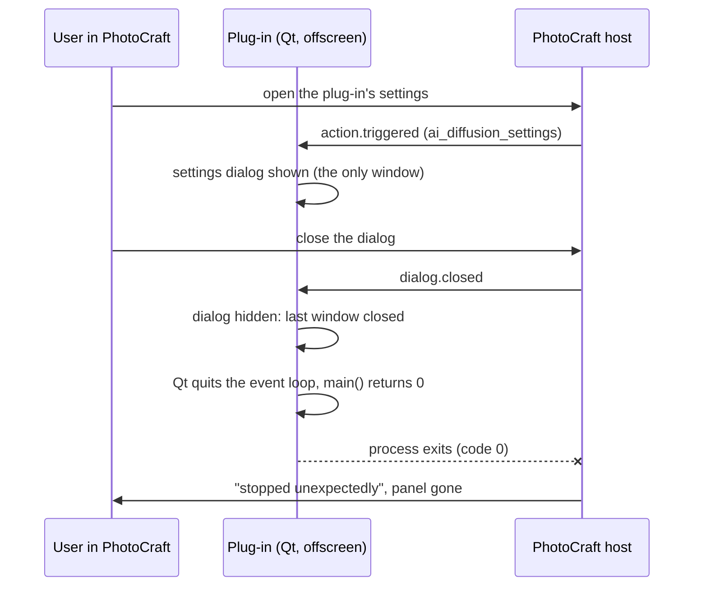

# Findings: the plug-in stops when its settings dialog is closed

## Problem

In the real PhotoCraft (the fork's `feat/process-plugins`), opening the plug-in's settings dialog and closing it stops the plug-in. Its panel disappears, and it comes back only after a restart from Preferences › Plug-ins. PhotoCraft's log says "stopped unexpectedly: the plug-in exited with code 0", three times in one session. The plug-in's own log has no error.

## Investigation

- **Exit code 0** means the process ended normally: the plug-in's `main()` returned. It returns when `app.exec()` does (`photocraft_host/main.py`), which happens on `app.quit()` (PhotoCraft's `shutdown`, or the connection closing; neither happened here) or when Qt ends the event loop by itself.
- **Qt's default.** `QApplication.quitOnLastWindowClosed()` is `True`: the event loop ends when the last visible top-level window closes. In the plug-in process, nothing but dialogs is ever shown as a window. The docker content is mirrored, never shown. So the settings dialog is the last window, and closing it ends `app.exec()`.
- **Reproduced in 15 lines.** On the offscreen platform, a `QApplication` with an unshown widget showed a `QDialog` and then closed it.
  - By default, `exec()` returned as soon as the dialog closed.
  - With `setQuitOnLastWindowClosed(False)`, the loop kept running.
- **Why the tests didn't see it.** The dialog tests (`test_qt_mirror*.py`, `upstream_settings.py`) open and close dialogs but drive Qt with `processEvents()`, never `app.exec()`, so nothing can end. The process test (`test_transport.py`) runs the real event loop but never opens a dialog.

## Root Cause(s)

`photocraft_host/main.py` creates the `QApplication` and runs `app.exec()` with Qt's default `quitOnLastWindowClosed = True`. In a GUI application that default makes sense; in the plug-in process, where no window but a dialog is ever shown, closing any dialog ends the process. That includes the settings dialog and any message box or error dialog upstream shows.

PhotoCraft treats any exit it didn't ask for as stopped and doesn't restart the plug-in on its own. That behaviour is the host's (the fork) and isn't part of this cause.

## Recommended Fix

- Call `app.setQuitOnLastWindowClosed(False)` right after creating the `QApplication` in `photocraft_host/main.py`. The plug-in already ends when PhotoCraft says `shutdown` or the connection closes.
- Add a process-level regression test. Start the plug-in as PhotoCraft does, open the settings dialog through `action.triggered`, close it with `dialog.closed`, then `ping`: the plug-in answers and is still running. Without the fix, it exits.
- Re-check in the real PhotoCraft: open and close the settings dialog a few times, then generate.
