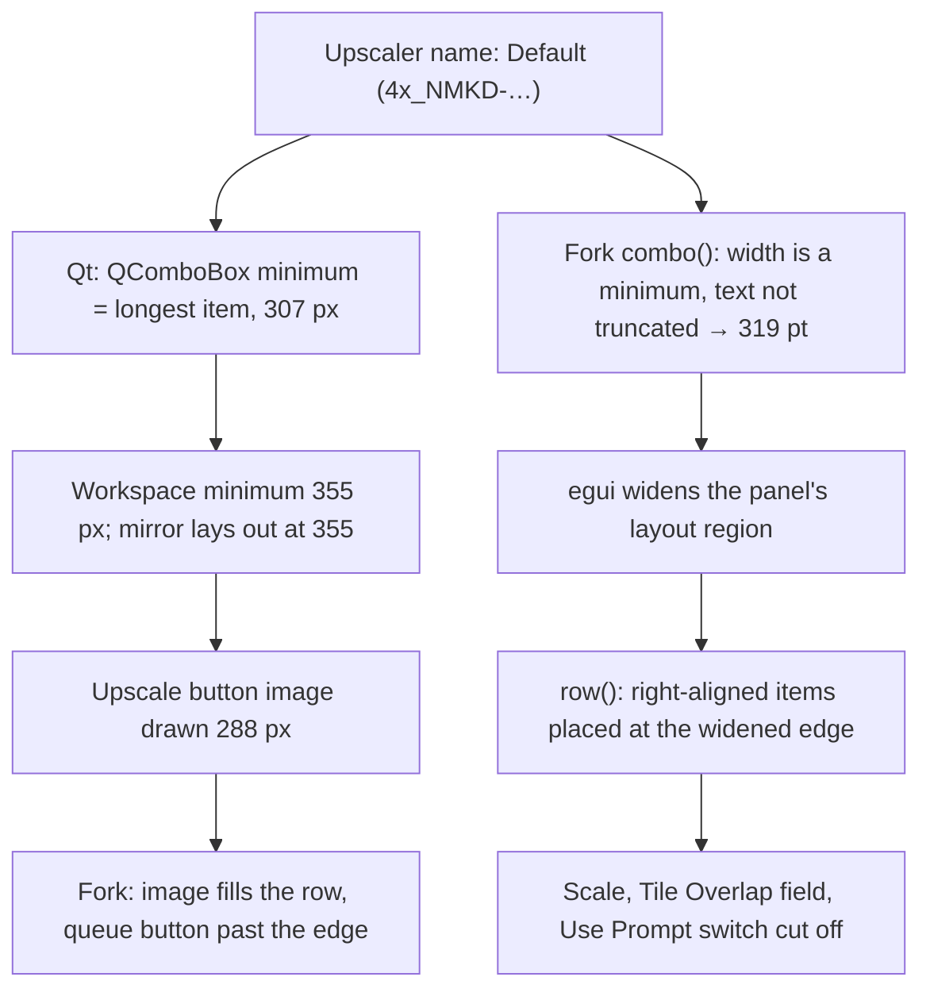

# Findings: the Upscale workspace runs past the panel's edge

## Problem

In the fork's PhotoCraft, at the dock's default width, the AI Image Generation panel's Upscale workspace ran past the dock's right edge. These were cut off at the edge:
- the Scale field (`Scale: 1.00x`) after the factor slider;
- the Tile Overlap number field;
- the Use Prompt switch.

The upscaler drop-down was cut off too: it showed `Default (4x_NMKD-Superscale-SP_178000_G…`. The Generate workspace's rows fit, after `spec/generate-panel-rows-fit`.

## Investigation

- **The rows in upstream** (`ai_diffusion/ui/upscale.py:123-206`):
  - the workspace button and the upscaler drop-down (`model_select`);
  - `FactorWidget`: a slider, then the Scale spin box;
  - the Refine group: style, Strength, Image guidance, Tile Overlap (label, combo, spin box) and Use Prompt (label, prompt text, warning, "Off", switch);
  - the Upscale button (self-drawn, sent as an image) and the queue button.
- **The upscaler names** come from the server (`upscale.py:250-272`). The default is listed as `Default (<file name>)`, here `Default (4x_NMKD-Superscale-SP_178000_G)`.
- **Qt's layout, from the mirror on the mock host.** A scratch script built upstream's `UpscaleWidget` and sent a `panel.resized` of 284 points. It used the system fonts the real plug-in gives Qt's offscreen platform (`photocraft_host/qt_setup.py`). Without them, label widths come out about twice as wide.

  | Upscaler name | Qt's minimum width | Laid out at | Upscale button image |
  |---|---|---|---|
  | `Default` | 255 px | 284 px | 217 px |
  | The long default name | 355 px | 355 px | 288 px |

  - A `QComboBox` defaults to `AdjustToContentsOnFirstShow`, so its minimum width is its longest item: 307 px for the long name. That alone sets the workspace's minimum.
  - The mirror lays a panel out at PhotoCraft's width, or at Qt's minimum when that's wider (`photocraft_host/qt_mirror/mirror.py`, from `generate-panel-rows-fit`). So every self-drawn widget is drawn for 355 px.
- **The fork's drawing.** A temporary test, since removed, drew the captured trees in a vertical scroll area 300 points wide, like a panel's body. With the long name:
  - **The upscaler drop-down** was 319 points wide, ending at 357.
  - **Everything after it that sits at a row's right edge ended at that same point:** the Scale field at 357, the Tile Overlap field at 350, the Use Prompt switch (Off at 306), and the queue button at 315.
  - **With the short name,** everything fit.
- **Why one drop-down moves the other rows:**
  - The fork's `combo()` asks for a width of at most 220 points (`crates/ui-egui/src/process_plugin_ui/render.rs:748`). In craft-ui's `ComboBox`, though, `width` is a minimum (`craft-ui crates/ui/src/combo.rs:285`). The selected text follows the `Ui`'s wrap mode, which in a horizontal row extends, so the button is as wide as its text.
  - egui then widens the panel's layout region to fit it.
  - `row()` places the items after a row's last growing child from the region's right edge (`render.rs:279-342`). So those items land at the widened edge, past the visible panel.
- **Both causes were confirmed with temporary changes:**
  - **The fork's `combo()` with `.truncate()`:** the drop-down was cut to 252 points, and the Scale, Tile Overlap and Use Prompt rows fit. The queue button still ended at 311 of 300, after the 288 px Upscale image laid out for 355 px.
  - **Also, in Qt, the drop-down's minimum set to a contents length of 8** (`AdjustToMinimumContentsLengthWithIcon`): Qt's minimum dropped to 284, the Upscale image to 217 px, and everything fit.
- **In Krita** the same 355 px minimum holds, but a docker can't be made narrower than its widget's minimum, so the rows never run past it. PhotoCraft's dock doesn't follow a plug-in's minimum.

## Root Cause(s)

1. **The fork's drop-down grows to its selected text** (`render.rs:748-750`). `.width(...)` is only a minimum in craft-ui's `ComboBox`, and the text isn't truncated. A long selection makes the drop-down wider than the panel. egui widens the panel's layout to it, and every right-aligned item in the rows after it (`row()`, `render.rs:301-304`) goes past the visible edge.
2. **Qt's minimum for the workspace is set by the longest upscaler name.** `QComboBox`'s default size policy makes its minimum width its longest item (307 px). The mirror lays the panel out at that minimum when it's wider than PhotoCraft's panel, so the self-drawn Upscale button is drawn 288 px wide. In the fork, the image then takes the row's width and pushes the queue button past the edge, as the Generate button did before `generate-panel-rows-fit`.

## Recommended Fix

1. **Fork:** `combo()` truncates its selected text, using craft-ui's `.truncate()`, so a drop-down never runs wider than the width it's given. The full text stays in the list and in the drop-down's accessible label. A tooltip with the full selection would help, since it no longer shows in full. This covers every plug-in drop-down, in panels and dialogs.
2. **Plug-in (mirror):** for a mirrored panel, the mirror gives each `QComboBox` a minimum based on a short contents length rather than its longest item. That way a long item can't widen the Qt layout the self-drawn widgets are drawn for. PhotoCraft draws drop-downs itself, so this changes only the layout the plug-in computes, not what the user sees. It belongs in the mirror rather than upstream's `upscale.py`, so it also covers other drop-downs with long items.
   - **Something to settle in the plan:** whether to leave dialogs out. They open at Qt's size hint, and the hint shrinks under this policy too.

## Also seen, not investigated

The "Target size: 2048 x 2048" line under the factor slider showed all the time in PhotoCraft. Upstream shows it only while the slider is held or the pointer is over the factor widget (`upscale.py:94-100`). It looks unrelated to the overflow.
