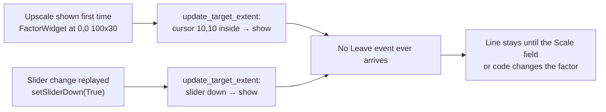

# Findings: Upscale's "Target size" line always shows in PhotoCraft

## Problem
In the fork's PhotoCraft, the Upscale workspace shows a grey "Target size: 2048 x 2048" line under the Scale slider all the time. Krita AI Diffusion shows it only while the slider is held or the pointer is over the scale row (`FactorWidget`), and clears it when the pointer leaves.

## Investigation
- Read upstream's `FactorWidget` (`ai_diffusion/ui/upscale.py:36-110`), the mirror's slider adapter, and the fork's plug-in input kinds.
- Reproduced it against the mock PhotoCraft (`photocraft_host.main.start`, a 1024×1024 document, offscreen Qt), reading the label's text at each step:

  | Step | Label |
  |---|---|
  | Start, Generate workspace | empty |
  | Switch to Upscale | `Target size: 2048 x 2048` |
  | Model factor set to 3.0 from code | empty |
  | Slider moved through the mirror (`change`, 250) | `Target size: 2560 x 2560` |
  | Scale field changed through the mirror (`change`, 1.5) | empty |

- The workspace snapshot (`tests/photocraft/fixtures/mirror/upscaling.json`) has the label empty, because it builds `UpscaleWidget` on its own, already laid out. So no test saw this.

## Root Cause(s)
Upstream decides whether to show the line in `FactorWidget.update_target_extent` (`ai_diffusion/ui/upscale.py:94-100`): it shows the size if `slider.isSliderDown()` or the widget's rectangle contains `QCursor.pos()`, and clears it otherwise. Its `enterEvent` and `leaveEvent` run that check again. In PhotoCraft:

1. **Qt's cursor sits inside the not-yet-laid-out page.** On the offscreen platform, `QCursor.pos()` is (10, 10) and never moves. Before Upscale is first shown, `FactorWidget` is at (0, 0) with Qt's default 100×30 size, so it contains (10, 10). The model's factor is applied to it then, and the check finds "the pointer is over it".
2. **A slider change is replayed with the slider held down.** `SliderAdapter.apply` (`photocraft_host/qt_mirror/adapters/inputs.py:93-99`) calls `setSliderDown(True)`, moves the slider, then `setSliderDown(False)`. The value changes while the slider is down, so the line is shown. Releasing the slider runs no check again; in Krita the pointer's later `leaveEvent` clears it. PhotoCraft sends a `change` on every step of a drag (`crates/ui-egui/src/process_plugin_ui/render.rs:823-824`), so any drag leaves it shown.
3. **Nothing ever clears it.** The fork's protocol has no hover or pointer-leave input for ordinary widgets (`InputKind` in `crates/process-plugin-protocol/src/event.rs:111-134`; `Pointer` is only for image widgets). The mirror never sends Qt `Enter` or `Leave` events, so the `leaveEvent` that would clear the line never runs.

The same gap affects upstream's `GenerateButton` (`ai_diffusion/ui/widget.py:963-968`), whose cost estimate is shown on hover. That only matters for the online service, which this project doesn't ship.

## Recommended Fix
Two directions:
- **Plug-in only: never show it.** Park Qt's offscreen cursor outside every window when the mirror starts. After replaying a slider change, send the slider's ancestors a `Leave` so they check again. The line then never shows, because nothing in PhotoCraft can tell the plug-in about the pointer. That matches Krita when the pointer isn't over the row, but the target size is no longer available anywhere.
- **Fork and plug-in: forward hover.** Add a `hover` input (`value`: whether the pointer is over the node) to the protocol. PhotoCraft sends it only for nodes the plug-in marks as hover-aware. The mirror marks widgets that override `enterEvent`/`leaveEvent` or set `WA_Hover`. On `hover`, it moves Qt's cursor into or out of the widget and sends `Enter`/`Leave`. A slider drag in PhotoCraft happens with the pointer over the row, so it shows the line during the drag and clears it when the pointer leaves, as in Krita. It also needs the cursor parked at start, for cause 1.
