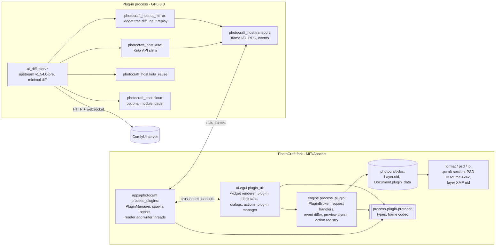
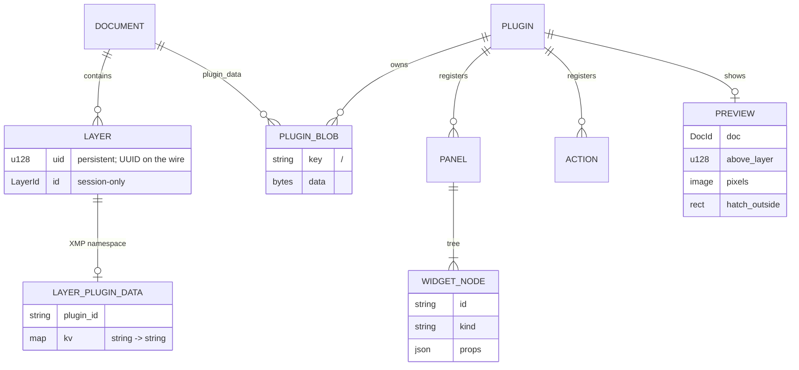

# AI Diffusion for PhotoCraft Design

## Summary

PhotoCraft gains a **process plug-in host**. It launches plug-in programs, talks to them over stdio frames, and exposes four things through a versioned request/response/event protocol:

- the document model: layers, pixels, selection, vector shapes and stored data;
- a transient preview layer;
- runtime actions;
- panels, drawn natively by PhotoCraft from widget trees the plug-in sends.

**AI Diffusion for PhotoCraft** is one such plug-in: Krita AI Diffusion's Python, almost unchanged, running on headless PyQt6. Three new adapter packages sit around that untouched core:

- a `krita` shim that implements the Krita API over the protocol;
- a Qt mirror that sends Krita AI Diffusion's real widget tree to PhotoCraft and plays user input back into it;
- a Krita AI Diffusion reuse module.

Everything AI-specific lives in the plug-in, and the host is generic. Both repositories follow [tech.md](tech.md).

The Animation workspace, the Graph workspace's Generate Animation mode, and live-painting recording are **deferred** until PhotoCraft has a Frame Animation panel (REQ-26), and so is all host timeline access (REQ-9).

## Architecture

### Host components (PhotoCraft fork)

1. **`process-plugin-protocol` crate (L0)**:
   - `Frame { header: Header, payload: Bytes }`, `encode`/`decode` with size limits, and `PROTOCOL_VERSION`;
   - `Header` is `Request { id, method, params }`, `Response { id, result | error }` or `Event { topic, data }`;
   - typed parameter and result structs for every method (see Interfaces);
   - the widget-tree types `Node`, `Patch` and `InputEvent`;
   - compiles for wasm and does no I/O.
2. **`PluginManager` (`apps/photocraft/src/process_plugins.rs`)**:
   - discovers manifests;
   - spawns enabled plug-ins with piped stdio and the environment `PHOTOCRAFT_PLUGIN_NONCE`, `PHOTOCRAFT_PLUGIN_DATA_DIR`, `PHOTOCRAFT_PLUGIN_LOG_DIR` and `PHOTOCRAFT_LOCALE`;
   - runs one reader thread and one writer thread per plug-in;
   - checks the `hello` frame, the nonce and the protocol version;
   - enforces request deadlines and a heartbeat;
   - handles restart, disable, remove and shutdown;
   - copies stderr to `<log dir>/<plugin-id>.log`, rotated;
   - reaches the UI through `Services::process_plugins` (native only; `None` on wasm).
3. **`PluginBroker` (`crates/engine/src/process_plugin/`)**:
   - lives in `Session`;
   - serves document requests (`doc.*`, `layer.*`, `pixels.*`, `selection.*`, `blob.*`, `layerData.*`, `vector.*`, `preview.*`);
   - keeps the action registry and progress records;
   - runs the **event differ**: once per frame it compares each open document's state with the last snapshot it sent (see "Change detection");
   - applies every mutation through `Session::edit` with the plug-in's label, and opens and closes an undo group on `undo.begin`/`undo.end`;
   - exposes `Session` operations only, with no threads, so `panic_hunt` can fuzz it as a command surface.
4. **`plugin_ui` (`crates/ui-egui/src/plugin_ui/`)**:
   - `PanelStore` keeps the widget tree for each plug-in panel, with patch application and an image cache;
   - `render.rs` draws a node tree with craft-ui/egui widgets and the theme tokens;
   - `input.rs` turns egui responses into `InputEvent`s;
   - `dialogs.rs` handles plug-in modal and modeless windows, message boxes and pickers;
   - `actions.rs` adds a dynamic "Plug-ins" menu, palette entries and Keyboard Shortcuts rows;
   - `manager.rs` adds an Edit › Preferences › Plug-ins page (process plug-ins listed next to the WASM ones);
   - a **plug-in dock group**: one new `dock::Group::Plugins` whose tabs are generated at run time from the open plug-in panels. It's the only edit to the static dock tables.
5. **Document model additions**:
   - `Layer.uid: u128`, a persistent id (see the decision below);
   - `Document.plugin_data: BTreeMap<String, Arc<Vec<u8>>>`;
   - transient previews are **not** part of `Document`. They live in `PluginBroker` and are composited through the existing `display_memo` preview path.

### Plug-in components (this repository)

1. **`photocraft_host.transport`**:
   - frame codec;
   - a reader thread that posts frames to the Qt thread through a queued signal;
   - `call(method, params, payload=None, timeout=…)`, which blocks the Qt thread on a `threading.Event` with a deadline while the reader thread fills in the reply, and does not re-enter the event loop;
   - an `on(topic, handler)` event bus;
   - descriptor setup: the original fd 1 is duplicated for frames and fd 1 is then pointed at stderr.
2. **`photocraft_host.krita`**: the shim package, imported as `krita`. Its classes are `Krita`, `Document`, `Node`, `VectorLayer`, `Shape`, `Selection`, `Window`, `View`, `Canvas`, `Action`, `Notifier`, `Extension`, `DockWidget`, `DockWidgetFactory`, `DockWidgetFactoryBase`, `DoubleSliderSpinBox` and the other symbols inventory §5 lists.
   - Each document holds a **local mirror** of its layer tree and properties, kept current by `layers.changed`, `document.*` and `selection.changed` events.
   - Reads come from the cache. Pixel and selection reads, and all writes, are RPCs.
   - `Notifier` signals come from host events.
3. **`photocraft_host.qt_mirror`**:
   - `Mirror(root_widget, panel_id)` walks the widget tree;
   - `adapters/` holds one adapter per Qt class (props out, input in);
   - `tracker.py` is an event filter plus a dirty set, flushed every 16 ms into one `panel.patch`;
   - `raster.py` is the image fallback;
   - `dialogs.py` patches `QMessageBox`/`QFileDialog`/`QInputDialog` static calls and `exec()` to use host dialogs;
   - `menus.py` maps `QMenu`/`QAction` to host menus.
4. **`photocraft_host.krita_reuse`**: detection, the reuse modes, settings import, and the guard on installs that Krita AI Diffusion manages (REQ-31).
5. **`photocraft_host.cloud`**: loads `ai_diffusion_cloud` if the flag is on and the module is importable. Otherwise it provides a `CloudUnavailable` stub (REQ-32).
6. **`photocraft_host.main`** (entry point):
   1. set up stdio and logging;
   2. create `QApplication` under `offscreen`;
   3. add the shim to `sys.path`;
   4. connect, send `hello`, and receive `welcome` (host version, locale, data folders);
   5. import `ai_diffusion` and run its `Extension.setup()` and `createActions()`, which register actions and the docker through the shim;
   6. mirror the docker into a host panel;
   7. hand control to `QApplication.exec()`.
7. **Upstream diff** (REQ-38.0.3), kept in `UPSTREAM-CHANGES.md`. Only these upstream files are expected to change:

   | File | Change |
   |---|---|
   | `ai_diffusion/__init__.py` | Accept the PhotoCraft host in the version check |
   | `ai_diffusion/util.py` | `user_data_dir` comes from the host |
   | `ai_diffusion/settings.py` | Cloud-only keys gated; `last_news` dropped; language default |
   | `ai_diffusion/backend/server.py` | `extra_model_paths.yaml` section name; default path; guard on Krita-managed installs |
   | `ai_diffusion/model/updates.py` | Update source |
   | `ai_diffusion/backend/cloud_client.py` | Behind the cloud loader |
   | `ai_diffusion/ui/settings.py`, `ai_diffusion/ui/server.py` | Cloud widgets gated; Krita reuse section added |
   | `ai_diffusion/presets/models.json` | License fields |
   | `ai_diffusion/document.py` | Bit-depth check relaxed |
   | `ai_diffusion/localization.py` | Default to the host locale |
   | `ai_diffusion/persistence.py` | `JobParams.from_dict` enum fix |
   | `ai_diffusion/ui/widget.py`, `ai_diffusion/ui/actions.py`, `ai_diffusion/ui/custom_workflow.py`, `ai_diffusion/ui/live.py` | Hide the Animation workspace, skip it in Toggle Workspace, hide Generate Animation, and hide the Live Record button, all behind one `ANIMATION_ENABLED = False` switch (REQ-26 deferral) |

   Everything else stays as upstream has it.

## Key design decisions

### D1. Persistent layer ids as a new `Layer.uid` field

**What:** `photocraft-doc` gains `Layer.uid: u128`. It's assigned randomly when a layer is created (including by duplication, which gets a new uid). The protocol exposes it as a UUID string.
- **.pcraft**: stored natively, with the format version bumped.
- **PSD, PSB, TIFF**: written into the layer's XMP under the process-plug-in namespace and read back on load.
- **Older files**: layers loaded from a file without a uid get a fresh one on load.

**Why:** `LayerId` comes from a per-process counter, so it isn't stable across reloads. `psd_id` exists only for PSD round trips. Krita AI Diffusion keeps region and control links as `uniqueId()` UUIDs, so REQ-2.0.2 and REQ-33 need a uid that survives save and reload in every format.

**Alternatives:**
- *Write a uid into layer XMP only when a plug-in first asks for it*: that changes the document on read, can make an undo step, and leaves most layers without an id.
- *Use `psd_id`*: new layers don't have one until the first PSD save.

### D2. Animation and timeline access deferred

**What:** The host exposes no timeline methods in this release. In the shim:
- `Node.animated()` and `hasKeyframeAtTime()` return `False`;
- `Document.currentTime()` and the playback range return `0`;
- `Document.importAnimation()` raises `NotImplementedError`, which is never reached because every caller is hidden behind `ANIMATION_ENABLED = False`.

The callers are the Animation workspace, Generate Animation and the Live Record button.

**Later (REQ-26, REQ-9):** PhotoCraft animation is the timeline plus video layers holding `frames: Vec<Surface>` ([host analysis §2](../../analysis/ai-diffusion-for-photocraft/reference/photocraft-host-analysis.md)). The plan:
- `timeline.info` and `timeline.importFrames` would create video layers from frames, filling held frames by sharing surfaces.
- A frame *t* would count as a keyframe if *t = 0* or `frames[t]` doesn't share all its copy-on-write tiles with `frames[t-1]`.
- Per-frame reads and writes and `frame.changed` events would follow.
- If PhotoCraft adds a Frame Animation panel (frames as sets of layer visibilities), it becomes a second source behind the same methods.

**Why:** PhotoCraft's timeline is about 30% built (`docs/target-app-parity.md:182`), with no Photoshop-style property keyframes and no Frame Animation panel. Building on it now would probably mean redoing the work.

**Alternatives:** *Keeping frame import for live recording only*: considered and declined. It was deferred so all animation output waits for PhotoCraft's own animation model.

### D3. Pose content as a group of shape layers

**What:**
- **Creating a pose layer**: `vector.createFromSvg` parses the SVG with `usvg`. It creates a group marked in layer data as `vectorGroup`, and inside it one shape layer per `<circle>` (an ellipse) or `<line>` (a stroked line), with the stroke colour, width and opacity from the SVG.
- **Element ids**: each shape layer's SVG `id` (for example `P00_J03`) is stored in its layer data.
- **Reading back**: `vector.shapes(group)` returns the elements as SVG fragments with their current geometry, taken from each shape's path and the layer's offset.
- **User editing**: the user moves joints with the existing Move and Path Selection tools, and duplicates them with Duplicate Layer. A duplicate keeps the element id, and the shim treats a repeated id as a new person, which is Krita AI Diffusion's own rule.
- **Mapping into Krita AI Diffusion**: the shim's `VectorLayer` maps to such a group, and `Shape` maps to a child.

**Why:** It works with PhotoCraft's existing tools and file formats with no new layer kind (REQ-10, REQ-20). Shape layers round-trip in PSD (116/116 parity).

**Alternatives:** *A new multi-element vector layer kind*. It'd be cleaner in the Layers panel, but needs new rendering, editing tools, PSD mapping and format work. The pose group is shown collapsed, with its name, so the extra layers stay tidy.

### D4. Transient preview outside the document

**What:** `preview.show {doc, above_layer?, image, offset, hatch_outside?: rect}` stores a preview in `PluginBroker`, never in `Document`. The canvas compositor takes it in through the same `display_memo` swap that filter previews use:
- a temporary `Arc<Document>` with a locked raster layer inserted;
- the Layers panel shows a synthetic locked row, and a click on it is refused;
- `pixels.read` composites leave it out unless `includePreview` is set.

`preview.hide` or a document switch drops it.

**Why:** Undo history and saved files stay clean (REQ-7). It reuses an existing rendering path.

**Alternatives:** *A real locked layer, as Krita does*. It pollutes undo and gets saved, so it was rejected under REQ-7.1.

### D5. Change detection by differencing per frame

**What:**
- **Snapshots**: once per UI frame, `PluginBroker` compares each open document's `(revision, layer-tree digest, selection generation, active layer, active doc)` with the snapshot it last sent.
- **Layer-tree digest**: a hash over (uid, parent, order, name, kind, visibility, lock, opacity, blend, bounds).
- **Pixel events**: carry the uids of layers whose content `Arc` changed, plus the union of their dirty bounds when the engine reports damage.
- **Throttling**: events are coalesced into one per kind per frame (REQ-4.0.2).
- **Origin**: events caused by the plug-in's own requests carry `origin: <plugin-id>` (REQ-4.3).

**Why:** It needs no hooks in the ~700 command implementations. It costs O(open docs × layers) hashing per frame, which is fine for document sizes users actually work with. Copy-on-write `Arc` identity makes the content check O(1) per layer.

**Alternatives:** *Emitting events from inside every command*: invasive across hundreds of files, so it was rejected under REQ-12.0.3.

### D6. Widget trees as declarative patches, not remote procedure calls

**What:** A panel is a tree of `Node { id, kind, props, children }`.
- The plug-in sends full trees once, then `panel.patch` with `Set{id, props}`, `Insert{parent, index, node}`, `Remove{id}` and `Move{id, parent, index}`.
- The host renders from its local copy every frame and sends `InputEvent`s back.
- The plug-in never waits on the host to render, and the host never waits on the plug-in (REQ-5.0.5).
- After an input event, the host shows the optimistic local state (a slider follows the drag, typed text appears) until the plug-in's patch confirms or corrects it.

**Why:** It keeps the 60 fps UI independent of Python latency (REQ-5.3, 5.5), and patches are small.

**Alternatives:** *An immediate-mode remote UI that redraws each frame over IPC*: too chatty, and it freezes with the plug-in. *Rasterizing the whole panel*: it wouldn't look native, so it's kept only as the per-widget fallback.

### D7. Qt mirror flushes on a timer, with the image fallback for widgets that draw themselves

**What:**
- **Tracking**: the event filter marks widgets dirty on `Show`/`Hide`/`EnabledChange`/`FontChange`/`LayoutRequest`/`Resize`, and adapters connect to value signals (`textChanged`, `valueChanged`, `currentIndexChanged`, `toggled`).
- **Flushing**: a 16 ms `QTimer` flushes the dirty set into a single patch.
- **Layout**: QLayouts become `row`/`column`/`grid`/`form` containers, with stretch and spacing taken from the layout. Size policies become `grow` hints. Exact pixel geometry isn't sent: the host lays out natively.
- **Image fallback**: widgets that override `paintEvent` without an adapter go through `raster.py`. They're re-rendered with `grab()` when marked dirty and sent as image nodes. Pointer and key input is sent back with `QCoreApplication.sendEvent` at widget-local coordinates.
- **Docker**: the `DockWidget`'s `widget()` becomes the panel root.
- **Dialogs**: the settings dialog (`QDialog`) is mirrored into a host dialog window.

**Why:** Upstream's UI runs unchanged (REQ-38.0.3) and PhotoCraft draws it natively (REQ-5.0.5).

**Alternatives:** Mirroring exact geometry would look pixel-identical to Qt, but foreign inside PhotoCraft. It was rejected in favour of native layout.

### D8. Blocking RPC from the Qt thread for Krita-style synchronous calls

**What:** Shim methods that Krita implements synchronously block the Qt thread in `transport.call`, with a deadline of 10 s for pixel calls and 2 s otherwise. The host handles requests within its frame loop, at about 16 ms latency. Pixel reads and writes for a generation are batched by upstream's own structure: one call per layer.

**Why:** It keeps upstream's call sites unchanged.

**Alternatives:** *Converting upstream to async calls*: a huge diff.

**Risk:** a slow host frame stalls the plug-in. That's acceptable, since the UI thread never waits the other way.

### D9. Settings and data folder separation

**What:** The plug-in data folder is `<PhotoCraft config>/process-plugins-data/io.github.coreyx.ai-diffusion-for-photocraft/`, supplied by the host. Upstream's `user_data_dir` is set to it, so `settings.json`, `styles/`, `presets/`, `workflows/`, `tags/`, `database/`, `logs/` and `server/` all live there, separately from Krita AI Diffusion's (REQ-13.0.3, REQ-28).

### D10. Krita AI Diffusion reuse is recorded as provenance, not a separate mode

**What:** Reuse writes ordinary settings and adds one extra key, `photocraft_reuse: {source_settings, mode: "same_server", detected_version}`:
- **custom mode**: `server_mode = external` with the same `server_url`;
- **managed mode**: `server_mode = managed` with `server_path` pointing at Krita AI Diffusion's install.

Upstream's managed-server code launches it unchanged. When `server_path` belongs to a Krita AI Diffusion install (its `.version` exists, and the path sits under a detected Krita AI Diffusion data folder), the guard disables Upgrade, Re-install and Delete. Switching to any other server clears `photocraft_reuse` (REQ-31.0.11).

**Why:** Reuse is just a configuration, so all of REQ-29 and REQ-30's behavior applies unchanged, and nothing is locked in.

**Alternatives:** *A separate "reuse" server mode*: more code paths and harder to switch away from.

### D11. Cloud boundary is an import seam

**What:** The `ServerMode.cloud` enum value stays, because upstream code references it, but the flag off or the module missing means:
- the UI adapters hide every widget tagged `cloud` (tags set where `ui/settings.py` builds them);
- `settings.py` maps a loaded `cloud` to `undefined`;
- `cloud_client.py` raises `CloudUnavailable` when it's imported without the module.

Packaging leaves out `ai_diffusion_cloud`. A build check fails if the string `interstice` appears in the package (REQ-32.3).

### D12. Graph-parity fixtures from unmodified upstream

**What:** `scripts/capture_parity.py` checks out `v1.54.0-pre` into a temporary worktree and runs upstream's own test environment: its mock Krita and `workflow.create`. It builds ComfyUI prompts for a fixture matrix of workflow kinds × architectures × inpaint modes × region and control sets, with stub model and resource tables taken from upstream test fixtures. The output is written to `tests/photocraft/fixtures/graphs/*.json`. Our parity tests build the same inputs through the shim and the mock host, and compare the graphs after normalising node ids (REQ-39.0.5).

## Data model

**Storage formats:**
- **`.pcraft`**: a new `plugin_data` section (a list of key/bytes entries), and `uid` in each layer record. The format version is bumped, and an older reader refuses the newer file, as `photocraft-format` already does for version bumps.
- **PSD/PSB**: image resource **4242**, named "PhotoCraft plug-in data", holding a container of `u32 count` followed by repeated `(u16 keyLen, key UTF-8, u64 len, bytes)` entries. The layer `uid` and per-layer plug-in data go in layer XMP, under `xmlns:pcpp="https://photocraft.invalid/ns/process-plugin/1.0/"` as `pcpp:uid` and `pcpp:data/<plugin-id>/<key>`.
- **Krita AI Diffusion's own blobs**, which mirror its `.kra` annotations ([APP-012]): `<plugin-id>/document_id`, `<plugin-id>/ui.json` and `<plugin-id>/result<N>.webp`, written through the shim's `Document.setAnnotation`.

**Plug-in-side files** (unchanged upstream formats, in the plug-in data folder):
- `settings.json` (adds the `photocraft_reuse` key);
- `styles/**/*.json`;
- `presets/samplers.json`, `presets/control.json`;
- `workflows/*.json`;
- `tags/*.csv`;
- `database/loras.json`;
- `logs/`;
- `server/`.

## Interfaces

### Frames and session

| Step | Direction | Message |
|---|---|---|
| 1 | plug-in → host | `hello {protocol: 1, nonce, plugin: {id, version}}` |
| 2 | host → plug-in | `welcome {hostVersion, protocol: 1, locale, dataDir, logDir, theme: {dark}}` or `error{unsupported}` and close |
| 3 | both | Requests `{id, method, params}`, responses `{id, result}` / `{id, error: {code, message}}`, events `{topic, data}` |
| keep-alive | host → plug-in | `ping` every 5 s. A plug-in that misses 3 is marked "not responding" (REQ-5.3) |
| shutdown | host → plug-in | `shutdown`, then the process is killed after 5 s (REQ-1.0.5) |

### Host methods (plug-in → host)

Every method below `doc.list` takes `doc` (a document id string) unless noted.

| Area | Method | Params → Result |
|---|---|---|
| Documents | `doc.list` | → `[{doc, name, path?, width, height, dpi, depth, mode, active}]` |
| | `doc.info` | → the same, for one document |
| | `doc.setActive` | `{doc}` |
| | `doc.resizeCanvas` | `{width, height, anchor}` (REQ-2.0.5) |
| | `doc.open` | `{path}` → `{doc}` |
| Layers | `layer.tree` | → nested `[{uid, name, kind, visible, locked, opacity, blend, bounds, animated, children}]` |
| | `layer.active` / `layer.setActive` | `{uid}` |
| | `layer.create` | `{kind: pixel|group, name, parent?, above?}` → `{uid}` |
| | `layer.update` | `{uid, name?, visible?, locked?, blend?, opacity?}` |
| | `layer.move` | `{uid, parent?, above?}` |
| | `layer.delete` | `{uid}` |
| | `layer.addMask` | `{uid, from: selection|alpha|image, payload?}` (REQ-23.0.4) |
| | `layer.thumbnail` | `{uid, w, h}` → payload PNG |
| Undo | `undo.begin` | `{label}` → `{group}` |
| | `undo.end` | `{group}` (REQ-2.0.4) |
| Pixels | `pixels.read` | `{source: layer(uid)|group(uid)|composite, rect, format: bgra8|rgba8|rgba16|rgba32f, exclude?: [uid], includePreview?: false}` → payload rows (REQ-3.0.1) |
| | `pixels.write` | `{uid, rect, format}` + payload (REQ-3.0.3) |
| | `pixels.createLayer` | `{name, parent?, above?, offset, size, format}` + payload → `{uid}` |
| Selection | `selection.read` | `{rect}` → payload gray8, or `{none: true}` (REQ-3.0.2) |
| | `selection.bounds` | → `rect | null` |
| | `selection.set` | `{rect}` + gray8 payload, or `{clear: true}` |
| Masks | `mask.read` | `{uid, which: alpha|layerMask, rect}` → gray8 (REQ-3.0.5) |
| Storage | `blob.get` / `blob.set` / `blob.delete` / `blob.list` | `{name}` (+ payload) (REQ-8.0.1) |
| | `layerData.get` / `layerData.set` | `{uid, key, value?}` (REQ-8.0.2) |
| Vector | `vector.createFromSvg` | `{name, parent?, svg}` → `{uid}` |
| | `vector.shapes` | `{uid}` → `[{id, svg}]` |
| | `vector.addSvg` / `vector.removeShapes` | `{uid, svg | ids}` (REQ-10) |
| Preview | `preview.show` | `{above?, offset, format, hatchOutside?}` + payload |
| | `preview.hide` | (REQ-7) |
| UI | `panel.register` | `{panelId, title, icon?, tree}` |
| | `panel.patch` | `{panelId, ops}` |
| | `panel.unregister` | |
| | `image.put` | `{hash}` + payload, cached (REQ-5.0.6) |
| | `dialog.open` / `dialog.patch` / `dialog.close` | `{dialogId, title, modal, tree}` |
| | `dialog.message` | `{kind, title, text, buttons}` → `{button}` |
| | `dialog.file` | `{mode: open|save|folder, filters, start?}` → `{path?}` |
| Actions | `action.register` | `{id, label, icon?, shortcut?, menu?}` |
| | `action.update` | `{id, enabled?, checked?}` (REQ-6) |
| Services | `notice.show` | `{level, text}` |
| | `progress.set` / `progress.clear` | `{taskId, fraction?, message, cancellable}` (REQ-11.0.2) |
| | `open.url` | `{url}` |
| | `open.path` | `{path}` |
| | `clipboard.get` / `clipboard.set` | |
| | `events.subscribe` | `{topics}` |

### Host events (host → plug-in)

| Topic | Data | Req |
|---|---|---|
| `document.opened`, `document.closed`, `document.saved`, `document.renamed`, `document.activated` | `{doc, …}` | 4.0.3 |
| `layers.changed` | `{doc, revision, tree}` (full tree, small) | 4.0.1 |
| `pixels.changed` | `{doc, revision, layers: [uid], bounds?, origin?}` | 4.1 |
| `selection.changed` | `{doc, bounds | null}` | 4.2 |
| `layer.activated` | `{doc, uid}` | 4.2 |
| `panel.input` | `{panelId, nodeId, kind: click|change|key|select|menu|drag|cursor|context, value, modifiers}` | 5.0.3 |
| `dialog.input` / `dialog.closed` | as above | 5.0.4 |
| `action.triggered` | `{id, doc?}` | 6.0.2 |
| `progress.cancel` | `{taskId}` | 11.0.2 |
| `locale.changed` | `{locale}` | 34.0.2 |

### Widget kinds (REQ-5.0.2)

| Group | Kinds |
|---|---|
| Layout | `row`, `column`, `grid`, `form`, `group`, `collapsible`, `tabs`, `stack`, `scroll`, `splitter`, `spacer` |
| Display | `label` (plain, rich text, link), `icon`, `image`, `progress`, `separator` |
| Input | `button`, `toolButton` (with `menu`), `toggleButton`, `splitButton`, `checkbox`, `switch`, `radioGroup`, `combo` (items with icon, separator, header), `slider`, `spin` (int/float), `sliderSpin`, `lineEdit`, `textEdit` (`spans`, `completions`, `minLines`, `maxLines`, `resizable`), `pathField` |
| Collections | `list` and `thumbGrid` (items with image, overlay, selection, context menu, drag reorder), `repeater` (each row is its own subtree) |
| Overlay | `tooltip` (a prop), `popup`, `menu` |

### Python shim surface

The shim follows the Krita Python API names and signatures that upstream uses (inventory §5 H-01 to H-72). Key mappings:
- `Node.uniqueId()` returns `QUuid(uid)`.
- `Node.pixelData(x, y, w, h)` calls `pixels.read` with `format: bgra8` and returns a `QByteArray`.
- `Document.pixelData` uses the composite with the preview left out.
- `Document.annotation` and `setAnnotation` use `blob.*`.
- Animation methods are stubbed (D2).
- `Document.createTransparencyMask` becomes `layer.addMask` on the parent.
- `VectorLayer.addShapesFromSvg` uses `vector.addSvg`.
- `Krita.instance().action(id)` returns a shim `Action` registered through `action.register`.

## Error handling & edge cases

| Case | Handling | Req |
|---|---|---|
| Plug-in crash, exit or broken pipe | `PluginManager` marks it stopped, removes its panels, actions and preview, posts a notice and keeps the log. Documents are untouched. **Restart** is offered. | 1.0.3, 1.3 |
| Malformed frame, bad magic or oversize frame | Disconnect and log the reason. Not retried automatically. | 1.4 |
| Wrong nonce or protocol | `error{unsupported}`, then close. Listed as incompatible. | 1.2, 1.5 |
| Request names a stale doc or uid | `error{not_found}`. No mutation. The shim raises upstream's expected exceptions (`None` returns where Krita returns `None`). | 2.0.6, 2.5 |
| A request misses its deadline | The shim raises a `TimeoutError` that upstream's handlers surface as an error. The host keeps rendering. | 5.3 |
| Plug-in stops responding | The panel is greyed with "not responding". Input is queued (up to 256 events), then dropped. | 5.3 |
| Unconvertible colour mode (Bitmap, Indexed, Multichannel, Duotone) | `pixels.read` returns `error{unsupported, mode}`. The plug-in shows REQ-37.0.3's message. | 37.2 |
| Blob too large | `error{too_large}`. Upstream's history storage already caps itself at `history_storage`. | 8.0.3 |
| Document saved without the plug-in present | `plugin_data` and the layer XMP are carried as opaque data. | 8.0.4, 8.3 |
| Undo group left open (plug-in crash) | The broker closes any open group when the plug-in disconnects. | 2.0.4 |
| Live mode while the user paints | Plug-in work holds no job lock. `pixels.changed` events trigger upstream's scheduler. | 24, 11.2 |
| Selection covers the whole document | Handled by upstream logic, unchanged. | 16.0.2 |
| Krita AI Diffusion install moved or deleted | `krita_reuse.validate()` runs on connect: a notice plus a "detect again or set up your own server" choice. | 31.0.9 |
| Port 8188 already used by another ComfyUI | Upstream tries to connect first. For an install we launch, our own managed install picks a free port if 8188 is taken. | 31 |
| Reused server missing nodes or models | Upstream's resource check runs. Our dialog offers "own server sharing models" or "continue with features disabled". | 31.0.6 |
| Secrets | The reuse import excludes `server_authorization` and `access_token` without a second confirmation. Upstream's diagnostics redaction is extended to the plug-in data path and the host nonce. | 31.0.8, 36.0.3, 39.0.2 |
| Stray writes to stdout | fd 1 is redirected at startup, and frames use the duplicated descriptor. | tech.md risk |
| Windows Smart App Control or macOS quarantine blocks `uv` | The plug-in manager clears quarantine on macOS. On Windows the error is shown with guidance. | 13.1 |

## Traceability

| Requirement | Design |
|---|---|
| REQ-1 lifecycle | `PluginManager`, the session table, error handling |
| REQ-2 documents and layers | `PluginBroker` `doc.*`/`layer.*`/`undo.*`, D1 |
| REQ-3 pixels and masks | `pixels.*`, `selection.*`, `mask.*`; frames (tech.md); `photocraft-cms` conversion |
| REQ-4 events | D5, the host events table |
| REQ-5 panels | D6, D7, widget kinds, `plugin_ui` |
| REQ-6 actions | `action.*`, `plugin_ui/actions.rs` |
| REQ-7 preview | D4 |
| REQ-8 stored data | Data model: `plugin_data`, resource 4242, layer XMP |
| REQ-9 timeline | Deferred (D2) |
| REQ-10 vector | D3, `vector.*` |
| REQ-11 services | Services methods, progress |
| REQ-12 quality | Layer placement (tech.md), `panic_hunt` on the broker, no AI naming in the host |
| REQ-13 packaging | `photocraft_host.main`, tech.md packaging |
| REQ-14 to REQ-27 features | Upstream `ai_diffusion` unchanged, via the shim and the mirror; parity tests (D12). REQ-26 (Animation) and Graph's Generate Animation are deferred and hidden behind `ANIMATION_ENABLED` |
| REQ-28 settings | D9, the mirrored settings dialog, cloud gating (D11) |
| REQ-29 managed server | Upstream `server.py` plus the listed diffs; license fields |
| REQ-30 custom server | Upstream `comfy_client.py`, unchanged |
| REQ-31 Krita AI Diffusion reuse | D10, `krita_reuse` |
| REQ-32 cloud | D11 |
| REQ-33 persistence | Blobs mirror the `.kra` annotations; D1 uids; the `from_dict` fix |
| REQ-34 localization | Upstream catalogs plus the host locale default; host `tl!` for Part A |
| REQ-35 actions | Upstream `extension.py` actions through the shim, mapped to `action.register` |
| REQ-36 updates and diagnostics | `model/updates.py` diff (GitHub Releases), redaction |
| REQ-37 colour | `pixels.*` conversion, the relaxed `document.py` check |
| REQ-38 licensing | Repository split, `UPSTREAM-CHANGES.md`, NOTICE |
| REQ-39 non-functional | Error handling; D12; coverage tooling (tech.md); network allow-list checked in end-to-end tests |

**Requirement-level notes:**
- **Criteria 16.1 and 20.1** (pixel-exact masks and pose positions) depend on upstream's `QImage`/`QPainter` maths running unchanged in PyQt6, which this design keeps.
- **Criterion 3.4** (CMYK, Lab and Grayscale within ±2/255) relies on PhotoCraft's display conversion as the reference.

Every acceptance criterion in scope maps to a component above. Criteria for deferred items (9.1–9.3, 24.4, 26.1–26.3) are intentionally not designed for in this release.

## Visual design application (Design-First only)

There's no `design-system.md` or `art-bible.md` for this work, in `analysis/` or `pre-production/`. Visual consistency comes from two existing sources instead: PhotoCraft's own theme tokens and widgets, which the host renderer uses for every plug-in widget (REQ-5.0.5), and Krita AI Diffusion's layout, labels and icons, which the Qt mirror carries over unchanged.
